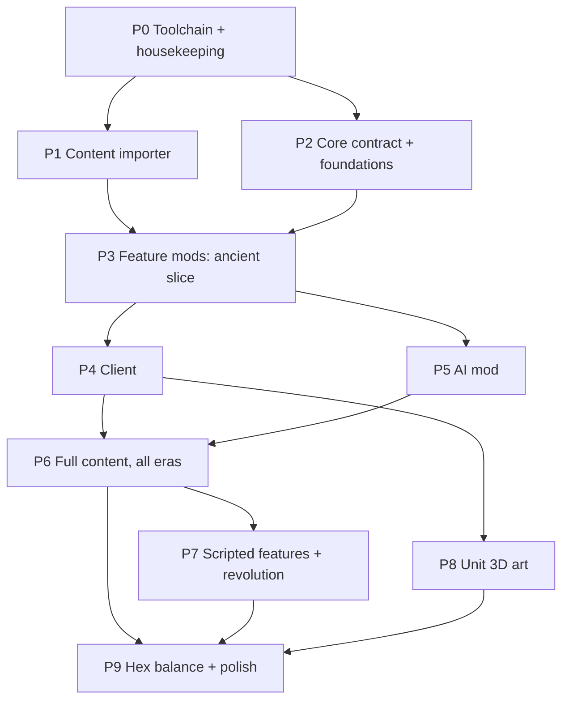

# Plan: the source mod's content on hexes

Goal: a playable game with the full content of the Civ4 mod that was extracted into `AND-extraction/` (called
"the source mod" below). That means its technologies, buildings, wonders, units, promotions, civics,
civilizations, leaders, traits, religions, corporations, resources and improvements. The map uses this repo's
hex grid.

This is a private project. The repository has no license file.

## 0. Product rules

- **No source branding in the product.** Mod ids, project names, namespaces, class names, content ids, UI text
  and docs shipped with the game never contain "AND", "A New Dawn", "Rise of Mankind" or "RoM". The importer
  scrubs or reports such strings, and a test fails if generated content contains them. Only dev tooling
  arguments (such as the `AND-extraction/` path) and this plan name the source.
- **Many small mods, not one big one.** Each feature area is its own mod (section 3). The game is the set of
  these mods.
- **Content is data.** The importer compiles the extraction into JSON sidecars inside each mod. The generated
  JSON is committed (private repo), so the game builds without the extraction. `AND-extraction/` itself is
  git-ignored (it is large and machine-local).

## 1. Where we are

### The extraction

- **Data.** Lossless YAML trees of every XML file, in `AND-extraction/data/layers/{base,warlords,bts,and}`,
  including all modules. Main tables: 252 techs, 625 buildings, 339 units, 266 promotions, 40 core
  civilizations, 86 leaders, 17 traits, 13 religions, 36 corporations, 71 resources, 53 improvements,
  32 projects, 327 event triggers, plus GlobalDefines.
- **File format.** A tree file is a few `key: <JSON>` lines (`format`, `source`, `namespace`, `tree`). A node is
  `[name, content]` or `[name, content, attributes]`. `System.Text.Json` reads it; no YAML library is needed.
  `and-xml-reference-v1` files point to an identical tree through `treeYaml`.
- **Text.** English text slices (`TXT_KEY_*`) are in `data/localization/english/`.
- **Module profile v1** is the MLF default: `AND_MP_00_main`, `AND_MP_02_alternate_LH_graphics`,
  `AND_MP_11_Europe`, `Interface`, `Modern_flags`, `MoreMusic`. Other packs are off.
- **Quarantine.** The core `CIV4CivicInfos.xml` failed strict parsing only because of `--` inside comments. Use
  the recovered tree in `data/recovered/and/`.
- **Rules reference.** `docs/00..09` is a design dossier with equations traced to the DLL source in
  `reference/and-source/CvGameCoreDLL`. Python sources are in `runtime-reference/`.
- **Media.** 2.77 GiB in `media/assets/`: NIF/KFM/KF unit models, DDS icons and atlases, MP3/WAV audio. Lookup
  manifests include `icon-bindings.json`.

### The game today (about 3,900 lines)

- `Civ.Core`: axial `Hex`, a hex-disk map with one terrain string per hex, small `*Def` classes, fixed
  registries in `IModContext`, deterministic RNG, state hash, lockstep.
- `Civ.BaseGame`: simple rules (all commerce to research, fixed 20-damage combat rounds, no gold, happiness or
  health).
- `Civ.Godot`: hex prisms, a city screen, research and civics tabs.

## 2. Decisions

1. **Fidelity: "source rules, adapted to hexes".** Port the source formulas and turn order where geometry does
   not matter. Adapt and record them where it does (section 4). No identical random histories, no bug-for-bug
   copies unless balance depends on them.
2. **Core is the contract, mods are the implementation.** `Civ.Core` holds the shared Civ4-style schema
   (definition classes, game state) and the extension-point interfaces. Feature mods register content and
   implement rules. The Godot client reads only Core types and Core query interfaces, so it can render what any
   mod computes.
3. **Ruleset selection.** The game setup loads a mod set. The default set is all feature mods in section 3.
   `Civ.BaseGame` is kept as a small test ruleset until P3 is done, then deleted.
4. **First playable scope:** prehistoric and ancient eras, then one era at a time.
5. **Unit art:** placeholder tokens with unit icons until the rules play well.

## 3. Mod layout

Every mod is `src/Mods/<Name>/Civ.Mods.<Name>.csproj` with `mod.json`, a DLL and `data/*.json`. Content ids are
`<modid>:<name>`, where `<name>` is the source symbol without its type prefix, in lower case
(`TECH_BRONZE_WORKING` → `research:bronze_working`). The importer keeps a private mapping for traceability.

v1 mods, in dependency order:

1. `foundation`: yields, commerce types, eras, game speeds, handicaps, world sizes, culture levels, specialists,
   typed rule constants (from GlobalDefines).
2. `world`: terrain, features, resources, improvements, routes, worker builds, rivers, map generators, plot
   yields, worker commands and build progress, resource connectivity.
3. `research`: techs, research cost and progress, all/any prerequisites, overflow, `set_research`.
4. `economy`: commerce sliders, treasury, maintenance, inflation, processes, `set_commerce_rates`.
5. `cities`: founding, growth and food retention, production queues, buildings and wonders, specialists,
   happiness and health, culture and borders, work area.
6. `military`: units and unit classes, movement, combat, promotions, experience, healing, upgrades, city
   capture, barbarians.
7. `government`: civics, civic categories, anarchy, civic upkeep and effects.
8. `peoples`: civilizations, leaders, traits, unique units and buildings, starting units and techs, city names.
9. `ai`: the computer player.

Later mods: `religion`, `great-people`, `trade`, `diplomacy`, `corporations`, `espionage`, `events`,
`projects-victory`, `scripted-wonders`, `revolution`.

How separate mods cooperate (all through Core interfaces, never through each other's types):

- **Generic content registries.** A mod can register any `ContentDef` subtype; `ContentDb.Get<T>()` returns its
  registry. Ids in data can point at content from any loaded mod.
- **Requirements.** A `Requirement` (all/any/not of typed leaves: tech, bonus, building, civic, religion, …) is
  checked through `IRequirementEvaluator`s. Each mod registers the evaluator for its own leaf kinds.
- **Modifier sources.** Mods register `IModifierSource`s that add effects to a scope (city, player, unit, plot):
  flat and percent yields and commerce, happiness, health, maintenance, combat modifiers, and so on. The mod
  that owns a calculation (for example `cities` for city yields) sums all sources. `government` adds civic
  effects, `peoples` adds trait effects, without knowing how cities compute.
- **Domain events.** Mods publish events (`TechDiscovered`, `CityGrew`, `CombatResolved`, …). Other mods
  subscribe in deterministic order; the client uses them for notifications, animation and sound.
- **Typed extension state.** A mod can attach its own state to the game, a player, a city or a unit. Save files
  and the state hash include it.
- **Ledgers.** Calculations return a ledger of contributions ("why is this 7"), used by the UI and by tests.

## 4. Hex adaptation (the only intentional rule changes)

The source counts square plots with 8 neighbours and Chebyshev distance. The plot counts match well:

- **City work area.** The source uses radius 3: 21 plots at radius 2, 37 at radius 3 (third ring unlocked by
  culture). A hex disk has 19 plots at radius 2 and exactly 37 at radius 3. Map the rings one to one and keep
  the culture thresholds.
- **Distances.** Use hex distance wherever the source uses plot distance: city spacing, culture radius, sight,
  bombard/air/paradrop ranges, AI distances. Hex areas are rounder and slightly smaller; tune later.
- **Map.** A rectangular hex map (offset rows) with optional east–west wrap. Keep the source plot count per
  world size.
- **Rivers** lie on hex edges (6-bit mask per plot). Port fresh water, irrigation, river crossing, river trade
  and defence rules.
- **Movement.** No diagonal-only special cases. Keep move costs, fractional route moves and terrain costs.
- **Map generation.** Port the algorithms of one or two source map scripts to hexes (elevation, climate,
  rivers, resources, fair starts).
- **Unit facing:** 6 facings (renderer only).
- All adaptation constants live in `src/Mods/Foundation/data/hex-overrides.json`, separate from imported values.

## 5. Phases

### P0 – Toolchain and housekeeping

- Make `dotnet test Civ.slnx` run (the .NET 8 runtime is missing; mise installs only .NET 10).
- Install a Godot 4.4.x .NET build; confirm the client builds and starts headless.
- Git-ignore `AND-extraction/` and converted art output.

### P1 – Content importer (`tools/Civ.ContentImport`)

1. Tree reader for both tree formats.
2. Effective registry: `and` layer, fallback bts → warlords → base, then enabled modules in MLF order. Measure
   Type collisions in the profile and port the source's `copyNonDefaults` merge only for classes that need it.
   Log every merge.
3. Typed intermediate records per Info class; read `NONE`, `-1`, `0`, empty and absent by each field's getter
   contract; keep OR and AND prerequisites apart; keep ordered yield and commerce arrays.
4. Resolve references by type; resolve class indirection and civilization overrides (unique units/buildings).
5. English text inlined into the records (name, help, pedia, strategy), with Civ4 markup converted to a neutral
   markup. Scrub source branding.
6. Field census report: each non-default field, how many records use it, status (preserved, parsed,
   implemented, tested).
7. Era filter (`--max-era`) that keeps the prerequisite graph closed.
8. Emit per-mod JSON in Core schema into `src/Mods/*/data/`, plus reports in `tools/Civ.ContentImport/reports/`.

### P2 – Core contract and foundations

- Rectangular wrapping hex grid (`HexGrid`) and a `Plot[]` (terrain, feature, bonus, improvement, route, river
  edges, owner, culture per player, visibility per team, area id).
- Teams (techs, research, war/peace).
- Schema: yield and commerce vectors, requirements, production queues, treasury.
- Generic content registries, requirement evaluators, modifier sources, domain events, typed extension state,
  ledgers.
- Indexed lookups for cities and units.
- Versioned JSON save/load with content hash and RNG state; save/replay test.
- Content hash in the lockstep handshake.
- Migrate `Civ.BaseGame` and its tests.

### P3 – Feature mods, ancient slice

Implement the v1 mods of section 3 for prehistoric and ancient content, in the source turn order
(`docs/02-turn-lifecycle.md`), using the census to order the work. Exit: scenario tests for growth, production,
commerce, research and combat pass; a headless AI-vs-AI game reaches turn 200 with no exceptions or desyncs;
save/reload at random turns gives identical hashes.

### P4 – Client

Setup screen (leader, speed, handicap, world size, map script, opponents); map with features, resources,
improvements, routes, rivers, borders and fog; icons converted from DDS (atlas cells cropped); city screen with
queue and ledgers; tech tree using `iGridX/iGridY`; civics screen; pedia; overviews; notifications; music and
sounds.

### P5 – AI mod

Deterministic utility AI driven by the content's own AI weights, flavors, unit AI types and leader
personalities. Layers: city management and workers, research and civics, settling, military, then diplomacy.

### Dogfood cleanup (before P6)

`Civ.Core` and the client still hard-code some mod ids and kinds (for example the default game speed, handicap
and era in `SimulationSettings`, `cities:hurry_gold` in `EconomyContracts`, and production kinds such as
`cities:building` and `economy:process` in `Civ.Client.Core` and `Civ.Godot`). Move these behind loaded content or
mod-registered services (for example a production-kind registry that a mod fills with label, icon and query
service), so that `docs/DESIGN.md` principles 1 and 2 hold. Add a test that scans Core and client sources for
hard-coded mod ids.

### P6 – Full content

Lift the era filter one era at a time and add the later mods. Records that need a missing mechanic are shown as
unavailable, never imported with silently zeroed effects.

### P7 – Scripted features

Port the enabled Python gameplay handlers (special wonders, scripted unit grants) to `scripted-wonders`;
`revolution` last, as an optional mod.

### P8 – Unit 3D art

Spike 3 units NIF/KF → glTF (Blender niftools addon targets Blender 4.x; installed Blender is 5.2), then batch
conversion with a per-unit report and an art registry. Off the critical path.

### P9 – Hex balance and polish

Measure in AI-vs-AI runs, tune with `hex-overrides.json`, then network transport and polish.

## 6. Testing

- Importer: golden snapshots of selected records, reference closure, record counts, branding scan.
- Rules: fixture scenarios with expected ledgers from the dossier equations.
- Determinism: two-peer lockstep and save/replay equivalence in AI-vs-AI soak runs.
- Client: `Civ.Client.Core` stays engine-free and unit-tested.

## 7. Risks

- Scope: the content is very large; era slices and the field census are the main controls.
- Loader merge semantics; limited to the classes the profile needs, with a merge log.
- AI quality decides whether single-player is fun.
- NIF conversion may be blocked by tool compatibility; the game must play well with icon tokens.

## 8. Progress checklist

Keep this list current. It is the source of truth for where the work is.

### Done (committed on `main`)

- [x] P0: toolchain. mise installs .NET 10 and Godot 4.7.2 .NET (`godot-mono`). `AND-extraction/` is
  git-ignored. The license file is removed.
- [x] P1: content importer (`tools/Civ.ContentImport`) with reports in `tools/Civ.ContentImport/reports/`.
- [x] P2: Core contract: `HexGrid` and `Plot[]`, teams, generic registries, requirements, modifiers and
  ledgers, domain events, state components, save/load, content-hash handshake.
- [x] Content schema and 8 data mods in `src/Mods/*`, generated by the importer (2,462 definitions).
- [x] Icons: `tools/icons/convert_icons.py` writes PNGs to `src/Mods/*/art/icons/`. Atlas cells win over direct
  files.
- [x] P3 rules: World, Cities, Research, Economy, Military, Government and Peoples. Details are in
  `docs/mechanics-status.md`.
- [x] P4 client, first pass: setup screen, wrapped hex map, unit, city, research and civics UI. Screenshots
  are in `docs/screenshots/`.
- [x] `docs/DESIGN.md` restores the dogfood principles (1: everything is a mod; 2: no mod ids in Core or the
  client).
- [x] History rewritten. The verbose commit messages follow the felix2 example style: subject, summary
  paragraph, titled sections of bullets. `main` must be force-pushed to update origin; that is not done yet.
- [x] Adversarial audit fixes across Core, World/ResourceNetwork, Cities, Economy, Government, Peoples and
  Military (`43cbf94`).
- [x] P6 Religion mod, `src/Mods/Religion`, plus importer and schema edits (`b3112b6`).
- [x] P5 AI mod, `src/Mods/Ai`: functional deterministic computer player (`ai:standard`).
- [x] Dogfood cleanup: mod-supplied setup defaults, production kinds, citizen role, ledger labels, and terrain appearance.
  Core and client source scans reject shipped mod ids. Custom-ruleset contract tests cover unrelated ids (`da4a4a0`).
- [x] Adversarial audit fixes for Religion spread scaling, AI peace treaties, staging area checks, and route bounds (`70fa3e2`).
- [x] P6 Great People mod (`src/Mods/GreatPeople`) and Trade mod (`src/Mods/Trade`) (`3872fcb`).
- [x] Client follow-ups: religion screen & city/unit religion actions, pedia browser, save/load UI, turn notifications,
  and Great People / Trade city-screen & unit-action wiring (`a7c8537`, `239bb82`).
- [x] P6 Diplomacy mod (`src/Mods/Diplomacy`): contact discovery, attitude ledgers, peace treaties, open borders,
  defensive pacts, and trade deals (`3879029`).
- [x] P6 Projects & Victory mod (`src/Mods/ProjectsVictory`): team/world projects, score breakdowns, and Conquest,
  Domination, Cultural, Time, and Space Race victories (`5015e41`).
- [x] Adversarial audit fixes across Trade, AI, Diplomacy, ProjectsVictory, and ResourceNetwork (`439f168`).
- [x] P6 Corporations mod (`src/Mods/Corporations`) and Espionage mod (`src/Mods/Espionage`) (`dc28917`).
- [x] P6 Events mod (`src/Mods/Events`) and Client Diplomacy / Score / Victory UI (`a2b1236`).
- [x] Delete legacy `src/Civ.BaseGame` and move its test ruleset into `tests/Civ.Tests/TestRuleset` (`5ce9f9a`).
- [x] Client Corporations, Espionage & Events UI (`2a9d72f`).
- [x] P7 Scripted Wonders mod (`src/Mods/ScriptedWonders`) and Revolution mod (`src/Mods/Revolution`) (`eb1ab91`).
- [x] Update `docs/DESIGN.md`, `docs/mechanics-status.md`, and `docs/content-schema.md` for P6/P7 mods and
  `TestRuleset` (`5d1defd`).
- [x] Client Scripted Wonders & Revolution UI (`8f3ffc2`).
- [x] P6 ContentImport multi-era closure sweep (`--max-era` `ancient`..`future` and `all`) and lowercase asset
  branding scrub (`502c09b`).
- [x] Adversarial audit fixes across Espionage bilateral ratios/eliminated teams, Corporations HQ Mercantilism,
  ProjectsVictory team tie-breaks, and Events duration parity/empire-wide modifiers.

### In progress

- [ ] P9 Hex balance (`src/Mods/Foundation/data/hex-overrides.json`) & remaining diplomatic/corporate/event audit
  polish.

### Next

- [ ] P8: unit 3D art spike.
- [ ] P9: hex balance (`hex-overrides.json`) and polish.

### Working conventions

- Subagents: blend `pawn:luna` / `pawn:haiku` for trivial/medium-low tasks and `pawn:sol` / `pawn:sonnet` for
  medium-high/complicated tasks. You can switch a subagent's model mid-work with `subagent_continue()` if one
  model family hits quota (`haiku`/`sonnet` reset at 3am; `luna`/`sol` reset at 5am). If both pools are out of
  quota, use `schedule_prompt` to wake up at 3am or 5am. Prefer `mode=background`, and always give a title.
- Subagents do not commit. The orchestrator commits after each task, with verbose messages.
- Occasionally use `AskAntigravity` (`thinking="high"`, `digest=true`, strictly read-only) to perform an
  adversarial review on recent commits to look for bugs, determinism leaks, save/load holes, and footguns.
- Product rule: never write "AND", "A New Dawn", "Rise of Mankind" or "RoM" in shipped code, ids, text or
  docs.
- Verification: `dotnet test Civ.slnx`, `dotnet build src/Civ.Godot`, and
  `timeout 30 xvfb-run -a godot-mono --headless --path src/Civ.Godot --quit-after 200`.
