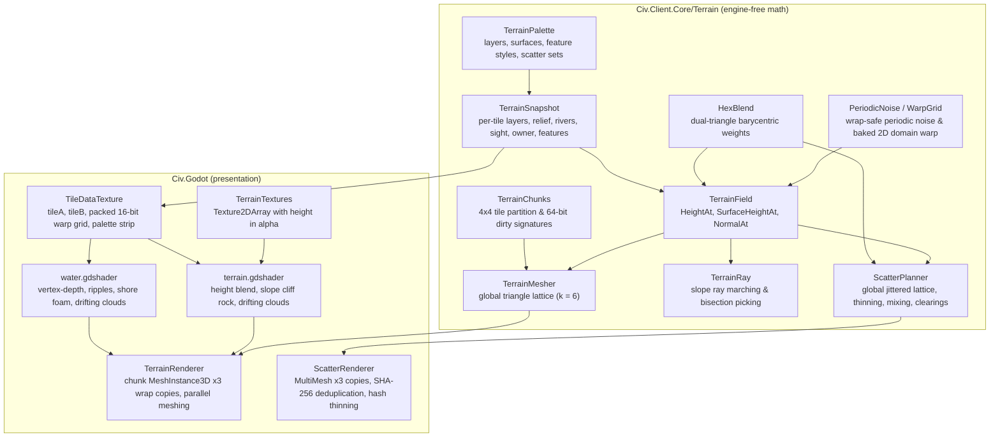

# Design

A deterministic Civilization-4-style game on a hex grid where **everything is a mod**. Core defines the contract.
Mods implement the rules.

## Principles

1. **Dogfood.** The shipped game is nothing but ordinary mods: Foundation, World, Research, Economy, Cities,
   Military, Government, Peoples, AI and later feature mods. They get no private hooks. If a shipped mod needs
   something, the mod API grows to offer it to every mod. Terrain, techs, buildings, units, civics, map
   generators, commands, turn systems and the AI are all registered through `IModContext`.
2. **No mod knowledge outside mods.** `Civ.Core`, `Civ.Client.Core` and `Civ.Godot` never hard-code a mod's
   content ids or kinds. Defaults and choices come from loaded content or from mod-registered services, so a
   different mod set can replace any shipped mod.
3. **Headless deterministic core.** `Civ.Core` has no engine dependency, no floats in game state, no wall clock
   and no unordered iteration affecting state. The renderer is a view.
4. **Commands over the wire.** Multiplayer is lockstep: only player commands are exchanged, and every peer runs
   the same simulation.
## Projects

- `Civ.Core`: geometry, shared data, content registries, extension contracts, simulation, commands, saves and hashes.
- `Civ.Net`: lockstep sessions and reliable ordered transport. `InProcessHub` connects local peers.
- `tests/Civ.Tests/TestRuleset`: test-only ruleset loaded through the same mod API as feature rulesets.
- `Civ.Client.Core`: engine-free selection, picking, commands and city screen data.
- `Civ.Godot`: Godot view. Build separately with `dotnet build src/Civ.Godot`.
- `Civ.Tests`: contract, rule, client, save/replay and lockstep tests.

The client uses Core query contracts. It has no reference to a feature-mod or test-ruleset assembly.
## Determinism

Authoritative state uses integer math. Rule code uses only simulation state and `Simulation.Rng`, not clocks or engine APIs.
String identities use ordinal comparisons. Content follows ordinal id order. Ordered sequences retain their order in saves and hashes.

Mods increase their manifest version whenever rule semantics change. Content hashes do not hash DLL bytes.

## Map and plots

`MapSpec(int Width, int Height, bool Wrap)` describes a rectangular, pointy-top odd-row map.
`HexGrid` converts axial coordinates, offset coordinates and row-major `TileId` values.
Columns normalize across east–west wrap. Rows never wrap.

- `HexGrid.Neighbors` returns distinct neighbors in direction order, without self-neighbors.
- Directions are east, northeast, northwest, west, southwest and southeast.
- `HexGrid.Distance` measures the shortest distance across wrap images.
- `HexGrid.Range` and `Ring` clip to the map and enumerate distinct tiles in ascending tile-index order.
- `Hex.DistanceTo`, `Hex.Range` and `Hex.Ring` describe the unbounded plane, not map topology.

`GameState.Plots[tile.Value]` stores terrain, feature, bonus, improvement, route, owner, culture, visibility and area id.
Culture uses sorted player ids. Revealed and visible teams use compact `TeamMask` bitsets, without a fixed team-count limit.
Bitsets enumerate team ids in ascending order. Dense team ids minimize their storage.

River bits follow the six directions. `GameState.SetRiver` mirrors each shared edge on both plots.
At a bounded edge, the single plot owns the edge. Map generators must preserve this convention.

`IMapGenerator.Generate(MapSpec, Plot[], DeterministicRng, ContentDb)` fills every plot.
Cities and units retain canonical axial positions. The client renders one map image, without duplicate wrap plots.

## Teams and entity data

Players have `TeamId`, civics, culture and treasury. Each player defaults to a separate team.
Teams hold members, known techs, a research target, progress per tech and war relations.
`Simulation.TeamOf(player)` and `KnowsTech(player, tech)` provide rule access.
Changing a research target retains its progress. `GameState.SetWar` keeps the war matrix symmetric.

Cities include a generic `ProductionQueue` of `ProductionOrder(Kind, ContentId, Progress)` entries.
Cities owns feature queues, paused item progress, completion snapshots, and normalized overflow. Test rules live in `tests/Civ.Tests/TestRuleset`.
`GameState` contains plain data and rebuildable lookup caches. Caches do not enter saves or hashes.
`UnitById`, `UnitsAt`, `CityById` and `CityAt` use indexes.
Runtime edits use `AddCity`, `RemoveCity`, `AddUnit`, `RemoveUnit` and `MoveUnit`.
After bulk data edits, `RebuildIndexes` restores the caches.

## Mod registration

Each mod folder contains `mod.json`, one DLL and optional JSON sidecars.
Dependencies determine load order. Ordinal mod ids break ties.
Ids use `modid:name`. Registration requires the owning namespace. Overrides can replace earlier content.

- `ctx.Content<T>()` returns `ModRegistry<T>` for any `ContentDef` subtype.
- `ContentDb.Get<T>()`, `Get<T>(id)` and `TryGet<T>(id, out item)` resolve generic content.
- Existing typed registries remain convenience accessors.
- `ctx.RegisterService<T>(name, service)` registers a non-content implementation under its shared interface.
- `ContentDb.Services.Get<T>()` returns implementations in mod-load and registration order.
- `ITurnSystem` retains explicit `(Order, Id)` execution order.

Registries freeze after load. Definitions and their nested collections must not change after that point.
The content hash includes canonical definitions, loaded mod ids/versions, command identities, service order and state-component identities.

## Setup and presentation services

Mods register these contracts through `ctx.RegisterService<T>()`:

- `ISetupPolicy.Default(SetupField)` supplies an optional default content id.
  `SortOrder(SetupField, string id)` supplies an optional display order.
  Each field permits at most one default provider. Each choice permits at most one display-order provider.
  The client selects the first loaded choice when no default exists. Display-order ties use ordinal ids.
- `IProductionKind` supplies a queue-kind id, tab label, continuous-production flag, content candidates, and definition lookup.
  It also supplies base costs, eligibility visibility, validation, and production calculations.
  The client builds tabs and choices from all registered kinds in service order.
  Continuous kinds show no completion turns or progress bar.
  Cities registers building and unit kinds. Economy registers the process kind.
  Commands require an explicit kind or hurry id, except queue-removal commands.
- `ILedgerSourceLabel.Label(Simulation, string source)` supplies optional text for mod-owned ledger sources.
  The client uses the first non-null label in service order, then content names or generic text.
- `ITileAppearanceService` supplies optional terrain and feature metadata by full content id.
  `TileAppearance` stores integer RGB, tint percent, mark count, and optional 3D scatter set name and density.
  `TerrainSurface` enumerates procedural and system surfaces (`Cliff`, `Seabed`, `DeepSeabed`, `Unexplored`).
  Default interface methods `Surface(TerrainSurface)` and `Scatter(string feature, string terrain)` allow mods to supply
  surface textures and terrain-specific scatter variants (such as snowy pine trees on tundra/snow forests).
  The client uses the first non-null result in service order. Unknown terrain is gray, and unknown features have no marks or props.

`ICityWorkService.DefaultSpecialist(Simulation)` identifies the plain citizen role for assignment controls.
All presentation and setup queries must avoid state changes and RNG use. Service implementations hold no mutable per-game state.
Service identities enter the content hash. Mods must change their manifest version when service behavior changes.

## Turn phases

`Civ.Game.TurnPhase` defines shared order slots. Systems use these constants instead of private numeric priorities.
Systems with equal orders run by ordinal `Id`. Additional orders can use the gaps between slots.

Orders from `PlayerBegin` through `Map - 1` require `IPlayerTurnSystem.Run(Simulation, int player)`.
The scheduler completes this interval for one player before the next player, in ascending player-id order.
Other orders use `ITurnSystem.Run(Simulation)` once per boundary. Legacy test-ruleset orders remain outside the player interval.
| Constant | Order | Work |
| --- | ---: | --- |
| `GameBegin` | 0 | Global begin hooks |
| `Properties` | 100 | Global properties |
| `Deals` | 200 | Deal settlement |
| `Teams` | 300 | Team maintenance |
| `PlayerBegin` | 1000 | Player timers and caches |
| `AssignWork` | 1100 | City work assignments |
| `Gold` | 2000 | Treasury settlement |
| `Research` | 2100 | Research and discoveries |
| `Espionage` | 2200 | Espionage allocation |
| `Economy` | 2300 | Taxes, consumption, inflation |
| `CityBegin` | 3000 | City preparation |
| `CityGrowth` | 4000 | Food, growth, starvation |
| `CityCulture` | 4100 | City culture |
| `CityPlotCulture` | 4200 | Plot culture and borders |
| `CityAutoBuildings` | 4300 | Automatic buildings |
| `CityProduction` | 5000 | Production eligibility and work |
| `CityCompletion` | 5100 | Completion effects |
| `CityPostProduction` | 6000 | Decay and later city rules |
| `PlayerEnd` | 7000 | Remaining player maintenance |
| `Units` | 8000 | Units and worker progress |
| `Map` | 9000 | Improvements and map updates |
| `Spawns` | 9100 | Barbarians and other spawns |
| `Environment` | 9200 | Environment and global founding |
| `Visibility` | 9500 | Team sight |
| `GameEnd` | 9900 | Pre-end hooks |

These slots follow `CvPlayer::doTurn` and the city pipeline: gold precedes research, and growth and culture precede production.
Cities processes all owned cities at each city slot, in ascending city-id order. Completion commits effects in that same order.
This preserves the source pipeline's cross-city stage boundaries without parallel mutations.
New buildings cannot change already-settled gold or research in that turn.

The simultaneous engine resolves submitted commands before these slots.
It resolves global map work after player work, rather than before player activation as in `CvGame::doTurn`.
This boundary adaptation gives worker completions one defined map-update point.
It does not reproduce sequential activation or shuffled source player order.
Most slots reserve future work and do not yet contain systems.

`TurnEnded` follows `GameEnd`, before the turn counter increases.
`TurnStarted` follows the counter increase and precedes AI commands. Both events retain their existing presentation semantics.

## Feature ruleset setup

A non-null `SimulationSettings.WorldSize` selects Foundation's `INewGameSetup` service.
Null retains the legacy setup. Feature settings include `WorldSize`, `GameSpeed`, `Handicap`, `StartingEra`, and one entry in `Leaders` per player.
Empty speed, handicap, era, and generator ids resolve through mod-registered `ISetupPolicy` services before generation.
Explicit ids remain unchanged. `Simulation.Settings` stores the resolved ids, and saves retain them.
World supplies its generator default. Foundation supplies the speed, handicap, era, and setup-screen world-size defaults.
The test ruleset supplies its own generator default. Without a generator policy, Core selects the first loaded generator in ordinal id order.
Core never selects a world size implicitly, so omitted `WorldSize` retains legacy setup.
An optional `Civilizations` entry resolves a leader shared by multiple civilizations. An incompatible selection fails before generation.

Foundation resolves dimensions from `WorldSizeDef.GridWidth/GridHeight` times the source landscape-cell scale of four.
Standard therefore contains 84 × 52 = 4368 plots, with east–west wrap.
`State.Map` holds the effective map. `Settings.Map` remains the caller's original legacy map setting.

Foundation creates teams and grants civilization and handicap starting technologies.
Civilization free-unit classes resolve through `UnitOverrides`, including explicit disabled classes.
Era and handicap fields supply multipliers, extra worker/defense/exploration grants, and starting gold.
Role selection uses eligible land units, known requirements, work rate, strength, movement, and exploration suitability.
It approximates `CvPlayer::addFreeUnitAI`, not the full military AI valuation.
All initial units share their player's start plot. Movement rules remain a Military task.

World scores radius-two and radius-three food and production, with coast and fresh-water weights.
It selects habitable starts with minimum wrapped spacing, then improves weak starts with grass and forest near the center.
Normalization never changes water, peaks, or resource plots. Impossible spacing produces a setup error, not overlapping starts.
The harness `tests/Civ.Mods.Tests/GameFactory.cs` creates full headless games through this API.

## World services

Clients and other mods resolve these Core contracts through `ContentDb.Services.Get<T>().Single()`:

- `IPlotYieldService.Calculate(Simulation, int player, TileId)` returns `PlotYieldResult(YieldVector, Ledger)`.
- `IPlotYieldService.CalculateNature(Simulation, int player, TileId, bool ignoreFeature = false)` returns natural potential.
- `IWaterService.IsFreshWater(Simulation, TileId)` and `IsIrrigated(Simulation, int player, TileId)` return availability.
- `IResourceNetwork.ConnectedCount(Simulation, int player, int city, string bonus)` returns physical connected copies.
- `IWorkerBuildService.Validate(Simulation, int player, int unit, string build)` returns a rejection reason or null.
- `IWorkerBuildService.Start(Simulation, int player, int unit, string build)` applies a validated assignment.
- `IWorkerBuildService.RequiredWork(Simulation, TileId, string build)` returns the integer work threshold.
- `IVisibilityService.Recompute(Simulation)` updates visible and revealed team masks.
- `IStartingPositionService.Select(Simulation, int count)` selects locations without mutation.
- `IStartingPositionService.Normalize(Simulation, IReadOnlyList<TileId>)` applies setup-only terrain changes.

Read-only queries never consume RNG or change authoritative state. Services hold no per-game caches.
Plot yields include terrain, relief, lakes, features, revealed resources, improvements, routes, irrigation, technology changes, and registered plot modifier sources.
Feature river changes replace terrain river changes. Route synergy suppresses smaller river contributions per yield, as in `CvPlot::calculateNatureYield`.
Nature clamps before improvement effects. Flat sources sum before percentage multiplication, integer division, and the final nonnegative clamp.
Ledger keys `yield.flat.*` and `yield.percent.*` explain inputs. `world:food`, `world:production`, and `world:commerce` hold final outputs.
Cities owns city-center minima and city-specific plot effects. Government and Peoples can contribute through `IModifierSource` with `ModifierScope.Plot`.

The generator adapts `Continents.py` and `FractalWorld`: polar fractal land with 75% water, separate relief, and latitude-based climate.
Integer value noise replaces the native fractal primitive. Priority-flood drainage connects high ground to water across a temporary filled surface.
River masks describe shared hex edges, not square-map river directions. `SetRiver` maintains both sides.
Flooded depressions can produce level drainage steps. The drainage parent order prevents cycles.
Connected water areas with at most the configured lake size supply fresh water.
Features and resources obey typed placement restrictions. Resource density uses appearance, eligible tiles, player count, class spacing, and clustering.
Starting normalization can replace climate-selected terrain near starts, but never invalidates a resource's terrain or feature.
Goody huts use improvement spacing and tiles-per rules. Starting eras can suppress all huts.

Networks use routes, city nodes, shared river edges, and technology-enabled coast/ocean plots.
Unowned plots require exploration. Foreign territory remains inaccessible until diplomacy rules supply permissions.
Queries recompute components so ownership, pillage and technology changes take effect immediately.
The `bonus` evaluator uses connected counts. Vicinity requirements remain unavailable until Cities defines their scope.

`world:start_build` serializes the Core `StartBuildCommand`.
Workers share plot progress by build id. An assignment stores its original tile, so movement cancels the assignment at the next worker phase.
Build times apply terrain, speed and starting-era multipliers in sequence. Known technologies and AI handicap fields modify work rates.
Completion can remove a feature, create an improvement or route, change terrain, or consume a worker.
A feature effect can permit removal without its production technology. Such removal grants no production.
`FeatureProduction` names the nearest owned city and the production grant. Cities must subscribe to apply overflow.
Improvement upgrades require worked turns or an outside-borders target, plus the target's technology.

Visibility runs at `TurnPhase.Visibility`, after founding, and after unit creation events.
Military must call `Recompute` after moves. Sight uses hex distance, team sharing, and promotion visibility changes.
It does not yet model terrain occlusion or remembered hidden terrain.

`Plot.Kind`, `IsLake`, `ImprovementTurns`, `BuildProgress`, player leader/start ids, and worker components enter saves and state hashes.
These fields are additive to save schema 1 and have defaults for older JSON.
Changed mod versions reject old content identities unless the caller explicitly forces loading.
Hand-authored geometry tuning lives in `src/Mods/Foundation/data/hex-overrides.json` and enters the content hash.
The importer writes only its declared definition families and rejects that reserved filename.

See [mechanics-status.md](mechanics-status.md) for consumed fields and remaining mechanics.

## City services

Cities registers Core query contracts. All queries are RNG-free and do not change authoritative state.
`Calculate(Simulation, int city)` returns ledgers through `ICityYieldService`, `ICityWellbeingService`, `ICityGrowthService`,
`ICityProductionService`, `ICityMaintenanceService`, and `ICityGreatPeopleService`.
Production calculation additionally takes `(string kind, string content)`.
`ICityProductionService.Validate` returns structured requirement failures with the same arguments.
`ICityWorkService` supplies `Radius`, `WorkArea`, assignment validation, and authoritative `Assign`.

`CityYieldResult.Yields.Commerce` is raw whole commerce. `DirectCommerceHundredths` bypasses sliders.
`CommercePercent` contains additive percentage bonuses, not final rates.
Economy allocates raw commerce, adds direct contributions, and applies each commerce modifier.
Economy can register one `ICityCultureSource.CultureHundredths(Simulation, int city)` provider for the final culture rate.
Without that provider, Cities applies culture modifiers to direct culture only.

Commands use `cities:found_city`, `cities:set_city_work`, and `cities:set_city_production` identities.
The Core types are `FoundCityWithSettlerCommand`, `SetCityAssignmentsCommand`, and `SetCityProductionCommand`.
Queue kinds are `cities:building` and `cities:unit`. Cities completes at most one item per city per turn.
Growth and culture precede production. Completion effects follow production work in city-id order.

`CityRuleState` and `CityPlayerState` contain saved feature-rule state.
Modifier sources use City scope for local effects and Player scope for player growth/maintenance percentages.
City keys include `cities:happiness`, `cities:health`, `cities:war_weariness`, `cities:food_kept_percent`, and `cities:growth_percent`.
Specialist keys use `cities:slots:<specialist-id>`, `cities:free:<specialist-id>`, and `cities:free_specialists`.
Other keys cover maintenance percentages, production percentages, experience, and great-person percentages.
See the Cities implementation and [mechanics-status.md](mechanics-status.md) for supported effects and deferred rules.

Food waste uses fixed-point recurrence with scale one billion. City-count maintenance uses a fixed-point root with scale one trillion.
These deterministic adaptations can differ from native floating-point results near integer boundaries.
Maintenance uses the maximum wrapped hex distance as the map normalization.
Plot culture uses hex distance without terrain obstacles. Ownership keeps an incumbent on ties, then selects the lowest player id.
Governor weights live in the hand-authored hex sidecar. The governor orders equal plot scores by tile id.
No feature mod references a test ruleset assembly. The client loads feature rules through Core contracts.
## Research and economy services

Research registers `IResearchService` for cost ledgers, rate modifiers, eligibility, queues, and team contributions.
`research:set_research` uses `SetTeamResearchCommand`. It accepts a target and optional queue, or one free-tech selection.
`ResearchTeamState` saves normalized overflow, repeat counts, free-tech credits, queues, and explicit contacts.
Discoveries publish `TechDiscovered`. Cities updates the current era through this event.
Overflow applies on the next contribution. Optional diffusion and timeline policies remain deferred.

Economy registers `IPlayerEconomyService` for player ledgers, city commerce ledgers, rates, and rate validation.
`economy:set_commerce_rates` uses `SetCommerceRatesCommand`.
City commerce keeps hundredths through allocation, direct contributions, percentage modifiers, and process conversion.
Gold settlement saves a commerce snapshot. `IPlayerResearchSource` supplies that snapshot to Research.
`ICityCultureSource` supplies final culture to Cities. Queries never mutate state or consume RNG.

`ICityProcessService` supplies eligibility and conversion for infinite `economy:process` queue items.
Processes use current production. Stored overflow remains available for later finite production.
`ICityHurryService` supplies payment previews and mutations through `economy:hurry` and `HurryCityCommand`.
Cities completes hurried items during its normal completion phase.

Player modifier keys include `economy:max_rate:<type>`, `economy:upkeep_percent`, `economy:inflation_percent`, and `economy:hurry_percent`.
Team key `research:cost_percent` changes research costs after the normal scaling steps.
`EconomyPlayerState` saves sliders, settlement snapshots, unpaid gold, aggregate espionage, and the inflation accumulator.
`EconomyCityState` saves hurry anger. Bankruptcy adjusts sliders before research, but does not disband units.
The imported profile disables inflation. Enabled profiles use the source binomial formula and momentum update after research.

## Military services

Military registers `IMovementService`, `IPathfindingService`, `ICombatService`, `IUnitService`, and `IUnitSupportService` through Core.
Movement paths exclude the starting plot. Commands traverse until movement expires or combat interrupts the path.
A costly destination can consume the remaining sub-moves. A* minimizes total edge cost, not the number of turns.
Route movement and combat share the hex river-edge policy. Military recomputes World visibility after movement and unit removal.

Command identities are `military:move_unit`, `promote_unit`, `set_unit_activity`, `pillage`, `upgrade_unit`, `disband_unit`, and `raze_city`.
The promotion command type is `PromoteMilitaryUnitCommand`, distinct from the legacy command.
Cities supplies the additive `ICityCaptureService`. Other mods need no dependency on the Military assembly.

Combat preview returns strengths, ledgers, firepower, round damage, first strikes, withdrawal, and success odds in millionths.
The defender strength includes relative attack modifiers, including the reciprocal formula for negative totals.
Combat is atomic. Saves between commands retain health, moves, experience fractions, activity, RNG, and current-turn combat reports.
General points are a counter only. No general births occur yet.

`UnitCreated` initializes training and granted units. `TurnStarted` initializes setup units without rerunning initialization after saves.
The unit phase follows worker work, then applies healing and refreshes moves. Newly created units do not heal or fortify that boundary.
Barbarian behavior runs at `GameBegin`. Land spawns run at `Spawns`. The barbarian player automatically ends each simultaneous turn.
Training modifiers use `military:initial_experience` and `military:free_promotion:<id>`.
Promotion modifiers use Unit scope. Government and Peoples must avoid duplicate military contributions when they supply full modifier sources.

See [mechanics-status.md](mechanics-status.md) for partial rules and deferred combat options.

## Government and Peoples services

`IGovernmentService` validates, previews (`CivicSwitchResult`) and adopts civic changes. `SetCivicsCommand` calls it.
Anarchy and cooldown timers live in `GovernmentPlayerState`. `GovernmentStatus.IsAnarchy` and `IsDisorder` give other mods one query.
`IPeoplesService` exposes leader, civilization and trait data. Both mods contribute through `IModifierSource`.
Civic and trait keys use the owning consumer's namespace: `cities:*`, `economy:*`, `world:*`, `military:*`, and `government:*`.
`RequirementContext.ProposedCivics` lets civic requirements see a pending cabinet without mutating state.

## Religion

`src/Mods/Religion` owns religion definitions, founding, city presence, state choice, spread, and shrine construction.
`IReligionService` exposes read-only presence, holy cities, adoption choices, missionary definitions, odds, and conversion costs through Core.
AI and client code can use this service without a reference to the Religion assembly.

Commands are `religion:set_state_religion`, `religion:spread_religion`, and `religion:build_shrine`.
Discovery events reserve the first discovering team. Founding selects a player and holy city with the source scoring rules.
A reservation survives saves when that team has no city. Discovery awards the imported free missionaries through `UnitCreated`.

City presence, last state choice, conversion cooldown, holy cities, founding turns, and reservations use saved extension components.
Secular civics suppress the last choice without deleting it. Conversion adds source-scaled anarchy to `GovernmentPlayerState`.
Natural spread runs immediately before the city post-production phase. All random draws use the simulation RNG.

World supplies `ICityConnectionService` for physical routes, river trade, and unlocked water trade within one team.
Foreign connections remain deferred. Distance uses hex distance and the hex map diameter.
Religion age uses elapsed turns. This corrects the source's reversed subtraction rather than preserving its age bug.
The baseline natural-spread policy stops after the first religion. Missionaries can add more religions.

Religion contributes happiness, health, direct commerce, shrine commerce, state-building commerce, production modifiers, and training experience.
Religion requirements distinguish city presence, state choice, and holy-city identity. Queries never consume RNG or change state.

## Great People and Trade

`src/Mods/GreatPeople` owns city GP progress, historical class weights, births, settlement, unit actions, and Golden Age timers.
`IGreatPeopleService` supplies read-only progress, rate ledgers, thresholds, settled specialists, timers, and available actions.
The existing `ICityGreatPeopleService` delegates to the same calculation. Cities no longer runs a birth system.
Threshold increases include both the personal increase and the team increase for the creator, as in the source.
Births use one simulation RNG draw, resolve civilization replacements, and publish `UnitCreated` and `GreatPersonBorn`.

Commands use `great_people:join_city`, `discover_tech`, `hurry_production`, `culture_bomb`, and `golden_age`.
Settlement contributes free-specialist keys, so Cities applies normal specialist yields, commerce, and modifiers.
Discovery selects the highest eligible flavor score, with ordinal technology ties. `IResearchService.AddProgress` grants unmodified, capped research.
Hurry adds capped production to the current eligible building. Cities completes it during the normal completion phase.
Culture works use `ICityCultureService` to update city history, surrounding plots, and ownership immediately.
Golden Ages consume distinct unit classes. Optional command `Units` lists all participants, including the initiating unit.
An omitted list selects nearest eligible units, then unit ids. Wonder completion also starts a Golden Age without increasing unit requirements.
Golden Ages add threshold-based plot production and commerce through `IPlotYieldFinalizer`, and additive GP rate modifiers.
Wonder-triggered timers retain their full duration until the next player turn. Unit-triggered timers include the current turn.

`src/Mods/Trade` derives active partners through `ICityConnectionService` and exposes `ITradeRouteService`.
Capacity includes initial, technology, civic, local-building, coastal-building, global-building, and external modifier contributions.
Routes use partner population, wrapped hex distance, world-size scaling, capital connection, overseas, building, civic, and foreign modifiers.
Profit and route yields retain hundredths. City aggregation truncates once per yield before the ordinary city modifiers and Economy sliders.
Routes select highest profit, then same-team partners, then city ids. Each city uses a partner at most once.
The source's empire-wide foreign-partner exclusivity is not implemented.
World permits peaceful foreign city connections, but resource queries retain their same-team ownership restrictions.
This interim policy uses peace instead of open-border agreements. Foreign routes receive full peace credit until diplomacy supplies peace counters.
Blockades, connectedness economics, and forced-trade diplomacy remain deferred.
The imported profile sets `INITIAL_TRADE_ROUTES` and `MAX_TRADE_ROUTES` to zero. Trade remains disabled unless a profile overrides these values.
External keys are `trade:slots`, `trade:profit_percent`, `trade:foreign_profit_percent`, and `trade:yield_percent:<yield>`.
GP accepts both the existing `cities:great_people_percent` and `cities:great_people_rate_percent` in city and player scopes.
Mod versions change the content identity. Older city GP state needs a migration before it can continue under the new owner.

## P6 and P7 feature services

P6 adds Diplomacy, ProjectsVictory, Corporations, and Espionage. P7 adds Events, ScriptedWonders, and Revolution.
Each mod registers Core contracts, commands, and saved extension state. The contracts remain available without references to mod assemblies.

Diplomacy tracks contact between teams, attitude ledgers, open borders, defensive pacts, war, peace, and bilateral deals.
Commands validate treaty changes, deal proposals, execution, cancellation, war declarations, and peace.
Deal assets include resources, gold, gold per turn, and technology. Team ids identify relations; player ids identify deal participants.

ProjectsVictory owns project eligibility and completion, team project counts, scores, and saved victory status.
Project definitions carry costs, technology and project prerequisites, instance limits, victory links, spaceship flags, and thresholds.
Victory definitions select conquest, domination, cultural, project, or time rules. Enabled conditions run by priority.
Projects enter the city production queue through a registered production kind and completion handler.

Corporations use founding and spread commands. A Great Person founds a corporation in a city with a connected prerequisite resource.
Active branches apply corporation yield, commerce, headquarters commerce, and resource-based maintenance.
Civics can prohibit local or foreign corporations. A branch requires an active branch owned by the spreading player.

Espionage allocates whole points from saved commerce output across met rival teams by player-set weights.
Passive thresholds unlock demographics, city visibility, research inspection, and city investigation.
Spy missions spend points and use a calculated success chance. Saved team, player, and city state tracks points, weights, remainders, and timers.

Events roll eligible triggers per turn with the simulation RNG. Trigger definitions set eligibility, chance, repeat policy, and cooldown.
Pending events hold a player choice. Options can change treasury, research, city stores, happiness, health, and plot yields.
Unresolved events use a default option. AI players resolve events automatically.

ScriptedWonders adds completion, periodic, combat, and modifier effects to selected buildings.
City-local timers survive saves and capture. Inactive wonders pause their timers, while completed effects do not repeat.
Revolution tracks city instability from wellbeing, distance, religion, civics, anarchy, garrisons, Golden Ages, and natural recovery.
Thresholds can trigger mutiny or rebellion. Players can suppress instability with gold or a military garrison.

## Client presentation

`Civ.Client.Core` supplies screen models and validated commands for diplomacy, score and victory, corporations, espionage, and pending events.
The city screen shows corporations, religion, commerce, wellbeing, and ledgers. Unit actions expose corporation and spy commands when valid.
`Civ.Godot` presents diplomacy and victory, corporation, espionage, event, religion, pedia, save, and load panels.
It also shows espionage rates, pending-event notifications, and corporation details on the city screen.

## Computer players
`src/Mods/Ai` registers `ai:standard` under `IPlayerAI`. Select it through `SimulationSettings.PlayerAis`.
Small planners handle citizens, production, workers, research, civics, commerce, settling, exploration and warfare.
They use Core services, not other mod assemblies. Content supplies weights, flavors, unit roles and leader personality.

Decisions use integer scores and ordinal content-id ties. War checks use only `Simulation.Rng`.
Planners apply ordinary commands through `Simulation.TryApply` during `Decide`, then return an empty command sequence.
This explicit sequential policy lets later decisions see founding, movement and production changes in the same turn.
Calling `Decide` therefore takes the AI turn; it is not a read-only preview.

The AI has no hidden per-game caches. Immutable content indexes can be shared between games.
War-start turns live in a saved team component. `ai:declare_war` and `ai:make_peace` change symmetric Core team relations.
Peace has a minimum war duration but no negotiation system yet.

World exposes `IWorkerBuildService.Preview` for remote build legality, resulting yields and required work.
Plot modifier queries accept a proposed plot, so civic and trait improvement effects enter the preview without state mutation.
Military path queries reuse modifier ledgers within one search. Their integer heuristic accounts for fractional routes.
Neither query cache survives a command or enters saves.

See [mechanics-status.md](mechanics-status.md) for AI limitations and the remaining rule systems.

## Requirements
`Requirement` supports `All`, `Any`, `Not` and `Leaf(Kind, Id, Count?, Param?)`.
A bare string denotes a `tech` leaf. Multiple composite clauses in one object form an `All` expression.

```json
{
  "all": ["research:bronze_working"],
  "any": [
    { "kind": "bonus", "id": "world:copper", "count": 1 },
    { "kind": "bonus", "id": "world:iron", "count": 1 }
  ],
  "not": { "kind": "civic", "id": "government:pacifism" }
}
```

Each owning mod registers one `IRequirementEvaluator` per leaf kind.
Loading rejects unknown kinds and duplicate evaluators, including requirements nested in custom definitions.
`RequirementContext` supplies the simulation, player and optional city, plot or unit.
Evaluation returns success and failure explanations. Successful alternatives discard failed branches.
Empty `All` succeeds. Empty `Any` fails. Evaluators must not change state.

## Modifiers and ledgers

`IModifierSource.Contribute(ModifierContext, ModifierSink)` contributes to a plot, city, player, team or unit calculation.
The calculating mod calls `ModifierSink.Collect`, then applies its own formula.

`YieldVector` holds food, production and commerce. `CommerceVector` holds gold, research, culture and espionage.
Sources contribute flat vectors, percent vectors and namespaced integer effects such as `military:combat_percent`.
Percentages add before integer multiplication and division. Division truncates toward zero.

The sink produces a `Ledger` with ordered `(Source, Key, Amount)` lines and totals by key.
Typed keys separate flat and percent units. Each calculating mod owns effect-key meanings, final formulas and rounding boundaries.
Test-ruleset civilization and civic bonuses are modifier sources, not special cases in the turn systems.
## Events and extension state

`ctx.Subscribe<TEvent>(name, handler)` registers deterministic event handlers.
`Simulation.Events.Publish(record)` dispatches handlers synchronously in registration order.
Nested publications enter a FIFO queue after the current dispatch.

Core event records cover tech discovery, founding, growth, building completion, unit creation, combat and turn boundaries.
Mods can define additional `DomainEvent` records.
`Published` holds current-turn presentation events. `PreviousTurn` retains the last completed turn.
These lists are neither saved nor hashed. Loading does not republish events or rerun AI.

`ctx.RegisterStateComponent<T>(name)` registers a concrete state type under a stable id.
Game, player, team, city and unit objects each expose `Extensions.Set<T>(content, instance)` and `Get<T>(content)`.
Attached instances remain mutable. Saves and hashes include their canonical JSON data.

State components use exact registered types, integer numbers and JSON-serializable properties.
Fields require `JsonInclude`. Runtime state belongs in components, not shared service instances.
Floating-point schemas fail during registration. Sorted string sets and dictionaries retain ordinal comparers after loading.
Unordered arrays, custom converters, opaque objects and computed properties need care: the mod owns their deterministic serialization contract.

## Saves and multiplayer

`SaveGame.Save(Simulation)` returns versioned JSON with content identity, settings, full state and four RNG words.
`SaveGame.Load(ContentDb, json, force: false)` checks the schema and content identity, restores state, and rebuilds indexes.
Forced loading bypasses content mismatch only. It cannot restore unknown component types or unsupported schemas.
Schema changes need explicit migrations. Component authors must version and migrate their own data contracts.

`StateHasher` hashes canonical state JSON and RNG words with FNV-1a.
Canonical JSON sorts object properties ordinally, preserves array order and rejects non-integer numbers.
Content identity uses SHA-256 over canonical content data.

Commands travel as registered JSON type/data envelopes. Every player ends a simultaneous turn before the simulation advances.
AI runs on every peer and submits ordinary validated commands locally.

Lockstep peers exchange content hashes before any tick runs. A mismatch raises an explicit content error.
Peers then submit command batches and exchange state hashes after each tick. A state mismatch raises `Desync`.
The handshake identifies content, not initial setup. State hashes detect setup divergence.

## Feature content mods

`src/Mods/` contains Foundation, World, Research, Economy, Cities, Military, Government, Peoples, Religion, Ai, GreatPeople, Trade, Diplomacy, ProjectsVictory, Corporations, Espionage, Events, ScriptedWonders, and Revolution.
Each manifest declares content providers in `references` and load-order needs in `dependencies`.
ModLoader checks provider presence before registration and typed references after all mods register.
The post-registration pass runs before freeze and content hashing. Unknown sidecar properties fail load.

`Civ.Content.Schema` holds immutable definitions. The schema includes costs, grouped requirements, vectors, indexed effects, class limits, civilization overrides, and AI weights.
Definitions retain English text, eras, icon references, and unsupported-field paths.
Corporation and victory identities now have executable definitions. Religion owns playable religion definitions and prerequisites.
The test ruleset moved to `tests/Civ.Tests/TestRuleset`; `src/Civ.BaseGame` was removed.
See [content-schema.md](content-schema.md) for definition types, units, scopes, and importer decisions.

## 3D terrain rendering

The client renders continuous 3D blended terrain instead of flat per-hex meshes. Neighbouring tiles blend smoothly in height and material across hex boundaries, mountain peaks merge into continuous ranges, and 3D nature props scatter organically with edge thinning and species mixing across borders.



### Engine-free terrain math (`Civ.Client.Core/Terrain`)

Terrain math is fully decoupled from Godot and deterministically unit-tested in `Civ.Client.Core`:

- `PeriodicNoise` & `WarpGrid`: Periodic value and ridged noise lattices wrap modulo the cylindrical map period ($W \sqrt{3}$). `WarpGrid` precomputes a 2D domain-warp displacement field that is sampled bilinearly on the CPU and as an RGBA8 texture in the shaders, giving tile boundaries an organic appearance without cylindrical wrap seams.
- `HexBlend`: Dual-triangle barycentric blending. Tile centres form a triangular lattice. Every world point lies within exactly one "corner triangle" formed by three mutually adjacent tile centres. Its barycentric coordinates $\lambda$ are continuous across triangle borders ($\lambda = 0$ on the opposite vertex). Weights are sharpened via $w_k = \lambda_k^s / \sum \lambda_j^s$ ($s = 4$ for materials, $s = 6$ for peak heights).
- `TerrainSnapshot`: Immutable snapshot of local-team terrain perception containing tile layers, feature ground indices, relief classes (`Hidden`, `DeepWater`, `ShallowWater`, `Flat`, `Hills`, `Peak`), water status, mirrored 6-bit river masks, sight (`Hidden`, `Fogged`, `Visible`), owner, and features.
- `TerrainField`: Pure deterministic function of world coordinates $(x, z)$ and the `TerrainSnapshot`:
  - `HeightAt(x, z)`: Blends relief profiles using warped corner-triangle weights. Unexplored tiles stay at flat 0.0 to prevent leaking unseen terrain relief. Deep water is $-0.45 \pm 0.02$ noise, shallow water/lakes are $-0.15 \pm 0.02$ noise, flat land is $0.03 + 0.03 \cdot \text{fbm}$, hills are $0.20 + 0.14 \cdot \text{fbm}$, and peaks are $0.45 + 0.75 \cdot \text{ridged}$, merging adjacent peaks into continuous ridges. Rivers carve down by up to 0.06 within a 0.12 band along mirrored river edges.
  - `SurfaceHeightAt(x, z)`: Visible ground or water elevation. Submerged terrain ($< 0$) is clamped to 0 near water for seating surface units, tokens, and path previews, while the seabed stays at `HeightAt`.
  - `NormalAt(x, z)`: Unit surface normal evaluated by central differences of `HeightAt`.
- `TerrainChunks`: Partitions the map into world-space rectangular chunks of $4 \times 4$ tiles ($4\sqrt{3} \times 6$ world units). Computes a 64-bit dirty signature over each chunk's tiles and an influence ring (accounting for domain warp, blend radius, normal step, and river carving). When world state changes, only chunks with modified signatures are rebuilt.
- `TerrainMesher`: Generates chunk meshes on a single global equilateral-ish triangle lattice at resolution $k = 6$ (step $\sqrt{3}/k$ in $x$, $1.5/k$ in $z$, alternating row offsets, ~36 vertices per hex). Because lattice vertices are globally indexed and divide chunk bounds exactly, chunk borders and the cylindrical wrap seam share identical vertex positions and normals without cracks.
- `TerrainRay`: Slope ray marching (step 0.05) with 8 rounds of bisection against `HeightAt` or `SurfaceHeightAt`. Accurately picks the visible 3D slope under the cursor rather than intersecting a flat $y = 0$ plane.
- `TerrainPalette`: Content-driven layer lookup mapping terrain and surface IDs to texture array indices and fallback RGB colours, plus feature ground tint styles and scatter model configurations.
- `ScatterPlanner`: Generates 3D prop candidates on a global jittered lattice (spacing ~0.2) dividing the map period. Evaluates the warped corner-triangle weights to sample cumulative density $\sum w_k \cdot \text{density}_k$; features thin smoothly at borders (forest fading into plains) and mix species across boundaries (pines and palms between forest and jungle). Avoids water, river troughs, steep slopes, cloud-covered tiles, and designated clearings (city centres, improvements, unit tokens).

### Godot presentation (`Civ.Godot`)

The Godot view translates the engine-free math into GPU-rendered visuals compliant with `gl_compatibility`:

- `TerrainRenderer`: Manages one lit ground `MeshInstance3D` and one water `MeshInstance3D` per chunk across 3 horizontal wrap copies ($[-P, 0, P]$) for seamless east-west cylindrical wrap. When chunks are invalidated, CPU meshing runs in parallel via `Parallel.For`.
- `TileDataTexture`: Packs tile state into two RGBA8 textures sampled via `texelFetch`:
  - `tileA`: R = terrain layer, G = feature ground, B = owner + 1, A = river edge mask (refreshed on world changes).
  - `tileB`: R = sight, G = overlay mark (workable/worked/locked), B = hover flag, A = reserved (refreshed on selection, sight, or hover changes without rebuilding meshes).
  - Also generates a 16-bit packed domain-warp texture and a $256 \times 4$ palette strip (layer colours, feature ground tints, owner colours, water tints).
- `TerrainTextures`: A mipmapped `Texture2DArray` (1024×1024 RGBA8 per slice) storing albedo in RGB and high-frequency surface height in alpha.
- Shaders (`terrain.gdshader` and `water.gdshader`):
  - `terrain.gdshader`: Height-modulated corner-triangle texture blending using the alpha height channel; transitions to cliff rock on steep slopes; renders owner borders, territory glow, river channels, work-tile overlay marks, and hover outline; draws unexplored tiles as stylised, slowly drifting dual-layer clouds.
  - `water.gdshader`: Translucent water surface at $y = 0$. Reads terrain depth from vertex `UV2.x = -HeightAt` without depth-texture fetches; renders multi-frequency ripples, shore foam, shallow/deep water gradients, seabed texturing, fog darkening, and drifting cloud cover.
- `ScatterRenderer`: Batches chunk props into `MultiMesh` instances shared across the three wrap copies:
  - Deduplicates GPU textures across GLB models via SHA-256 image hashes.
  - Applies hash-stable per-instance thinning (`KeepProp` using deterministic 32-bit integer mixing of tile, model index, and float coordinates) to sustain high framerates on large maps without prop flickering during chunk updates.
  - Distance culling with `VisibilityRangeEnd = 34f`.
  - Modulates instance vertex colours for fog darkening (1.0 for visible, 0.55 for fogged).

### Mod appearance contract & asset discovery

The presentation contract in `Civ.Core` and client catalog in `Civ.Client.Core` provide extension points for 3D art:

- `TileAppearance`: Extended record `TileAppearance(int Rgb, int TintPercent = 0, int Marks = 0, string? Scatter = null, int ScatterDensity = 0)`.
- `TerrainSurface`: Enum defining system and procedural surfaces (`Cliff`, `Seabed`, `DeepSeabed`, `Unexplored`).
- `ITileAppearanceService`: Interface offering default methods `string? Surface(TerrainSurface surface) => null;` and `TileAppearance? Scatter(string feature, string terrain) => null;`. Mods override these to specify procedural surface textures and terrain-specific scatter variants (e.g. snowy pine trees on tundra/snow forests).
- `GameCatalog.TexturePath(string? id)`: Resolves texture PNGs from `<mod>/art/terrain/<name>.png`.
- `GameCatalog.ScatterModels(string? set)`: Discovers sorted `.glb` models from `<mod>/art/scatter/<suffix>/*.glb`.

## Remaining feature work

Feature rules continue to expand through mod contracts. Deferred rules and client gaps are listed in [mechanics-status.md](mechanics-status.md).
