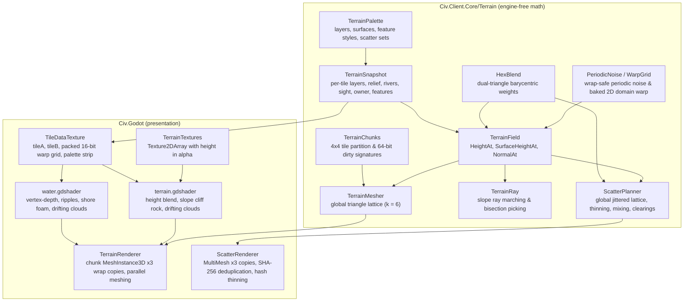

# Design

A deterministic Civilization-4-style game on a hex grid where **everything is a mod**.
Core defines the contract. Mods implement the rules.

## Principles

1. **Dogfood.** The shipped game is nothing but ordinary mods: Foundation, World,
   Research, Economy, Cities, Military, Government, Peoples, AI and later feature mods.
   They get no private hooks. If a shipped mod needs something, the mod API grows to
   offer it to every mod. Terrain, techs, buildings, units, civics, map generators,
   commands, turn systems and the AI are all registered through `IModContext`.
2. **No mod knowledge outside mods.** `Civ.Core`, `Civ.Client.Core` and `Civ.Godot`
   never hard-code a mod's content ids or kinds. Defaults and choices come from loaded
   content or from mod-registered services, so a different mod set can replace any
   shipped mod.
3. **Headless deterministic core.** `Civ.Core` has no engine dependency, no floats in
   game state, no wall clock and no unordered iteration affecting state. The renderer is
   a view.
4. **Commands over the wire.** Multiplayer is lockstep: only player commands are
   exchanged, and every peer runs the same simulation.

## Projects

- `Civ.Core`: geometry, shared data, content registries, extension contracts,
  simulation, commands, saves and hashes.
- `Civ.Net`: lockstep sessions and reliable ordered transport. `InProcessHub` connects
  local peers.
- `tests/Civ.Tests/TestRuleset`: test-only ruleset loaded through the same mod API as
  feature rulesets.
- `Civ.Client.Core`: engine-free selection, picking, commands and city screen data.
- `Civ.Godot`: Godot view. Build separately with `dotnet build src/Civ.Godot`.
- `Civ.Tests`: contract, rule, client, save/replay and lockstep tests.

The client uses Core query contracts. It has no reference to a feature-mod or
test-ruleset assembly.

## Determinism

Authoritative state uses integer math. Rule code uses only simulation state and
`Simulation.Rng`, not clocks or engine APIs. String identities use ordinal comparisons.
Content follows ordinal id order. Ordered sequences retain their order in saves and
hashes.

Mods increase their manifest version whenever rule semantics change. Content hashes do
not hash DLL bytes.

## Map and plots

`MapSpec(int Width, int Height, bool Wrap)` describes a rectangular, pointy-top odd-row
map. `HexGrid` converts axial coordinates, offset coordinates and row-major `TileId`
values. Columns normalize across east–west wrap. Rows never wrap.

- `HexGrid.Neighbors` returns distinct neighbors in direction order, without
  self-neighbors.
- Directions are east, northeast, northwest, west, southwest and southeast.
- `HexGrid.Distance` measures the shortest distance across wrap images.
- `HexGrid.Range` and `Ring` clip to the map and enumerate distinct tiles in ascending
  tile-index order.
- `Hex.DistanceTo`, `Hex.Range` and `Hex.Ring` describe the unbounded plane, not map
  topology.

`GameState.Plots[tile.Value]` stores terrain, feature, bonus, improvement, route, owner,
culture, visibility and area id. Culture uses sorted player ids. Revealed and visible
teams use compact `TeamMask` bitsets, without a fixed team-count limit. Bitsets
enumerate team ids in ascending order. Dense team ids minimize their storage.

`RiverEdges` and `CliffEdges` store six bits in direction order. `GameState.SetRiver`
and `SetCliff` mirror shared edges on both plots. Off-map edges never carry either bit.
World clears cliffs unless the edge joins land to non-lake water. `IMapSanitizer`
repairs map rules after setup, scenario configuration, and save loading.

`IMapGenerator.Generate(MapSpec, Plot[], DeterministicRng, ContentDb)` fills every plot.
Cities and units retain canonical axial positions. The client renders one map image,
without duplicate wrap plots.

### Coastal cliffs

World places cliffs after terrain, lakes, relief, and rivers, before start selection.
`CliffGenerator` targets 20% of land/sea edges through ranked smooth noise (scale 6, two
octaves, range 0–999). Hills and Peak plots receive a 400-point priority bonus. River
mouths and sea-edge endpoints with rivers remain beaches. Each coastal land area keeps
one beach. Islands of at most four tiles keep at least 50% of their sea edges open.
Coastal starts and new cities keep one beach, with direction order resolving conflicts.
Terrain changes and lake reassignment clear invalid cliffs without creating new cliffs.

Cliffs block land units from boarding, landing, or attacking across the edge. Ships
cannot enter or leave a land tile across a cliff, including friendly cities. The
Amphibious promotion does not bypass cliffs. `CanMoveAllTerrain` units ignore cliffs.
Ranged attacks, aircraft, and coastal building/yield eligibility do not change.
Pathfinding uses the same movement rules. Naval AI selects ports and landing edges with
beach access.

## Teams and entity data

Players have `TeamId`, civics, culture and treasury. Each player defaults to a separate
team. Teams hold members, known techs, a research target, progress per tech and war
relations. `Simulation.TeamOf(player)` and `KnowsTech(player, tech)` provide rule
access. Changing a research target retains its progress. `GameState.SetWar` keeps the
war matrix symmetric.

Cities include a generic `ProductionQueue` of
`ProductionOrder(Kind, ContentId, Progress)` entries. Cities owns feature queues, paused
item progress, completion snapshots, and normalized overflow. Test rules live in
`tests/Civ.Tests/TestRuleset`. `GameState` contains plain data and rebuildable lookup
caches. Caches do not enter saves or hashes. `UnitById`, `UnitsAt`, `CityById` and
`CityAt` use indexes. Runtime edits use `AddCity`, `RemoveCity`, `AddUnit`, `RemoveUnit`
and `MoveUnit`. After bulk data edits, `RebuildIndexes` restores the caches.

## Mod registration

Each mod folder contains `mod.json`, one DLL and optional JSON sidecars. Dependencies
determine load order. Ordinal mod ids break ties. Ids use `modid:name`. Registration
requires the owning namespace. Overrides can replace earlier content.

- `ctx.Content<T>()` returns `ModRegistry<T>` for any `ContentDef` subtype.
- `ContentDb.Get<T>()`, `Get<T>(id)` and `TryGet<T>(id, out item)` resolve generic
  content.
- Existing typed registries remain convenience accessors.
- `ctx.RegisterService<T>(name, service)` registers a non-content implementation under
  its shared interface.
- `ContentDb.Services.Get<T>()` returns implementations in mod-load and registration
  order.
- `ITurnSystem` retains explicit `(Order, Id)` execution order.

Registries freeze after load. Definitions and their nested collections must not change
after that point. The content hash includes canonical definitions, loaded mod
ids/versions, command identities, service order and state-component identities.

## Setup and presentation services

Mods register these contracts through `ctx.RegisterService<T>()`:

- `ISetupPolicy.Default(SetupField)` supplies an optional default content id.
  `SortOrder(SetupField, string id)` supplies an optional display order. Each field
  permits at most one default provider. Each choice permits at most one display-order
  provider. The client selects the first loaded choice when no default exists.
  Display-order ties use ordinal ids.
- `ISetupPolicy.GameOptions(ContentDb)` supplies optional setup game options.
  `GameCatalog.GameOptions` aggregates these options for the setup screen.
  `SimulationSettings.GameOptions` records enabled option choices.
  `Simulation.IsOptionEnabled(string id)` checks option state during play. The setup
  screen displays checkboxes for implemented simulation options. Remaining option
  definitions in `src/Mods/Foundation/data/game-option.json` remain deferred as a future
  pending item.
- `IProductionKind` supplies a queue-kind id, tab label, continuous-production flag,
  content candidates, and definition lookup. It also supplies base costs, eligibility
  visibility, validation, and production calculations. The client builds tabs and
  choices from all registered kinds in service order. Continuous kinds show no
  completion turns or progress bar. Cities registers building and unit kinds. Economy
  registers the process kind. Commands require an explicit kind or hurry id, except
  queue-removal commands.
- `ILedgerSourceLabel.Label(Simulation, string source)` supplies optional text for
  mod-owned ledger sources. The client uses the first non-null label in service order,
  then content names or generic text.
- `ITileAppearanceService` supplies optional terrain and feature metadata by full
  content id. `TileAppearance` stores integer RGB, tint percent, mark count, optional 3D
  scatter set name and density, and a terrain's ground spread (0..100, how far its
  ground reaches into neighbouring tiles). `TerrainSurface` enumerates procedural and
  system surfaces (`Cliff`, `Seabed`, `DeepSeabed`, `Unexplored`). Default interface
  methods `Surface(TerrainSurface)` and `Scatter(string feature, string terrain)` allow
  mods to supply surface textures and terrain-specific scatter variants (such as snowy
  pine trees on tundra/snow forests). The client uses the first non-null result in
  service order. Unknown terrain is gray, and unknown features have no marks or props.

`ICityWorkService.DefaultSpecialist(Simulation)` identifies the plain citizen role for
assignment controls. All presentation and setup queries must avoid state changes and RNG
use. Service implementations hold no mutable per-game state. Service identities enter
the content hash. Mods must change their manifest version when service behavior changes.

## Turn phases

`Civ.Game.TurnPhase` defines shared order slots. Systems use these constants instead of
private numeric priorities. Systems with equal orders run by ordinal `Id`. Additional
orders can use the gaps between slots.

Orders from `PlayerBegin` through `Map - 1` require
`IPlayerTurnSystem.Run(Simulation, int player)`. The scheduler completes this interval
for one player before the next player, in ascending player-id order. Other orders use
`ITurnSystem.Run(Simulation)` once per boundary. Legacy test-ruleset orders remain
outside the player interval.

| Constant             | Order | Work                            |
| -------------------- | ----: | ------------------------------- |
| `GameBegin`          |     0 | Global begin hooks              |
| `Properties`         |   100 | Global properties               |
| `Deals`              |   200 | Deal settlement                 |
| `Teams`              |   300 | Team maintenance                |
| `PlayerBegin`        |  1000 | Player timers and caches        |
| `AssignWork`         |  1100 | City work assignments           |
| `Gold`               |  2000 | Treasury settlement             |
| `Research`           |  2100 | Research and discoveries        |
| `Espionage`          |  2200 | Espionage allocation            |
| `Economy`            |  2300 | Taxes, consumption, inflation   |
| `CityBegin`          |  3000 | City preparation                |
| `CityGrowth`         |  4000 | Food, growth, starvation        |
| `CityCulture`        |  4100 | City culture                    |
| `CityPlotCulture`    |  4200 | Plot culture and borders        |
| `CityAutoBuildings`  |  4300 | Automatic buildings             |
| `CityProduction`     |  5000 | Production eligibility and work |
| `CityCompletion`     |  5100 | Completion effects              |
| `CityPostProduction` |  6000 | Decay and later city rules      |
| `PlayerEnd`          |  7000 | Remaining player maintenance    |
| `Units`              |  8000 | Units and worker progress       |
| `Map`                |  9000 | Improvements and map updates    |
| `Spawns`             |  9100 | Barbarians and other spawns     |
| `Environment`        |  9200 | Environment and global founding |
| `Visibility`         |  9500 | Team sight                      |
| `GameEnd`            |  9900 | Pre-end hooks                   |

These slots follow `CvPlayer::doTurn` and the city pipeline: gold precedes research, and
growth and culture precede production. Cities processes all owned cities at each city
slot, in ascending city-id order. Completion commits effects in that same order. This
preserves the source pipeline's cross-city stage boundaries without parallel mutations.
New buildings cannot change already-settled gold or research in that turn.

The simultaneous engine resolves submitted commands before these slots. It resolves
global map work after player work, rather than before player activation as in
`CvGame::doTurn`. This boundary adaptation gives worker completions one defined
map-update point. It does not reproduce sequential activation or shuffled source player
order. Most slots reserve future work and do not yet contain systems.

`TurnEnded` follows `GameEnd`, before the turn counter increases. `TurnStarted` follows
the counter increase and precedes AI commands. Both events retain their existing
presentation semantics.

## Feature ruleset setup

A non-null `SimulationSettings.WorldSize` selects Foundation's `INewGameSetup` service.
Null retains the legacy setup. Feature settings include `WorldSize`, `GameSpeed`,
`Handicap`, `StartingEra`, and one entry in `Leaders` per player. Empty speed, handicap,
era, and generator ids resolve through mod-registered `ISetupPolicy` services before
generation. Explicit ids remain unchanged. `Simulation.Settings` stores the resolved
ids, and saves retain them. World supplies its generator default. Foundation supplies
the speed, handicap, era, and setup-screen world-size defaults. The test ruleset
supplies its own generator default. Without a generator policy, Core selects the first
loaded generator in ordinal id order. Core never selects a world size implicitly, so
omitted `WorldSize` retains legacy setup. An optional `Civilizations` entry resolves a
leader shared by multiple civilizations. An incompatible selection fails before
generation.

Foundation resolves dimensions from `WorldSizeDef.GridWidth/GridHeight` times the source
landscape-cell scale of four. Standard therefore contains 84 × 52 = 4368 plots, with
east–west wrap. `State.Map` holds the effective map. `Settings.Map` remains the caller's
original legacy map setting.

Foundation creates teams and grants civilization and handicap starting technologies.
Civilization free-unit classes resolve through `UnitOverrides`, including explicit
disabled classes. Era and handicap fields supply multipliers, extra
worker/defense/exploration grants, and starting gold. Role selection uses eligible land
units, known requirements, work rate, strength, movement, and exploration suitability.
It approximates `CvPlayer::addFreeUnitAI`, not the full military AI valuation. All
initial units share their player's start plot. Movement rules remain a Military task.

World scores radius-two and radius-three food and production, with coast and fresh-water
weights. It selects habitable starts with minimum wrapped spacing, then improves weak
starts with grass and forest near the center. Normalization never changes water, peaks,
or resource plots. Impossible spacing produces a setup error, not overlapping starts.
The harness `tests/Civ.Mods.Tests/GameFactory.cs` creates full headless games through
this API.

## World services

Clients and other mods resolve these Core contracts through
`ContentDb.Services.Get<T>().Single()`:

- `IPlotYieldService.Calculate(Simulation, int player, TileId)` returns
  `PlotYieldResult(YieldVector, Ledger)`.
- `IPlotYieldService.CalculateNature(Simulation, int player, TileId, bool ignoreFeature = false)`
  returns natural potential.
- `IWaterService.IsFreshWater(Simulation, TileId)` and
  `IsIrrigated(Simulation, int player, TileId)` return availability.
- `IResourceNetwork.ConnectedCount(Simulation, int player, int city, string bonus)`
  returns physical connected copies.
- `IWorkerBuildService.Validate(Simulation, int player, int unit, string build)` returns
  a rejection reason or null.
- `IWorkerBuildService.Start(Simulation, int player, int unit, string build)` applies a
  validated assignment.
- `IWorkerBuildService.RequiredWork(Simulation, TileId, string build)` returns the
  integer work threshold.
- `IWorkerBuildService.IsWorking(Simulation, int player, int unit)` checks active build
  orders.
- `IVisibilityService.Recompute(Simulation)` updates visible and revealed team masks.
- `IVisibilityService.CanSeePlot(Simulation, TileId observer, TileId target, int team, int range, bool aerial = false)`
  tests line of sight.
- `IVisibilityService.SnapshotOf(Simulation, TileId tile, int team)` returns
  last-observed plot state.
- `INavalBlockadeService.IsTileBlockaded(Simulation, TileId tile, int team)` and
  `IsCityBlockaded(Simulation, int city)` query naval blockades.
- `IStartingPositionService.Select(Simulation, int count)` selects locations without
  mutation.
- `IStartingPositionService.Normalize(Simulation, IReadOnlyList<TileId>)` applies
  setup-only terrain changes.

Read-only queries never consume RNG or change authoritative state. Services hold no
per-game caches. Plot yields include terrain, relief, lakes, features, revealed
resources, improvements, routes, irrigation, technology changes, and registered plot
modifier sources. Feature river changes replace terrain river changes. Route synergy
suppresses smaller river contributions per yield, as in `CvPlot::calculateNatureYield`.
Nature clamps before improvement effects. Flat sources sum before percentage
multiplication, integer division, and the final nonnegative clamp. Ledger keys
`yield.flat.*` and `yield.percent.*` explain inputs. `world:food`, `world:production`,
and `world:commerce` hold final outputs. Cities owns city-center minima and
city-specific plot effects. Government and Peoples can contribute through
`IModifierSource` with `ModifierScope.Plot`.

The generator adapts `Continents.py` and `FractalWorld`: polar fractal land with 75%
water, separate relief, and latitude-based climate. Integer value noise replaces the
native fractal primitive. Priority-flood drainage connects high ground to water across a
temporary filled surface. River masks describe shared hex edges, not square-map river
directions. `SetRiver` maintains both sides. Flooded depressions can produce level
drainage steps. The drainage parent order prevents cycles. Connected water areas with at
most the configured lake size supply fresh water. Features and resources obey typed
placement restrictions. Resource density uses appearance, eligible tiles, player count,
class spacing, and clustering. Starting normalization can replace climate-selected
terrain near starts, but never invalidates a resource's terrain or feature. Goody huts
use improvement spacing and tiles-per rules. Starting eras can suppress all huts.

Networks use routes, city nodes, shared river edges, and technology-enabled coast/ocean
plots. Unowned plots require exploration. Physical resource networks and city
connections transit revealed peaceful foreign territory without Open Borders treaties
(`CvPlot::isTradeNetwork`). International city trade routes still require Open Borders
agreements when Diplomacy is active. Naval blockades by enemy warships within
`SHIP_BLOCKADE_RANGE` (default 3) on non-lake water sever water network tiles. Blockades
also prevent coastal cities from working water tiles and cancel trade routes. Autonomous
AI blockade planning is absent. Queries recompute components so ownership, pillage,
blockade, and technology changes take effect immediately. The `bonus` evaluator uses
connected counts. Vicinity requirements check bonus reveal, obsolescence, city
availability, and physical connectivity to local sources. Valid sources include city
centers, improved local plots, or active building grants.

`world:start_build` serializes the Core `StartBuildCommand`. Workers share plot progress
by build id. An assignment stores its original tile, so movement cancels the assignment
at the next worker phase. `IWorkerBuildService.IsWorking` checks active orders so legal
continuing work avoids repeat costs or abandonment. Build times apply terrain, speed,
and starting-era multipliers in sequence. Building on peak tiles applies
`PEAK_BUILD_TIME_MODIFIER` (+100%). Upgrading an existing route to a superior route
subtracts the existing route's base build time under `ROUTES_UPGRADE`, with a minimum
floor of one. Known technologies and AI handicap fields modify work rates. Completion
can remove a feature, create an improvement or route, change terrain, or consume a
worker. A feature effect can permit removal without its production technology. Such
removal grants no production. `FeatureProduction` names the nearest owned city and the
production grant. Cities must subscribe to apply overflow. Improvement upgrades require
worked turns or an outside-borders target, plus the target's technology. City disorder
or empire anarchy suspends discovery, mine exhaustion, and normal upgrades. Genuinely
unworked tiles retain the existing outside-borders upgrade exception.

At `TurnPhase.Map`, `ImprovementTurnSystem` processes feature evolution and resource
discovery. Feature disappearance rolls (`FeatureDef.Disappearance`) can remove temporary
features. Adjacent feature growth and spread rolls (`FeatureDef.Growth`,
`FeatureDef.Spread`, `ImprovementDef.FeatureGrowth` on preserves) scale with game speed,
feature growth modifiers, and route penalties. Worked improved bonus-free tiles roll for
resource discovery, with a 10× boost when `foundation:gameoption_resource_depletion` is
active. When resource depletion is active, worked mines can exhaust to
`world:depleted_mine`, setting `Plot.DepletedMine` and blocking new mines until a bonus
is revealed. Resource deposit exhaustion removes exhausted bonuses. Deposit depletion
uses the reference zero-consumption path until a resource-consumption service exists.

`GlobalWarmingSystem` runs at `TurnPhase.Environment`. Global warming defense sums map
features (`FeatureDef.WarmingDefense`), doubled for players with active health civics
(`TREEHUGGER_DEFENSE_BONUS`), scaled by `GLOBAL_WARMING_FOREST` per land plot. City
pollution sums building unhealthiness (`GLOBAL_WARMING_UNHEALTH_WEIGHT`), bonus
unhealthiness (`GLOBAL_WARMING_BONUS_WEIGHT`), and dirty power
(`GLOBAL_WARMING_POWER_WEIGHT`). City wellbeing queries derive pollution from active
building and resource rules because city power outage state is absent. Warming rolls
consume probabilities and degrade random non-city plots. Degradation steps follow snow
to tundra or marsh, grass, plains, desert, and coast. Tile degradation clears
improvements and emits `GlobalWarmingOccurred`. Deterministic port RNG selection uses an
ordinal non-city candidate array instead of native random map coordinate retries.

Visibility runs at `TurnPhase.Visibility`, after founding, and after unit movement.
Line-of-sight elevation and feature occlusion (`TerrainDef.SeeFrom`,
`TerrainDef.SeeThrough`, `FeatureDef.SeeThrough`) block sight behind hills, peaks, and
dense features. High ground grants outer-ring vantage sight across lower terrain. Aerial
units and recon bypass terrain occlusion. Per-team fog-of-war plot snapshots
(`plot.RevealedSnapshots[team]`) preserve last-observed terrain, relief, features,
bonuses, improvements, routes, and ownership. Missing fog memory hides tiles until real
observation or explicit map reveal, preventing live state leaks. The client reads
perceived snapshots for fogged tiles to hide unseen mutations.

`military:pillage` (`PillageCommand`) validates cargo, domain, and improvement
permanence. During peace, a player can demolish their own non-permanent improvement
without a gold award. Wartime enemy pillaging awards gold from
`ImprovementDef.PillageGold` scaled by `pillage_percent` and steps improvements down
along `ImprovementDef.ImprovementPillage`. Pillaging routes removes the route and emits
`PlotPillaged`. `WorkerPlanner` prioritizes repairing ruins, depleted mines, and severed
routes, and replacing pillaged improvements to reconnect revealed resources.

`Plot.Kind`, `IsLake`, `DepletedMine`, `ImprovementTurns`, `BuildProgress`,
`RevealedSnapshots`, player leader/start ids, and worker components enter saves and
state hashes. These fields are additive to save schema 1 and have defaults for older
JSON. Changed mod versions reject old content identities unless the caller explicitly
forces loading. Hand-authored geometry tuning lives in
`src/Mods/Foundation/data/hex-overrides.json` and enters the content hash. The importer
writes only its declared definition families and rejects that reserved filename.

## City services

Cities registers Core query contracts. All queries are RNG-free and do not change
authoritative state. `Calculate(Simulation, int city)` returns ledgers through
`ICityYieldService`, `ICityWellbeingService`, `ICityGrowthService`,
`ICityProductionService`, `ICityMaintenanceService`, and `ICityGreatPeopleService`.
Production calculation additionally takes `(string kind, string content)`.
`ICityProductionService.Validate` returns structured requirement failures with the same
arguments. `ICityWorkService` supplies `Radius`, `WorkArea`, assignment validation, and
authoritative `Assign`. `ICityBuildingService` provides `EffectiveBuildings`,
`ActiveBuildings`, `IsPowered`, `IsDirtyPower`, and `ProvidesPower`.
`ICityCaptureService` provides `Capture`, `ValidateRaze`, and `Raze`.

`CityYieldResult.Yields.Commerce` is raw whole commerce. `DirectCommerceHundredths`
bypasses sliders. `CommercePercent` contains additive percentage bonuses, not final
rates. Economy allocates raw commerce, adds direct contributions, and applies each
commerce modifier. Economy can register one
`ICityCultureSource.CultureHundredths(Simulation, int city)` provider for the final
culture rate. Without that provider, Cities applies culture modifiers to direct culture
only.

Commands use `cities:found_city`, `cities:set_city_work`, `cities:set_city_production`,
`cities:conscript`, and `cities:resolve_conquest_choice` identities. The Core types are
`FoundCityWithSettlerCommand`, `SetCityAssignmentsCommand`, `SetCityProductionCommand`,
`ConscriptCityCommand`, and `ResolveCityConquestCommand`. Queue kinds are
`cities:building` and `cities:unit`. Cities completes at most one item per city per
turn. Growth and culture precede production. Completion effects follow production work
in city-id order.

`ICityProductionService` handles order completion and surplus conversion. Surplus
production above the overflow cap converts into treasury gold. The overflow cap is the
maximum of item cost and current turn production. Surplus production scales back from
item-specific modifiers to city base yield production modifiers. The system multiplies
scaled surplus by unit, building, or project gold percentages. Invalid head orders in
the queue are removed and refund accumulated progress as gold.

`ICityBuildingService` resolves power states and active building lists.
`CityData.IsPowered` checks local power plants and area clean power sources. Local
plants supply power through `ProducesPower` or `PowerBonus` with connected resources.
Buildings with `AreaCleanPower` grant clean power to all team cities on the landmass
(`IsAreaCleanPower`). `CityData.IsDirtyPower` is true when all active local power
sources have `DirtyPower` and clean power is absent. Buildings with `RequiresPower` fail
construction validation and deactivate when unpowered. Clean area power blocks
construction of buildings with `NoPower`. Powered cities apply `PowerYieldModifiers` in
`BuildingEffects`. City wellbeing adds `PowerHealthChange` for power and
`DirtyPowerHealthChange` for dirty power.

Free buildings calculate dynamically from team `FreeBuilding` sources and completed
`EmpireFreeBuilding` wonders. Categories resolve through owner civilization overrides or
original civilization under assimilation. Grants appear in `CityData.EffectiveBuildings`
and `ActiveBuildings` without mutating `city.Buildings`. Building replacement is
non-destructive. Constructed buildings remain in city storage when replaced. Active
buildings with `ReplaceBuildings` suppress matching lower-tier buildings in
`CityBuildingRules.Active`. Suppressed buildings reactivate automatically if the
replacer becomes obsolete or is removed. `ProductionEligibility` blocks construction of
replaced buildings and checks `ExtendsBuildingClass` prerequisites.

`ICityCaptureService` executes city conquest during wartime. Captures calculate capture
gold from population and random rolls, scaled by elapsed ownership turns. Building
survival strips capitals and non-capturable buildings. Surviving buildings check
location validity, player class limits, and survival percentage rolls. Team culture
majority guarantees building survival on recapture. Capturing or razing a capital
relocates the victim capital automatically via `CityCapital.RelocateIfNeeded`. Size-1
cities that never grew auto-raze upon capture. Captures with less than 75% team culture
suffer civil disorder during `OccupationTurns`.

Human conquests set `PendingConquestChoice` and default to `Puppet` until resolved.
Players resolve conquests with `CityConquestOption.Annex`, `Puppet`, or `Raze`. Puppet
cities manage citizen assignments and production automatically via the governor AI.
Puppet cities reject manual queue, citizen assignment, hurry, and conscription commands.
Puppet governance reduces city-count maintenance by 50% and city-count unhappiness by
50%. Players can annex puppet cities at any time through `ResolveCityConquestCommand`.
AI conquests evaluate city counts, raze probabilities, and raze protections. Capitals,
wonders, holy cities, headquarters, and strategic resource cities are protected from
razing.

`ICityConscriptService` provides `Calculate`, `Validate`, and `Conscript` operations for
drafting. The city selects the highest-priority eligible unit with `Conscription > 0`
(respecting civilization overrides and assimilation). Conscription validates against
minimum nationality team culture on the city plot (`CONSCRIPT_MIN_CULTURE_PERCENT`,
default 50%), absence of civil disorder, adequate population
(`ConscriptMinCityPopulation = baseMin + unit.Cost / perCost`), and remaining player
draft quotas (`cities:max_conscript`). Executing a draft deducts population, spawns the
unit with zero moves and halved accumulated local production experience, marks
`DraftedThisTurn`, and increments `ConscriptAngerTurns` by `flatHurryAngerLength` scaled
by world size draft modifiers.

`CityRuleState` and `CityPlayerState` contain saved feature-rule state. `CityRuleState`
tracks `TurnAcquired`, `HighestPopulation`, `OccupationTurns`, `IsPuppet`, and
`PendingConquestChoice`. Modifier sources use City scope for local effects and Player
scope for player growth/maintenance percentages. City keys include `cities:happiness`,
`cities:health`, `cities:war_weariness`, `cities:food_kept_percent`,
`cities:growth_percent`, and `cities:extra_culture_level`. Specialist keys use
`cities:slots:<specialist-id>`, `cities:free:<specialist-id>`, and
`cities:free_specialists`. Other keys cover maintenance percentages, production
percentages, experience, and great-person percentages. Modifier calculations inspect
these keys during yield, wellbeing, and growth processing.

Food waste uses fixed-point recurrence with scale one billion. City-count maintenance
uses a fixed-point root with scale one trillion. These deterministic adaptations can
differ from native floating-point results near integer boundaries. Maintenance uses the
maximum wrapped hex distance as the map normalization.

Cultural spread uses shortest-path distance search bounded by city cultural radius.
Pathfinding blocks spread across impassable terrain, peaks, and hostile enemy borders.
The realistic culture option adds terrain and feature distance penalties plus river
crossing costs. Founding grants claim unobstructed first-ring plots immediately. Plot
ownership resolves among living cities whose cultural radius reaches the plot. Ownership
preserves an incumbent on ties, then selects the lowest player id. `DecayPlotCulture`
runs at `TurnPhase.Map + 2` on game-speed golden age halving intervals
(`CultureDecayTurns`). Plots with culture for non-barbarian players above
`CityFreeCultureGrowthFactor` and foreign city `CultureHundredths` are halved, allowing
cultural borders and city nationality to assimilate over time. When cities are founded
or captured, `CityRuleState.OriginalCivilization` records the origin civilization. Under
the assimilation game option (`foundation:gameoption_assimilation`), production
eligibility and conscription resolve unit and building class overrides against
`OriginalCivilization` rather than current owner civilization.

`ICityWellbeingService` calculates `cities:culture_anger` based on foreign living
players' plot culture on the city tile, with a +50% multiplier against teams at war and
complete suppression for same-team players. Foreign nationality unhappiness is further
modified by civic `ForeignerUnhappyPercent` under `government:foreigner_anger`.
Modifiers under `cities:extra_culture_level` (from traits, civics, or civilizations) are
additive and expand initial city founding culture and border radius. Governor weights
live in the hand-authored hex sidecar. The governor orders equal plot scores by tile id.
No feature mod references a test ruleset assembly. The client loads feature rules
through Core contracts.

## Research and economy services

Research registers `IResearchService` for cost ledgers, rate modifiers, eligibility,
queues, and team contributions. `research:set_research` uses `SetTeamResearchCommand`.
It accepts a target and optional queue, or one free-tech selection. `ResearchTeamState`
saves normalized overflow, repeat counts, free-tech credits, queues, and explicit
contacts. Discoveries publish `TechDiscovered`. Cities updates the current era through
this event. Overflow applies on the next contribution. Optional diffusion and timeline
policies remain deferred.

Economy registers `IPlayerEconomyService` for player ledgers, city commerce ledgers,
rates, and rate validation. `economy:set_commerce_rates` uses `SetCommerceRatesCommand`.
City commerce keeps hundredths through allocation, direct contributions, percentage
modifiers, and process conversion. Gold settlement saves a commerce snapshot.
`IPlayerResearchSource` supplies that snapshot to Research. `ICityCultureSource`
supplies final culture to Cities. Queries never mutate state or consume RNG.

`ICityProcessService` supplies eligibility and conversion for infinite `economy:process`
queue items. Processes use current production. Stored overflow remains available for
later finite production. `ICityHurryService` supplies payment previews and mutations
through `economy:hurry` and `HurryCityCommand`. Cities completes hurried items during
its normal completion phase. Whip anger duration dynamically incorporates building
modifiers (`cities:hurry_anger_percent`) with a 1-turn floor. When a building with
`HurryAngerModifier` completes in a city with active `HurryAngerTurns > 0`, the
remaining anger turns are retroactively rescaled by
`(100 + newModifier) / (100 + oldModifier)`. Player-wide building discounts contribute
to `economy:hurry_percent`. Each hurry increments `EconomyPlayerState.HurriedCount`,
multiplying per-turn inflation by `(100 + HurriedCount) / 100`. `HurriedCount` decays on
elapsed turn boundaries based on game speed and civic `HurryInflationModifier`.

`CorporationService.MaintenanceHundredths` calculates city corporate branch expenses:
base headquarter commerce (100 per gold, research, culture, and espionage), resource
consumption scaled by world size, population scaling `(population + 17) / 18`, handicap
scaling, player civic modifier (`cities:corporation_maintenance_percent`, selecting
`RealCorporationMaintenanceModifier` when realistic corporations is active), inflation
pre-division `* 100 / (100 + inflation)` to balance subsequent economy inflation, and
realistic handicap scaling. `CityMaintenanceResult.CorporateHundredths` exposes the
uninflated base corporate cost, while `RecurringCosts` records
`economy:corporate_maintenance_hundredths` per city and `economy:corporate_maintenance`
in empire expenses.

Bilateral diplomatic trade deals (`TradeItemKind.GoldPerTurn`) integrate directly into
`PlayerEconomy.Calculate`, contributing to `Income` (`economy:deal_income`), `Expenses`
(`economy:deal_expenses`), and `NetGold`. In `PlayerEconomy.Settle` (`TurnPhase.Gold`),
sliders automatically step down flexible allocations to keep `Treasury + NetGold >= 0`.
Domestic income and expenses apply immediately, while domestic deficit is held in
`EconomyPlayerState.UnpaidGold`. At `TurnPhase.Map + 1`, `DiplomacyDeals` executes
transfers with net-payment participant affordability validation (`CanSettle`).

At `TurnPhase.Map + 2`, `PlayerEconomy.ReconcileGold` reconciles `UnpaidGold` against
actual treasury following deal payments. If treasury remains negative after deal
transfers, `EconomyPlayerState.StrikeTurns` increments; when `StrikeTurns > 1`,
`DisbandForDeficit` forces removal of up to `StrikeTurns / 2` lowest-value units. Unit
valuation in `SelectDisbandUnit` scores units based on random seed, cost, experience,
level, city defense, extra cost, territory ownership (own territory score is divided by
6, prioritizing domestic units unless outweighed by extra cost), and AI role multipliers
(settlers ×20, workers ×10, explorers ×15, city defense ×6, spies ×12). Units with
`GoldenAge = true`, free units (`Cost <= 0`), and the sole garrison unit providing
military happiness are exempt. Disbanding halts early once `NetGold` reaches
non-negative equilibrium.

`PlayerEconomy` implements `IPlayerEspionageSource.EspionageHundredths`. `EconomyMod`
delegates espionage accumulation to `EspionageService` when loaded, preventing duplicate
aggregate pooling. `PlayerEconomy.Calculate` queries `IEspionageService.Spending` to
project per-rival points under `economy:espionage_target:<team>`.

Player modifier keys include `economy:max_rate:<type>`, `economy:upkeep_percent`,
`economy:inflation_percent`, and `economy:hurry_percent`. Team key
`research:cost_percent` changes research costs after the normal scaling steps.
`EconomyPlayerState` saves sliders, settlement snapshots, unpaid gold, strike turns,
hurried count, aggregate espionage (when espionage service is absent), and the inflation
accumulator. `EconomyCityState` saves hurry anger. The imported profile disables
inflation. Enabled profiles use the source binomial formula and momentum update after
research.

## Military services

Military registers `IMovementService`, `IPathfindingService`, `ICombatService`,
`IUnitService`, `IUnitSupportService`, and `IAirMissionService` through Core, and
interacts with World's `IVisibilityService`. Movement paths exclude the starting plot.
Commands traverse until movement expires or combat interrupts the path. A costly
destination can consume the remaining sub-moves. A\* minimizes total edge cost, not the
number of turns. Route movement and combat share the hex river-edge policy. Military
recomputes World visibility after movement and unit removal.

Command identities include:

- `military:move_unit` (`MoveUnitPathCommand`), `military:promote_unit`
  (`PromoteMilitaryUnitCommand`), `military:set_unit_activity`
  (`SetUnitActivityCommand`), `military:pillage` (`PillageCommand`),
  `military:upgrade_unit` (`UpgradeUnitCommand`), `military:disband_unit`
  (`DisbandUnitCommand`), and `military:raze_city` (`RazeCityCommand`).
- `military:bombard_city` (`BombardCityCommand`): Siege weapons expend movement to
  reduce defensive fortification bonuses (`DefenseDamage`) on an adjacent enemy city.
- `military:ranged_strike` (`RangedStrikeCommand`): Support fire up to `BombRange` hexes
  against visible enemy units or cities. Rolls against accuracy (`BombAccuracyPercent`),
  delivering damage to the top defender (capped at `CombatLimit`) plus collateral damage
  to stack companions, without reciprocal melee damage or risking the firing unit. Also
  applies city defense damage if targeting an enemy city.
- `military:load_unit` (`LoadUnitCommand`): Boards an eligible land unit onto a
  co-located transport ship possessing available `CargoCapacity` and matching cargo
  categories/domains.
- `military:unload_unit` (`UnloadUnitCommand`): Disembarks a cargo unit to the current
  tile (if valid) or an adjacent land tile, expending remaining movement.
- `military:air_mission` (`AirMissionCommand`): Executes domain-air operations governed
  by `AirMissionKind` (`Rebase`, `AirStrike`, `AirBomb`, `Recon`).
- `military:set_unit_activity`: Added `UnitActivity.Intercept` (Combat Air Patrol) and
  `UnitActivity.Blockade` (Naval Blockade). Naval combat units on non-lake water can
  blockade within `SHIP_BLOCKADE_RANGE` (default 3), severing enemy water trade networks
  and coastal city sea work. Core exposes `INavalBlockadeService`. Autonomous AI naval
  blockade planning is absent.

Domain events include:

- `PlotPillaged(int Unit, int Player, TileId Plot, string? Improvement, string? ReplacementImprovement, string? Route, int Gold)`:
  Published when an improvement or route is pillaged.
- `CityBombarded(int Unit, int City, int DefenseReduction, int TotalDefenseDamage)`:
  Published upon successful city defense bombardment.
- `AirMissionResolved(AirMissionReport Report)`: Details air mission results including
  interceptor involvement, interception damage, target damage, collateral hits, and
  suicide consumption.
- `GreatGeneralBorn(int Player, int Unit, string UnitType, int City)`: Dispatched when
  combat experience satisfies the general emergence threshold.

Saved extension components:

- `MilitaryUnitState`: `int? TransportId` (tracking vessel hosting this cargo unit),
  `string? AttachedLeaderUnitType` (attached warlord promotion identity), and
  `bool InterceptedThisTurn` (preventing multiple CAP interceptions in the same turn).
- `MilitaryPlayerState`: `long GeneralPoints` (accumulated combat XP),
  `int GreatGeneralsCreated` (lifetime count), `long GeneralThresholdModifier`
  (threshold inflation), and `bool Barbarian` (flag).
- `MilitaryGameState`: `ReconSights` (temporary turn reconnaissance visibility entries
  cleared on turn boundaries).
- `CityRuleState` (Cities): `int DefenseDamage` (accumulated wall/defense reduction) and
  `bool BombardedThisTurn` (suppressing natural defense healing).

Combat and system mechanics:

- **Combat resolution & odds preview**: Combat preview returns strengths, ledgers,
  firepower, round damage, first strikes, withdrawal, and success odds in millionths.
  The defender strength includes relative attack modifiers, including the reciprocal
  formula for negative totals. Combat is atomic. Saves between commands retain health,
  moves, experience fractions, activity, RNG, and current-turn combat reports.
- **Combat Great General emergence**: Military victories award combat experience to
  `playerState.GeneralPoints`. Reaching `GeneralThreshold(sim, player)` (scaled by game
  speed, era, and inflation modifiers) spawns a Great General in the player's best
  domestic city, increments `GreatGeneralsCreated`, and escalates both personal and team
  thresholds.
- **Warlord attachments & leader promotions**: Great Generals attaching via
  `LeadGreatPersonCommand` grant `military:leader`, record `AttachedLeaderUnitType`, and
  distribute bonus experience across the plot stack. Units with an attached leader
  qualify for exclusive `PromotionDef.Leader` promotions (e.g. Morale).
- **City defense damage & recovery**: City fortifications provide defensive percentage
  modifiers that are scaled down by accumulated `DefenseDamage` up to
  `MaximumCityDefenseDamage` (default 100). Cities that avoid enemy bombardment across a
  full turn cycle heal `CityDefenseDamageHealRate` defense damage during
  `TurnPhase.PlayerBegin`.
- **Cargo transports & amphibious warfare**: Transports expose `CargoCapacity` computed
  from unit definitions plus `cargo` promotion modifiers. Moving a transport
  simultaneously moves all carried units. If a transport is sunk or disbanded, all
  loaded cargo units are immediately lost. Land units aboard naval transports may
  assault adjacent hostile coastal land directly; amphibious attacks suffer
  `-AmphibAttackModifier` unless the attacking unit holds the `military:amphibious`
  promotion.
- **Stealth & invisibility detection**: Units with `Invisibility` (e.g. Submarines,
  Spies) remain invisible to enemy teams unless an enemy unit possessing a matching
  `VisibleInvisibilityTypes` category is stationed within detection range. Invisible
  units do not wake sentry units and do not obstruct peaceful unit movement through
  their tile.
- **Flanking strikes & defender withdrawal**: Mounted units with flanking capabilities
  inflict collateral damage on siege weapons defending in the same tile when the
  attacker wins or withdraws, provided combat occurs outside a city. Defending units
  with withdrawal capabilities can trigger `CombatOutcome.DefenderWithdrawn` when
  surviving lethal combat, retreating to an adjacent safe tile.
- **Air missions & interception**: Aircraft operate from friendly cities and carriers
  within `AirUnitCapacity` (default 8 per city). Missions include `Rebase` (up to
  `2 * AirRange`), `Recon` (revealing fog of war across the target area until next
  turn), `AirStrike` (bombarding units up to `AirCombatLimit` with collateral damage),
  and `AirBomb` (reducing city defenses by `BombardRate` or pillaging worked
  improvements). Defending interceptors on CAP or anti-air ground units roll
  interception chances; upon interception, 5 rounds of air-to-air combat occur,
  factoring in attacker evasion. Suicide aircraft are consumed after an uninterrupted
  attack. An intercepted aircraft survives an aborted mission unless interception damage
  kills it. Active city buildings scale direct and collateral air-strike damage through
  their combined `AirModifier`, before damage limits apply.
- **Barbarian spawns & naval piracy**: Land spawns run at `TurnPhase.Spawns`.
  `BarbarianSpawns.SpawnArea` also evaluates water areas, applying handicap setting
  `UnownedWaterTilesPerBarbarianUnit` against unowned coastal water plots. Spawning
  enforces bounds on the ratio of barbarian to civilized naval units, excludes
  freshwater lakes and tiles visible to players, and spawns adjacent to land. Barbarian
  naval raiders hunt visible fishing improvements and vulnerable merchant/transport
  shipping.

Training modifiers use `military:initial_experience` and `military:free_promotion:<id>`.
Promotion modifiers use Unit scope. Government and Peoples must avoid duplicate military
contributions when they supply full modifier sources.

## Government and Peoples services

`IGovernmentService` validates, previews (`CivicSwitchResult`) and adopts civic changes.
`SetCivicsCommand` calls it. Anarchy and cooldown timers live in
`GovernmentPlayerState`. `GovernmentStatus.IsAnarchy` and `IsDisorder` give other mods
one query. `IPeoplesService` exposes leader, civilization and trait data. Both mods
contribute through `IModifierSource`. Civic and trait keys use the owning consumer's
namespace: `cities:*`, `economy:*`, `world:*`, `military:*`, and `government:*`.
`RequirementContext.ProposedCivics` lets civic requirements see a pending cabinet
without mutating state.

Civics supply draft permissions and quotas under `cities:max_conscript` at Player scope,
with base quotas scaled by the active world size modifier (`getWorldSizeMaxConscript`)
and integer truncation. Leader traits (`TraitDef.ExtraCultureLevel`), civics, and
civilizations contribute additive modifiers under `cities:extra_culture_level`. Newly
founded cities inspect this modifier to expand initial plot culture and work territory
immediately upon founding.

## Religion

`src/Mods/Religion` owns religion definitions, founding, city presence, state choice,
spread, and shrine construction. `IReligionService` exposes read-only presence, holy
cities, adoption choices, missionary definitions, odds, and conversion costs through
Core. AI and client code can use this service without a reference to the Religion
assembly.

Command identities are:

- `religion:set_state_religion`, `religion:spread_religion`, and
  `religion:build_shrine`.
- `religion:perform_inquisition` (`PerformInquisitionCommand`): Dispatches an inquisitor
  unit to purge non-state faiths from an owned or friendly city.

Domain events include:

- `InquisitionAttempt(int City, int Player, bool Success, IReadOnlyList<string> RemovedReligions, long CompensationGold)`:
  Published when an inquisition completes.
- `ReligionRemoved(int City, string Religion, string Reason)`: Published when a minority
  religion is purged or decays.

City presence, last state choice, conversion cooldown, holy cities, founding turns, and
reservations use saved extension components. Secular civics suppress the last choice
without deleting it. Conversion adds source-scaled anarchy to `GovernmentPlayerState`.
Natural spread runs immediately before the city post-production phase. All random draws
use the simulation RNG.

World supplies `ICityConnectionService` for physical routes, river trade, and unlocked
water trade. Distance uses hex distance and the hex map diameter. Religion age uses
elapsed turns.

Religion mechanics:

- **Foreign trade spread**: International trade routes connect cities across open
  borders and revealed road/water networks. Natural spread evaluates connected foreign
  trade partners, spreading state religions to foreign cities when allowed by standard
  spread rules or the `foundation:gameoption_multiple_religion_spread` option.
- **Religion decay & attrition**: When `foundation:gameoption_religion_decay` is
  enabled, cities with non-state minority religions lacking religious buildings roll for
  decay based on elapsed city turns and foreign pressure. Holy cities and the player's
  active state religion are immune. When decay triggers, minority religions and their
  associated buildings are purged, emitting `ReligionRemoved`.
- **Civic-gated Inquisitions**: Inquisitions are enabled when player civics grant
  `AllowInquisitions` (e.g., State Church) and blocked when any civic has
  `DisallowInquisitions` (e.g., Liberalism). Inquisitors validate against cities with
  non-state religions. Success purges minority religions and buildings
  (temples/monasteries), grants gold compensation (or reduces
  `RevolutionCityState.InstabilityIndex`), increases `HurryAngerTurns`, and applies
  negative diplomatic memories (`memory_inquisition`) with leaders following the purged
  faith.
- **Holy City relocation & extinction**: When an inquisition purges a holy city, if
  other cities in the world possess the religion, holy city status relocates to the
  highest-scoring candidate city; if no other city in the world has the faith, holy city
  status is extinguished (`-1` / `null`).

Religion contributes happiness, health, direct commerce, shrine commerce, state-building
commerce, production modifiers, and training experience. Religion requirements
distinguish city presence, state choice, and holy-city identity. Queries never consume
RNG or change state.

## Great People and Trade

`src/Mods/GreatPeople` owns city GP progress, historical class weights, births,
settlement, unit actions, and Golden Age timers. `IGreatPeopleService` supplies
read-only progress, rate ledgers, thresholds, settled specialists, timers, and available
actions. The existing `ICityGreatPeopleService` delegates to the same calculation.
Cities no longer runs a birth system. Threshold increases include both the personal
increase and the team increase for the creator, as in the source. Births use one
simulation RNG draw, resolve civilization replacements, and publish `UnitCreated` and
`GreatPersonBorn`.

Commands include:

- `great_people:join_city`, `discover_tech`, `hurry_production`, `culture_bomb`, and
  `golden_age`.
- `great_people:lead_unit` (`LeadGreatPersonCommand`): Attaches a Great General to a
  friendly combat unit on the same tile, granting `military:leader`, setting
  `AttachedLeaderUnitType`, and distributing experience across the stack. Unlocks
  `PromotionDef.Leader` promotions (e.g. Morale).
- `great_people:construct_building` (`ConstructGreatPersonCommand`): Constructs special
  Great Person buildings (Academies by Scientists, Military Academies by Great
  Generals).
- `great_people:trade_mission` (`TradeGreatPersonCommand`): Great Merchants can traverse
  peaceful foreign borders without open borders agreements. Executing a trade mission in
  a foreign city awards instant gold calculated from distance and capital trade route
  profit.

Great People mechanics:

- **Combat Great General emergence**: Combat experience won in battle contributes to
  `playerState.GeneralPoints`. Reaching `GeneralThreshold(sim, player)` (scaled by game
  speed, era, and threshold modifiers) spawns a Great General in the player's best
  domestic city. Spawning increments `playerState.GreatGeneralsCreated` and increases
  both personal and team thresholds (`GREAT_GENERALS_THRESHOLD_INCREASE` and
  `GREAT_GENERALS_THRESHOLD_INCREASE_TEAM`), publishing `GreatGeneralBorn`.
- **Warlord attachments**: Attaching a Great General to a unit distributes bonus
  experience evenly across all eligible friendly combat units on the plot and enables
  elite leadership promotions.
- **Special building construction**: Allows Great Scientists to build Academies
  (`cities:academy`) and Great Generals to build Military Academies
  (`cities:military_academy`), verifying technology prerequisites and existing building
  instances.
- **Foreign trade missions**: Great Merchants can enter peaceful foreign territory
  without open borders treaties. Reaching a foreign city enables `"trade"`, granting
  instant treasury gold calculated from base trade values, speed settings, and capital
  trade route distance profit. Settlement contributes free-specialist keys, so Cities
  applies normal specialist yields, commerce, and modifiers. Discovery selects the
  highest eligible flavor score, with ordinal technology ties.
  `IResearchService.AddProgress` grants unmodified, capped research. Hurry adds capped
  production to the current eligible building. Cities completes it during the normal
  completion phase. Culture works use `ICityCultureService` to update city history,
  surrounding plots, and ownership immediately. Golden Ages consume distinct unit
  classes. Optional command `Units` lists all participants, including the initiating
  unit. An omitted list selects nearest eligible units, then unit ids. Wonder completion
  also starts a Golden Age without increasing unit requirements. Golden Ages add
  threshold-based plot production and commerce through `IPlotYieldFinalizer`, and
  additive GP rate modifiers. Wonder-triggered timers retain their full duration until
  the next player turn. Unit-triggered timers include the current turn.

`src/Mods/Trade` derives active partners through `ICityConnectionService` and exposes
`ITradeRouteService`. Capacity includes initial, technology, civic, local-building,
coastal-building, global-building, and external modifier contributions. Routes use
partner population, wrapped hex distance, world-size scaling, capital connection,
overseas, building, civic, and foreign modifiers. Profit and route yields retain
hundredths. City aggregation truncates once per yield before the ordinary city modifiers
and Economy sliders. Routes select highest profit, then same-team partners, then city
ids. Each city uses a partner at most once. Physical resource networks and city
connections transit revealed peaceful foreign territory without Open Borders treaties
(`CvPlot::isTradeNetwork`). International city trade routes still require Open Borders
agreements when Diplomacy is active. Player naval blockades by enemy warships within
`SHIP_BLOCKADE_RANGE` (default 3) on non-lake water sever water trade networks.
Blockades also prevent coastal cities from working water tiles and cancel trade routes.
Autonomous AI naval blockade planning remains absent. Connectedness economics and
forced-trade diplomacy remain deferred. The imported profile sets `INITIAL_TRADE_ROUTES`
and `MAX_TRADE_ROUTES` to zero. Trade remains disabled unless a profile overrides these
values. External keys are `trade:slots`, `trade:profit_percent`,
`trade:foreign_profit_percent`, and `trade:yield_percent:<yield>`. GP accepts both the
existing `cities:great_people_percent` and `cities:great_people_rate_percent` in city
and player scopes. Mod versions change the content identity. Older city GP state needs a
migration before it can continue under the new owner.

## Modular feature services

Modular feature services include Diplomacy, ProjectsVictory, Corporations, Espionage,
Events, ScriptedWonders, and Revolution. Each mod registers Core contracts, commands,
and saved extension state. The contracts remain available without references to mod
assemblies.

Diplomacy tracks contact between teams, attitude ledgers, open borders, defensive pacts,
war, peace, and bilateral deals. Commands validate treaty changes, deal proposals,
execution, cancellation, war declarations, and peace. Deal assets include resources,
gold, gold per turn, and technology. Team ids identify relations; player ids identify
deal participants.

ProjectsVictory owns project eligibility and completion, team project counts, scores,
and saved victory status. Project definitions carry costs, technology and project
prerequisites, instance limits, victory links, spaceship flags, and thresholds. Victory
definitions select conquest, domination, cultural, project, or time rules. Enabled
conditions run by priority. Projects enter the city production queue through a
registered production kind and completion handler.

Corporations use founding and spread commands. A Great Person founds a corporation in a
city with a connected prerequisite resource. Active branches apply corporation yield,
commerce, headquarters commerce, and resource-based maintenance. Civics can prohibit
local or foreign corporations. A branch requires an active branch owned by the spreading
player.

Espionage allocates whole points from saved commerce output across met rival teams by
player-set weights. Passive thresholds unlock demographics, city visibility, research
inspection, and city investigation. Spy missions spend points and use a calculated
success chance. Saved team, player, and city state tracks points, weights, remainders,
and timers.

Events roll eligible triggers per turn with the simulation RNG. Trigger definitions set
eligibility, chance, repeat policy, and cooldown. Pending events hold a player choice.
Options can change treasury, research, city stores, happiness, health, and plot yields.
Unresolved events use a default option. AI players resolve events automatically.

ScriptedWonders adds completion, periodic, combat, and modifier effects to selected
buildings. City-local timers survive saves and capture. Inactive wonders pause their
timers, while completed effects do not repeat. Revolution tracks city instability from
wellbeing, distance, religion, civics, anarchy, garrisons, Golden Ages, and natural
recovery. Thresholds can trigger mutiny or rebellion. Players can suppress instability
with gold or a military garrison.

## Client presentation

`Civ.Client.Core` supplies screen models and validated commands for diplomacy, score and
victory, corporations, espionage, and pending events. The city screen shows
corporations, religion, commerce, wellbeing, and ledgers. Unit actions expose
corporation and spy commands when valid. `Civ.Godot` presents diplomacy and victory,
corporation, espionage, event, religion, pedia, save, and load panels. It also shows
espionage rates, pending-event notifications, and corporation details on the city
screen.

## Computer players

`src/Mods/Ai` registers `ai:standard` under `IPlayerAI`. Select it through
`SimulationSettings.PlayerAis`. Specialized planners handle empire governance and
military campaigns:

- **Civilian & empire planners**: `CitizenPlanner`, `ProductionPlanner`,
  `WorkerPlanner`, `ResearchPlanner`, `CivicsPlanner`, `CommercePlanner`,
  `SettlerPlanner`, and `ExplorerPlanner`.
- **Multi-theater combined arms campaigns (`AttackPlanner`, `MilitaryPlanner`)**:
  Partitions free combat units by landmass (`AreaId`), forming separate coordinated task
  forces per theater. Staging rings form 2 hexes outside target enemy cities. Before
  melee units attack, the AI sequences support fire: siege weapons execute
  `BombardCityCommand` against city defenses, and ranged units execute
  `RangedStrikeCommand` to soften stack defenders. Defensive reinforcement lines score
  candidate defenders by threat differential, moving surplus garrisons to border cities
  along road corridors.
- **Naval warfare & amphibious sealift (`NavalPlanner`)**: Classifies naval vessels into
  `NavalExplorer`, `NavalCombat`, and `NavalTransport`. Transports coordinate amphibious
  invasions: gathering at friendly coastal embarkation cities, loading waiting
  melee/siege troops up to `CargoCapacity`, sailing to enemy beachheads on foreign
  landmasses, and disembarking or attacking from sea. Warships escort transports, patrol
  coastal waters, and bombard coastal cities.
- **Air warfare management (`AirPlanner`)**: Dynamically rebases bombers and fighters
  forward to theater cities within range of target objectives. Flies aerial
  reconnaissance (`AirRecon`) to expose enemy stacks and fogged frontier plots. Conducts
  `AirBomb` missions against city defenses and strategic tile improvements, executes
  `AirStrike` missions against clustered enemy defenders, and maintains Combat Air
  Patrol (`UnitActivity.Intercept`) to intercept incoming enemy airstrikes.
- **Great Person & Religion AI (`GreatPersonPlanner`, `ReligionPlanner`)**: Dynamically
  scores Great Person actions: evaluates empire-wide value of Golden Ages (scaled by
  population and revolution instability) versus immediate technology bulbing, special
  building construction, or trade missions. Dispatches missionaries to unconverted
  domestic cities, and trains inquisitors to purge minority religions from unstable
  cities under state church civics.

Decisions use integer scores and ordinal content-id ties. War checks use only
`Simulation.Rng`. Planners apply ordinary commands through `Simulation.TryApply` during
`Decide`, then return an empty command sequence. This explicit sequential policy lets
later decisions see founding, movement and production changes in the same turn. Calling
`Decide` therefore takes the AI turn; it is not a read-only preview.

The AI has no hidden per-game caches. Immutable content indexes can be shared between
games. War-start turns live in a saved team component. `ai:declare_war` and
`ai:make_peace` change symmetric Core team relations. Peace has a minimum war duration
but no negotiation system yet.

World exposes `IWorkerBuildService.Preview` for remote build legality, resulting yields
and required work. Plot modifier queries accept a proposed plot, so civic and trait
improvement effects enter the preview without state mutation. Military path queries
reuse modifier ledgers within one search. Their integer heuristic accounts for
fractional routes. Neither query cache survives a command or enters saves.

### Parallel candidate scoring and intra-planner concurrency

Candidate evaluation within single-player planners parallelizes read-only scoring using
`ParallelScoring.Select` across candidate thresholds:

- `SitePlanner`: candidate city founding plots and full-map tile valuations.
- `CityPlanner`: city view snapshots and building production candidate options.
- `ResearchPlanner`: candidate research technologies.
- `WorkerPlanner`: candidate tile improvement jobs for each worker.
- `MilitaryPlanner`: pathfinding for defensive reinforcements.
- `AttackPlanner`: reachability of candidate assault and staging hexes.

Evaluation callbacks must not issue commands, mutate simulation state, or draw from
`Simulation.Rng`. Results populate preallocated arrays matching input indices,
preserving identical candidate evaluation results regardless of thread scheduling.
Candidates are sorted deterministically using descending integer scores with
ordinal/entity ID tie-breaking (e.g. `StringComparer.Ordinal` on content IDs, or
ascending `Tile.Value` / `Unit.Id`).

To prevent thread-pool oversubscription when multiple players plan concurrently,
`ParallelScoring.Select` checks `Simulation.IsParallelAiTurn`. When true (during
multi-player speculative waves), intra-planner candidate loops execute serially.
Candidate parallelism is reserved for single-player turns.

### Read-only city query optimizations

City and worker planning perform intensive read-only queries against empire state.
Several query paths avoid redundant traversal:

- `CityReadScope`: a `[ThreadStatic]` per-thread memoization scope keyed by simulation
  instance caches building activity, power status, and modifier grants during read-only
  city calculations (such as citizen specialist and tile assignments in
  `CitizenPlanner`). It provides zero-overhead memoization without mutating game state
  or leaking across threads.
- Lazy `ResourceNetwork.Modes`: route and transport mode checks are resolved lazily per
  query on first access rather than traversed upfront.
- `INavalBlockadeService.BlockadedTiles`: computes and caches the complete set of
  blockaded water tiles once per query instead of repeating hex-distance checks per
  candidate plot.

### State cloning and simulation forking

To support concurrent turn planning without full-save canonical JSON serialization
overhead:

- `GameState.Clone()`: performs an in-memory deep copy of the simulation state.
  `Plot.Clone()` copies plot attributes, culture arrays, team visibility masks, and
  shallow-copies immutable `RevealedPlotSnapshot` records while sharing the immutable
  `HexGrid`. Player, unit, team, and city records are cloned directly into pre-allocated
  collections and reindexed.
- `ExtensionState.Clone()`: clones attached extension component instances using UTF-8
  JSON round-trips (`JsonSerializer.SerializeToUtf8Bytes` and
  `JsonSerializer.Deserialize`) with `CanonicalJson.Options`, copying only entities that
  define non-empty extension dictionaries.
- `Simulation.ForkSpeculative()`: creates an isolated speculative `Simulation` with a
  cloned `GameState`, restored `DeterministicRng` matching the source RNG state, and
  top-level command recording enabled.

### Wave-based speculative parallel turns (`AiTurnSpeculator`)

`Simulation.RunAi()` delegates turn execution to `AiTurnSpeculator.Run(this)`:

- **Speculative waves**: uncommitted AI players are partitioned into waves. Players on
  the same team or at war with earlier players in the wave are excluded from the same
  wave to avoid direct interactions. Within each wave, the first remaining player
  ($p_0$) executes directly against the authoritative `Simulation`, while following
  independent players ($p_1, \\dots, p\_{m-1}$) plan concurrently on isolated
  speculative forks of the wave-start state.
- **Deterministic commit order**: plans commit strictly in ascending `Player.Id` order.
  Each committed plan replays its recorded `GameCommand` sequence against the
  authoritative simulation via `TryApply`, verifying that pre-command and post-command
  RNG states match the fork execution and that per-player state digests remain
  identical.
- **Conflict detection**:
  - *Active mutation footprint proximity*: a cumulative active mutation footprint tracks
    tiles where earlier players moved units (including intermediate path steps),
    founded, captured, or razed cities, or modified plot ownership, improvements,
    routes, or features. Stationary units (such as fortified garrisons) and unchanged
    border plots are excluded from the footprint unless their unit state (health,
    experience, promotions, activity) mutates. A spatial conflict occurs if any tile in
    a candidate plan's active footprint is within 5 hexes (`ActiveFootprintRadius = 5`)
    of an earlier player's cumulative active footprint.
  - *Global entity-aggregate conflicts*: a conflict occurs if an earlier player altered
    entity counters (`NextCityId`, `NextUnitId`), entity membership or ownership, unit
    health/experience/promotions/type, city buildings/population/extensions, or power
    inputs. This prevents stale reads for global evaluations (such as `WarPlanner`
    military power calculations or world wonder constraints).
  - *RNG and diplomacy conflicts*: a conflict occurs if an earlier player drew from
    `Simulation.Rng` and the candidate plan also used RNG, or if team relations
    (`Team.Wars`) or global extension components changed.
- **Wave relaunch on conflict**: if a speculative plan encounters any spatial,
  aggregate, RNG, or diplomatic conflict, or if command replay diverges, the
  authoritative simulation restores from a pre-commit checkpoint, re-applies already
  verified plans, and immediately relaunches a new speculative wave for the remaining
  uncommitted players against the updated authoritative state.

### Serial work reduction and calculation reuse

To minimize serial latency during AI player turns and the surrounding simulation, work
is reduced across eight optimization areas:

- **Calculation reuse within planning segments (`AiContext.Segment`)**: Planners
  evaluate decisions in a fixed sequence within an unchanged planning segment. A context
  segment caches role counts, queued production counts, city view snapshots, production
  eligibility dictionaries, nearest-city queries, and campaign targets geography.
  Repeated queries within the segment reuse memoized results instead of repeating linear
  entity scans or service queries.
- **Path query reuse and local search structures (`AiContext.FindPath`)**: Exact
  pathfinding queries (keyed by unit ID, destination tile, and attack mode) are cached
  within the segment. Garrison selection carries its reachability path directly into the
  resulting movement command, eliminating duplicate searches. Within A\*
  (`PathfindingService`), costs and parent pointers are consolidated into a single local
  table (`Dictionary<TileId, (int Cost, TileId Parent)>`), removing a second dictionary
  and its growth allocations per search.
- **Candidate pruning and allocation reduction**: Cheap legality and budget checks
  precede expensive evaluations. In `CityPlanner`, unaffordable wonder candidates are
  rejected before evaluating production eligibility or building values. In
  `WorkerPlanner`, tile candidates skip improvement previews if the tile already has an
  identical improvement, depleted mine, obsolete build, or equal/better route. In
  `AiOptions.Best`, the top legal choice is selected directly via score comparisons and
  ordinal content-ID ties without allocating a sorted ranking buffer. Garrison selection
  sorts city priority once for both defensive passes and materializes only requested
  defenders before commands.
- **Non-AI turn optimization: call-local visibility recomputation
  (`VisibilityService.Recompute`)**: During full visibility recalculation, directional
  terrain levels (`SeeFrom` and `SeeThrough`) are resolved at most once per queried
  tile, and team water-sight capability is resolved once per queried team. Two
  plot-sized lazy arrays and a small team dictionary memoize these queries exclusively
  for the duration of a single `Recompute` call.
- **Spatial threat indexing and settlement geography**: In `AiContext`, repeated
  whole-map enemy scans are replaced by a spatial threat grid (`ThreatStrength`). Enemy
  combat units populate tile-strength buckets once per segment that queries threats, and
  threat queries sum values within a radius over the grid. In
  `SitePlanner.BuildGeography`, city exclusion masks and a nearest-owned-city distance
  field are precomputed, replacing repeated whole-city distance scans during site
  eligibility scoring.
- **Strategic goal retention**: Unchanged civic and primary land campaign evaluations
  are retained rather than re-scored every turn.
- **Continuing civilian missions**: Valid settler and worker destinations are retained
  across turns, bypassing destination enumeration, scoring, and candidate ranking.
- **Sorting and allocation reduction**: Nearest-city queries use distance/ID tuple
  minima, eliminating ordered-iterator allocations.

### Cache lifetimes and invalidation boundaries

All caching mechanisms adhere to strict lifetime and isolation boundaries:

- **Segment-local caches (`AiContext.Segment`)**: Segment caches are strictly local to a
  single planning pass on a specific simulation instance. Caches are invalidated and
  replaced immediately upon any successful command execution via `AiContext.Issue`, as
  well as on explicit `Refresh`. Synchronous command callbacks (movement, visibility,
  promotions, cargo transport, diplomacy, city capture, and tile ownership) finish
  before the next command or query.
- **Bounded path cache**: To prevent unbounded memory growth, `AiContext.FindPath` caps
  cached routes at $\\min(256, \\max(1, \\text{units}) \\times 8)$ per unchanged
  segment. Subsequent queries fall back deterministically to uncached A\* search.
- **Call-local visibility memoization**: The lazy level arrays and team capability
  dictionary in `VisibilityService.Recompute` belong entirely to that single invocation.
  They are discarded before `Recompute` returns and are never stored on the service, in
  state, or across threads.
- **Mid-turn entity refresh and stale-cache bug fixes**:
  - *Zero-health enemy filtering*: `AiContext.Enemies` explicitly filters
    `u.Health > 0`. Because `CombatService.Collateral` can leave zero-health units in
    `State.Units`, this repairs stale enemy state and prevents dead units from exerting
    threat or attracting attacks.
  - *Per-command entity refresh*: Discarding and replacing the segment on successful
    `Issue` updates `Cities` and `Units` mid-turn. Planners observe live state following
    captures, civilian captures, and city foundings rather than stale turn-start
    snapshots.

### Persistent strategic goals and civilian missions

Rather than remaining volatile caches, strategic intent and civilian travel missions are
modelled as authoritative game state:

- **Authoritative state component (`AiPlayerState`)**: Registered under
  `ai:player_state`, this component stores active civic goals, primary land campaign
  city targets (or explicit absence) per requested land area, and travelling civilian
  mission records. It stores no entity references, service results, scores, or path
  routes. It is cloned, serialized to JSON, canonically hashed, and restored via
  standard Core extension state contracts. Older saves without the component start with
  empty intent.
- **Speculative wave safety and command replay**: Intent changes are executed through
  replayable `AiPlanningCommand` records (`ReviewCivicGoalCommand`,
  `ReviewCampaignGoalsCommand`, `PrepareWorkerMissionsCommand`,
  `PrepareSettlerMissionsCommand`). During validation—both on speculative forks and
  during authoritative wave commit—the command recomputes detached decision data from
  current state dependencies and verifies that the canonical `ExpectedIntent` digest
  matches the command's recorded digest. If authoritative dependencies changed (e.g.
  from an earlier player's actions in the wave), validation fails with
  `AI intent changed`, preventing any state write and triggering a speculative wave
  relaunch.
- **Periodic strategic review and immediate invalidation**: Civic and primary land
  campaign goals have a maximum lifetime of 3 turns, staggered by player ID
  (`turn + 3 - (turn + playerId) % 3`) to distribute re-evaluation across turns without
  consuming RNG. Immediate invalidation occurs upon relevant state transitions:
  - War declaration or peace treaty.
  - City loss, acquisition, capture, or destruction.
  - Destruction or acquisition of a targeted campaign city.
  - Technology acquisition.
  - Economic emergencies: treasury falling below reserve, unpaid unit gold, economic
    strike, or negative net income.
  - For civics, anarchy and revolution cooldown are captured as Boolean thresholds
    (`> 0`) in the dependency digest, preventing countdown turns from prematurely
    invalidating stable goals.
- **Civilian mission persistence and live safety checks**:
  - Settler and worker missions store unit ID, unit type, mission kind, target tile,
    optional build ID, creation turn, and a fixed 12-turn expiry. Valid continuation
    does not extend the 12-turn deadline.
  - Both origin and destination tiles are checked for hostile threat (radius 3 for
    settlers, 2 for workers). Any detected threat immediately overrides the mission and
    triggers a retreat step toward a friendly city. Settler destinations must be safe,
    replacing the former wait-for-escort policy.
  - Workers recheck build permissions, technology, obsolescence, budget, domain, and
    reachability each turn. Settlers recheck spacing, founding terrain, ownership,
    domain, and reachability. Paths are recomputed through live movement validation;
    routes are never persisted.
  - Multi-batch worker fallback recovery: `WorkerPlanner.ChooseJob` evaluates candidate
    tiles in ordered batches of 8. If all candidates in the top batch are path-blocked,
    subsequent batches are evaluated until reachable work is found or candidates are
    exhausted, preventing workers from idling or retreating when reachable jobs exist.
  - Mission cleanup immediately clears records for dead, captured, zero-health,
    transported, or role-changed units, as well as completed builds or city foundings.

### Policy changes, transparent optimizations, and bug fixes

To maintain clear behavioral accounting, changes are separated into three distinct
categories:

- **Transparent optimizations**: Calculation reuse in `AiContext.Segment`, exact path
  query caching, local A\* table consolidation, early wonder-budget pruning, worker
  build checks before preview, `AiOptions.Best` selection, once-per-recompute visibility
  level memoization, spatial threat bucketing, and settlement geography masks. These
  preserve exact score arithmetic, candidate rankings, ties, RNG consumption, and state
  hashes.
- **Stale-cache bug fixes**: Filtering zero-health units in `AiContext.Enemies` and
  refreshing `Cities`/`Units` after successful commands. These correct stale-state
  anomalies in collateral damage, capture, and founding turns.
- **Deliberate policy changes**: Strategic inertia (up to 3-turn retention of civic and
  land campaign goals), civilian mission persistence (12-turn fixed missions bypassing
  destination search), safe settler destination requirements (retreating instead of
  waiting for escort), and multi-batch worker candidate search (evaluating batches of 8
  to find reachable jobs when the top 8 are blocked).

### Search compatibility, unmeasured gains, and architecture limits

- **Deferred shared searches and unsuccessful candidates**: Broader path sharing (such
  as reverse Dijkstra distance fields or multi-unit shared routes) was evaluated and
  deferred. Movement costs in the simulation are directional (elevation slope, river
  crossings, bridge technology), depend on unit-specific capabilities (domain,
  double-move promotions, impassable terrain filters, transport capacity), and are
  restricted by dynamic diplomatic borders (open borders, wars, zone of control).
  Furthermore, sharing searches across units or multiple goals alters goal-directed A\*
  tie-breaking and equal-cost parent selection. Priority queue and buffer pooling were
  also deferred pending demonstrable allocation benefit.
- **Unmeasured runtime gains**: All performance gains are documented as removed
  redundant work (scans, sorts, queries, allocations, and re-evaluations). Elapsed
  execution time, memory allocations, and speedup ratios remain unmeasured; no
  percentage speedup is claimed.
- **Operational trade-offs and limits**:
  - *Threat grid allocation*: In `AiContext.ThreatStrength`, allocating an
    `int[Grid.Count]` array per segment that queries threats introduces allocation and
    initialization overhead on large maps with many commands, representing an unmeasured
    trade-off against eliminated linear scans.
  - *Worker fallback search*: Evaluating candidate improvement tiles in batches of 8
    until reachable work is found, combined with full mission re-evaluation upon
    invalidation (`PrepareWorkerMissionsCommand`), adds search work on turns where top
    candidate tiles are blocked.
  - *Speculative replay validation*: Recomputing detached decision data and verifying
    `ExpectedIntent` digests during command validation adds CPU verification overhead
    during speculative wave commits.
  - *Explorer requirement index*: `CityPlanner.NeedsExplorer` indexes `ctx.Cities[0]`;
    safe because production planning runs after puppet annexation, but any future
    command that removes all cities inside the city loop must guard against empty
    `Cities`.
  - *Settler destination spacing*: `SitePlanner.LegalDestination` checks distance
    against cities directly rather than sharing the `BuildGeography` exclusion mask.
  - *Campaign goal scope*: `ReviewCampaignGoalsCommand` persists goals only for land
    area IDs requested by active free-soldier theaters in `AttackPlanner`; areas without
    free soldiers drop saved goals.

## Requirements

`Requirement` supports `All`, `Any`, `Not` and `Leaf(Kind, Id, Count?, Param?)`. A bare
string denotes a `tech` leaf. Multiple composite clauses in one object form an `All`
expression.

```json
{
  "all": ["research:bronze_working"],
  "any": [
    { "kind": "bonus", "id": "world:copper", "count": 1 },
    { "kind": "bonus", "id": "world:iron", "count": 1 }
  ],
  "not": { "kind": "civic", "id": "government:pacifism" }
}
```

Each owning mod registers one `IRequirementEvaluator` per leaf kind. Loading rejects
unknown kinds and duplicate evaluators, including requirements nested in custom
definitions. `RequirementContext` supplies the simulation, player and optional city,
plot or unit. Evaluation returns success and failure explanations. Successful
alternatives discard failed branches. Empty `All` succeeds. Empty `Any` fails.
Evaluators must not change state.

## Modifiers and ledgers

`IModifierSource.Contribute(ModifierContext, ModifierSink)` contributes to a plot, city,
player, team or unit calculation. The calculating mod calls `ModifierSink.Collect`, then
applies its own formula.

`YieldVector` holds food, production and commerce. `CommerceVector` holds gold,
research, culture and espionage. Sources contribute flat vectors, percent vectors and
namespaced integer effects such as `military:combat_percent`. Percentages add before
integer multiplication and division. Division truncates toward zero.

The sink produces a `Ledger` with ordered `(Source, Key, Amount)` lines and totals by
key. Typed keys separate flat and percent units. Each calculating mod owns effect-key
meanings, final formulas and rounding boundaries. Test-ruleset civilization and civic
bonuses are modifier sources, not special cases in the turn systems.

## Events and extension state

`ctx.Subscribe<TEvent>(name, handler)` registers deterministic event handlers.
`Simulation.Events.Publish(record)` dispatches handlers synchronously in registration
order. Nested publications enter a FIFO queue after the current dispatch.

Core and mod event records cover:

- Core lifecycle: `TurnStarted`, `TurnEnded`, `TechDiscovered`, `CityFounded`,
  `CityGrown`, `BuildingCompleted`, `UnitCreated`, and `CombatResolved`.
- Advanced systems: `GreatPersonBorn`, `GreatGeneralBorn`, `InquisitionAttempt`,
  `ReligionRemoved`, `CityBombarded`, and `AirMissionResolved`.

`Published` holds current-turn presentation events. `PreviousTurn` retains the last
completed turn. These lists are neither saved nor hashed. Loading does not republish
events or rerun AI.

`ctx.RegisterStateComponent<T>(name)` registers a concrete state type under a stable id.
Game, player, team, city and unit objects each expose
`Extensions.Set<T>(content, instance)` and `Get<T>(content)`. Attached instances remain
mutable. Saves and hashes include their canonical JSON data.

Registered state components across mods include:

- Game: `ReligionGameState` (founded holy cities), `EspionageGameState` (global
  espionage points), and `MilitaryGameState` (temporary recon sights).
- Player: `EconomyPlayerState` (sliders, inflation, settlement), `GovernmentPlayerState`
  (anarchy, cooldowns), `ReligionPlayerState` (state religion, cooldown),
  `GreatPeoplePlayerState` (Golden Age timers), `MilitaryPlayerState` (combat general
  points, thresholds, barbarian flag), and `EspionagePlayerState` (point allocations).
- City: `EconomyCityState` (hurry anger), `ReligionCityState` (city religion list),
  `RevolutionCityState` (instability indices), and `CityRuleState` (accumulated defense
  damage, turn bombardment status).
- Unit: `MilitaryUnitState` (activity, transport vessel reference, attached warlord
  leader type, air interception exhaustion).

State components use exact registered types, integer numbers and JSON-serializable
properties. Fields require `JsonInclude`. Runtime state belongs in components, not
shared service instances. Floating-point schemas fail during registration. Sorted string
sets and dictionaries retain ordinal comparers after loading. Unordered arrays, custom
converters, opaque objects and computed properties need care: the mod owns their
deterministic serialization contract.

## Saves and multiplayer

`SaveGame.Save(Simulation)` returns versioned JSON with content identity, settings, full
state and four RNG words. `SaveGame.Load(ContentDb, json, force: false)` checks the
schema and content identity, restores state, and rebuilds indexes. Forced loading
bypasses content mismatch only. It cannot restore unknown component types or unsupported
schemas. Schema changes need explicit migrations. Component authors must version and
migrate their own data contracts.

`StateHasher` hashes canonical state JSON and RNG words with FNV-1a. Canonical JSON
sorts object properties ordinally, preserves array order and rejects non-integer
numbers. Content identity uses SHA-256 over canonical content data.

Commands travel as registered JSON type/data envelopes. Every player ends a simultaneous
turn before the simulation advances. AI runs on every peer and submits ordinary
validated commands locally.

Lockstep peers exchange content hashes before any tick runs. A mismatch raises an
explicit content error. Peers then submit command batches and exchange state hashes
after each tick. A state mismatch raises `Desync`. The handshake identifies content, not
initial setup. State hashes detect setup divergence.

## Feature content mods

`src/Mods/` contains Foundation, World, Research, Economy, Cities, Military, Government,
Peoples, Religion, Ai, GreatPeople, Trade, Diplomacy, ProjectsVictory, Corporations,
Espionage, Events, ScriptedWonders, and Revolution. Each manifest declares content
providers in `references` and load-order needs in `dependencies`. ModLoader checks
provider presence before registration and typed references after all mods register. The
post-registration pass runs before freeze and content hashing. Unknown sidecar
properties fail load.

`Civ.Content.Schema` holds immutable definitions. The schema includes costs, grouped
requirements, vectors, indexed effects, class limits, civilization overrides, and AI
weights. Definitions retain English text, eras, icon references, and unsupported-field
paths. Corporation and victory identities now have executable definitions. Religion owns
playable religion definitions and prerequisites. The test ruleset moved to
`tests/Civ.Tests/TestRuleset`; `src/Civ.BaseGame` was removed. See
[content-schema.md](content-schema.md) for definition types, units, scopes, and importer
decisions.

## 3D terrain rendering

The client renders continuous 3D blended terrain instead of flat per-hex meshes.
Neighbouring tiles blend smoothly in height and material across hex boundaries, mountain
peaks merge into continuous ranges, and 3D nature props scatter organically with edge
thinning and species mixing across borders.



### Engine-free terrain math (`Civ.Client.Core/Terrain`)

Terrain math is fully decoupled from Godot and deterministically unit-tested in
`Civ.Client.Core`:

- `PeriodicNoise` & `WarpGrid`: Periodic value and ridged noise lattices wrap modulo the
  cylindrical map period ($W \\sqrt{3}$). `WarpGrid` precomputes a 2D domain-warp
  displacement field that is sampled bilinearly on the CPU and as an RGBA8 texture in
  the shaders, giving tile boundaries an organic appearance without cylindrical wrap
  seams.
- `HexBlend`: Dual-triangle barycentric blending. Tile centres form a triangular
  lattice. Every world point lies within exactly one "corner triangle" formed by three
  mutually adjacent tile centres. Its barycentric coordinates $\\lambda$ are continuous
  across triangle borders ($\\lambda = 0$ on the opposite vertex). Weights are sharpened
  via $w_k = \\lambda_k^s / \\sum \\lambda_j^s$ ($s = 4$ for materials, $s = 6$ for peak
  heights).
- `TerrainSnapshot`: Immutable snapshot of local-team terrain perception containing tile
  layers, feature ground indices, relief classes (`Hidden`, `DeepWater`, `ShallowWater`,
  `Flat`, `Hills`, `Peak`), water status, mirrored 6-bit river masks, sight (`Hidden`,
  `Fogged`, `Visible`), owner, and features.
- `TerrainField`: Pure deterministic function of world coordinates $(x, z)$ and the
  `TerrainSnapshot`:
  - `HeightAt(x, z)`: Blends relief profiles using warped corner-triangle weights.
    Unexplored tiles stay at flat 0.0 to prevent leaking unseen terrain relief. Deep
    water is $-0.45 \\pm 0.02$ noise, shallow water/lakes are $-0.15 \\pm 0.02$ noise,
    flat land is $0.03 + 0.03 \\cdot \\text{fbm}$, hills are $0.20 + 0.14 \\cdot
    \\text{fbm}$, and peaks are $0.45 + 0.75 \\cdot \\text{ridged}$, merging adjacent
    peaks into continuous ridges. Rivers carve down by up to 0.06 within a 0.12 band
    along mirrored river edges.
  - `SurfaceHeightAt(x, z)`: Visible ground or water elevation. Submerged terrain ($\<
    0$) is clamped to 0 near water for seating surface units, tokens, and path previews,
    while the seabed stays at `HeightAt`.
  - `NormalAt(x, z)`: Unit surface normal evaluated by central differences of
    `HeightAt`.
- `TerrainChunks`: Partitions the map into world-space rectangular chunks of $4 \\times
  4$ tiles ($4\\sqrt{3} \\times 6$ world units). Computes a 64-bit dirty signature over
  each chunk's tiles and an influence ring (accounting for domain warp, blend radius,
  normal step, and river carving). When world state changes, only chunks with modified
  signatures are rebuilt.
- `TerrainMesher`: Generates chunk meshes on a single global equilateral-ish triangle
  lattice at resolution $k = 6$ (step $\\sqrt{3}/k$ in $x$, $1.5/k$ in $z$, alternating
  row offsets, ~36 vertices per hex). Because lattice vertices are globally indexed and
  divide chunk bounds exactly, chunk borders and the cylindrical wrap seam share
  identical vertex positions and normals without cracks.
- `TerrainRay`: Slope ray marching (step 0.05) with 8 rounds of bisection against
  `HeightAt` or `SurfaceHeightAt`. Accurately picks the visible 3D slope under the
  cursor rather than intersecting a flat $y = 0$ plane.
- `TerrainPalette`: Content-driven layer lookup mapping terrain and surface IDs to
  texture array indices and fallback RGB colours, plus feature ground tint styles and
  scatter model configurations.
- `ScatterPlanner`: Generates 3D prop candidates on a global jittered lattice (spacing
  ~0.2) dividing the map period. Evaluates the warped corner-triangle weights to sample
  cumulative density $\\sum w_k \\cdot \\text{density}\_k$; features thin smoothly at
  borders (forest fading into plains) and mix species across boundaries (pines and palms
  between forest and jungle). Avoids water, river troughs, steep slopes, cloud-covered
  tiles, and designated clearings (city centres, improvements, unit tokens).

### Godot presentation (`Civ.Godot`)

The Godot view translates the engine-free math into GPU-rendered visuals compliant with
`gl_compatibility`:

- `TerrainRenderer`: Manages one lit ground `MeshInstance3D` and one water
  `MeshInstance3D` per chunk across 3 horizontal wrap copies ($[-P, 0, P]$) for seamless
  east-west cylindrical wrap. When chunks are invalidated, CPU meshing runs in parallel
  via `Parallel.For`.
- `TileDataTexture`: Packs tile state into two RGBA8 textures sampled via `texelFetch`:
  - `tileA`: R = terrain layer, G = feature ground, B = owner + 1, A = river edge mask
    (refreshed on world changes).
  - `tileB`: R = sight, G = overlay mark (workable/worked/locked), B = hover flag, A =
    reserved (refreshed on selection, sight, or hover changes without rebuilding
    meshes).
  - Also generates a 16-bit packed domain-warp texture and a $256 \\times 4$ palette
    strip (layer colours, feature ground tints, owner colours, water tints).
- `TerrainTextures`: A mipmapped `Texture2DArray` (1024×1024 RGBA8 per slice) storing
  albedo in RGB and high-frequency surface height in alpha.
- Shaders (`terrain.gdshader` and `water.gdshader`):
  - `terrain.gdshader`: Soft corner-triangle ground blends whose centre line wanders.
    Each tile claims a point with $\\ln\\lambda$ plus its own seeded noise (up to 0.4
    world units of shift), its terrain's spread (lush ground such as grass grows into
    dry ground such as desert) and its texture height; a softmax of the claims
    ($\\lambda^s e^{s \\cdot \\text{shift}}$) gives the colour weights over a 0.35-unit
    band. Water layers get no noise or texture-height term, so seabeds only fade.
    Forest-floor shade and fog stay soft; transitions to cliff rock on steep slopes;
    renders owner borders, territory glow, river channels, work-tile overlay marks, and
    hover outline; draws unexplored tiles as stylised, slowly drifting dual-layer
    clouds.
  - `water.gdshader`: Translucent water surface at $y = 0$. Reads terrain depth from
    vertex `UV2.x = -HeightAt` without depth-texture fetches; renders multi-frequency
    ripples, shore foam, shallow/deep water gradients, seabed texturing, fog darkening,
    and drifting cloud cover.
- Ground marker shaders, all drawn on terrain-draped meshes and animated with `TIME`:
  - `selection.gdshader`: The marker under the selected unit: a bevelled gold ring, a
    dashed inner ring, turning chevrons, glow and a drop shadow.
  - `path.gdshader`: The go-to route. Ribbon vertices carry UV (across, distance along),
    which drives a dark-edged core and chevrons that flow toward the destination; black
    vertices mark waypoint pips with a radial UV.
  - `destination.gdshader`: The route's end: a ring in the route colour, four inward
    chevrons, an outward ripple, and a centre dot (a cross for an attack).
- `ScatterRenderer`: Batches chunk props into `MultiMesh` instances shared across the
  three wrap copies:
  - Deduplicates GPU textures across GLB models via SHA-256 image hashes.
  - Applies hash-stable per-instance thinning (`KeepProp` using deterministic 32-bit
    integer mixing of tile, model index, and float coordinates) to sustain high
    framerates on large maps without prop flickering during chunk updates.
  - Distance culling with `VisibilityRangeEnd = 34f`.
  - Modulates instance vertex colours for fog darkening (1.0 for visible, 0.55 for
    fogged).

### Mod appearance contract & asset discovery

The presentation contract in `Civ.Core` and client catalog in `Civ.Client.Core` provide
extension points for 3D art:

- `TileAppearance`: Extended record
  `TileAppearance(int Rgb, int TintPercent = 0, int Marks = 0, string? Scatter = null, int ScatterDensity = 0, int Spread = 50)`.
- `TerrainSurface`: Enum defining system and procedural surfaces (`Cliff`, `Seabed`,
  `DeepSeabed`, `Unexplored`).
- `ITileAppearanceService`: Interface offering default methods
  `string? Surface(TerrainSurface surface) => null;` and
  `TileAppearance? Scatter(string feature, string terrain) => null;`. Mods override
  these to specify procedural surface textures and terrain-specific scatter variants
  (e.g. snowy pine trees on tundra/snow forests).
- `GameCatalog.TexturePath(string? id)`: Resolves texture PNGs from
  `<mod>/art/terrain/<name>.png`.
- `GameCatalog.ScatterModels(string? set)`: Discovers sorted `.glb` models from
  `<mod>/art/scatter/<suffix>/*.glb`.
- `GameCatalog.ModelPath(string? id)`: Resolves `<mod>/art/models/<name>.glb`. Units and
  improvements share it. `ImprovementRenderer` treats each top-level node of an
  improvement model as one part. It seats each part upright on the ground at the part's
  offset from the tile centre, or tilts it to the surface when its name starts with
  `ground`. The scene extras `"clear"` value (`tile` by default, or `centre`) decides
  whether scatter props are removed from the whole tile or only from its centre. It
  batches parts into MultiMeshes per model and part, and uses instance colour for fog.
  For each part that is not `ground*` or `nodecal*`, it takes the convex hull of the
  vertices at or below y = 0.06 as the part's footprint. On every rebuild it drapes all
  footprints into one transparent mesh (`shaders/ground_decal.gdshader`): a fan over the
  hull grown by a margin, then two feathered rings that fade to zero alpha. Every vertex
  is seated on the ground height, with a lift that grows with slope, and is tinted dark
  earth times the fog shade. Footprints whose centre is on water are skipped. The map
  stats report its size as `improvement_ground`.
