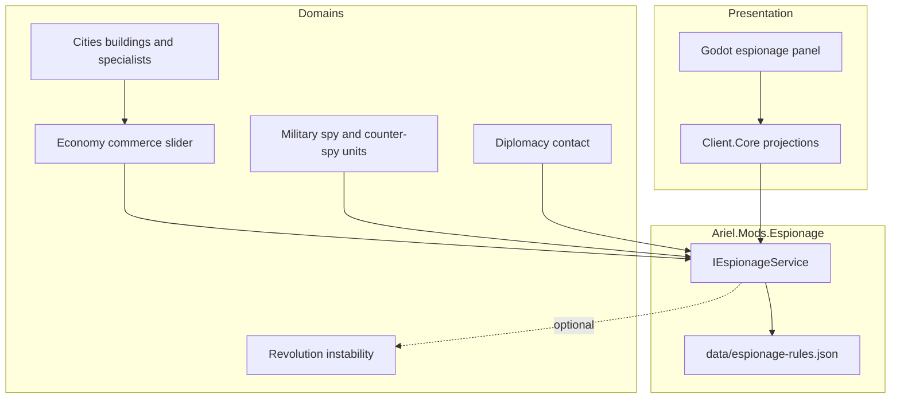

# Espionage Subsystem

The espionage subsystem models passive intelligence and covert operations against
rival civilizations. It is a separate mod. Cities, economy, military and diplomacy
supply the units, commerce and contacts that it uses.



## Rules content

All balance numbers live in `src/Mods/Espionage/data/espionage-rules.json`, typed by
`EspionageRulesDef`. `EspionageMod` implements `IPreparableMod` and validates the file
at load. Rebalancing needs no rebuild.

Groups of fields:

- Passive thresholds: `DemographicsThreshold`, `CityVisibilityThreshold`,
  `InspectResearchThreshold`, `InvestigateCityThreshold`.
- Mission costs: `StealTreasuryCost`, `SabotageProductionCost`, `InciteRevoltCost`,
  `FomentUnhappinessCost`, `CounterEspionageCost`, `StealTechCostPercent`.
- Mission effects: `StealTreasuryPercent`, `SabotagePercent`,
  `FomentUnhappinessTurns`, `FomentUnhappiness`, `InciteRevoltTurns`.
- Counter-espionage: `CounterEspionageTurns`, `CounterEspionagePercent`,
  `CounterEspionagePerInterception`.
- Success chance: `BaseSuccessPercent`, `DefenderSuccessPenalty`, `MaxDefenders`,
  `ProtectionSuccessPenalty`, `RatioSuccessDivisor`, `MinSuccessPercent`,
  `MaxSuccessPercent`.
- Allocation: `MaxWeight`.

Turn counts scale with the game speed's pace (`GameSpeedDef.scalingPercents.default`),
never with its research rate. `GamePace.Scale` is the only scaling helper.

## State

The mod registers three state components:

- `EspionageTeamState`: `Points`, lifetime `Spent`, and `CounterEspionage` records per
  rival team.
- `EspionagePlayerState`: target `Weights` and fractional `RemainderHundredths`.
- `EspionageCityState`: `UnhappyUntilTurn` and `RevoltUntilTurn`, both absolute turns.
  Zero means no active effect. The mod clears every field it sets.

A conquest resets the city state: the `CityCaptured` subscription replaces the
component with a fresh one so the previous owner's spy effects never reach the new
owner.

## Points and allocation

Espionage is the fourth commerce channel. `PlayerEconomy` produces espionage
hundredths; `EspionageService.Allocate` runs at `TurnPhase.Espionage + 1`.

1. Only met, living, non-barbarian rival teams receive points.
2. An unset weight is zero. Points stay in `RemainderHundredths` until the player
   assigns a weight, and `Held` reports them so the panel can show them.
3. Shares are proportional. The indivisible remainder goes to the largest fractional
   remainders, and ties go to the lower team id.
4. `Spending` is a forecast and never changes state.

`KnownRivals` is the single rival query. `PassiveStatus` returns all four passive tiers
for one rival from one investment calculation.

### Bilateral ratio

Passive thresholds and mission costs scale with each side's investment against the
other:

```text
Invested(team, target) = Spent[target] + Points[target]
RatioPercent = clamp(200 * (rival + 50) / (own + rival + 100), 50, 200)
```

- Investment against a third party does not change the ratio.
- A mission spends points and is **not** credited back to `Spent`. Running missions
  therefore lowers the attacker's own investment and makes the next mission more
  expensive.
- `CostModifier` multiplies the ratio by any active counter-espionage protection.

## Passive intelligence

Points unlock intelligence tiers without being spent:

| Effect | Rule field | Reveals |
| :--- | :--- | :--- |
| Demographics | `DemographicsThreshold` | Population, units, treasury |
| City visibility | `CityVisibilityThreshold` | Rival cities on the map |
| Inspect research | `InspectResearchThreshold` | Current research and queue |
| Investigate city | `InvestigateCityThreshold` | City yields and queues |

The threshold is the rule value scaled by `RatioPercent`. A rival that outspends the
player raises the threshold. Eliminating the rival revokes every tier.

The client projects only unlocked sections. Locked sections are null, never
zero-filled.

## Missions

A spy must stand in a rival city, have a movement point, and have enough points
against that team. `ValidateMission` checks all of it.

| Mission | Cost field | Effect |
| :--- | :--- | :--- |
| `StealTreasury` | `StealTreasuryCost` | Steal `StealTreasuryPercent` of the treasury |
| `SabotageProduction` | `SabotageProductionCost` | Destroy progress on the active order |
| `InciteRevolt` | `InciteRevoltCost` | Disorder for `InciteRevoltTurns` turns |
| `FomentUnhappiness` | `FomentUnhappinessCost` | Unhappiness for `FomentUnhappinessTurns` |
| `StealTech` | `StealTechCostPercent` of research cost | Award the technology |
| `CounterEspionage` | `CounterEspionageCost` | Raise the rival's costs and risk |

Details:

- `StealTech` requires a technology id. The command rejects a missing id before it is
  priced, and `MissionCost` throws rather than returns a fake price. The spy panel
  offers a picker built from `StealableTechnologies`: technologies the rival knows,
  the player does not, and the player could research.
- `InciteRevolt` is rejected when the city is already in revolt (`GovernmentStatus`
  disorder, occupation, anarchy, or an unfinished spy revolt). On success it sets
  `CityRuleState.Disorder` for a fixed number of turns and calls
  `IRevolutionService.Incite` when that mod is present, which raises the city's
  instability and starts unrest. A real rebellion follows through the normal
  Revolution rules if the city crosses the threshold.
- `SabotageProduction` destroys `SabotagePercent` of the progress on the first queue
  item, or of build and train progress when the queue is empty.
- Mission prices use `EspionageService.Percent`, the single documented truncation
  step, so multiplying and dividing in a different order cannot silently rebalance
  missions.

## Resolution

```text
chance = base
       - min(defenders, maxDefenders) * defenderPenalty
       + (100 - RatioPercent) / ratioDivisor
       - (protectionCostPercent - 100) * protectionSuccessPenalty / 100
chance = clamp(chance, minSuccessPercent, maxSuccessPercent)
```

- `defenders` counts units on the city plot with `UnitDef.CounterSpy == true` and more
  than zero hit points. Past `MaxDefenders` the penalty stops growing, so the cliff is
  explicit content rather than a hidden constant.
- Counter-espionage protection moves cost and risk together: a 250% cost multiplier
  also costs `protectionSuccessPenalty` percentage points of success.
- Health never changes a spy's odds. Spies die when attacked, so a wounded spy does
  not exist.
- On success the mission applies, and the spy retreats to the nearest owned city with
  no moves left. On failure the spy is removed and the points stay spent.
- One command prices the mission once. `ValidateMission` and `ExecuteMission` share
  `ValidateMissionCore`.

### Counter-espionage

Protection is directed: it belongs to the defending team against one rival team. It
lasts `CounterEspionageTurns` turns from the turn it is set, costs the flat
`CounterEspionageCost` (the same on every game speed), and multiplies the rival's
mission costs and passive thresholds by
`CounterEspionagePercent + CounterEspionagePerInterception * interception`. A repeat
mission against the same rival is rejected while protection is active. Expired records
are deleted at the next turn boundary.

## Integration

- Buildings and specialists (`src/Ariel.Rules/Cities`) add espionage commerce.
- Spy units (`src/Ariel.Rules/Military`) set `spy: true`. Counter-spy units set
  `counterSpy: true`.
- Revolution is optional. Without it, a spy revolt still causes disorder, but adds no
  instability.
- Economy is optional. Without `IEspionageService` the economy mod accumulates
  espionage itself.

## Client and presentation

- `GameSession.DescribeEspionage` returns one row per known rival plus the held points.
- `GameSession.DescribeRivalIntelligence` reads the settled budget snapshot. It does
  not recalculate city commerce.
- `GameSession.SpyActions` offers the one-click missions. `StealableTechs` and
  `StealTechnology` back the spy panel's technology picker.
- The espionage panel is `src/Ariel.Godot/GameUi.Espionage.cs`. Weight controls step by
  one and by ten.

## Notes

- The mission enum ordinals are saved command data. Append new missions; never reorder
  them. `EspionageMissionOrder.Display` sets button order independently.
- The `Warning` stability tier belongs to the Revolution mod.
