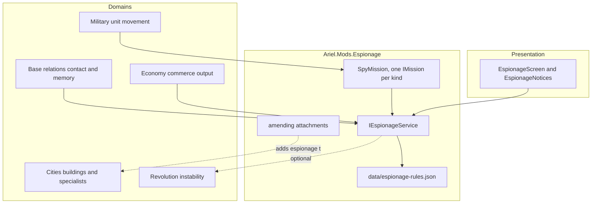

# Espionage Subsystem

The espionage subsystem models passive intelligence and covert operations against
rival civilizations. It is an optional feature mod, and the base game names no espionage:
the mod registers its own commerce type, adds its amounts to base rows through amending
attachments, and owns its process, its spy units and specialist, and its game options. The
base game's relations supply
contacts and remember a caught spy (`espionage:spy_caught`, a memory kind in the mod's
`data/memory-kind.json`).



## Rules content

All balance numbers live in `src/Mods/Espionage/data/espionage-rules.json`, typed by
`EspionageRulesDef`. `EspionageMod` implements `IPreparableMod` and validates the file
at load. Rebalancing needs no rebuild.

Groups of fields:

- Passive thresholds: `DemographicsThreshold`, `CityVisibilityThreshold`,
  `InspectResearchThreshold`, `InvestigateCityThreshold`.
- Mission costs: `StealTreasuryCost`, `SabotageProductionCost`, `InciteRevoltCost`,
  `FomentUnhappinessCost`, `CounterEspionageCost`, `StealTechCostPercent`.
- Mission effects: `StealTreasuryPercent`, `SabotagePercent`,
  `FomentUnhappinessTurns`, `FomentUnhappiness`, `InciteRevoltTurns`.
- Counter-espionage: `CounterEspionageTurns`, `CounterEspionagePercent`,
  `CounterEspionagePerInterception`.
- Success chance: `BaseSuccessPercent`, `DefenderSuccessPenalty`, `MaxDefenders`,
  `ProtectionSuccessPenalty`, `RatioSuccessDivisor`, `MinSuccessPercent`,
  `MaxSuccessPercent`.
- Allocation: `MaxWeight`.

Turn counts scale with the game speed's pace (`GameSpeedDef.scalingPercents.default`),
never with its research rate. `GamePace.Scale` is the only scaling helper.

## State

The mod registers two state components:

- `EspionageTeamState`: `Points` and lifetime `Spent`.
- `EspionagePlayerState`: target `Weights` and fractional `RemainderHundredths`.

What lasts a while is a timer in the base game's store (Timers in DESIGN.md), and the mod
registers three kinds: `espionage:counter_espionage` (held by the pair of defending and
rival team, the cost percentage in its value, replaced by a new one),
`espionage:foment_unhappiness` (the city's unhappiness modifier, replaced by a new one) and
`espionage:revolt` (the city's disorder; the kind sets the city's disorder flag when it
starts and clears it when it runs out, at the end of the last turn it applies, in the
owner's turn). A conquest or a secession ends a city's timers, so the previous owner's
spy effects never reach the new owner.

## Points and allocation

Espionage is a commerce type the mod registers (`espionage:commerce_espionage`, key
`espionage`, in `data/commerce.json`), so the slider, the city split and the ledgers carry it
while the mod is loaded. The economy does not bank it: `EspionageService.Allocate`, the mod's
turn system at `TurnPhase.CommerceSpending`, reads the player's output of the type
(`EspionageCommerce.Hundredths`, over `IPlayerEconomyService.CommerceHundredths`) and
divides it among rivals.

1. Only met, living, non-barbarian rival teams receive points.
2. An unset weight is zero. Points stay in `RemainderHundredths` until the player
   assigns a weight, and `Held` reports them so the panel can show them.
3. Shares are proportional. The indivisible remainder goes to the largest fractional
   remainders, and ties go to the lower team id.
4. `Spending` is a forecast and never changes state.

`KnownRivals` is the single rival query. `PassiveStatus` returns all four passive tiers
for one rival from one investment calculation.

### Bilateral ratio

Passive thresholds and mission costs scale with each side's investment against the
other:

```text
Invested(team, target) = Spent[target] + Points[target]
RatioPercent = clamp(200 * (rival + 50) / (own + rival + 100), 50, 200)
```

- Investment against a third party does not change the ratio.
- A mission spends points and is **not** credited back to `Spent`. Running missions
  therefore lowers the attacker's own investment and makes the next mission more
  expensive.
- `CostModifier` multiplies the ratio by any active counter-espionage protection.

## Passive intelligence

Points unlock intelligence tiers without being spent:

| Effect | Rule field | Reveals |
| :--- | :--- | :--- |
| Demographics | `DemographicsThreshold` | Population, units, treasury |
| City visibility | `CityVisibilityThreshold` | Rival cities on the map |
| Inspect research | `InspectResearchThreshold` | Current research and queue |
| Investigate city | `InvestigateCityThreshold` | City yields and queues |

The threshold is the rule value scaled by `RatioPercent`. A rival that outspends the
player raises the threshold. Eliminating the rival revokes every tier.

The client projects only unlocked sections. Locked sections are null, never
zero-filled.

## Missions

A spy must stand in a rival city, have a movement point, and have enough points
against that team. `ValidateMission` checks all of it.

| Mission | Cost field | Effect |
| :--- | :--- | :--- |
| `StealTreasury` | `StealTreasuryCost` | Steal `StealTreasuryPercent` of the treasury |
| `SabotageProduction` | `SabotageProductionCost` | Destroy progress on the active order |
| `InciteRevolt` | `InciteRevoltCost` | Disorder for `InciteRevoltTurns` turns |
| `FomentUnhappiness` | `FomentUnhappinessCost` | Unhappiness for `FomentUnhappinessTurns` |
| `StealTech` | `StealTechCostPercent` of research cost | Award the technology |
| `CounterEspionage` | `CounterEspionageCost` | Raise the rival's costs and risk |

Details:

- `StealTech` requires a technology id. The command rejects a missing id before it is
  priced, and `MissionCost` throws rather than returns a fake price. The spy panel
  offers a picker built from `StealableTechnologies`: technologies the rival knows,
  the player does not, and the player could research.
- `InciteRevolt` is rejected when the city is already in revolt (`GovernmentStatus`
  disorder, occupation, anarchy, or an unfinished spy revolt). On success it sets
  `CityRuleState.Disorder` for a fixed number of turns and calls
  `IRevolutionService.Incite` when that mod is present, which raises the city's
  instability and starts unrest. A real rebellion follows through the normal
  Revolution rules if the city crosses the threshold.
- `SabotageProduction` destroys `SabotagePercent` of the progress on the first queue
  item, or of build and train progress when the queue is empty.
- Mission prices use `EspionageService.Percent`, the single documented truncation
  step, so multiplying and dividing in a different order cannot silently rebalance
  missions.

## Resolution

```text
chance = base
       - min(defenders, maxDefenders) * defenderPenalty
       + (100 - RatioPercent) / ratioDivisor
       - (protectionCostPercent - 100) * protectionSuccessPenalty / 100
chance = clamp(chance, minSuccessPercent, maxSuccessPercent)
```

- `defenders` counts units on the city plot with `UnitEspionageDef.CounterSpy == true` and more
  than zero hit points. Past `MaxDefenders` the penalty stops growing, so the cliff is
  explicit content rather than a hidden constant.
- Counter-espionage protection moves cost and risk together: a 250% cost multiplier
  also costs `protectionSuccessPenalty` percentage points of success.
- Health never changes a spy's odds. Spies die when attacked, so a wounded spy does
  not exist.
- On success the mission applies, and the spy retreats to the nearest owned city with
  no moves left. On failure the spy is removed and the points stay spent.
- One command prices the mission once. `ValidateMission` and `ExecuteMission` share
  `ValidateMissionCore`.

### Counter-espionage

Protection is directed: it belongs to the defending team against one rival team. It
lasts `CounterEspionageTurns` turns from the turn it is set, costs the flat
`CounterEspionageCost` (the same on every game speed), and multiplies the rival's
mission costs and passive thresholds by
`CounterEspionagePercent + CounterEspionagePerInterception * interception`. A repeat
mission against the same rival is rejected while protection is active. The timer is
inert from its expiry turn and is dropped at the next turn boundary.

## Integration

- Base rows carry no espionage. The mod's amending attachments (`BuildingEspionageDef`,
  `CivicEspionageDef`, `TraitEspionageDef`, `SpecialistEspionageDef`, and rows for the
  Religion mod's Alhambra and the Corporations mod's headquarters, each loaded only with that
  mod) add the espionage amounts to the target rows when content freezes ("Content
  amendments" in DESIGN.md), so every reader of a building sees its espionage while the mod
  is loaded and none without it.
- The mod's own rows: the espionage process (`espionage:process_espionage`), the six spy
  units (`espionage:spy`, `espionage:agent`, `espionage:special_agent`, `espionage:007`,
  `espionage:hacker`, `espionage:nanite_spy`, in `data/unit.json`, with their icons and
  models in the mod's `art/`), the spy specialist (`espionage:specialist_spy`) and the
  Advanced Espionage and No Espionage game options (`espionage:gameoption_*`, which no
  rule reads yet). `data/unit-espionage.json` attaches a `UnitEspionageDef` row to each spy
  unit, with `spy: true` and `counterSpy: true`.
- Amendments also carry what the base rows said about those units and the specialist:
  buildings' spy slots and free spies, civics' spy specialist effects, the barbarians'
  ban on the nanite spy (`CivilizationEspionageDef`), each leader's attitude to a caught
  spy (`LeaderEspionageDef`), and, with the Great People mod, the great person the spy
  specialist's points produce (that mod's `SpecialistGreatPeopleDef`, registered only
  when it is loaded).
- The Religion mod owns every religious building, so the mod's rows about them (their
  espionage amounts, `BuildingEspionageDef`, and the state religion espionage of the
  Religion mod's own rows, `BuildingReligionEspionageDef`) live under `data/religion/` and
  load only with that mod.
- What stays in the base game names espionage only where the base reads it or a base row
  needs it: the great spy unit and specialist (base technologies, buildings and
  corporations name them as single references, which an amendment cannot add), the
  `unitcombat_spy` combat class and its promotions (base buildings grant them), the
  `unitai_spy` roles (the ambassador and envoy use them too), the AI's flavor key, and
  buildings, technologies and civics whose espionage is all in the mod's amendments.
- The mod's contracts, commands, state and events live in its published API
  (`Ariel.Mods.Espionage`, assembly `Ariel.Mods.Espionage.Api`).
- Revolution is optional. The mod incites a revolt through the Revolution mod's API when
  it is loaded; without it, a spy revolt still causes disorder, but adds no instability.
- Each mission is an `IMission` (`SpyMission`, one per `EspionageMissionKind`), run by the
  base `PerformMissionCommand`; the caught-spy memory is the mod's handler of its own
  `EspionageMissionResult` event.
- The computer player's espionage is the mod's own planner (`espionage:planner`, at
  `AiPlannerOrder.Military + 100`), and its `espionage:spies` production wish asks AI
  cities for spies. The base AI knows no espionage: it values the commerce type by its
  `AiPoints` like any other.

## Client and presentation

The client has no espionage code. The mod registers its presentation through the
presentation seams, and the client draws whatever they describe:

- `EspionageScreen` (`espionage:screen`, an `IGameScreen`) is the espionage advisor: every
  known rival with its points and weight, the intelligence the points unlock against the
  selected rival (locked sections are left out, never zero-filled), the budget
  (`EspionageCommerce.Hundredths`), and the selected spy's missions with the technology
  picker for a theft. Weight controls step by one and by ten. Its button is hidden when
  the service is absent.
- A spy's one-click missions also appear among the unit's orders, since each is an
  `IMission`.
- `EspionageNotices` (an `INotificationSource`) tells the player how their spies' missions
  went and about missions run in their cities.

## Notes

- The mission enum ordinals are saved command data. Append new missions; never reorder
  them. `EspionageMissionOrder.Display` sets button order independently.
- The `Warning` stability tier belongs to the Revolution mod.
