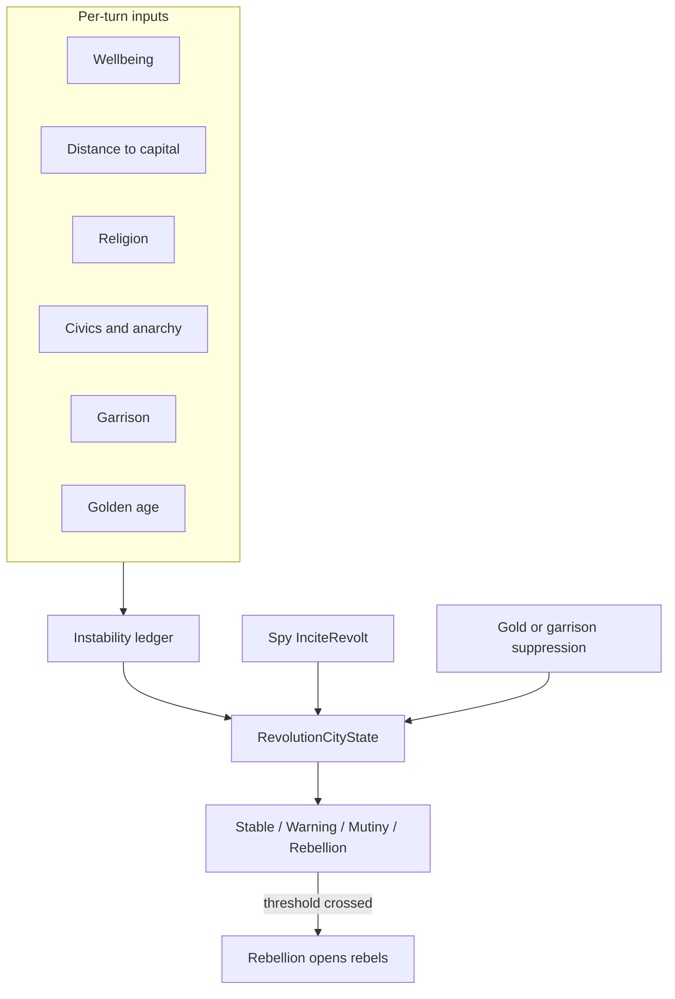

# Revolution Subsystem

The Revolution mod tracks city instability and turns it into rebellion. It is optional
and depends on Cities, Foundation, Government and Military.

## Rules content

`src/Mods/Revolution/data/revolution-rules.json` is typed by `RevolutionRulesDef`.
`RevolutionMod` implements `IPreparableMod` and validates it at load:

- Threshold ordering and positivity.
- Response values: release, cooldown, unrest, rebel count, suppression price and size.
- Factor signs: stabilizers are non-positive, irritants are non-negative.
- Content ids: rebel unit, rebel civilization, rebel leader, and every civic factor key.
  A rename fails at load instead of during a rebellion.

## Instability ledger

Each city has one integer `InstabilityIndex`. Every turn, `InstabilityLedger` rebuilds
the contributing lines and `Update` applies the total once per city per owner turn.

Line sources:

- `revolution:wellbeing`: unhappy minus happy, times `WellbeingFactor`.
- `revolution:distance`: hex distance to the capital, times `DistanceFactor`.
- `revolution:non_state_religion` and `revolution:state_religion`, with an intolerance
  multiplier from the player's civics.
- One line per civic, valued by `CivicFactors`.
- `revolution:anarchy` while the player is in anarchy.
- `revolution:garrison`: `UndefendedFactor` with no garrison, otherwise the garrison
  count capped at `MaxGarrison` times `GarrisonFactor`. A garrison is a land military
  unit with positive strength, alive and not an animal: air and naval units add
  nothing, a wounded unit calms as much as a healthy one, and the fifth garrison adds
  nothing. Undefended is worse than one garrison by more than one garrison's worth, on
  purpose.
- `revolution:golden_age` during a Golden Age.
- `revolution:recovery`, always applied.

Each line is scaled by the game speed's pace and rounded once, to the nearest point
away from zero, so the displayed lines add up to the displayed total. Turn counts use
`GamePace.Scale`, never the research rate.

## Tiers

`CityStabilityStatus` is computed from the index:

| Tier | Start | Effect |
| :--- | :--- | :--- |
| Stable | 0 | None |
| Warning | `WarningThreshold` | Display only: an early alert |
| Mutiny | `MutinyThreshold` | `MutinyUnhappiness` added to city happiness |
| Rebellion | `RebellionThreshold` | Rebellion opens at turn end |

Warning is deliberately display-only. The city screen colours every tier differently.
The top bar shows how many own cities are at or above Warning: `CitiesAtRisk` reads the
saved index only, so counting them costs no wellbeing ledger per city.

## Rebellion

`revolution:rebellions` runs at `TurnPhase.GameEnd`. A city rebels when its index is at
or above `RebellionThreshold` and its cooldown has passed.

- Rebels spawn on legal adjacent tiles: owned by the city owner or unowned, passable,
  outside a third party's borders, and empty. The tile order is shuffled with the
  seeded simulation RNG, so the spots are random per game but identical on replay.
- If no legal tile exists, the city does not rebel. No units spawn, no pressure is
  released and no cooldown starts. Enclosing a city is therefore not a way to vent
  instability cheaply.
- The first rebellion reuses an existing barbarian player. Otherwise it creates one
  rebel player and team, at war with everyone. A `CityRebellionTriggered` event carries
  the rebel player id, or -1 when no faction was needed.
- Pressure above the threshold is discarded: the index is clamped to the threshold and
  reduced by `RebellionRelease`, so a rebellion always leaves the city below the
  threshold.
- `RebellionCooldownUntilTurn` and `UnrestUntilTurn` use `GamePace.Scale`. Unrest adds
  `UnrestUnhappiness` to city happiness while it lasts.

## Suppression

`SuppressRebellionCommand` removes `SuppressionReduction` instability, or all of it when
the city has less. The player chooses the method:

- Gold costs `SuppressionGold * reduction / SuppressionReduction`, so suppressing a
  nearly calm city is cheap. The city screen shows the price.
- A garrison spends the remaining movement of one owned land military unit in the city.

There is no suppression cooldown. Validation is atomic: a rejected command changes no
state and draws no random numbers.

## Spy-incited revolt

The Espionage mod may call `IRevolutionService.Incite` on a rival city. It raises the
index by `InciteInstability` and starts unrest. It does not spawn units directly: a
real rebellion follows the normal rules if the index crosses the threshold. A city
already in disorder cannot be incited.

## State

`RevolutionCityState` holds `InstabilityIndex`, `LastUpdatedTurn`,
`RebellionCooldownUntilTurn` and `UnrestUntilTurn`. A conquest resets the component, so
the loser's instability never reaches the winner.

## AI

`StabilityPlanner` suppresses in AI cities every three turns: a qualifying garrison
first, then gold, in city id order. It stops when the treasury can no longer pay.
