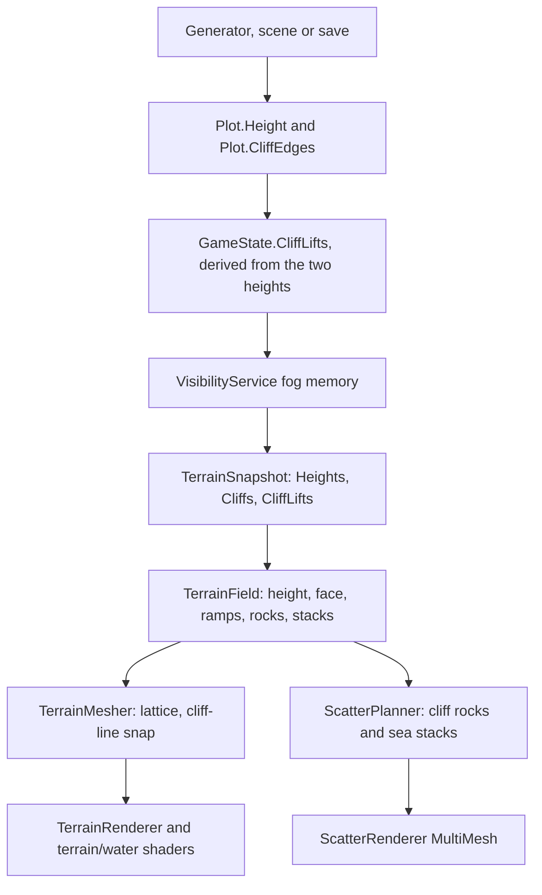

# Cliff rendering: state, rules, target look and capture workflow

This is a working brief for an agent changing how cliffs look. It is not a design
proposal: it records what the code does today, which rules a cliff must obey, what the
finished cliff should read as, and how to capture one so a change can be judged.

Read this before touching `TerrainField`, `TerrainMesher`, the terrain shaders or the
cliff rock scatter. The authoritative code is in the files named at the end; where this
document and an older document disagree, trust the code and the validator.

Five things to remember:

- A cliff is a mirrored edge bit plus two stored heights; the high side is derived,
  never stored.
- `mise run validate` is the state check. A legal scene can still look wrong; a renderer
  must not be used to hide an illegal cliff.
- A cliff edge is a step. The slope belongs to bare edges and to the ends of a run.
- The rock wall belongs in front of the face, from the foot to just above the crest.
- `--terrain-debug bands` is the purple height map; `lattice` is the white triangle
  grid.

Use it in this order: sections 1-4 are the contract (state, rules, pipeline, target
look); sections 5-6 are the capture recipe; sections 7-8 are diagnosis and the work
loop; sections 9-10 are reference and known traps.

## 1. Where a cliff lives

A cliff is an **edge**, not a tile or a height level. The simulation stores two things
and derives a third:

- `Plot.Height` (`sbyte`) is the tile's tier: deep water `-2`, coast/lake `-1`, flat
  land `0`, hills or a raised flat `1`, peak `2` (`Levels` in
  `src/Ariel.Core/Game/Plot.cs`).
- `Plot.CliffEdges` is a six-bit mask in `Hex.Directions` order. The bit is **mirrored**
  on both plots that share the edge.
- The raised side is **not stored**. `GameState.CliffLifts(tile)` derives it by
  comparing the two heights: bit `d` is set when this plot is higher than its neighbour
  across edge `d`.

`GameState.SetCliff(high, direction, present)` is the only writer. It sets the bit on
both sides, and when present raises the named side to
`min(low.Height + 1, Levels.Peak)`. It never lowers a height. Clearing an edge clears
both bits and leaves the heights alone, because another cliff on the same tile may still
justify the raise. Off-map edges never carry a cliff.

Direction order (`Hex.Directions`) is:

- `0` east, `1` northeast, `2` northwest, `3` west, `4` southwest, `5` southeast.
- Bit values are `1, 2, 4, 8, 16, 32`. For example mask `54` is northeast + northwest +
  southwest + southeast, the perimeter of a horizontal row of lifted tiles.

A word of warning about hand-written edge masks: a pointy-top odd-row grid changes which
neighbour a diagonal direction index names when a row is shifted by an odd number.
`SceneFrame.Fit` therefore always shifts a hand-made scene by an even number of rows.
Never author a scene by manually adding an odd row offset to a mask.

Fog memory (`RevealedPlotSnapshot`) carries `Height`, `CliffEdges` and a derived
`CliffLiftEdges` captured by `VisibilityService`. The live client snapshot
(`TerrainSnapshot`) carries `Heights`, `Cliffs` and `CliffLifts`. A renderer trusts a
cliff only when it knows both tiles. A land/land cliff whose lift is unknown stays bare,
because a rock wall with nothing behind it reads worse than no wall; a coastal cliff can
still be inferred when one side is land and the other water.



## 2. Which cliffs are legal

The rules live in `src/Mods/World/CliffRules.cs` and are reported by
`mise run validate`. The game does not repair or refuse a map; a map loads exactly as
written. The generator builds legal maps by construction, and the validator is how an
author finds a mistake.

### Edge rules

- The edge must have a neighbour on the map, and both plots must carry the bit.
- At least one side must be land. Two water plots can never carry a cliff.
- Water is never the high side.
- Land to land with no peak on either side: the heights must differ by exactly one tier.
  A flat raised to `1` counts as a hill for this test. Two hills, two raised flats, or a
  hill and a raised flat have no step and cannot carry a cliff.
- Land to land with a peak: the step may be one or two tiers, the peak must be the high
  side, and a peak is never the low side.
- Land to water: any land height against the water, with an explicit bit. Lakes are
  included. No step rule applies; a shoreline is not a terrace.
- Water to water: never.

### Height rules

- A plot's height must equal the height its ground implies: its terrain depth for water,
  and `Flat`, `Hills` or `Peak` for land. The one exception is a flat raised to `1` by a
  land cliff that drops from it to lower land. A shoreline cliff does not justify a
  raise.
- Under the rules, only a cliff raise writes a height, and the only raise is flat land
  to `1`; a peak stays at `2`, never `3`. Clearing a cliff leaves the height, so the
  validator may report a raise that no cliff supports any more.

### Spacing

Two separate terraces need room to read as separate features. The raised side of one
cliff must be at least **three hex steps** from the raised side of another (two
intermediate tiles along the shortest path). Touching raised tiles are one raised mass,
so a ridge, plateau or long bluff is allowed however long its rim runs. Two raised tiles
with one low tile between them are distance two and are rejected. The rule is about
land-to-land terraces; a land high side facing water is not compared this way.

`CliffRules.CliffSpacing` is the implementation. Its XML comment still mentions a
shared-low-tile exception; the code and the tests do not allow it, so trust the code.

### Slopes and enclosure

This is the part most likely to be mistaken for a rendering bug. It is a geometry rule.

A raised mass is a group of cliff-lifted land tiles connected through other lifted
tiles. Every raised mass must have at least one **uncliffed edge** to ramp out of, and
every uncliffed land-to-land step of that mass is a slope. A slope is one edge wide (0.5
world units either side of the edge midpoint) and runs `Lattice.CliffRamp` (1.6 world
units). That sweep must reach the ground below before it meets another cliff face or
another mass's slope. A mass walled in on every edge is illegal. Two slopes that meet in
the gap between two raised tiles are illegal.

The control applies to every land tile that is the high side of a cliff, including a
hill or peak that already stands high. It is not limited to flats that a cliff raised. A
peak is never raised above `2`, but a cliff on a hill or peak still forms a raised mass
for the enclosure and slope check.

### Walkability, beaches and access

- A cliff may not cut a land area in two. `Plot.AreaId` means "reachable on foot", and
  pathfinding, cities, barbarians and naval blockades rely on it.
- Every coastal land area keeps at least one open sea edge (a beach). An island of at
  most `CliffGenerator.SmallIslandTiles` (4) tiles keeps half of its sea edges open.
- A start or city tile keeps one open sea edge and, when every edge is walled, one open
  land edge. `EnsureAccess` runs when starts and cities are placed.
- The generator reconnects a severed area by opening the first cut edge, then drops
  terraces that stand too close. It then legalises slopes in bounded passes.

### Rivers

A river edge may also carry a cliff. `RiverMesher` turns the channel downhill over the
face and the water shader foams where it does. The generator keeps river mouths and sea
edge river endpoints open, and gives river edges a scoring bonus so some rivers pour
over a cliff as waterfalls.

### Gameplay reads

- `MilitaryData.CrossesCliff` reads the raw `CliffEdges` bit. Land units cannot board,
  land, attack or walk across a cliff; ships cannot enter or leave a land tile across
  one; the Amphibious promotion does not bypass it. `CanMoveAllTerrain` units and
  aircraft ignore cliffs. Ranged attacks and aircraft are unaffected.
- `VisibilityService.ElevationLevel` reads `Height`, not `PlotKind`: water and flat add
  0, hills and raised flats add +1, peaks add +2 to sight.
- `GlobalWarmingSystem` calls `CliffRules.AfterTerrainChange` after it changes a tile:
  water clears its cliffs, and the tile and its neighbours settle back to the height
  their ground implies.

## 3. How the current renderer turns state into a cliff

The engine-free part is `src/Ariel.Client.Core/Terrain`; the Godot part is
`src/Ariel.Godot/TerrainRenderer.cs`, the shaders and the scatter renderer.

- `TerrainField` is one pure height function of world `(x, z)` and a `TerrainSnapshot`.
  Every chunk mesh, normal, scatter point and ray pick samples it, so tile and chunk
  borders cannot crack.
- `TerrainMesher` samples a global triangle lattice. Default resolution is 9 steps per
  tile column; a chunk that contains a peak or a cliff is meshed at `PeakResolution`
  (27) so a cliff face and a sea-stack shoal are fine enough to read. Chunk edges agree
  exactly across resolution changes.
- `TerrainRenderer` builds one lit ground mesh, one water mesh and one river surface per
  chunk, with wrap copies. It uploads `UV.x = cliff share` on the ground and
  `UV2.y = CliffAt` on the water; the ground shader uses the cliff share to narrow the
  palette transition to the step so the raised top keeps its own ground.
- `TerrainChunks` decides which chunks are dirty. `CliffRingRadius` includes
  `CliffRamp`, and the dirty signature includes heights and cliff bits. A new global
  input to cliff height must be added to the ring and the signature, or chunks will keep
  stale geometry.
- `ScatterPlanner` adds the cliff rocks and sea stacks. Cliff rocks are marked `Exact`,
  so the deterministic thinning used for trees and other props never drops or thins
  them: a wall of columns with holes is worse than no wall.

### The height profile

The knobs are in `TerrainTuning` (`src/Ariel.Client.Core/Terrain/TerrainField.cs`) and
can be overridden for a capture with `--tuning Name=value,Name=value`.

- `CliffRise` (0.22) is the maximum lift of the raised side over the whole tile. A bluff
  stands this much above the ground below it; hills and peaks on the tile stand this
  much higher too. `BuildLiftScale` lowers the ends of a run below this maximum.
- `CliffRamp` (1.6, equal to `Lattice.CliffRamp`) is how far the ground beyond a raised
  tile climbs to the bluff on a **bare** edge. A ramp never crosses a cliff edge.
- `CliffSharpness` (45) sharpens the high/low blend across a cliff edge. It is high
  enough that the whole drop falls inside one lattice step of a cliff chunk.
- `CliffInner` / `CliffOuter` (0.16 / 0.42) are the distances over which the cliff shape
  is full and then faded out. They stay within half a tile of the edge.
- `CliffEndScale` (0.64, about 0.14 at the default rise), `CliffEndTaper` (2.5) and
  `CliffEndRamp` (2.4) control the ends of a run. A multi-tile run caps at about 0.14
  and climbs to full 0.22 over up to 2.5 tiles along the run; the adjacent tile's ground
  then eases from about 0.14 to 0 over 2.4 world units. A two-tile run is all cap (about
  0.14 on both tiles). A single isolated lifted tile is kept at full 0.22, and its bare
  adjacent ground ramps from 0.22 to 0 over `CliffRamp` (1.6).
- `CliffNoise` (0.06) and `CliffWander` (0.04) move the cliff line along and across the
  edge. `CliffWander` stays inside `CliffInner`, so a bluff still follows the straight
  hex side while the face is not machined from one edge.

The lift is split into two forms and combined with `max`, never summed:

- Along a cliff edge, the **sharp bluff share** puts the whole rise on the lifted tile
  and leaves the ground at the foot level. This is the step.
- Away from a cliff edge, the **ramp** from nearby bare edges carries the bluff down to
  the ground over `CliffRamp`. This is the slope. Each slope runs straight out from its
  edge, one edge wide. Past an end of the edge it fades sideways: widely where the next
  edge is bare, and over `RampFaceFade` (0.45), widening by `RampFaceSpread` (0.7) per
  unit outwards, where the next edge is a cliff face, so a run end eases into a grassy
  shoulder instead of spilling in front of the wall. The ramp applies wherever a bare
  edge is in reach, not only in corner sets that touch a cliff tile.
- Raised tiles of one run with different lift scales meet through a linear blend of
  their scales, so the top has no step between them.
- Overlapping lifts never add up to more than one `CliffRise`.

`BuildLiftScale` measures each run of lifted tiles from its caps (degree-one tiles) and
scales the rise from `CliffEndScale` at a cap to full height in the middle. A tile with
no lifted neighbour is kept at full scale, which is the one-tile exception.
`BuildBareEdges` collects, per tile, only edges of lifted tiles that carry no cliff bit.
`LiftRamp` reads those edges; a cliff edge is not in the list, so a ramp cannot climb
the wrong side of a wall.

### The drawn face

The mesh draws a cliff face as the height field's own drop: `CliffSharpness` puts the
whole drop inside one `PeakResolution` lattice step (about 0.064 world units), so the
face is a steep slope that wide. Mesh vertices stay on their lattice points. Pulling the
points either side of a face onto the cliff line would make it vertical, but it flips
the triangles that cross the line on a slant, and it takes the drawn ground off the
lattice that rivers drape over (`TerrainLattice`).

`TerrainField.DrawPoint` finds where the face stands: it moves a point within a given
radius of the chosen cliff line onto that line. Where two faces of one tile meet (an
outside corner of the bluff, or an inside corner wrapped round a low tile), `FilletAt`
rounds the corner with an arc of radius `CliffFillet` (0.6) tangent to both faces:
`CliffWeights` biases that tile so the height field steps on the arc, and `DrawPoint`
offsets the line by the same amount, so the drop and the rock wall follow it. Only a
face that ends (a run end) or a three-way junction still snaps to the corner point
itself. The rock walls use `DrawPoint`; the mesh does not.

A cliff face is drawn only when the ground actually steps. `LandEdgeRocks` probes the
drop across the face and yields no wall when it is less than half a `CliffRise`. An edge
that carries a bit but has no step draws nothing, and `mise run validate` reports it. Do
not add rocks there to make it visible; fix the state.

### The rock wall

`TerrainField.CliffRocks` walks the cliffs whose lifted tile lies near the requested
chunk. Only the lifted side draws the wall, so a land/land edge with the bit mirrored on
both plots still gets exactly one wall.

- Coastal cliff (`EdgeRocks`): 12 columns per edge. The wall follows the waterline
  outward from the edge; each column's foot is just under the water and its top is the
  bluff just inland. It also gets sea stacks (`SeaStacks`) and surf in the water shader.
- Inland cliff (`LandEdgeRocks`): 16 columns per edge. Each column asks `DrawPoint`
  where the face is, stands `FaceOut` (0.06) outside it at its foot, probes the ground
  on several rings (`WallProbe` = 0.12, 0.25, 0.4) for its foot, takes its top from the
  nearest inland ring that stands on the raised ground (so a hill behind the brink does
  not carry the wall up with it), and is buried 0.03 below the foot. A column whose drop
  is under 0.3 `CliffRise` (the shoulder at a run end) is skipped, so no loose boulders
  sit on the grass.
- `Column` solves the column scale from the height it must span: `CliffRockHeight` is
  0.16 world units at scale 1 and the stretch is only 0.8-1.1, so the models keep their
  own broad foot and narrow top and read as squat buttresses, not spikes. The top crests
  the bluff by a very small lip (0.005 inland, 0.015 coast). Each column then leans into
  the face (`MaxLean` 0.4 rad) so its top travels `FaceOut + LeanPast` towards it and
  rests against the brink; coastal columns lean 0.03 towards the land. The lean is the
  instance's `TiltX/TiltZ`, applied in `ScatterRenderer`.
- The models come from the `rocks` scatter set, the same rocks used at mountain feet.
  They are exact props.

`ScatterPlanner` also keeps ordinary props off a cliff face: a candidate is rejected
when `CliffAt(x, z) > 0.2` and the normal's `Y < 0.8`. Nothing should grow out of the
wall.

`CliffRocks` is called once per chunk and walks every tile before the distance filter.
That is fine at current map sizes, but it is the first place to look if cliff captures
become slow on a very large map. Do not add expensive per-column work without measuring
with `--stats` and `mise run benchmark`.

### Shaders

- `terrain.gdshader` blends the terrain textures, uses `cliff_share` to narrow the
  palette transition inside the step, and applies the cliff/rock palette layer to steep
  ground. The fallback `TerrainSurface.Cliff` colour is `0x8a8a90`. Its `cliff_face`
  function then finds the drawn wall itself (the triangle's geometric normal is near
  horizontal and the cliff share is up) and paints it as the rock columns' stone:
  `cliff_face_tint` darkens and cools the colour, and block noise and joints are laid
  out along the wall and up it, because the ground's top-down texture smears into
  streaks on a vertical quad.
- `water.gdshader` reads `UV2.y = CliffAt` and draws surf and foam at the foot of a
  coastal cliff.
- The `terrain_common.gdshaderinc` helper `blend_ground` is where the palette transition
  is actually narrowed. A change to cliff colour usually belongs there, not in the
  per-frame code.
- `TerrainRenderer` sets the material uniforms once and rebuilds only dirty chunks. Do
  not put per-frame cliff work into `_Process`; the frame loop is expected to be
  allocation-free when nothing changes.

## 4. The target look

This is the visual contract. The most important distinction is:

> **A cliff edge is a step, not a slope. The slope belongs to the bare edges of the same
> raised mass and to the ends of a run.**

A change that turns a cliff edge into a grassy ramp is wrong even if it looks softer. A
change that turns a bare edge into a vertical wall is also wrong.

`52f0efe` established this distinction. If the intended silhouette is a sloped cut
rather than a step, do not tune it in isolation: it changes the rule that a cliff is a
step, so agree the new contract with the owner before implementing it.

Read the target from the low side and the high side:

- **From the low side:** a short, near-vertical cut, and a wall of rock columns standing
  **in front of** the cut. The columns start at the foot (buried slightly, broad at the
  base) and lean back to rest against the crest. The face behind them is stone, not
  grass and not a smooth grey wedge with a fringe of rocks along its top. That fringe is
  the old defect fixed by `52f0efe`; do not reintroduce it.
- **From the high side:** continuous ground on top, a brink you can read, and the cut
  falling away. On the bare sides of the same raised mass the ground should slope gently
  down to the level below over `CliffRamp`. You should not see a tall picket fence of
  rocks blocking the top of the bluff.
- **At a run end:** a multi-tile run tapers from about 0.14 at the end tile to the full
  0.22 over up to `CliffEndTaper` (2.5) tiles along the run, shortened to the run's own
  half-length. The adjacent tile's bare ground then eases from about 0.14 to 0 over
  `CliffEndRamp` (2.4 world units), assuming flat land with no hill, peak or water. A
  two-tile run has no interior, so both tiles sit at about 0.14. A single isolated
  lifted tile does not drop to 0.14: it keeps the full 0.22, and its bare adjacent
  ground ramps from 0.22 to 0 over `CliffRamp` (1.6). If the tile has no bare edge at
  all (every side is a cliff or the map edge), there is no ramp and the face drops the
  full 0.22. The current `CliffEndRamp` is 2.4 world units, a little over one tile; if
  the taper must finish inside the adjacent tile, reduce it to the tile width (`sqrt(3)`
  is about 1.73).
- **At a corner where two cliff edges meet:** the two faces meet through a slight
  smoothing. There should be no razor arris, no broad rounded cove, no slanted gusset
  and no gap between the walls.
- **On a coast:** columns stand on the waterline, surf and foam break at their foot, and
  sea stacks stand off the foot where the rules place them. No column should float above
  the water or stand on dry flat ground.
- **On a peak cliff:** the mountain profile tapers down to the bluff before the drop. A
  sheared vertical mountain wall with the cliff rocks pasted on is wrong.
- **Colour:** the face reads as stone. The raised top keeps its own ground colour. The
  palette transition should not paint the low tile's grass across the face.
- **Props:** no tree, bush or ordinary rock grows on the face.
- **Rivers:** where a river crosses a cliff, the channel drops over the face and foams
  at the drop. The water surface should follow the step, not hover above it.
- **Density:** the wall is continuous enough to hide the face, but the crest should
  still read as separate blocks, not a smooth concrete wall. The face between them is
  painted as the same dark stone (`cliff_face` in `terrain.gdshader`), so a gap reads as
  shadowed rock, not as bare ground.

`docs/screenshots/mountain-cliff-ocean.png` is a useful reference for the coastal
relationship: mountains taper to a shoreline, rocks stand at the waterline, surf runs
between them. `docs/screenshots/cliffs-land.png` is the land reference, but it predates
`52f0efe`, so its bottom panel shows the old wall placement. Regenerate it before using
it to judge the current code.

At the time of writing, a close high-side capture of `cliffs-land` still reads as a row
of tall pillars that hides the top, while the low side is covered. Judge both sides: a
change that covers the face but turns the top into a fence is not finished.

## 5. Capturing a cliff

### Before you start

- Run `mise run help` first. Use the mise tasks; do not call `godot-mono`, `dotnet` or
  `tools/*.sh` directly when a task covers the job.
- Write temporary files to `/tmp/ariel`.
- Use `Xvfb`, not the Wayland desktop, so the client is not throttled and frame timing
  is real:

```sh
Xvfb :99 -screen 0 1600x900x24 -nolisten tcp &
DISPLAY=:99 mise run shot -- --stage world --clean --screenshot smoke --out-dir /tmp/ariel/smoke
pkill -f "Xvfb :99"
```

`mise run shot` builds the game and then runs `tools/shots/shot.sh`. Relative
`--scenario`, `--shots`, `--out-dir` and `--tuning-file` paths resolve against the
directory you ran the task from. If you call `godot-mono` directly, pass absolute paths.

### One capture

```sh
mise run shot -- \
  --scenario tools/shots/scenarios/cliffs-land.json \
  --world tiny --clean --frames 3 \
  --focus-tile 10,11 --yaw 0 --pitch 10 --distance 1.6 \
  --out-dir /tmp/ariel/cliff-shots --screenshot land-low
```

- `--focus-tile col,row` uses the coordinates written in the scene file. The scene is
  shifted into its own world, but the focus tool follows the authored coordinates.
- `--yaw 0` looks north. To look at a cliff from the low side, stand on the low tile and
  look north at the raised tile. To look from the high side, stand on the raised tile
  and use `--yaw 180`.
- `--pitch` is clamped to 5-89 and `--distance` to 1-120. A low pitch (8-20) reads the
  height; a near-vertical pitch (89) reads a plan.
- `--clean` removes the HUD, tooltips, hover, path preview, units, cities and labels.
  Cliff rocks are scatter, so they stay.
- `--frames 3` skips the usual 60-frame settling delay and makes iteration fast. If the
  terrain looks half-built, use `--frames 30`.
- `--world tiny` lays the scene over a generated tiny world. Omit `--world` for a map
  made only from the scene's bounding box plus two tiles of margin (minimum 8x6); that
  is better for isolating the cliff and avoiding generated cliffs in the background. The
  row shift is rounded up to an even number, so the top margin can be three rows.
- `--stats` writes `<name>.json` beside the PNG with props per set before and after
  thinning, triangles per layer, height min/max/mean per relief class, and FPS.

### Low side and high side in one launch

A pose file takes several shots from one launch. A missing camera field keeps the
previous shot's value, so a file can sweep one thing.

```json
[
  { "name": "land-low", "focusTile": [10, 11], "pitch": 10, "yaw": 0, "distance": 1.6 },
  { "name": "land-low-20", "pitch": 14, "distance": 2.2 },
  { "name": "land-high", "focusTile": [10, 10], "pitch": 10, "yaw": 180, "distance": 1.6 },
  { "name": "land-high-20", "pitch": 14, "distance": 2.2 }
]
```

```sh
mise run shot -- \
  --shots /tmp/ariel/cliff-poses.json \
  --scenario tools/shots/scenarios/cliffs-land.json --world tiny --clean --frames 3 \
  --out-dir /tmp/ariel/cliff-shots
```

Debug modes persist across shots. If one shot uses `terrainDebug`, set
`"terrainDebug": "normal"` on the next shot to go back.

### Authoring a small cliff scene

A scene is JSON. `fill` sets the whole map, `tiles` overrides individual tiles, and
`cliff` is `true` (all six edges), `false` (clear), or a mask on the named tile. The
named tile is the high side; `SetCliff` mirrors the edge and raises it one tier. An
entry clears every direction it does not name, so set a shared edge before the entry
that would clear it. `height` overrides the tier the terrain and relief imply.

This is a three-tile south-facing bluff: mask `48` is southwest + southeast, so the
south side is the face and the north side is bare ground.

```json
{
  "fill": { "terrain": "world:grass", "kind": "Flat", "owner": null },
  "tiles": [
    { "rect": [0, 0, 200, 200], "cliff": false },
    { "at": [8, 10], "cliff": 48 },
    { "at": [9, 10], "cliff": 48 },
    { "at": [10, 10], "cliff": 48 }
  ],
  "clearUnits": true,
  "focus": [9, 11]
}
```

A 200 × 200 rect clears the whole map but does not stretch it; the scene map is sized
from the authored points. `--focus-tile` uses the authored coordinates. Use the shipped
scenes when you can: their `// note` fields explain the masks and the intended camera.

### Looking around by hand

Drop `--screenshot`/`--shots` and add `--inspect` to start on the same scene and pose
with a live camera: WASD or arrows to pan, Q/E to turn, Z/X to tilt, the wheel to zoom.

```sh
mise run shot -- --inspect --stage world --clean \
  --scenario tools/shots/scenarios/cliffs-land-ramp.json \
  --focus-tile 10,10 --yaw 0 --pitch 20 --distance 6
```

The wheel cannot go closer than a distance of 6. A capture pose can reach 1, so set
`--distance` for close work.

## 6. The debug views

`--terrain-debug` takes a number or a name. These change the ground shader only; water,
cliff rocks, units and other props still draw normally. That is why a height-map capture
still shows the rock wall on top of the colours.

- `0 normal`: the normal lit scene.
- `1 weights`: the sharpened blend weights as RGB. Useful for seeing the corner-triangle
  blend, not for height.
- `2 hidden`: the hidden weight, for fog checks.
- `3` (number only; there is no name for it): the blended ground colour without lines or
  clouds. Useful for seeing what colour the face is taking.
- `4 relief`: white ground with lighting and relief only. This is the **white ground**
  view; use it to read the silhouette and whether the face is a step or a slope.
- `5 bands`: the **purple height map**. It colours by world height with contour lines
  every 0.05 world units: water and low ground read blue, raised ground (including a
  cliff top) reads violet/purple, and the highest ground moves toward red. Use
  `--pitch 89 --distance 6` for a plan view of one cliff. This is the view to check
  whether a raised mass and its ramps return to base level.
- `6 slope`: green flat to red steep. This is the quickest way to see whether a cliff
  edge is a step (red) or a grassy ramp (green).
- `7 lattice`: the **white triangle** view. White ground with black triangle lines. The
  shader draws a reference lattice at `lattice_steps = 9`; a cliff chunk is meshed at
  resolution 27, so the lines are three times coarser than the actual triangles. Use the
  view to see the lattice orientation and the face snap, not to count the mesh's real
  triangles. `--wireframe` is an alias for mode 7.
- `8 cavity`: blue valleys and red ridges. Useful for seeing how the wall meets the
  ground and whether the face has a dark band.

The debug mode is read only in unattended runs. A normal launch ignores it. In a pose
file, `terrainDebug` is the same name or number; `wireframe: true` is mode 7. Mode 3 has
no name in `DebugOptions.TerrainDebugNames`, so write `"terrainDebug": 3` rather than
`"colour"`.

Two captures worth making for every cliff change, from the same plan pose:

```sh
# Purple height map: mode 5, looking straight down.
mise run shot -- \
  --scenario tools/shots/scenarios/cliffs-land.json --clean --frames 3 \
  --focus-tile 10,11 --pitch 89 --distance 6 --terrain-debug bands \
  --out-dir /tmp/ariel/cliff-shots --screenshot land-height

# White lattice: mode 7, same pose.
mise run shot -- \
  --scenario tools/shots/scenarios/cliffs-land.json --clean --frames 3 \
  --focus-tile 10,11 --pitch 89 --distance 6 --terrain-debug lattice \
  --out-dir /tmp/ariel/cliff-shots --screenshot land-lattice
```

These are scene-only captures (no `--world`), so the background does not add generated
cliffs. If you need more context, add `--world tiny` and set `--distance` larger.

### Plan view without the client

`tools/shots/scenario_map.py` draws a scene as a top-down plan before you launch the
game. It draws cliff rock only where the state says a step is: the edge carries a bit
and the two tiles differ in height. It marks a raised flat with `H`, draws rivers as
blue hex borders, and reports a scene whose authored cliffs break the rules.

```sh
python3 tools/shots/scenario_map.py tools/shots/scenarios/cliffs-land.json \
  --world tiny --hex 40 --out /tmp/ariel/cliff-maps
```

This is the fastest way to check that a mask names the edges you think it does.

### Validate before you capture

```sh
mise run validate -- tools/shots/scenarios/cliffs-land.json --scene
```

Exit code 0 means the scene follows the height and cliff rules; exit code 1 prints one
line per violation, naming the tile and direction. Fix the state before blaming the
renderer. If a scene names no position, pass `--map` to say what map it sits on.

### Compare before and after

```sh
mise run shot:compare -- \
  /tmp/ariel/cliff-shots/before.png \
  /tmp/ariel/cliff-shots/after.png \
  /tmp/ariel/cliff-shots/diff.png
```

This writes a side-by-side plus difference image and prints the differing pixel count.
Use the same scene, seed and pose for both captures.

## 7. Diagnosing a bad cliff

Use the smallest scene that shows the problem. The shipped scenes are deliberately
specific:

- `tools/shots/scenarios/cliffs-land.json`: one row of six lifted tiles, cliffed on its
  perimeter only. This is the continuous-wall test. Its `// note` explains the mask.
- `tools/shots/scenarios/cliffs-land-ramp.json`: a row cliffed only on its south edges,
  so the south side is a sheer face and the north side climbs to it over the bare-edge
  ramp. This is the step-versus-slope test.
- `tools/shots/scenarios/cliffs-two-states.json`: a land-to-land run and a land-to-water
  run, so the inland wall and the coastal wall can be compared in one capture.
  `python3 tools/shots/cliffs-two-states.py --out /tmp/ariel/sheet.png` captures all its
  poses (ends, corners, both sides, height and slope plans) in one Xvfb launch; use
  `--only name,name` for a subset and `--tuning Name=value` for an A/B.
- `tools/shots/scenarios/cliff-river.json`: a river crossing a cliff, for the waterfall
  and foam path.
- `tools/shots/scenarios/water-adjacent-cliff-mountains.json` and `...-sea.json`:
  mountains beside water, for the taper-to-bluff and coastal relationship.

Match the symptom to the layer before changing code:

- **No wall at all.** Check the state first: `mise run validate`, then
  `scenario_map.py`. Then check that the tile is known (fog), that the lifted side is
  known (`CliffLifts`), and that the edge actually steps. `LandEdgeRocks` deliberately
  yields nothing when the drop is less than half a `CliffRise`. A missing wall on a flat
  edge is a state defect, not a rock-density defect.
- **Wall stands on top of the face, or behind it.** Check `DrawPoint`, `FaceOut` and
  `WallProbe` in `LandEdgeRocks`. Each pillar should find the drawn face itself, not the
  brink. The old bug placed the wall by bracketing the steepest step of a march across
  the edge; the current code asks the face directly.
- **The face is a smooth slope, not a step.** Check `CliffSharpness`, `CliffOuter`,
  and the chunk resolution. A cliff chunk must mesh at
  `PeakResolution`; if it falls back to 9, the drop is a chamfer. `TerrainChunks`
  decides this from the snapshot's relief and cliff bits.
- **The face is grass-coloured, or the low tile's ground paints across it.** Check
  `SurfaceAt`, `TerrainRenderer.PrepareGround` (`UV.x`) and `blend_ground` in
  `terrain_common.gdshaderinc`. The cliff share must be full across the band the colour
  needs and gone beyond it.
- **The wall floats, sinks, or is inside the ground.** Check the `foot` and `top`
  probes, `FaceOut`, `WallProbe` and `Column`. The foot is deliberately buried 0.03; the
  top is deliberately a little above the crest. A column based on one probe can land on
  the ground above a wandering face; that is why there are three probes.
- **The wall is too sparse, too dense, or reads as a fence.** `CliffRocksPerEdge` (12)
  and `LandRocksPerEdge` (16) are the counts; `ColumnStretch` and `ColumnStretchSpread`
  set how squat the columns are. Changing the count changes both coverage and cost.
  Check `--stats` and a close-up at distance 1.2-2.0.
- **A run ends abruptly, or a one-tile cliff is too low.** Check `CliffEndScale`,
  `CliffEndTaper`, `CliffEndRamp` and `BuildLiftScale`. A multi-tile run tapers from
  about 0.14 at an end to full height in the middle; a two-tile run has no middle and
  both tiles sit at about 0.14. A single isolated lifted tile is deliberately kept at
  the full 0.22, so do not force the 0.64 end scale onto it.
- **A corner is a razor arris or a broad rounded cove.** Check how `DrawPoint` handles
  the corner where two cliff edges meet, and `FilletAt` and `CliffFillet` for the arc.
  `CliffWeights` and `DrawPoint` must apply the same offset, or the drop and the rock
  wall part company at the corner.
- **A ramp climbs into another face, or two slopes meet.** This is a world rule, not a
  renderer setting. `Lattice.CliffRamp` is shared by `CliffRules.CliffRampRoom` and
  `TerrainTuning.CliffRamp`; changing the rendered ramp without changing the rule makes
  the picture disagree with `mise run validate`. Fix the scene or the generator, or
  change the shared constant and re-run the world-generation tests.
- **Coastal rocks are not at the waterline.** Check the waterline search in `EdgeRocks`
  and the `off` clamp. The search starts just inland and walks out until the height is
  below 0; the clamp keeps the wall one column thick along its own edge.
- **Surf is missing.** Check `CliffAt` and the `UV2.y` upload in
  `TerrainRenderer.PrepareWater`, then `cliff_surf` in `water.gdshader`.
- **Props grow on the face.** Check the `CliffAt > 0.2` and normal-`Y < 0.8` exclusion
  in `ScatterPlanner.Candidate`.

## 8. The work loop

1. Read this document and `mise run help`.
2. Pick the narrowest shipped scene, or author a small one. Run `mise run validate` on
   it. Do not start from a generated map when a six-tile scene can show the bug.
3. Capture the normal view from the low side and the high side. Add the debug view that
   isolates the layer you suspect: `relief` for silhouette, `bands` for height, `slope`
   for steepness, `lattice` for tessellation, mode `3` for the face's palette.
4. Make one change in one layer. Rebuild and recapture at the same pose. Use
   `shot:compare`.
5. If you changed geometry, run `mise run test` and, when the change touches generation,
   `mise run test:worldgen`. If you changed a rule, add or update the report test that
   fails when the rule is removed. Add a height-field test for the run-end profile (full
   interior, about 0.14 at an end, the one-tile exception) and a test that a corner
   fillet stays small; a screenshot is not a substitute for either.
6. If you changed a global input, update `TerrainChunks.CliffRingRadius` and the dirty
   signature. If you changed the cliff ramp, update `Lattice.CliffRamp` and re-run the
   world-generation tests.
7. Measure. `--stats` gives props and triangles; `mise run benchmark` gives wall-clock
   numbers. Cliff rocks are exact and can be numerous; do not add per-frame work to hide
   a geometry problem. Keep the 60 FPS frame loop allocation-free.
8. Commit with the `verbose-commits` skill. Do not put product names in code,
   identifiers, text or documentation.

### Definition of done

A cliff change is ready when all of these hold on a fresh capture:

- From the low side, rock covers the face from foot to crest; no continuous bare grey
  band, no grass on the face, no gap between wall and ground.
- From the high side, the top is continuous and the brink reads; the wall crests just
  above the top instead of forming a tall fence.
- A bare edge is a slope, not a wall; a cliff edge is a step, not a slope.
- Multi-tile run ends go from about 0.22 to about 0.14 at the end tile, then about 0.14
  to 0 on the adjacent ground; a two-tile run sits at about 0.14 on both tiles; a single
  isolated lifted tile stays at 0.22 and ramps to 0. Corners are slightly smoothed, not
  razor-sharp.
- Coastal cliffs stand on the waterline with surf and sea stacks; inland cliffs have the
  denser wall of leaning buttresses.
- `mise run validate` is clean on the scene, `mise run test` passes, and
  `mise run test:worldgen` passes when generation or the shared ramp changed.
- `--stats` shows no unexpected change in cliff-rock count, and the frame loop has no
  new per-frame allocation.

## 9. Reference

### Commands

- `mise run help`: list the supported tasks.
- `mise run shot -- <switches>`: build and capture.
- `mise run shot:compare -- before.png after.png out.png`: side-by-side and difference.
- `mise run validate -- <file> [--save|--scene] [--map id] [--size id]`: report cliff
  and height violations.
- `mise run test`: the default suite.
- `mise run test:worldgen`: world-generation tests; run when generation, the ramp or the
  rules change.
- `mise run benchmark`: operational benchmarks.
- The full switch list is in `src/Ariel.Godot/README.md` and the worked examples are in
  `tools/shots/README.md`.

### Files

- `src/Ariel.Core/Game/Plot.cs`: `Levels`, `Plot.Height`, `Plot.CliffEdges`,
  `RevealedPlotSnapshot`.
- `src/Ariel.Core/Game/GameState.cs`: `SetCliff`, `CliffLifts`.
- `src/Mods/World/CliffRules.cs`: every legal-edge rule, spacing, slopes, access, and
  the generator.
- `src/Mods/World/VisibilityService.cs`: fog capture of height, cliff bits and derived
  lifts.
- `src/Mods/World/GlobalWarmingSystem.cs`: the terrain-change path that clears cliffs.
- `src/Mods/Military/MilitaryData.cs` and `MovementService.cs`: cliff movement rules.
- `src/Ariel.Client.Core/DebugScenario.cs` and `SceneFrame.cs`: hand-made scene format
  and the even-row framing rule.
- `src/Ariel.Client.Core/Terrain/TerrainSnapshot.cs`: per-tile heights, cliffs and
  lifts.
- `src/Ariel.Client.Core/Terrain/TerrainField.cs`: the height function, cliff lift and
  ramp, `DrawPoint`, `SurfaceAt`, `CliffRocks`, `SeaStacks`, and the tuning values.
- `src/Ariel.Client.Core/Terrain/TerrainMesher.cs`: lattice, resolution and the cliff
  line snap.
- `src/Ariel.Client.Core/Terrain/TerrainChunks.cs`: chunk partition, dirty rings and
  per-chunk resolution.
- `src/Ariel.Client.Core/Terrain/ScatterPlanner.cs`: exact cliff rocks, sea stacks and
  the cliff-face prop exclusion.
- `src/Ariel.Godot/TerrainRenderer.cs`: chunk mesh upload, ground/water UVs, debug mode.
- `src/Ariel.Godot/shaders/terrain.gdshader`, `water.gdshader`,
  `terrain_common.gdshaderinc`: ground colour, surf and palette blending.
- `src/Ariel.Godot/Debug/DebugOptions.cs`, `DebugShots.cs`: capture switches and pose
  files.
- `tools/shots/README.md`: capture examples.
- `tools/shots/scenario_map.py`: plan-view renderer and rule checker.
- `tools/Ariel.Validate/Program.cs`: the standalone validator.
- `tests/Ariel.Mods.Tests/TerrainMathTests.cs`, `TerrainMeshTests.cs`,
  `CliffRulesTests.cs`, `CliffSlopeRulesTests.cs`, `SceneFrameTests.cs`: the tests that
  cover height, face, rocks, rules and scene framing.

### Tuning and constants worth knowing

- `CliffRise = 0.22`, `CliffRamp = 1.6`, `CliffSharpness = 45`, `CliffInner = 0.16`,
  `CliffOuter = 0.42`, `CliffEndScale = 0.64` (about 0.14 at the default rise),
  `CliffEndTaper = 2.5`, `CliffEndRamp = 2.4`, `CliffNoise = 0.06`,
  `CliffWander = 0.04`, `CliffFillet = 0.6`. A single isolated lifted tile keeps the
  full rise; the 0.64 end scale applies to the caps of a multi-tile run.
- `Lattice.CliffRamp = 1.6` is shared by the world rules and the renderer. A permanent
  change to the ramp means changing this constant, not just `--tuning CliffRamp`.
- `TerrainMesher.DefaultResolution = 9`, `PeakResolution = 27`.
- `TerrainField.CliffRocksPerEdge = 12`, `LandRocksPerEdge = 16`,
  `CliffRockHeight = 0.16`, `FaceSnap = 0.45`, `FaceOut = 0.06`, `LeanPast = 0.015`,
  `MaxLean = 0.4`, `WallProbe = 0.12, 0.25, 0.4`.
- `CliffRules.HighGap = 3`, `CliffRampRoom = Lattice.CliffRamp`,
  `CliffGenerator.TargetPercent = 20`, `TerracePercent = 8`, `SmallIslandTiles = 4`.

## 10. Known stale or misleading notes

- `docs/screenshots/cliffs-land.png` predates `52f0efe` and shows the old wall placement
  (rocks along the crest, bare grey face below). Regenerate it before using it as a
  reference.
- `CliffRules.CliffSpacing`'s XML comment still mentions a shared-low-tile exception.
  The code no longer allows two cliffs facing across one low tile; the tests are the
  source of truth.
- The terrain shader comments still use older names (`LedgeAt`, `CliffFaceAt`). The
  current methods are `CliffAt` and `SurfaceAt`.
- The `--terrain-debug lattice` view draws a fixed 9-step reference lattice, not the
  actual 27-step mesh used by cliff chunks. Do not judge triangle density from it.
- `--terrain-debug` changes only the ground shader. Cliff rocks, water, surf, units and
  other props still render in their normal materials.
