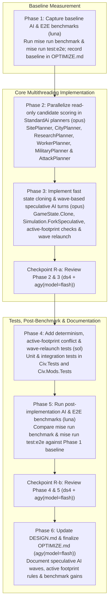

# AI Multithreading Plan: Parallel Planner Scoring & Speculative Parallel Turns

## Overview

This plan speeds up computer-player turns (`ai:standard` and `Simulation.RunAi()`) while preserving 100% deterministic simulation execution across runs, save/load, and lockstep peers:

1. **Before & after performance benchmarking (`luna` via `term-cli`)**:
   - Capture baseline wall-clock timings for both `mise run benchmark` (including the 8-player turn-100 AI decision benchmark) and the full E2E AI test suite (`mise run test:e2e`) before any code changes, and repeat the exact measurements after implementation.
   - Launch benchmark and E2E runs inside named `term-cli` sessions (`civ-bench-before` for Phase 1, `civ-bench-after` for Phase 5) while teeing output to `/tmp/civ-ai-bench-before.log` and `/tmp/civ-ai-bench-after.log`, so long-running E2E/benchmark processes survive if the sub-agent harness times out and can be polled or read on continuation.
2. **Parallel read-only candidate scoring within `StandardAi` planners (`opus`)**:
   - Parallelize independent read-only evaluations inside single-player AI planners (`SitePlanner`, `CityPlanner`, `ResearchPlanner`, `WorkerPlanner`, `MilitaryPlanner`, and `AttackPlanner`) against the unchanged `Simulation` state.
   - Materialize shared per-turn lazy lookups with `LazyThreadSafetyMode.ExecutionAndPublication` before parallel loops, collect scored candidates without mutating state or touching `Simulation.Rng`, and sort results deterministically by integer score and ordinal/entity IDs before issuing commands sequentially.
3. **Wave-based speculative parallel AI turns with active-footprint proximity checks (`opus`)**:
   - Add a fast in-memory `GameState.Clone()` / `Simulation.ForkSpeculative()` path that copies plots, entities, indexes, and `ExtensionState` without full-save JSON canonicalization or copying immutable `RevealedPlotSnapshot` records.
   - Use **deterministic speculative semantics** in `Simulation.RunAi()`: process uncommitted AI players in speculative waves. In each wave, the first remaining AI player ($p_0$) runs directly on the authoritative `Simulation` while subsequent eligible AI players ($p_1 \dots p_{m-1}$) plan concurrently on isolated forks of the wave-start state.
   - Validate each player $p_i$ in ascending `Player.Id` order using **active footprint proximity** rather than static border distance: stationary garrisons and unchanged border plots do not cause conflicts; a spatial conflict occurs only when a tile that an earlier player in the wave *actually changed or moved a unit across this turn* lies within the active footprint radius ($\le 5$ hexes) of tiles that $p_i$ actively moved across, targeted, or modified this turn (or when RNG, entity ID counters, war/diplomacy, or global wonders conflict).
   - **Wave relaunch on conflict**: if player $p_i$'s speculative plan is invalidated by an earlier player's commit, immediately start a new speculative wave for the remaining uncommitted players ($p_i, p_{i+1}, \dots, p_{m-1}$) from the current authoritative `Simulation` state—so while $p_i$ executes on the main simulation, $p_{i+1} \dots p_{m-1}$ re-speculate in parallel against the updated state.



## Usage of Subagents

- **Phase 1** and **Phase 5** (running benchmark suites, E2E timing runs, and recording timings) use the `luna` sub-agent, which must launch the benchmark and E2E commands inside the provided `term-cli` session (`civ-bench-before` in Phase 1, `civ-bench-after` in Phase 5) so the underlying process continues running even if the sub-agent times out.
- **Phase 2** and **Phase 3** (complex intra-planner concurrency, fast state cloning, active-footprint dependency tracking, and wave-based speculative turn execution) use the `opus` sub-agent.
- **Phase 4** (authoring unit and integration tests for parallel scoring, cloning, active-footprint conflicts, and wave relaunches) uses the `sol` sub-agent.
- **Phase 6** (documentation-only) uses the `agy(model=flash)` tool, not a sub-agent.
- **Checkpoints R-a and R-b** use `ds4` and the `agy(model=flash)` tool for dual adversarial reviews.
- All sub-agents must be launched in background mode with a concise session `title`.

## Parallelism

- Implementation and measurement phases (**Phase 1** through **Phase 6**) run sequentially because each phase depends on the baseline, code, or test artifacts of the previous phase.
- Within each review checkpoint (**R-a** and **R-b**), the `ds4` sub-agent and the `agy(model=flash)` review run in parallel and independently without seeing each other's findings.

## Periodic Updates

Sub-agents must update the **Encountered Serious Issues** sub-section of their assigned Phase for any non-trivial problems, determinism subtleties, or unexpected test interactions encountered during implementation.

## Commit Boundaries

Every Phase ends in a commit before its review checkpoint starts, and reviewers always work on a frozen commit hash. Commit messages must stand alone without referencing plan phase numbers or checkpoint IDs, and must never contain forbidden product names.

## Review Checkpoints

- **Phase 1** is a baseline measurement phase executed by `luna` and receives no review checkpoint.
- **Checkpoint R-a**: Dual adversarial review of **Phase 2** and **Phase 3** by `ds4` and `agy(model=flash)`.
- **Checkpoint R-b**: Dual adversarial review of **Phase 4** and **Phase 5** by `ds4` and `agy(model=flash)`.
- **Phase 6** is a documentation-only phase implemented with `agy(model=flash)` and receives no review checkpoint.

## Phase List

```
[x] 1.   (*luna*, session `f81b5ae2-65ca-470c-a604-f419f244ffd7`) Capture baseline performance benchmarks for `mise run benchmark` and `mise run test:e2e` — killed & skipped after `Civ.Benchmarks` exceeded 90 minutes of CPU time (`Fifty-city turn: 83120.65 ms`, 8-player 99-turn AI preparation exceeded 90 min CPU time)
[x] 2.   (*opus*, session `dc1bd838-7c20-46bb-a68e-6b028b3185df`, commit `b451d69`) Parallelize read-only candidate scoring within StandardAi planners
[x] 3.   (*opus*, session `75d7ce64-06b0-4f8b-88c3-25147d39037f`, commit `bee661e`) Implement fast state cloning and wave-based speculative parallel AI turns with active-footprint checks
[x] R-a. (*ds4*, session `03066bcf-ec1e-4d7c-a2d4-d82acd800dc6`) (`agy(model=flash)`, subagent `74cfafd1-fbd3-4872-8cb7-76e03e8aa7b6`) Checkpoint A: Review Phase 2 & 3 on frozen commit `bee661e` — CLOSED (0 DEMANDs)
[x] 4.   (*sol*, session `01a148ec-56d7-7200-a049-140665c9fc3f`, task title `Phase 4 implementer`) Add determinism, active-footprint conflict, and wave-relaunch unit and integration tests. Session path: `/home/gordon/.pi/agent/sessions/--home-gordon-workspace-civ-worktrees-fast-ai--/2026-10-17T08-13-30-712Z_01a148ec-56d7-7200-a049-140665c9fc3f.jsonl`. Parent: `47bc6e13-716e-41ae-a909-fc69edc9e568`, commit `17931ef`.
[x] 5.   (*luna*, session `1932a871-3cbf-4d4b-abb6-04a5a8d6e347`, commit `c67b88f`) Run post-implementation benchmarks (`mise run benchmark` and `mise run test:e2e`) and record speedup
[x] R-b. (*ds4*, session `f66bdd40-20fa-42d3-ab56-baf087e6eefc`) (`agy(model=flash)`, subagent `7951a9c0-d118-43f9-b440-3d97e97911ec`) Checkpoint B: Review Phase 4 & 5 on frozen `c67b88f` (Round 1) and `eadc4aa` (Round 2) — CLOSED (0 DEMANDs)
[x] 6.   (`agy(model=flash)`, subagent `90f36c41-30eb-404c-97d4-2be2ace48c3e`, commit `a1761ef`) Update DESIGN.md and finalize OPTIMIZE.md (no review)
```

---

## Phase 1: Capture baseline performance benchmarks for `mise run benchmark` and `mise run test:e2e`

> **Runtime note:** It is highly likely that `mise run test:e2e` will take more than 30 minutes. Run it in the persistent `term-cli` session and check the session or log after the sub-agent's wait period; do not assume it has failed or start a duplicate run because the sub-agent timed out.

### Goal

Measure and record the pre-change baseline wall-clock timings for `mise run benchmark` (specifically the 8-player turn-100 AI decision benchmark and 99-turn preparation) and `mise run test:e2e` (the 200-turn 4-AI development/combat test and 150-turn determinism test) in `docs/OPTIMIZE.md`.

### Target Sites & Planned Changes

1. `docs/OPTIMIZE.md`
   - Add an **AI multithreading** section recording the baseline commands, hardware/runtime context, and measured timings for:
     - `mise run benchmark` (single run, recording the 99-turn 8-player preparation time and turn-100 `RunAi()` decision time).
     - `mise run test:e2e` (single run, recording per-test and total wall-clock duration for `Four_computer_players_develop_and_fight_over_200_turns` and `Identical_games_and_a_midgame_save_have_equal_hashes_at_every_turn`).

### Pseudocode

```sh
# Launch inside persistent term-cli session "civ-bench-before" and tee to /tmp/civ-ai-bench-before.log:
term-cli start --session civ-bench-before --cwd /home/gordon/workspace/civ
term-cli run --session civ-bench-before "{ mise run benchmark; mise run test:e2e -- --logger 'console;verbosity=detailed'; } 2>&1 | tee /tmp/civ-ai-bench-before.log" --wait --timeout 600
term-cli capture --session civ-bench-before --scrollback 100
term-cli kill --session civ-bench-before
```

### Test Strategy

- Use the `term-cli` skill with session name `civ-bench-before` (and log file `/tmp/civ-ai-bench-before.log`) to run `mise run benchmark` and `mise run test:e2e` without modifying any production or test code. If the command exceeds a single wait window, poll with `term-cli wait --session civ-bench-before --timeout 600` and `term-cli capture --session civ-bench-before` (or read `/tmp/civ-ai-bench-before.log`), then clean up the session with `term-cli kill --session civ-bench-before`.
- Run `git diff --check` after recording the baseline numbers in `docs/OPTIMIZE.md`.

### Exit Criteria

- Baseline timings for both `mise run benchmark` and `mise run test:e2e` are recorded in `docs/OPTIMIZE.md`.
- All existing E2E tests pass in the baseline run, and there is no known regression.

### Encountered Serious Issues

- Baseline `mise run benchmark` spent `83120.65 ms` on `Fifty-city turn` and then exceeded 90 minutes of CPU time inside the 8-player 99-turn AI preparation without completing. Per user instruction, `civ-bench-before` was killed and Phase 1 was skipped to proceed directly to Phase 2.

---

## Phase 2: Parallelize read-only candidate scoring within StandardAi planners

### Goal

Parallelize CPU-heavy, read-only candidate evaluation loops inside `src/Mods/Ai/` (`SitePlanner`, `CityPlanner`, `ResearchPlanner`, `WorkerPlanner`, `MilitaryPlanner`, and `AttackPlanner`) so multi-tile, multi-city, multi-building, and multi-unit path queries run concurrently above small work thresholds while producing the exact same deterministic command sequence as single-threaded planner evaluation.

### Target Sites & Planned Changes

1. `src/Mods/Ai/AiContext.cs`
   - Configure `_enemyPlayers` and `_enemies` `Lazy<T>` instances with `LazyThreadSafetyMode.ExecutionAndPublication` so concurrent read-only planner threads can safely read `ctx.Enemies` and `ctx.ThreatAround(...)`.
2. `src/Mods/Ai/SitePlanner.cs`
   - Configure `_tileValue`, `_claimed`, and `_sites` with `LazyThreadSafetyMode.ExecutionAndPublication`.
   - In `BuildTileValues(AiContext ctx)`: when `plots.Length >= 256`, compute `PlotValue(ctx, plots[i])` across array indices using `Parallel.For`.
   - In `FindSites()`: materialize `var candidates = CandidateTiles().ToArray()` and force `_ = _tileValue.Value; _ = _claimed.Value;` before scoring. When `candidates.Length >= 8`, score candidates in parallel (`Parallel.For` into a preallocated `Site[]`), then filter `s.Score >= MinSiteScore` and order by `.OrderByDescending(s => s.Score).ThenBy(s => s.Tile.Value)`.
3. `src/Mods/Ai/CityPlanner.cs`
   - Configure `_options` with `LazyThreadSafetyMode.ExecutionAndPublication`.
   - In `Plan()`: when `ctx.Cities.Count >= 3`, build `CityView` snapshots in parallel into an array, preserving city order before `OrderByDescending(v => v.Population).ThenBy(v => v.City.Id)`.
   - In `Scored(CityView v)`: materialize `_ = Options;` and evaluate building eligibility (`ICityProductionService.Validate`) plus valuation (`Rate(b, v)`) in parallel when `Options.Buildings.Count >= 8`, collecting valid `(Kind, Id, Score)` tuples and sorting by `.OrderByDescending(o => o.Score).ThenBy(o => o.Id, StringComparer.Ordinal)`.
4. `src/Mods/Ai/ResearchPlanner.cs`
   - In `Plan()`: materialize unknown candidate techs from `ctx.Catalog.Techs`. When candidate count `>= 6`, evaluate `research.Validate(ctx.Sim, ctx.PlayerId, t.Id).Success` and `Score(research, t, owned)` in parallel, then select `.OrderByDescending(x => x.Score).ThenBy(x => x.Tech.Id, StringComparer.Ordinal).FirstOrDefault()`.
5. `src/Mods/Ai/WorkerPlanner.cs`
   - Make `AvailableBuilds(Unit worker)` safe for concurrent reads on the same worker unit type (pre-populate or synchronize `_builds` before parallel tile previewing).
   - In `ChooseJob(Unit worker)`: materialize the top 8 candidate tiles in priority order. Evaluate `BestBuildAt(worker, tile.Tile)` across those candidates in parallel into a `Job?[]`, then return the first non-null `Job` in the original candidate priority order.
6. `src/Mods/Ai/MilitaryPlanner.cs` and `src/Mods/Ai/AttackPlanner.cs`
   - In `MilitaryPlanner.Reinforce(CityView view)`: eliminate the duplicate `FindPath` call per soldier; evaluate `(Unit, Path)` for candidate soldiers (in parallel when candidate count `>= 4`), filter `Path is not null`, and order by `(view.Threat - sourceThreat) * 1000L - path.Cost` descending then `u.Id` ascending.
   - In `AttackPlanner.StagingTile` and `AttackPlanner.AssaultTile`: when evaluating candidate ring/neighbor tiles across a multi-unit `force`, evaluate reachability in parallel across candidate tiles while preserving the existing deterministic tile ordering and first-match selection.
7. `src/Mods/Ai/mod.json`
   - Increment `version`.

### Pseudocode

```csharp
// SitePlanner.FindSites:
private IReadOnlyList<Site> FindSites()
{
    var candidates = CandidateTiles().ToArray();
    if (candidates.Length == 0) return [];
    _ = _tileValue.Value;
    _ = _claimed.Value;
    var scored = new Site[candidates.Length];
    if (candidates.Length >= 8)
        Parallel.For(0, candidates.Length, i => scored[i] = Score(candidates[i]));
    else
        for (int i = 0; i < candidates.Length; i++) scored[i] = Score(candidates[i]);

    return scored.Where(s => s.Score >= MinSiteScore)
        .OrderByDescending(s => s.Score)
        .ThenBy(s => s.Tile.Value)
        .ToArray();
}
```

### Test Strategy

- Run `mise run test` to verify all default unit and integration tests pass.
- Run focused AI tests:
  `mise exec -- dotnet test tests/Civ.Mods.Tests --no-restore --filter "FullyQualifiedName~AiTests&Category!=E2E"`

### Exit Criteria

- All read-only candidate scoring loops in `SitePlanner`, `CityPlanner`, `ResearchPlanner`, `WorkerPlanner`, `MilitaryPlanner`, and `AttackPlanner` execute deterministically without mutating `Simulation` state or `Simulation.Rng` inside parallel callbacks.
- `mise run test` passes with zero failures, and there is no known regression from an earlier Phase.

### Encountered Serious Issues

- Five `Civ.Mods.Tests` failures already exist at the base commit `23db29c`, before any Phase 2 change. They come from city capture (`KeyNotFoundException` in `GameState.CityById` and similar): `AiTests.Strong_army_declares_war_and_captures_a_weak_neighbour`, `AiTests.Loaded_transport_delivers_an_overseas_assault(departureX: 7, captures: True)`, `CorporationRulesTests.Captured_headquarters_moves_the_mercantilism_boundary_to_the_new_owner`, `EventRulesTests.Empire_wide_effects_reach_every_city_the_player_owns_and_stop_at_capture`, and `EspionageRulesTests.Missions_apply_effects_and_return_spies_and_resume_identically(mission: InciteRevolt)`. Phase 2 does not change this set.
- A temporary 60-turn `GameFactory.CreateAi(seed: 5)` probe gave identical per-turn `ComputeHash()` values before and after the change. The probe was not committed. Wall time did not change (about 7 minutes in both runs, with user CPU close to wall time). Phase 3 must not assume that intra-planner parallelism alone gives a speedup.
- Shared lazy caches outside the AI mod are benign under concurrent reads: `HexGrid.MaximumDistance` and `GameState.Grid` use idempotent `??=`, and frozen content registries are read-only. `WorkerPlanner` resolves `AvailableBuilds` and `RoadTiles` before tile previews start, so the parallel callbacks never write to `_builds` or `_roads`.

---

## Phase 3: Implement fast state cloning and wave-based speculative parallel AI turns with active-footprint checks

### Goal

Enable multiple AI players to plan their turns concurrently in speculative waves inside `Simulation.RunAi()` using fast in-memory `Simulation` forks, committing plans in ascending `Player.Id` order under **deterministic speculative semantics** with **active footprint proximity** checks, and immediately relaunching a new speculative wave for all remaining uncommitted AI players whenever an earlier commit invalidates the next player's plan.

### Target Sites & Planned Changes

1. `src/Civ.Core/Game/CanonicalJson.cs` and `src/Civ.Core/Game/GameState.cs`
   - Add `ExtensionState.Clone()` on `ExtensionState` that deep-copies attached component instances using `JsonSerializer.SerializeToUtf8Bytes(component, component.GetType(), CanonicalJson.Options)` and `JsonSerializer.Deserialize(bytes, component.GetType(), CanonicalJson.Options)` without running whole-save canonical normalization.
   - Add `GameState.Clone()` on `GameState`:
     - Reuses `_grid` (`HexGrid` is immutable for a fixed `MapSpec`).
     - Copies `Plots` in memory (`Plot` fields, `BuildProgress`, `Culture`, `TeamMask.FromWords`, and shallow-copied `RevealedSnapshots` dictionary referencing immutable `RevealedPlotSnapshot` records).
     - Copies `Players`, `Teams`, `Cities`, `Units`, and `Extensions` (calling `ExtensionState.Clone()` only on entities that have non-empty `Extensions.Values`), and populates lookup indexes (`_players`, `_teams`, `_units`, `_cities`, `_cityPlots`, `_unitPlots`).
2. `src/Civ.Core/Game/Simulation.cs`
   - Add internal command recording on `Simulation` (`List<(GameCommand Command, (ulong, ulong, ulong, ulong) PreRng, (ulong, ulong, ulong, ulong) PostRng)>? _recordedCommands`) so `TryApply` records top-level applied commands and whether `Simulation.Rng` was advanced inside vs outside `GameCommand.Apply`.
   - Add `internal Simulation ForkSpeculative()` that constructs a `Simulation(Content, Settings, State.Clone(), DeterministicRng.Restore(a, b, c, d))` with command recording enabled.
   - Update `RunAi()` to delegate to `AiTurnSpeculator.Run(this)`.
3. `src/Civ.Core/Game/AiTurnSpeculator.cs` (new file)
   - Implement **wave-based speculative turn execution**:
     - Collect ordered uncommitted AI players `remaining = State.Players.OrderBy(p => p.Id).Where(p => p.Ai != null && !p.EndedTurn).ToArray()`.
     - Loop while `remaining.Length > 0`:
       - If `remaining.Length == 1`, execute `remaining[0]` sequentially on `sim`, mark `EndedTurn = true`, and return.
       - Capture `WaveBaseline` from `sim` before `remaining[0]` runs:
         - `StartRng = sim.Rng.State`, `StartNextCityId = sim.State.NextCityId`, `StartNextUnitId = sim.State.NextUnitId`.
         - Per-plot snapshot of shared gameplay fields (`Owner`, `Improvement`, `Route`, `Feature`, `Terrain`, `Kind`, `Bonus`, `DepletedMine`), per-player unit positions (`UnitId -> TileId`) and city positions/building sets, per-team `Wars`, and global `State.Extensions` digest.
       - For each `i` in `1 .. remaining.Length - 1`, check wave eligibility for `remaining[i]`:
         - Has at least one city or unit.
         - Does not share `TeamId` with any `remaining[j]` ($0 \le j < i$).
         - Is not currently at war (`Team.Wars`) with any `remaining[j]` ($0 \le j < i$).
         - If eligible, create `fork_i = sim.ForkSpeculative()` from the wave-start `sim`.
       - Execute the wave in parallel (`Parallel.For(0, remaining.Length, ...)`):
         - `i == 0`: run `remaining[0]` directly on `sim` and set `remaining[0].EndedTurn = true`.
         - `i >= 1`: run `Decide(fork_i, remaining[i].Id)` (and apply any returned commands on `fork_i`), then extract `SpeculativePlan`:
           - `RecordedCommands`, `UsedRng`, `UsedPlannerRngOutsideCommands`, `AllocatedCityId`, `AllocatedUnitId`, `ChangedWarsOrDiplomacy`, and `ActiveFootprintTiles` (the set of `TileId`s where `remaining[i]`'s units moved from/to or acted, tiles where `remaining[i]` founded/captured/razed a city or changed a plot's `Owner`/`Improvement`/`Route`/`Feature`/`BuildProgress`, plus tiles within radius 3 of any settler or explorer of `remaining[i]` that moved).
       - Compute the cumulative **Active Mutation Footprint** on `sim` starting from `remaining[0]`'s turn:
         - All `TileId`s where an earlier player in the wave moved a unit (start tile, end tile, or intermediate step), founded/captured/razed a city, or changed `Plot.Owner`, `Plot.Improvement`, `Plot.Route`, `Plot.Feature`, `Plot.Terrain`, `Plot.Kind`, `Plot.Bonus`, or `Plot.DepletedMine`.
         - Notice: stationary units (such as fortified border garrisons) and unchanged border plots are **not** in the active mutation footprint.
       - Iterate `i = 1 .. remaining.Length - 1` to commit or relaunch:
         - Check whether `plan_i` can commit on `sim`:
           1. `plan_i` was eligible and `!plan_i.UsedPlannerRngOutsideCommands` (or `sim.Rng.State == baseline.StartRng`).
           2. **No RNG collision**: `!(sim.Rng.State != baseline.StartRng && plan_i.UsedRng)`.
           3. **Historical allocation-only rule, superseded after R-b**: entity counter changes now invalidate all later plans. Membership, ownership, population, and power-input changes also invalidate them regardless of distance. The original allocation-specific condition was: `!(sim.State.NextCityId != baseline.StartNextCityId && plan_i.AllocatedCityId)` and `!(sim.State.NextUnitId != baseline.StartNextUnitId && plan_i.AllocatedUnitId)`.
           4. **No War / Diplomacy / Wonder collision**: no war matrix entry (`Team.Wars`) changed, no global `State.Extensions` component changed that conflicts with `plan_i`, and no world/team limited building was added by an earlier player in the wave.
           5. **Active Footprint Proximity**: no tile in the wave's cumulative **Active Mutation Footprint** on `sim` is within hex distance $\le 5$ (`ActiveFootprintRadius = 5`) of any tile in `plan_i.ActiveFootprintTiles`.
         - If `plan_i` passes all checks:
           - Replay `plan_i.RecordedCommands` onto `sim` via `TryApply` (if `plan_i.UsedPlannerRngOutsideCommands` and `sim.Rng.State == baseline.StartRng`, restore `fork_i.Rng.State`), mark `EndedTurn = true`, and merge `plan_i`'s active mutations into the wave's cumulative Active Mutation Footprint.
           - If any command unexpectedly fails `TryApply`, restore `sim` from a pre-commit clone and treat `i` as conflicted.
         - **If `plan_i` conflicts**:
           - Set `remaining = remaining[i..]` and immediately start the next iteration of the wave loop from the current authoritative `sim` state (so `remaining[i]` runs on `sim` while `remaining[i+1..]` re-speculate in parallel on fresh forks of `sim`).

### Pseudocode

```csharp
internal static class AiTurnSpeculator
{
    public const int ActiveFootprintRadius = 5;

    public static void Run(Simulation sim)
    {
        var remaining = sim.State.Players.OrderBy(p => p.Id)
            .Where(p => p.Ai is not null && !p.EndedTurn)
            .Select(p => p.Id)
            .ToArray();

        while (remaining.Length > 0)
        {
            if (remaining.Length == 1)
            {
                RunSequential(sim, remaining[0]);
                return;
            }

            var baseline = WaveBaseline.Capture(sim, remaining);
            var plans = new SpeculativePlan?[remaining.Length];
            for (int i = 1; i < remaining.Length; i++)
                if (baseline.CanSpeculate(sim, remaining, i))
                    plans[i] = new SpeculativePlan(remaining[i], sim.ForkSpeculative(), baseline);

            Parallel.For(0, remaining.Length, i =>
            {
                if (i == 0) RunSequential(sim, remaining[0]);
                else plans[i]?.Execute();
            });

            var mutations = baseline.CaptureActiveMutations(sim, remaining[0]);
            int relaunchFrom = -1;
            for (int i = 1; i < remaining.Length; i++)
            {
                if (plans[i] is { } plan && mutations.CanCommit(sim, baseline, plan) && plan.TryCommit(sim))
                {
                    mutations.Absorb(sim, plan);
                }
                else
                {
                    relaunchFrom = i;
                    break;
                }
            }

            if (relaunchFrom < 0) return;
            remaining = remaining[relaunchFrom..];
        }
    }
}
```

### Test Strategy

- Run `mise run test` to confirm all default unit and integration tests pass.
- Run focused core and AI tests:
  `mise exec -- dotnet test tests/Civ.Tests --no-restore`
  `mise exec -- dotnet test tests/Civ.Mods.Tests --no-restore --filter "FullyQualifiedName~AiTests&Category!=E2E"`

### Exit Criteria

- `GameState.Clone()` produces an independent deep copy whose `StateHasher.Hash` matches the source `GameState`.
- `Simulation.RunAi()` executes speculative waves in parallel, commits non-conflicting plans using active-footprint proximity, and relaunches a new parallel wave for remaining players whenever a conflict occurs.
- `mise run test` passes with zero failures, and there is no known regression from an earlier Phase.

### Encountered Serious Issues

- Speculation does not yet give a net speedup on this 8-core, 15 GB machine. A 100-turn, 8-player, standard-size equivalence probe (seed 9) gave 0 hash mismatches against strictly sequential turns, but `spec=78.2s` against `seq=56.9s`. Outcomes over 800 AI turns: 482 committed plans, 318 players run in place, 194 footprint conflicts, 15 global-state conflicts, 5 city-id conflicts and 4 RNG conflicts. On a saved turn-100 state, the first (cold) `RunAi` was faster with waves (about 1.5 s against 1.8 to 2.1 s), but warm repeats were slower (about 0.5 s against 0.4 to 0.5 s). The costs are the fork copy (`GameState.Clone()` takes about 18 ms on 4368 plots), the replay check, wasted work after a conflict, and allocation pressure under parallel planners. Server GC (`DOTNET_gcServer=1`) helps. Phase 5 must measure before it claims a gain.
- Commit is replay, not state merge. Each fork records its top-level commands with the RNG state before validation and after application. Commit replays them in player order on the authoritative simulation and checks that each command gives the same RNG state and the same per-player digest as on the fork. The RNG is restored between commands, so planner draws between commands are reproduced. If a replay differs, the state is restored from a copy taken before the first commit, the matched plans are replayed again, and a new wave starts at the failed player.
- A plan is rejected (in addition to active-footprint proximity) when an earlier player of the wave drew from the shared RNG, allocated a unit or city id, changed a war, changed global state, changed another player's or team's records, or changed buildings (wonder limits). Settlers and explorers get extra footprint reach because their choices depend on the land around them. Players with no cities or units act in place at their turn position.
- `RunAi()` resets the command depth to zero. Without this, AI commands issued from inside an end-turn command that advanced the turn counted as nested commands and were not recorded, so replays were empty.
- `CitizenPlanner` cost dominated the sequential baseline, so three read paths were made cheaper without changing results: a per-thread `CityReadScope` memo for building activity, power and grants inside one read-only city query; a lazy per-query `ResourceNetwork.Modes`; and `INavalBlockadeService.BlockadedTiles`, which resolves blockades once per query instead of once per plot. The memo is `[ThreadStatic]` and keyed by simulation, so forks on other threads never share it.
- `CityRecord` no longer compares worked tiles. A city can only work plots its owner controls, so citizen changes are never shared state, and comparing them produced false conflicts.
- Explorer detection uses the `:unitai_explore` suffix, because `DogfoodTests` forbids shipped mod ids in `Civ.Core`. Legacy `UnitDef` content falls back to `CanFoundCity`.
- `Civ.Core` now has `InternalsVisibleTo` for `Civ.Tests` and `Civ.Mods.Tests`, so Phase 4 can use `AiWaveLimit`, `SpeculationObserver` and `GameState.Clone()` directly.
- `mise run test` still has the same five pre-existing `Civ.Mods.Tests` city-capture failures that Phase 2 recorded. There are no new failures (`Civ.Tests` 107/107, `Civ.ContentImport.Tests` 37/37, `Civ.Mods.Tests` 722/727).

---

## Checkpoint R-a: Review Phase 2 & 3

Dual adversarial review of **Phase 2** (`b451d69`) and **Phase 3** (`bee661e`) on frozen commit `bee661e`:

- **Reviewer 1 (`agy(model=flash)`, subagent `74cfafd1-fbd3-4872-8cb7-76e03e8aa7b6`)**: **0 DEMANDs**, **5 ACCEPTs**, **1 NOTE**.
  - Verified index-preserving determinism and thread safety of intra-planner parallel candidate scoring (`ParallelScoring.Select`, `LazyThreadSafetyMode.ExecutionAndPublication`, pre-resolved `AvailableBuilds`/`RoadTiles`).
  - Verified in `/tmp/probe-ra-check` that `GameState.Clone()` matches `StateHasher.Hash` and isolates plot/player/city/team/extension mutations, and that 15 turns of 4-player full AI produce identical per-turn hashes under `AiWaveLimit = 1` vs `AiWaveLimit = int.MaxValue`.
  - **NOTE (R-a.1 — Nested ThreadPool oversubscription & speculation overhead)**: Running intra-planner `Parallel.For` inside outer wave `Parallel.For` tasks, plus `ExtensionState.Clone()` JSON roundtrips, conservative `NextUnitId` invalidation, and double execution on replay explain why `spec=78.2s` vs `seq=56.9s` on 8 cores.
- **Reviewer 2 (`ds4`, session `03066bcf-ec1e-4d7c-a2d4-d82acd800dc6`)**: **0 DEMANDs**, **6 ACCEPTs**, **7 NOTEs**.
  - Verified in `/tmp/civ-ra-probe` that speculative vs sequential (`AiWaveLimit = 1`) `ComputeHash()` values match every turn across seeds 5, 17 (4 players, 40 turns) and seed 9 (8 players, 50 turns), and cross-processor-count (`DOTNET_PROCESSOR_COUNT=1` vs `8`) hashes match on seeds 11 and 23.
  - **NOTE (R-a.2 — Pre-existing city-capture failures)**: 5 `Civ.Mods.Tests` city-capture failures reproduce identically at base `23db29c`.
  - **NOTE (R-a.3 — Stationary unit non-position state in conflict model)**: Stationary unit state changes without a command `Hex` or RNG draw (e.g., `SetUnitActivityCommand { Activity = Blockade }` or `FortifyTurns`) are not tracked in `WaveBaseline`/`PlayerTrace` unless they affect tile footprint or RNG; Phase 4 should test stationary unit activity/blockade parity or include unit state in `WaveBaseline`.
  - **NOTE (R-a.4 — Nested parallelism & SHA-256 digest cost in waves)**: Same nested `Parallel.For` + clone + digest observation as R-a.1.
  - **NOTE (R-a.5 — `CityReadScope` read-only invariant)**: Callers must not mutate state while a `CityReadScope` is active (verified all current callers are read-only).
  - **NOTE (R-a.6 — `Parallel.For` wraps exceptions in `AggregateException`)**: Fork/planner exceptions surface wrapped in `AggregateException`.
  - **NOTE (R-a.7 — `InternalsVisibleTo` scope)**: `Civ.Core` internals exposed to `Civ.Tests` and `Civ.Mods.Tests` for Phase 4 testing.
  - **NOTE (R-a.8 — `CommitLog.Restore` truncates `_turnEvents` only)**: Safe because `RunAi` never calls `BeginTurn`.

---

## Phase 4: Add determinism, active-footprint conflict, and wave-relaunch unit and integration tests

### Goal

Add focused unit and integration tests in `tests/Civ.Tests` and `tests/Civ.Mods.Tests` covering `GameState.Clone()`, intra-planner parallel scoring determinism, active-footprint proximity (verifying that stationary border garrisons do not trigger conflicts while nearby active unit moves/foundings do), and wave relaunch when a middle player conflicts.

### Target Sites & Planned Changes

1. `tests/Civ.Tests/SimulationTests.cs` (or a dedicated test file in `tests/Civ.Tests/`)
   - Add unit tests verifying:
     - `GameState.Clone()` preserves exact `ComputeHash()` equivalence while isolating subsequent plot, unit, city, team, player, and `ExtensionState` mutations.
     - **Active-footprint non-conflict**: two peaceful AI players with stationary units/cities within 3 hexes of a shared border both commit in a single wave without replanning when their active moves occur outside the 5-hex active footprint radius.
     - **Active-footprint conflict & wave relaunch**: in a 4-AI turn (`A, B, C, D`), when `A` mutates a plot / moves a unit within 5 hexes of `B`'s active footprint, `B` conflicts and triggers a wave relaunch for `[B, C, D]` against the post-`A` state, allowing `C` and `D` to re-speculate in parallel with `B` and commit cleanly.
2. `tests/Civ.Mods.Tests/AiTests.cs`
   - Add non-E2E `[Fact]` tests verifying:
     - **Deterministic repeatability & midgame save/load parity**: two multi-AI games with the same seed (plus a mid-run `SaveGame.Load(SaveGame.Save(...))`) produce identical `ComputeHash()` values at every turn across 20 turns.
     - **Contested settlement conflict handling**: when two peaceful AI settlers target the same founding site on the same turn, the second AI's speculative founding is invalidated by the first AI's active footprint / `NextCityId` change and replans cleanly without error.

### Pseudocode

```csharp
[Fact]
public void Peaceful_neighbors_with_stationary_border_garrisons_commit_speculatively_without_conflict()
{
    // Place stationary border cities/garrisons 3 hexes apart for Player 0 and Player 1,
    // while their active units act 10+ hexes away. Verify both commit in Wave 1.
}

[Fact]
public void Conflict_on_player_B_relaunches_speculative_wave_for_players_C_and_D()
{
    // Verify that when Player 0 invalidates Player 1, Wave 2 launches [1, 2, 3]
    // from the post-Player-0 state so Players 2 and 3 re-speculate while Player 1 runs.
}
```

### Test Strategy

- Run `mise run test` to execute the full default test suite.
- Run focused new tests in `tests/Civ.Tests` and `tests/Civ.Mods.Tests`.

### Exit Criteria

- All new unit and integration tests in `tests/Civ.Tests` and `tests/Civ.Mods.Tests` pass.
- `mise run test` passes with zero failures, and there is no known regression from an earlier Phase.

### Encountered Serious Issues

- Stationary unit changes were absent from the wave footprint. Fortify, Blockade, fortification progress, health, experience, movement points, and promotions produced sequential hash mismatches. The baseline now records each complete unit contract, including extensions. Completed traces include changed, created, and removed units at their old and new tiles. Command tracing still records intermediate movement. Unchanged garrisons remain outside the footprint.
- Historical Phase 4 change, explicitly reversed after R-b: the unconditional unit-counter guard rejected distant creation even when the later plan allocated no ID. Phase 4 removed the guard. That removal was unsafe for global reads and is now reversed by conservative entity-aggregate invalidation. The allocation-specific guard remains. Removing only the unconditional guard still caused a hash mismatch after direct unit creation in a temporary worktree. Complete unit snapshots are necessary for safe spatial validation.
- Candidate scoring started nested parallel tasks inside player waves. `Simulation.IsParallelAiTurn` now tells production scoring callers to run candidates serially inside a wave. Single-player turns retain candidate parallelism. A requirement evaluator attached to real building candidates detects the original nested tasks without timing assertions.
- The regression evidence used a temporary worktree at `/tmp/civ-p4-prefix`, based on starting commit `bee661e208b2f30023595e31a7f63747a9915ce8`. The reviewer removed that worktree. Only the logs persist. Baseline core tests: 12 failures and 5 passes. The nested-task regression also failed before the fix. Logs: `/tmp/civ-p4-prefix-core.log`, `/tmp/civ-p4-prefix-scoring.log`, and `/tmp/civ-p4-guard-only.log`.
- New tests protect clone hash equality and isolation, stationary-border independence, concurrent three-player relaunch, unit mutations, ID allocation, contested settlement, and 20-turn save/load parity. The concurrent relaunch test uses a three-party rendezvous rather than elapsed-time assertions.
- Final validation: new core tests 17/17, new mods tests 3/3, full core 124/124, and focused non-E2E AI tests 21/23. The focused failures are the two known city-capture failures. `mise run test` reports core 124/124, content import 37/37, and mods 725/730. The same five known city-capture failures remain. `git diff --check` passes. Final logs: `/tmp/civ-p4-core-full.log`, `/tmp/civ-p4-ai-full.log`, and `/tmp/civ-p4-default.log`.
- Unit snapshots add canonical serialization per unit at wave start and trace completion. No performance claim is made. Phase 5 still owns measurements. No benchmark, E2E test, or later review checkpoint ran in this task.
- Independent Phase 4 sanity reviews closed on frozen commit `17931ef7b056e571b97fb0ef179ed82bddb8ed0e` with zero required changes. These reviews do not replace scheduled checkpoint R-b. R-b remains after Phase 5.
- The `ds4` review task `subtask_pawn_1792225584527_c953a37d` independently reproduced all 20 new test passes and all 124 full-core test passes. Focused AI tests passed 21/23, with the two known capture failures. The reviewer also reproduced 12 pre-fix core failures and the pre-fix scoring failure. Speculative and sequential probes matched at every turn over 60 turns for seeds 5, 17, and 9. These probes included war and unit creation.
- The `agy(model=flash)` review conversation `fabc85ad-4d89-4fc7-bf03-8af62d94bf6e` independently reproduced all 20 new test passes.
- Historical risk assessment, superseded by the correction: `WarPlanner` reads global `Power` from turn 45 onward. Earlier probes did not reproduce the problem. New regressions confirm hash divergence after distant unit creation, removal, ownership/type/health changes, and city creation/removal/ownership/population changes. Spatial validation alone was insufficient.
- Correction task resumed in session `01a148ec-56d7-7200-a049-140665c9fc3f`, path `/home/gordon/.pi/agent/sessions/--home-gordon-workspace-civ-worktrees-fast-ai--/2026-10-17T08-13-30-712Z_01a148ec-56d7-7200-a049-140665c9fc3f.jsonl`. Global validation now compares entity records and counters without treating ordinary movement as a global conflict. All 11 new global-read regression cases failed with hash mismatches on frozen `c67b88f`. The revised nonallocating creation expectation also failed there. The allocation-specific case still passes. A separate 20-turn parity test starts at turn 44 and requires an actual declaration of war, proving target selection and the roll occur. This is parity coverage, not a bug regression.
- Correction source/tests/docs commit: `eadc4aa7c4d83f52569706cda954d2ae0571596e`. The plan remains outside the commit.
- Final correction validation: `mise run test` reports core 135/135, import 37/37, and mods 726/731. Only the same five known city-capture failures remain. Log: `/tmp/civ-correction-default.log`. `git diff --check` passes. No E2E or benchmark ran. Production changes add 16 lines and remove 1. Tests add 129 lines and remove 5. Documentation adds 32 lines. Lizard reports `Conflict` 6 to 8, with new aggregate methods at 1 and 3.
- Correction evidence: `/tmp/civ-correction-prefix.log` records 11 new hash-mismatch regressions plus the changed nonallocating-creation expectation failure on frozen `c67b88f`. The disposable `/tmp/civ-aggregate-prefix` worktree was removed after reproduction. Fixed focused core coverage passes 28/28, full core passes 135/135, and focused AI passes 22/24 with the two known capture failures. The new war-threshold parity test passes. Logs: `/tmp/civ-correction-focused.log`, `/tmp/civ-correction-war.log`, `/tmp/civ-correction-core.log`, and `/tmp/civ-correction-ai.log`.
- Nonblocking measurement note: the overhead of complete unit serialization remains unmeasured until Phase 5.
- Nonblocking coverage note: inspection shows that single-player scoring retains parallelism. No positive-control test demonstrates that parallelism.
- Nonblocking scheduler note: the three-party relaunch test has a 20-second timeout. Its scheduler must be able to start three participants.

---

## Phase 5: Run post-implementation benchmarks (`mise run benchmark` and `mise run test:e2e`) and record speedup

> **Runtime note:** It is highly likely that `mise run test:e2e` will take more than 30 minutes. Run it in the persistent `term-cli` session and check the session or log after the sub-agent's wait period; do not assume it has failed or start a duplicate run because the sub-agent timed out.

### Goal

Re-run `mise run benchmark` and `mise run test:e2e` on the completed implementation, verify that all E2E determinism and 200-turn AI gameplay assertions pass, and record the before/after performance comparison in `docs/OPTIMIZE.md`.

### Target Sites & Planned Changes

1. `docs/OPTIMIZE.md`
   - Record post-implementation measurements from a single run of `mise run benchmark` and `mise run test:e2e` alongside the Phase 1 baseline numbers, including percentage speedup for the 8-player turn-100 AI decision benchmark, 99-turn preparation, and the E2E test suite.

### Pseudocode

```sh
# Launch inside persistent term-cli session "civ-bench-after" and tee to /tmp/civ-ai-bench-after.log:
term-cli start --session civ-bench-after --cwd /home/gordon/workspace/civ
term-cli run --session civ-bench-after "{ mise run benchmark; mise run test:e2e -- --logger 'console;verbosity=detailed'; mise run test; } 2>&1 | tee /tmp/civ-ai-bench-after.log" --wait --timeout 600
term-cli capture --session civ-bench-after --scrollback 100
term-cli kill --session civ-bench-after
```

### Test Strategy

- Use the `term-cli` skill with session name `civ-bench-after` (and log file `/tmp/civ-ai-bench-after.log`) to run `mise run benchmark`, `mise run test:e2e`, and `mise run test`. If the sub-agent wait times out, poll or resume against `civ-bench-after` / `/tmp/civ-ai-bench-after.log`, then clean up with `term-cli kill --session civ-bench-after`.
- Run `git diff --check` after updating `docs/OPTIMIZE.md`.

### Exit Criteria

- The default and E2E suites introduce no new failures. The five known city-capture failures and the pre-existing turn-76 scout failure are deferred. Existing gameplay expectations remain unchanged.
- Before-and-after benchmark timings and E2E test durations are recorded in `docs/OPTIMIZE.md`, and there is no known regression from an earlier Phase.

### Encountered Serious Issues

- Independent evidence supplied after measurement confirms that the scout failure is wave-independent and pre-existing. Base `23db29c` failed after about 1 hour 15 minutes. `bee661e` with `AiWaveLimit = 1` also failed. `c67b88f` with `AiWaveLimit = 1` and `DOTNET_PROCESSOR_COUNT=1` failed after about 1 minute 41 seconds. Speculative `c67b88f` failed identically. Turns 26/51/76 had bit-for-bit identical states. Turn-76 cities were 5/5/5/1, technologies 28/24/25/26, units 11/11/12/6, with one war. An `onlyDefensive` scout reveals a hostile unit mid-command. `ExplorerPlanner` reaches `MovementService.MoveStep`, then `CombatService.ValidateCombat` rejects the attack. This defect remains deferred, separate from the five city-capture failures. The approximate 45× comparison is time to the same failure, not a successful E2E speedup or benchmark ratio. The correction task did not rerun these long reproductions.
- `mise run test:e2e` completed in 11.8656 minutes but failed one of four tests. `Four_computer_players_develop_and_fight_over_200_turns` failed at turn 76 after 1 minute 41 seconds with `InvalidOperationException: Unit cannot attack`, reached through `ExplorerPlanner` / `MilitaryPlanner` while speculative AI turns ran. `Identical_games_and_a_midgame_save_have_equal_hashes_at_every_turn` passed in 10 minutes 6 seconds. The run did not satisfy the original zero-failure E2E exit criterion. The revised criterion defers this known failure.
- Phase 1's 8-player preparation benchmark was terminated after exceeding 90 minutes of CPU time, and Phase 1 did not run E2E tests. The post-change 99-turn preparation completed in 231,096.19 ms, but the different/incomplete baseline does not support a reliable speedup ratio. No baseline turn-100 `RunAi()` measurement exists.

---

## Checkpoint R-b: Review Phase 4 & 5

Both independent correction reviews closed on frozen commit `eadc4aa7c4d83f52569706cda954d2ae0571596e` with **0 DEMANDs**. This is the source/tests/docs correction commit after Phase 5's `c67b88f`, not a new measurement commit.

- **ds4**, task `subtask_pawn_1792225584527_c953a37d`: independently confirmed that all 11 global-read regressions fail on `c67b88f`. On the correction commit, focused core tests passed 28/28 and full core tests passed 135/135. The war-threshold parity test passed on both versions. That test supplies parity coverage, not pre-fix bug evidence.
- **agy(model=flash)**, conversation `fabc85ad-4d89-4fc7-bf03-8af62d94bf6e`: independently ran 13 targeted core cases and the war-threshold case. All 14 cases passed on the correction commit.
- Both reviewers accepted the global invalidation invariant and the documented gameplay deferral. Both confirmed that the earlier stationary-unit and concurrency fixes still hold.
- These review outcomes use the supplied historical E2E evidence. Neither outcome constitutes a fresh E2E reproduction. The five pre-existing city-capture failures and the one wave-independent scout E2E failure remain deferred.

Nonblocking residuals:

- Aggregate JSON serialization/digest overhead remains unbenchmarked after the correction.
- The reproduction documentation lists internal `AiWaveLimit` configurations, but does not provide a standalone runnable harness.
- One unindented `Assert.Equal` at `tests/Civ.Tests/AiSpeculationTests.cs:195` is a formatting nit only. No source change accompanies this bookkeeping update.

Correction/bookkeeping session: `01a148ec-56d7-7200-a049-140665c9fc3f`. Session path: `/home/gordon/.pi/agent/sessions/--home-gordon-workspace-civ-worktrees-fast-ai--/2026-10-17T08-13-30-712Z_01a148ec-56d7-7200-a049-140665c9fc3f.jsonl`. Reviewer session-file paths are not known. The plan remains ignored and outside the correction commit.

Phase 6 remains pending. Closing this checkpoint does not complete the whole plan.

---

## Phase 6: Update DESIGN.md and finalize OPTIMIZE.md (no review)

### Goal

Document the intra-planner parallel read-only scoring architecture, fast `GameState.Clone()` / `Simulation.ForkSpeculative()` mechanics, active-footprint proximity conflict rules, and wave-based speculative `Simulation.RunAi()` execution in `docs/DESIGN.md`, and finalize the optimization log in `docs/OPTIMIZE.md`.

### Target Sites & Planned Changes

1. `docs/DESIGN.md`
   - Update the **Computer players** section to document:
     - Intra-planner parallel read-only candidate evaluation and deterministic tie-breaking.
     - Wave-based speculative parallel turn planning in `Simulation.RunAi()` via `ForkSpeculative()`, deterministic ascending player-ID commit order, active-footprint proximity conflict checks, and wave relaunch for remaining players on conflict.
2. `docs/OPTIMIZE.md`
   - Finalize the **AI multithreading** section with architectural notes, safety invariants, and the verified before/after benchmark summary.

### Test Strategy

- Run `git diff --check` and `mise run test` to confirm documentation edits introduce no formatting or build issues.

### Exit Criteria

- `docs/DESIGN.md` and `docs/OPTIMIZE.md` accurately describe the implemented AI parallelization and benchmark results.
- Neither document contains any forbidden product names.
- `mise run test` passes with zero failures, and there is no known regression from an earlier Phase.

### Encountered Serious Issues

_None yet._

---

## Review Protocol

**Verdicts.** Every finding gets exactly one:

- **ACCEPT** — the reviewer reproduced the claimed behavior (or the claimed absence of a
  defect) and confirms it. Nothing to record and no action needed.
- **NOTE** — the reviewer has something to record: a caveat, a nit, or an unreachable
  edge case. It does not require a change, and it is carried into the plan and the
  closing summary so it is not lost.
- **DEMAND** — a change is required before the checkpoint closes. A DEMAND must carry a
  minimal reproduction and an exact implementable scope.

**Review scope.** Every review states which areas and behaviors it examined, how it
examined them (for example, code inspection, tests, or probes), and what it did not
examine or run. Reviewers should assess whether the phase's relevant tests support its
claims, but they do not need to prove that a defect category is exhausted or enumerate
hypothetical untested cases. Report a coverage gap as a finding only when it creates a
specific concern; explain the scenario and its reachability. A DEMAND requires a minimal
reproduction and an exact implementable scope.

---

## Stopping Rule

- **Complete** when all six Phases are implemented, `mise run test` and `mise run test:e2e` pass, before/after benchmarks are recorded, both adversarial reviewers (`ds4` and `agy(model=flash)`) close Checkpoints R-a and R-b with zero unresolved DEMANDs, and any remaining NOTES are recorded with severity and reachability.
- **Not complete** if any reachable scenario causes `Simulation.RunAi()` to break deterministic save/load or lockstep hash parity, mutate shared state across threads unsafely, or fail to relaunch/replan when active footprints, RNG, entity IDs, or diplomacy conflict.
