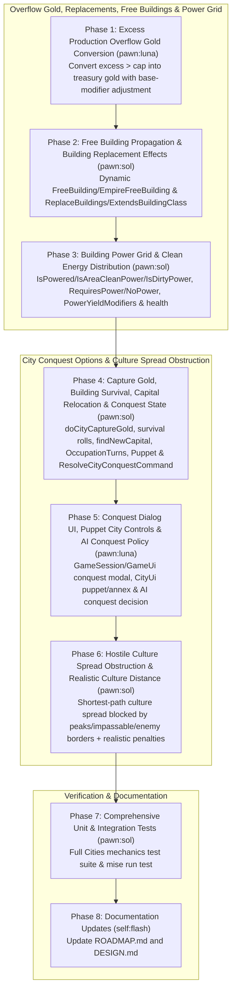

# Cities Completion Plan

## Overview

This plan completes the 6 remaining items in the **Cities** stanza of `docs/ROADMAP.md` (Section 4), aligned with the C++ DLL reference (`CvCity.cpp`, `CvPlayer.cpp`, `CvPlayerAI.cpp`, `CvGameUtils.py`) and the user-confirmed design choices:

- **Excess production gold conversion** (`CvCity::popOrder`, `CvCity.cpp:19517–19587, 19675–19681, 19790–19796`): Convert surplus production exceeding the overflow cap (`Math.Max(cost, currentTurnProduction)`) into treasury gold, scaled back from item-specific production modifiers to the city's base yield production modifier and multiplied by `MAXED_UNIT_GOLD_PERCENT`, `MAXED_BUILDING_GOLD_PERCENT`, or `MAXED_PROJECT_GOLD_PERCENT` (`100` in `rule-constants.json`).
- **Building replacement effects & free building propagation** (`CvCity::getNumBuilding`, `CvCity::getNumActiveBuilding`, `CvCity::canConstruct`, `CvPlayer::getFreeBuildingCount`, `CvCity.cpp:4433–4450, 8545–8653, 17795–17812`, `CvPlayer.cpp:10766–10817, 17884–18050`):
  - Compute free buildings dynamically for every city from active empire/team `BuildingDef.FreeBuilding` sources (respecting `BuildingDef.TeamShare`) and completed `WonderScriptDef.EmpireFreeBuilding` wonders, mapped through the city owner's `CivilizationDef.BuildingOverrides` (or original civilization under `foundation:gameoption_assimilation`), and include them in `CityData.EffectiveBuildings` / `CityData.Active` without mutating `city.Buildings`.
  - Keep replaced buildings (`BuildingDef.ReplaceBuildings`) in `city.Buildings` on completion instead of deleting them; dynamically suppress any building in `CityData.Active` when the city has an active building whose `ReplaceBuildings` includes the target building's `DefaultBuilding` (or ID), so replaced buildings automatically reactivate if the replacing building is destroyed or becomes obsolete; and enforce `ReplaceBuildings` and `ExtendsBuildingClass` in `ProductionEligibility`.
- **Building power grid** (`CvCity::isPower`, `CvCity::isAreaCleanPower`, `CvCity::isDirtyPower`, `CvCity::checkBuildings`, `CvCity::canConstruct`, `CvCity.cpp:4412–4429, 12886–13028, 25451–25465`):
  - Implement `CityPower` (`IsPowered`, `IsAreaCleanPower`, `IsDirtyPower`) from active local power plants (`ProducesPower` or `PowerBonus` with available connected resource) and same-area team `AreaCleanPower` wonders/buildings.
  - Gate `RequiresPower` buildings in both `ProductionEligibility` (cannot construct when `!IsPowered`) and `CityData.Active` (deactivated when `!IsPowered` without circular evaluation since power-producing buildings do not require power), and block `NoPower` buildings in `ProductionEligibility` when `IsAreaCleanPower` is true.
  - Apply `BuildingDef.PowerYieldModifiers` in `BuildingEffects.Local` when the city is powered, and apply `RuleConstants.PowerHealthChange` and `RuleConstants.DirtyPowerHealthChange` to the city's actual health ledger in `CityWellbeingService.Calculate` (as well as `EnvironmentalUnhealth`), plus AI valuation of power plants and power yield modifiers in `BuildingValuer`.
- **City conquest options, capture gold, building survival rolls & capital relocation** (`CvPlayer::acquireCity`, `CvPlayer::doCityCaptureGold`, `CvPlayer::findNewCapital`, `CvPlayerAI::AI_conquerCity`, `CvPlayer.cpp:3274–3830, 8819–8878`, `CvGameUtils.py:324–340`):
  - Track `TurnAcquired` and `HighestPopulation` on `CityRuleState`; award capture gold (`(BASE_CAPTURE_GOLD + oldPopulation * CAPTURE_GOLD_PER_POPULATION + Next(CAPTURE_GOLD_RAND1) + Next(CAPTURE_GOLD_RAND2)) * Clamp(turn - turnAcquired, 0, CAPTURE_GOLD_MAX_TURNS) / CAPTURE_GOLD_MAX_TURNS`) to the captor and emit it on `CityCaptured`.
  - Roll building survival on capture: strip `Capital` and `NeverCapture` buildings, remap non-world-wonder buildings to the captor's civilization override (unless `foundation:gameoption_assimilation` is enabled), check class limits and location eligibility, and keep buildings on team culture majority (`Recapture`) or `sim.Rng.Next(100) < b.CaptureSurvivalPercent`.
  - Relocate the previous owner's capital (`FindNewCapital`) when a city containing a `Capital` building is captured or razed and the previous owner still owns other cities without a `Capital` building.
  - Auto-raze size-1 cities that never grew (`HighestPopulation <= 1` and `LevelIndex <= 0`); otherwise compute post-capture `OccupationTurns` (disorder while `OccupationTurns > 0`, decaying each turn) when team culture is below `OCCUPATION_CULTURE_PERCENT_THRESHOLD` (`75%`), and place human captures into `PendingConquestChoice = true` (defaulting to `Puppet` until resolved via `ResolveCityConquestCommand` with `CityConquestOption.Annex`, `Puppet`, or `Raze`, or settled automatically at turn end; AI resolves immediately upon capture).
  - Implement **Puppet** city rules: puppet cities auto-assign citizens and auto-select production via the city governor/AI without allowing manual `SetCityProductionCommand`, `SetCityAssignmentsCommand`, `HurryCityCommand`, or `ConscriptCityCommand`; contribute 50% less city-count maintenance (`CityMaintenance.CityCount`) and 50% less city-count unhappiness (`CityWellbeingService.Calculate`); and can be annexed at any time via `ResolveCityConquestCommand(Annex)` or the city screen UI.
  - Expose conquest choice modal and puppet/occupation/annex controls in `GameSession` and Godot (`GameUi` / `CityUi`).
- **Hostile culture spread obstruction** (`CvCity::cultureDistance`, `CvCity::doPlotCultureTimes100`, `CvCity.cpp:8250–8453, 20127–20174`):
  - Replace raw hex distance in `CityCulture.Spread`, `CityCulture.Initialize` (extra culture levels), and `CityCulture.InRange` with a shortest-path cultural distance search from the city center up to `CultureRadius(sim, city)`:
    - Always block culture propagation across impassable tiles (`PlotKind.Peak`, `TerrainDef.Impassable`, `FeatureDef.Impassable`) and hostile territory (plots owned by a team at war with the city owner's team).
    - When `foundation:gameoption_realistic_culture_spread` is enabled, add terrain/feature `CultureDistance` penalties (`FeatureDef.CultureDistance` plus `TerrainDef.CultureDistance` unless `FeatureDef.IgnoreTerrainCulture` is true) and `+1` for river crossings along each step.



## Usage of Subagents

Every implementation phase and review checkpoint is delegated to a sub-agent. Simple implementation phases (**Phase 1** and **Phase 5**) use `pawn:luna`; complex implementation phases (**Phase 2**, **Phase 3**, **Phase 4**, **Phase 6**, and **Phase 7**) use `pawn:sol`; **Phase 8** (documentation-only) uses an Antigravity `self` subagent with `Model: "flash"` (`*self:flash*`). Adversarial review checkpoints use `pawn:ds4` and an Antigravity `self` subagent with `Model: "flash"` (`*self:flash*`). Sub-agents must always be launched in background mode with a concise `title` / `Role` matching the phase or checkpoint identifier.

## Parallelism

- Implementation phases run sequentially in phase order because later phases build on shared `Civ.Core` city contracts (`CityRuleState`, `CityContracts.cs`, `MilitaryContracts.cs`) and `src/Mods/Cities/` services (`CityData`, `CityProduction`, `CityCapture`, `CityWellbeing`, `BuildingEffects`).
- Within every review checkpoint (`R-a`, `R-b`, `R-c`, `R-d`), the two adversarial reviewers (`pawn:ds4` and `self:flash`) must run in parallel and independently without seeing each other's reports.

## Periodic Updates

Implementor sub-agents must update the **Encountered Serious Issues** sub-section of their assigned Phase whenever they encounter non-trivial problems, unexpected test contract interactions, or schema/contract constraints during implementation.

## Commit Boundaries

Every Phase ends in a standalone commit before its review checkpoint starts. Reviewers always inspect a frozen commit hash and must never run against an uncommitted working tree or edit tracked files. Commit messages must stand alone without referencing plan phase numbers or checkpoint IDs, and must never contain forbidden product names.

## Review Checkpoints

- **Checkpoint R-a**: Dual adversarial review of **Phase 1**, **Phase 2**, and **Phase 3** by `pawn:ds4` and `self` (`Model: "flash"`).
- **Checkpoint R-b**: Dual adversarial review of **Phase 4** and **Phase 5** by `pawn:ds4` and `self` (`Model: "flash"`).
- **Checkpoint R-c**: Dual adversarial review of **Phase 6** by `pawn:ds4` and `self` (`Model: "flash"`).
- **Checkpoint R-d**: Dual adversarial review of **Phase 7** (comprehensive unit and integration tests) by `pawn:ds4` and `self` (`Model: "flash"`).
- **Phase 8** is a documentation-only phase executed by `self` (`Model: "flash"`) and receives no review checkpoint.

## Phase List

```
[x] 1.   (*pawn:luna*) Implement excess production overflow gold conversion
[x] 2.   (*pawn:sol*)  Implement dynamic free building propagation and non-destructive building replacement effects
[x] 3.   (*pawn:sol*)  Implement building power grid, clean energy distribution, and unpowered deactivation
[x] R-a. (*pawn:ds4*) (*self:flash*) Checkpoint A: Review Phase 1, 2 & 3
[x] 4.   (*pawn:sol*)  Implement city capture gold, building survival rolls, capital relocation, occupation disorder, and puppet/annex/raze mechanics
[x] 5.   (*pawn:luna*) Implement client/Godot conquest choice dialog, puppet city screen controls, and AI conquest resolution
[x] R-b. (*pawn:ds4*) (*self:flash*) Checkpoint B: Review Phase 4 & 5
[x] 6.   (*pawn:sol*)  Implement hostile culture spread obstruction and path-based realistic culture distance
[x] R-c. (*pawn:ds4*) (*self:flash*) Checkpoint C: Review Phase 6
[x] 7.   (*pawn:sol*)  Add comprehensive unit and integration tests for all Cities mechanics
[x] R-d. (*pawn:ds4*) (*self:flash*) Checkpoint D: Review Phase 7
[x] 8.   (*self:flash*) Update ROADMAP.md and DESIGN.md (no review)
```

---

## Execution Log

- Phase 1: committed `d6606d4450b81b192e0a15eb939a0b785636d90f`; model `openai-codex/gpt-6-luna`; session `~/.pi/agent/sessions/cities-phase1.jsonl`. Implementer reports 20 targeted `CityRulesTests` passed and baseline worktree failures confirmed; independent review pending at R-a.
- Phase 2: committed `5b4485c`; model `openai-codex/gpt-6.1-sol`; session `~/.pi/agent/sessions/cities-phase2.jsonl`. Implementer reports 73 targeted tests (`CityRulesTests`, `ScriptedWonderTests`) passed and 7 baseline worktree failures confirmed; independent review pending at R-a.
- Phase 3: committed `81d5c1019dc9cd7c22122532e044439c008b643c`; model `openai-codex/gpt-6.1-sol`; session `~/.pi/agent/sessions/cities-phase3.jsonl`. Implementer reports 172 targeted tests passed and 15 baseline worktree failures confirmed; independent review pending at R-a.
- Checkpoint R-a: reviewed `d6606d4450b81b192e0a15eb939a0b785636d90f..81d5c1019dc9cd7c22122532e044439c008b643c` in parallel via `pawn:ds4` (`~/.pi/agent/sessions/cities-review-ra-ds4.jsonl`) and `self:flash` (conversation `0310906d-6247-45c3-8800-b2ec980c7735`). Resolved 2 DEMANDs in fix commit `f83c07b4793d21154e2a6bf84ca932e62740f78c` (`CityProduction.Complete` CCN 11 -> 9 via `ConvertExcessOverflow`; added scaled failed-order refund test). Both reviewers re-verified `f83c07b4793d21154e2a6bf84ca932e62740f78c` with 0 DEMANDs (186 targeted tests passed).
- Phase 4: committed `7c1f42a532463afc54f6f9488826977ad17cb7fa`; model `openai-codex/gpt-6.1-sol`; session `~/.pi/agent/sessions/cities-phase4.jsonl`. Implementer reports 143 targeted tests (`CityRulesTests`, `MilitaryRulesTests`) passed and 43 baseline worktree failures confirmed; independent review pending at R-b.
- Phase 5: committed `7c7e82881f290177dc3ca58c5db764a98ae2619d`; model `openai-codex/gpt-6-luna`; session `~/.pi/agent/sessions/cities-phase5-finalize.jsonl`. Solution build (`dotnet build Civ.slnx --no-restore`) and lizard CCN <= 10 verified (tests skipped per user instruction); independent review pending at R-b.
- Checkpoint R-b: reviewed `f83c07b4793d21154e2a6bf84ca932e62740f78c..7c7e82881f290177dc3ca58c5db764a98ae2619d` in parallel via `pawn:ds4` (`~/.pi/agent/sessions/cities-review-rb-ds4.jsonl`) and `self:flash` (conversation `df469ef8-96ca-4918-a15e-60a0129cdf15`). Resolved `world:bonusclass_rush` raze protection in `c6362afac695ec147c502eb2dbca7e2eeb5a773f` and `CityPlanner.NeedsChoice` CCN (12 -> 10) in `6f0da6ce5f1adb0ca5bebc21637cb1bad7396c77`. Both reviewers re-verified `6f0da6ce5f1adb0ca5bebc21637cb1bad7396c77` with 0 DEMANDs.
- Phase 6: committed `5b912feb5082ab828fa7031e652411d2997ea640`; model `openai-codex/gpt-6.1-sol`; session `~/.pi/agent/sessions/cities-phase6.jsonl`. Solution build and lizard CCN <= 10 verified (tests skipped per user instruction); independent review pending at R-c.
- Checkpoint R-c: reviewed `5b912feb5082ab828fa7031e652411d2997ea640` in parallel via `pawn:ds4` (`~/.pi/agent/sessions/cities-review-rc-ds4.jsonl`) and `self:flash` (conversation `87f116fd-17ab-4b92-b1d4-8d644ea4fdee`). Resolved ring-1 founding/reachability under realistic culture spread in `c1ed93d7e070ec6408a0ef2f1f1389a503b60c4e` and `extraLevels` level-index expectation in `94ae28dd02cf8847052e99738491ed8c1b4d88e0`. Both reviewers re-verified `94ae28dd02cf8847052e99738491ed8c1b4d88e0` with 0 DEMANDs.
- Phase 7: committed `38b63e12fecbbdacfa5abad0405e3ef1beba3ba0`; model `openai-codex/gpt-6.1-sol`; session `~/.pi/agent/sessions/cities-phase7.jsonl`. Solution + Godot build and lizard CCN <= 10 verified (tests skipped per user instruction); independent review pending at R-d.
- Checkpoint R-d: reviewed `38b63e12fecbbdacfa5abad0405e3ef1beba3ba0` in parallel via `pawn:ds4` (`~/.pi/agent/sessions/cities-review-rd-ds4.jsonl`) and `self:flash` (conversation `498049a6-b222-4035-a480-bb801592395d`). Both reviewers reported 0 DEMANDs.
- Phase 8: committed `8dceaa99f2b4ee91a56d88b7a43855d6f2ef16da`; model `self:flash` (conversation `ff7b7a30-2150-4662-aebf-fe9e2cfe468c`). Updated `docs/ROADMAP.md` and `docs/DESIGN.md` (no review checkpoint).

---

## Phase 1: Implement excess production overflow gold conversion

### Goal

Convert surplus production above the overflow cap (`Math.Max(state.PendingCost, state.PendingProduction)`) into treasury gold when a city completes a unit, building, or project in `CityProduction.Complete`, matching `CvCity::popOrder` (`CvCity.cpp:19517–19587, 19675–19681, 19790–19796`).

### Target Sites & Planned Changes

1. `src/Mods/Cities/CityProduction.cs`
   - In `CityProduction.Complete(Simulation sim, City city)` (lines 149–153):
     - After computing:
       ```csharp
       long excess = order.Progress - state.PendingCost;
       long cap = Math.Max(state.PendingCost, state.PendingProduction);
       state.Overflow = Math.Min(excess, cap) * 100 / Math.Max(1, state.PendingModifierPercent);
       ```
     - Compute lost overflow production beyond `cap` and convert it to treasury gold:
       - If `excess > cap`:
         - Let `long lost = excess - cap;`
         - Compute the city's base yield production modifier percent (`int basePercent = Math.Max(0, 100 + (int)yields.Calculate(sim, city.Id).Ledger.Total("yield.percent.production"));`).
         - Adjust `lost` from the item-specific production modifier (`state.PendingModifierPercent`) back to the base yield production modifier (`CvCity.cpp:19578, 19675, 19790`):
           `long adjusted = lost * basePercent / Math.Max(1, state.PendingModifierPercent);`
         - Determine the gold conversion percentage from `RuleConstants.Raw` (`CityData.Raw`):
           - `order.Kind == "cities:unit"` -> `CityData.Raw(sim, "MAXED_UNIT_GOLD_PERCENT", 100)`
           - `order.Kind == "cities:building"` -> `CityData.Raw(sim, "MAXED_BUILDING_GOLD_PERCENT", 100)`
           - Otherwise (e.g., `"projects:project"`) -> `CityData.Raw(sim, "MAXED_PROJECT_GOLD_PERCENT", 100)`
         - `long gold = adjusted * Math.Max(0, goldPercent) / 100;`
         - If `gold > 0`: add `gold` to `sim.State.PlayerById(city.Owner).Treasury`.
   - Also apply the corresponding `MAXED_BUILDING_GOLD_PERCENT` / `MAXED_PROJECT_GOLD_PERCENT` / `MAXED_UNIT_GOLD_PERCENT` factor to failed-validation refunds in `DropInvalidHead` (line 132) and `Complete` (line 146) (`order.Progress * Math.Max(0, GoldPercent(sim, order.Kind)) / 100`).
2. Bump `version` in `src/Mods/Cities/mod.json`.

### Pseudocode

```csharp
private static int OverflowGoldPercent(Simulation sim, string kind) => kind switch
{
    "cities:unit" => CityData.Raw(sim, "MAXED_UNIT_GOLD_PERCENT", 100),
    "cities:building" => CityData.Raw(sim, "MAXED_BUILDING_GOLD_PERCENT", 100),
    _ => CityData.Raw(sim, "MAXED_PROJECT_GOLD_PERCENT", 100),
};

// Inside CityProduction.Complete:
long excess = order.Progress - state.PendingCost;
long cap = Math.Max(state.PendingCost, state.PendingProduction);
state.Overflow = Math.Min(excess, cap) * 100 / Math.Max(1, state.PendingModifierPercent);
if (excess > cap)
{
    int basePercent = Math.Max(0, 100 + (int)yields.Calculate(sim, city.Id).Ledger.Total("yield.percent.production"));
    long lost = (excess - cap) * basePercent / Math.Max(1, state.PendingModifierPercent);
    long gold = lost * Math.Max(0, OverflowGoldPercent(sim, order.Kind)) / 100;
    if (gold > 0) sim.State.PlayerById(city.Owner).Treasury += gold;
}
```

### Exit Criteria

- Targeted tests pass: `mise exec -- dotnet test tests/Civ.Mods.Tests --no-restore --filter "FullyQualifiedName~CityRulesTests"`.
- The Phase's required checks pass, and no known regression from an earlier Phase.

### Implementation Checks

- `mise exec -- dotnet test tests/Civ.Mods.Tests --no-restore --filter "FullyQualifiedName~CityRulesTests"` — passed (20 tests).
- The new overflow cases failed on the pre-change `HEAD` worktree for units, buildings, and projects, then passed with this implementation.
- The project case uses a test-registered production kind because the fixture does not load the optional project mod.

### Encountered Serious Issues

No blocking issues. Turn-phase settlement produced two more gold than the pre-turn estimate in these scenarios; assertions cover the actual completed-turn behavior.

---

## Phase 2: Implement dynamic free building propagation and non-destructive building replacement effects

### Goal

Implement dynamic empire/team free building propagation (`BuildingDef.FreeBuilding` and `WonderScriptDef.EmpireFreeBuilding`) and non-destructive building replacement (`BuildingDef.ReplaceBuildings` and `BuildingDef.ExtendsBuildingClass`) across `CityData`, `BuildingEffects`, `CityProduction`, `ProductionEligibility`, `CityRequirements`, `CityHurry`, `ScriptedWonderService`, and `CityScreen`.

### Target Sites & Planned Changes

1. `src/Mods/Cities/CityData.cs`
   - Add Civilization building-override resolution helper:
     ```csharp
     internal static string? ResolveBuilding(Simulation sim, City city, string defaultBuilding)
     {
         string civId = sim.State.PlayerById(city.Owner).Civilization;
         if (sim.IsOptionEnabled("foundation:gameoption_assimilation")
             && Read(sim, city).OriginalCivilization is { Length: > 0 } orig)
             civId = orig;
         var civ = sim.Content.Get<S.CivilizationDef>(civId);
         return civ.BuildingOverrides.GetValueOrDefault(defaultBuilding, defaultBuilding);
     }
     ```
     *(Note: In C++ `CvPlayer.cpp:10773`, `FreeBuilding` uses the city owner's `CivilizationDef.BuildingOverrides`—or `ResolveOwnerBuilding(sim, city.Owner, defaultBuilding)`—check if any `BuildingOverrides` value can be `null` or empty to disable a building for a civ).*
   - Add `FreeBuildings(Simulation sim, City city)`:
     - Collect all `BuildingDef`s currently active in any city owned by `city.Owner` (or owned by any teammate of `city.Owner` when `sourceBuilding.TeamShare` is true) where `sourceBuilding.FreeBuilding is { Length: > 0 } freeCategory`.
     - For each such `freeCategory`, resolve the civilization-specific building ID (`ResolveOwnerBuilding(sim, city.Owner, freeCategory)`). If non-null and valid in `sim.Content`, include it if the city meets location requirements (`CanHaveFreeBuilding` or if C++ `CvPlayer::processBuilding` grants it unconditionally to every city of the player—in `CvPlayer.cpp:10766–10817` and `CvCity.cpp:12095`, `changeFreeBuildingCount` grants the free building to every owned city unconditionally!).
     - Also check `IScriptedWonderService` (or a new query / modifier / contract): for `ScriptedWonders`, `scripted_wonders:pyramids` has `EmpireFreeBuilding = "cities:granary"`. Instead of `ScriptedWonderService.GrantBuildings` mutating `target.Buildings`, have `ScriptedWonderService` expose active empire free buildings (or check active buildings with `EmpireFreeBuilding` / `FreeBuilding`), so that `FreeBuildings(sim, city)` includes any `EmpireFreeBuilding` from an active wonder in the owner's (or team's, if `TeamShare`) cities!
   - Add `EffectiveBuildings(Simulation sim, City city)`:
     - Union of `city.Buildings` and `FreeBuildings(sim, city)`, ordered by `StringComparer.Ordinal`.
     - Exclude any building `b` whose `ExtendsBuildingClass is { Length: > 0 } baseCategory` when the city does not have an effective building of `baseCategory` (`DefaultBuilding == baseCategory || Id == baseCategory`).
   - Update `Active(Simulation sim, City city)`:
     - Start from `EffectiveBuildings(sim, city)` (instead of only `city.Buildings`).
     - First filter to buildings passing `IsBaseActive(sim, city, b)` (not obsolete via `ObsoleteTech`, and civic requirements met when `RequiresActiveCivics`).
     - Then apply **Building Replacement Suppression** (`CvCity.cpp:8545–8653`):
       - A building `b` is suppressed (replaced) if any other building `replacer` in the city's base-active set has `replacer.ReplaceBuildings.GetValueOrDefault(b.DefaultBuilding) || replacer.ReplaceBuildings.GetValueOrDefault(b.Id)`.
       - (Handle chains cleanly: a building is only suppressed by a `replacer` that is itself active and not obsolete; in DAG order, if C replaces B and B replaces A, and C is active, C's `ReplaceBuildings` in data lists both A and B, or evaluating against base-active replacers suppresses both).
2. `src/Mods/Cities/CityProduction.cs` and `src/Mods/Cities/ProductionEligibility.cs`
   - In `CityProduction.Complete` (lines 154–160):
     - **Remove** the destructive loop `foreach (var replaced in ...) city.Buildings.Remove(replaced);` so replaced buildings remain in `city.Buildings`.
     - If `!city.Buildings.Contains(order.ContentId)`, add `order.ContentId` to `city.Buildings`.
     - When a building is removed or checked, if `ExtendsBuildingClass` is used in `ProductionEligibility.Building`:
       - In `ProductionEligibility.Building`:
         - If `CityData.EffectiveBuildings(sim, city).Contains(id)`: fail with `"Building already exists"`.
         - In `ProductionEligibility.Upgrade`: fail with `"Replaced by an upgraded building"` if any active building `existing` in `CityData.Active(sim, city)` (or any building in `CityData.EffectiveBuildings(sim, city)` that is not obsolete) has `existing.ReplaceBuildings.GetValueOrDefault(b.DefaultBuilding) || existing.ReplaceBuildings.GetValueOrDefault(b.Id)`.
         - Add `Extends(Simulation sim, City city, S.BuildingDef b, List<RequirementFailure> failures)`: if `b.ExtendsBuildingClass is { Length: > 0 } reqClass` and `!CityData.Active(sim, city).Any(x => x.DefaultBuilding == reqClass || x.Id == reqClass)`, fail with `"Requires active building class: " + reqClass` (`CvCity.cpp:4430`).
3. `src/Mods/Cities/CityRequirements.cs`, `src/Mods/Cities/BuildingEffects.cs`, `src/Mods/Economy/CityHurry.cs`, `src/Mods/ScriptedWonders/ScriptedWonderService.cs`, `src/Mods/Ai/CityPlanner.cs`, and `src/Civ.Client.Core/CityScreen.cs`
   - In `BuildingRequirement.Evaluate` (`CityRequirements.cs:63–77`):
     - Use `CityData.Active(sim, city)` (or `CityData.EffectiveBuildings(sim, city)` where appropriate; in C++ `CvCity.cpp:4465`, `getNumActiveBuilding` is used for `isBuildingClassNeededInCity` and `PrereqBuildingClasses`!) Wait: check whether `BuildingRequirement` is used by existing tests with obsolete or unpowered buildings. In `CvCity::canConstruct` (`CvCity.cpp:4454, 4496`), local building prerequisites check `getNumActiveBuilding(ePrereqBuilding) <= 0` (which includes free buildings and excludes replaced/obsolete/unpowered buildings), while empire-wide `PrereqBuildingClasses` (`leaf.Param == 1`) checks `GET_PLAYER(getOwnerINLINE()).getBuildingClassCount(iI)` (which in `CvPlayer.cpp` counts real + free non-replaced buildings across owned cities). Using `CityData.Active(sim, city)` (or `EffectiveBuildings` excluding replaced) ensures free buildings satisfy building requirements and replaced buildings do not double-count!
   - In `BuildingEffects.Contribute` (`BuildingEffects.cs:25`):
     - For `ObsoleteSafeCommerceChanges`, iterate `CityData.EffectiveBuildings(sim, city)` excluding replaced buildings so free buildings also grant their `ObsoleteSafeCommerceChanges` while replaced buildings do not stack with their replacer.
   - In `CityHurry.HurryAngerModifier` (`CityHurry.cs:113`):
     - Check active buildings via `CityData.Active` (or through the city modifier `"cities:hurry_anger_percent"` which `BuildingEffects.Local` already contributes!). Look at `BuildingEffects.cs:81`: `sink.Add(b.Id, "cities:hurry_anger_percent", b.HurryAngerModifier);` is ALREADY contributed by `BuildingEffects` for all `CityData.Active(sim, city)`! So `CityHurry.HurryAngerModifier` can simply query `ModifierSink.Collect(new(sim, ModifierScope.City, city.Owner, city, sim.State.Grid.TileAt(city.Position), Team: sim.TeamOf(city.Owner))).Ledger.Total("cities:hurry_anger_percent")`!
   - In `ScriptedWonderService.cs`:
     - Update `GrantBuildings` (lines 68–78) and `IScriptedWonderService` (`src/Civ.Core/Game/ScriptedWonderContracts.cs`):
       - Add `IReadOnlyList<string> EmpireFreeBuildings(Simulation sim, int player);` to `IScriptedWonderService` (returning the `EmpireFreeBuilding` IDs of all active scripted wonders on `player`'s team—or owner—where `CompletionApplied` is true, or whenever `ActiveCity(sim, player, rule) is not null`).
       - In `GrantBuildings`: still publish `ScriptedWonderEffectApplied(city.Id, rule.Building, "free_building", 1)` on wonder completion for notifications/tests, without permanently mutating `target.Buildings` (or check if any existing `ScriptedWonderTests` assert `city.Buildings.Contains("cities:granary")`).
       - **Important check**: Check `tests/Civ.Mods.Tests/ScriptedWonderTests.cs` before changing `GrantBuildings`! If an existing test asserts `city.Buildings.Contains("cities:granary")` or `DescribeCity(city).Buildings`, make sure `DescribeCity(city).Buildings` in `CityScreen.cs` uses active/effective buildings and check whether `ScriptedWonderTests` inspects `city.Buildings` directly. (If `ScriptedWonderTests` checks `city.Buildings` directly, evaluate under the user's authorized test-contract migration rule whether updating the test to check active/effective buildings or keeping `EmpireFreeBuilding` dynamic is cleaner).
   - In `CityScreen.cs` (line 77) and `CityPlanner.cs` (line 119):
     - In `CityScreen.DescribeCity`: display active/effective buildings (excluding replaced buildings, including free buildings) in `Buildings`.
4. Bump `version` in `src/Mods/Cities/mod.json`, `src/Mods/Economy/mod.json`, and `src/Mods/ScriptedWonders/mod.json`.

### Pseudocode

```csharp
internal static IEnumerable<string> FreeBuildings(Simulation sim, City city)
{
    int team = sim.TeamOf(city.Owner).Id;
    var categories = new SortedSet<string>(StringComparer.Ordinal);
    foreach (var other in sim.State.Cities)
    {
        bool sameOwner = other.Owner == city.Owner;
        bool sameTeam = sim.TeamOf(other.Owner).Id == team;
        if (!sameOwner && !sameTeam) continue;
        foreach (var id in other.Buildings)
        {
            var def = sim.Content.Get<S.BuildingDef>(id);
            if (def.FreeBuilding is not { Length: > 0 } freeCat) continue;
            if (!sameOwner && !def.TeamShare) continue;
            if (IsSourceActive(sim, other, def)) categories.Add(freeCat);
        }
    }
    if (sim.Content.Services.Get<IScriptedWonderService>().SingleOrDefault() is { } scripted)
        foreach (var freeCat in scripted.EmpireFreeBuildings(sim, city.Owner))
            categories.Add(freeCat);

    foreach (var cat in categories)
        if (ResolveOwnerBuilding(sim, city.Owner, cat) is { } resolved)
            yield return resolved;
}
```

### Exit Criteria

- Targeted tests pass: `mise exec -- dotnet test tests/Civ.Mods.Tests --no-restore --filter "FullyQualifiedName~CityRulesTests|FullyQualifiedName~ScriptedWonderTests"`.
- The Phase's required checks pass, and no known regression from an earlier Phase.

### Encountered Serious Issues

- The repository test file is `ScriptedWonderRulesTests.cs`. Its class now uses `ScriptedWonderTests` so the prescribed filter executes these tests.
- The actual scripted wonder building ID is `cities:pyramid`. Dynamic grants replace permanent granary insertion; existing assertions now cover effective buildings, deduplication, persistence, and grant removal.
- Collecting all city modifiers inside `CityHurry` causes recursion through its own contribution. A read-only Core building service supplies the shared activity view instead.
- Assimilation defaults to enabled. The capture fixture explicitly disables it before checking owner overrides, then checks original-civilization overrides and null overrides separately.
- Source queries resolve constructed buildings separately from empire grants to avoid recursive grant queries. Free buildings do not initiate additional empire grants.

### Implementation Checks

- The prescribed targeted command passed: 73 tests, zero failures, zero skipped. No full suite, E2E tests, or extractor tests ran.
- A detached `/tmp/civ-cities-baseline` worktree used baseline `d6606d4450b81b192e0a15eb939a0b785636d90f`. The same tests compiled and produced seven expected failures.
- Baseline failures covered free propagation, destructive replacement, override suppression, extension requirements, free-building hurry anger, and permanent scripted grants.
- Positive checks covered founding, capture, team sharing, assimilation, null overrides, source capture, obsolescence, reactivation, obsolete-safe commerce, save hashes, and query purity.
- The temporary worktree was removed. `git diff --check` passed. Plan changes remain unstaged.
- No complexity analyzer is configured or installed. Manual review kept the new selection methods small; `IsActive` has five decision points.

---

## Phase 3: Implement building power grid, clean energy distribution, and unpowered deactivation

### Goal

Implement the full building power grid (`CvCity::isPower`, `CvCity::isAreaCleanPower`, `CvCity::isDirtyPower`, `CvCity::checkBuildings`, `CvCity::canConstruct`), including local power plants (`ProducesPower` and `PowerBonus`), area clean power (`AreaCleanPower`), power yield modifiers (`PowerYieldModifiers`), power health/dirty-power health in `CityWellbeingService.Calculate`, `RequiresPower` eligibility and unpowered building deactivation, `NoPower` eligibility under area clean power, and AI valuation of power in `BuildingValuer`.

### Target Sites & Planned Changes

1. `src/Mods/Cities/CityData.cs`
   - Implement power state queries on `CityData`:
     - `internal static bool IsAreaCleanPower(Simulation sim, City city)`:
       - True if any city `c` on the same `AreaId` (`sim.State.PlotAt(c.Position).AreaId == sim.State.PlotAt(city.Position).AreaId`) belonging to the same team (`sim.TeamOf(c.Owner).Id == sim.TeamOf(city.Owner).Id`) has a base-active (non-obsolete, civic-active, non-replaced) building `b` with `b.AreaCleanPower && !b.RequiresPower`.
     - `internal static bool ProvidesLocalPower(Simulation sim, City city, S.BuildingDef b, IReadOnlyDictionary<string, int> bonuses)`:
       - True if `b.ProducesPower || (b.PowerBonus is { } bonus && bonuses.GetValueOrDefault(bonus) > 0)`.
     - `internal static bool IsPowered(Simulation sim, City city)`:
       - Check `IsAreaCleanPower(sim, city)`; if true, return `true`.
       - Otherwise, collect non-power-requiring active buildings in `city`, compute `bonuses` from those buildings + resource network (`BuildingEffects.BonusesForPower(sim, city)`), and check whether any of those buildings satisfies `ProvidesLocalPower(sim, city, b, bonuses)`.
     - `internal static bool IsDirtyPower(Simulation sim, City city)`:
       - If `!IsPowered(sim, city) || IsAreaCleanPower(sim, city)` return `false`.
       - Let `sources` be all active buildings in `city` that satisfy `ProvidesLocalPower(sim, city, b, bonuses)`.
       - Return `sources.Length > 0 && sources.All(b => b.DirtyPower)`.
   - In `CityData.Active(Simulation sim, City city)`:
     - A building with `b.RequiresPower` is only active when `IsPowered(sim, city)` is `true` (`CvCity.cpp:25451–25465`).
     - Because no power-providing building (`ProducesPower`, `PowerBonus != null`, or `AreaCleanPower`) has `RequiresPower = true`, evaluating non-`RequiresPower` buildings first to determine `IsPowered(sim, city)` and then gating `RequiresPower` buildings avoids any recursion.
2. `src/Mods/Cities/ProductionEligibility.cs`
   - In `ProductionEligibility.Building` (line 40):
     - Replace `if (b.RequiresPower) Fail(failures, "Power state is unavailable");` with:
       ```csharp
       if (b.RequiresPower && !CityData.IsPowered(sim, city))
           Fail(failures, "Requires power");
       if (b.NoPower && CityData.IsAreaCleanPower(sim, city))
           Fail(failures, "Area already has clean power");
       ```
       (Matches `CvCity::canConstruct` in `CvCity.cpp:4412–4429`).
3. `src/Mods/Cities/BuildingEffects.cs`
   - In `BuildingEffects.Local` (line 79):
     - When `CityData.IsPowered(sim, city)` is true and `b.PowerYieldModifiers != default`:
       `sink.AddYield(b.Id + ":power", b.PowerYieldModifiers, true);`
4. `src/Mods/Cities/CityWellbeing.cs`
   - In `CityWellbeingService.Calculate` (around line 25):
     - Call `AddPowerHealth(sim, city, lines)`:
       - When `CityData.IsPowered(sim, city)`:
         - `Add(lines, "cities:power", "health", CityData.Constants(sim).PowerHealthChange);`
         - If `CityData.IsDirtyPower(sim, city)`:
           `Add(lines, "cities:dirty_power", "health", CityData.Constants(sim).DirtyPowerHealthChange);`
   - Refactor `PowerUnhealth` (lines 43–55) to use `CityData.IsPowered(sim, city)` and `CityData.IsDirtyPower(sim, city)` so `Calculate` and `EnvironmentalUnhealth` share one authoritative power definition.
5. `src/Mods/Ai/BuildingValuer.cs`
   - In `BuildingValuer.YieldValue`:
     - Account for `b.PowerYieldModifiers` when the city is already powered, and give power-producing buildings (`b.ProducesPower`, `b.AreaCleanPower`, or `b.PowerBonus` when the resource is available) the value of unlocking `PowerYieldModifiers` on existing buildings in the city (minus `DirtyPowerHealthChange` / `PowerHealthChange` health cost when health margin is low).
6. Bump `version` in `src/Mods/Cities/mod.json` and `src/Mods/Ai/mod.json`.

### Pseudocode

```csharp
// In CityData.cs:
internal static bool IsPowered(Simulation sim, City city)
{
    if (IsAreaCleanPower(sim, city)) return true;
    var unpoweredActive = ActiveWithoutPowerGate(sim, city).ToArray();
    var bonuses = BuildingEffects.Bonuses(sim, city, unpoweredActive);
    return unpoweredActive.Any(b => b.ProducesPower || (b.PowerBonus is { } bonus && bonuses.GetValueOrDefault(bonus) > 0));
}

// In BuildingEffects.Local:
if (powered && b.PowerYieldModifiers != default)
    sink.AddYield(b.Id + ":power", b.PowerYieldModifiers, true);

// In CityWellbeingService.Calculate:
if (CityData.IsPowered(sim, city))
{
    var constants = CityData.Constants(sim);
    Add(lines, "cities:power", "health", constants.PowerHealthChange);
    if (CityData.IsDirtyPower(sim, city))
        Add(lines, "cities:dirty_power", "health", constants.DirtyPowerHealthChange);
}
```

### Exit Criteria

- Targeted tests pass: `mise exec -- dotnet test tests/Civ.Mods.Tests --no-restore --filter "FullyQualifiedName~CityRulesTests|FullyQualifiedName~WorldRulesTests"`.
- The Phase's required checks pass, and no known regression from an earlier Phase.

### Encountered Serious Issues

- No blocking issues occurred. Baseline dependencies restored without production file changes.
- AI needs authoritative power queries across mod boundaries. The Core building service now exposes current power and candidate power supply.
- AI previously excluded every power consumer before city validation. The prefilter now permits these candidates.
- The requested filter has no `AiRulesTests` class in this checkout. New AI regression cases reside in `CityRulesTests` and run with that filter.
- The governor assigns specialists in the AI fixture. Its production differs by population. The health-choice fixture uses explicit health margins.
- Review notes: power queries repeat city and resource scans. Profile large empires before adding a cache.
- Power supply assumes that power sources do not require power. Content validation does not enforce this assumption.
- Tests do not directly cover a power plant granted through dynamic free buildings. Review found no defect in this path.

### Implementation Checks

- Implementer: delegated implementation agent, model `gpt-6.1-sol`, session `01a147b1-42ac-76b0-9bed-8b8d7f6453a4`.
- Session file: `/home/gordon/.pi/agent/sessions/--home-gordon-workspace-civ--/2026-10-17T02-29-21-709Z_01a147b1-42ac-76b0-9bed-8b8d7f6453a4.jsonl`.
- Only this test command ran: `mise exec -- dotnet test tests/Civ.Mods.Tests --no-restore --filter "FullyQualifiedName~CityRulesTests|FullyQualifiedName~WorldRulesTests|FullyQualifiedName~AiRulesTests"`.
- Initial checkout: 157 passed, zero failed, zero skipped. Completed implementation: 172 passed, zero failed, zero skipped.
- Detached baseline: `/tmp/civ-phase3-baseline`, commit `5b4485c58cdc7df23114f81342dce3c2c0647bd2`. Only new test changes were copied.
- Baseline tests compiled. Results: 15 failed, 157 passed, zero skipped. All 15 new regression cases failed for the intended behavior.
- Baseline failures covered power eligibility, consumer activity, powered yields, free fuel, clean-area construction blocks, actual health penalties, and AI power valuation.
- Positive controls cover disconnected fuel, foreign teams, other areas, source obsolescence, replacement suppression, clean overrides, resource blocks, reactivation, and save/query purity.
- The baseline worktree was removed with `git worktree remove --force /tmp/civ-phase3-baseline`. No live files were reverted.
- No complexity analyzer is configured. Lizard ran through `uvx --from lizard lizard -l csharp -V` before and after changes.
- Changed existing method CC: `CityData.Active` 1→2, `ProductionEligibility.Building` 10→9, `BuildingEffects.Bonuses` 3→1 (wrapper) and 3 (overload).
- Other changed method CC: `BuildingEffects.Local` 2→4, `Calculate` 4→4, `EnvironmentalUnhealth` 2→2, `PowerUnhealth` 8→3.
- AI changed method CC: `YieldValue` 1→2, `UnavailableMechanic` 5→4.
- New city method CC: `ActiveWithoutPower` 1, `IsAreaCleanPower` 2, `ProvidesLocalPower` 2, `LocalPowerSources` 1, `IsPowered` 2, `IsDirtyPower` 3.
- New service method CC: `IsPowered` 1, `IsDirtyPower` 1, `ProvidesPower` 2. New wellbeing method `AddPowerHealth`: 3.
- New AI method CC: `YieldPercentValue` 1, `PowerValue` 3, `PowerHealthValue` 9. New test and fixture methods: 1–3.
- All touched methods remain within CC 10. `git diff --check` passed. Plan changes remain ignored and unstaged.
- Code and tests committed as `81d5c1019dc9cd7c22122532e044439c008b643c`.
- Independent reviewer `pawn:ds4`, task `subtask_pawn_1792204770571_9adf6b81`, accepted this commit with no required changes.
- That reviewer repeated the targeted tests: 172 passed. The reviewer also repeated the baseline proof: 15 failed and 157 passed.
- Independent reviewer `flash`, conversation `77e1e547-7e39-48af-abe1-4c098b971469`, accepted this commit with no required changes.
- Both reviews covered power behavior, AI valuation, health, resource access, replacement interactions, tests, versions, and complexity.
- Neither review covered the full test suite or unrelated conquest and culture work.

---

## Checkpoint R-a: Review Phase 1, 2 & 3

- Run dual adversarial review of the frozen commit after Phase 3 using `pawn:ds4` and `self` (`Model: "flash"`) in parallel.
- Verify:
  1. Surplus production overflow gold conversion formula, modifier scaling, and failed-order gold refunds.
  2. Dynamic `FreeBuilding` and `EmpireFreeBuilding` propagation across owned/team cities, civilization `BuildingOverrides` mapping, and immediate removal when the granting wonder is lost or obsoleted.
  3. Non-destructive `ReplaceBuildings` suppression in `CityData.Active`, reactivation when the replacer is obsoleted/removed, and `ReplaceBuildings` / `ExtendsBuildingClass` checks in `ProductionEligibility`.
  4. `IsPowered`, `IsAreaCleanPower`, `IsDirtyPower`, `RequiresPower` construction gate & unpowered building deactivation, `NoPower` block under `IsAreaCleanPower`, `PowerYieldModifiers`, and `PowerHealthChange` / `DirtyPowerHealthChange` in `CityWellbeingService.Calculate`.
- Resolve all `DEMAND` items before starting Phase 4.

---

## Phase 4: Implement city capture gold, building survival rolls, capital relocation, occupation disorder, and puppet/annex/raze mechanics

### Goal

Upgrade `CityCapture` (`src/Mods/Cities/CityCapture.cs`) and `CityContracts` / `MilitaryContracts` to implement capture gold calculations (`CvPlayer::doCityCaptureGold`), building survival rolls (`CvPlayer::acquireCity`), capital relocation (`CvPlayer::findNewCapital`), size-1 auto-raze, post-capture occupation disorder timer (`OccupationTurns`), and conquest choices (`Annex`, `Puppet`, `Raze`) with full **Puppet** city rules.

### Target Sites & Planned Changes

1. `src/Civ.Core/Game/CityContracts.cs` and `src/Civ.Core/Game/MilitaryContracts.cs`
   - In `CityContracts.cs`:
     - Add `public enum CityConquestOption { Annex, Puppet, Raze }`.
     - Extend `CityRuleState`:
       - `public int TurnAcquired { get; set; }`
       - `public int HighestPopulation { get; set; } = 1;`
       - `public int OccupationTurns { get; set; }`
       - `public bool IsPuppet { get; set; }`
       - `public bool PendingConquestChoice { get; set; }`
     - Extend `ICityCommandService`:
       - `string? ValidateConquestChoice(Simulation sim, int player, int city, CityConquestOption option);`
       - `void ResolveConquestChoice(Simulation sim, int player, int city, CityConquestOption option);`
     - Add `ResolveCityConquestCommand : GameCommand`:
       ```csharp
       public sealed class ResolveCityConquestCommand : GameCommand
       {
           public int CityId { get; init; }
           public CityConquestOption Option { get; init; }
           public override string? Validate(Simulation sim) => sim.Content.Services.Get<ICityCommandService>().Single().ValidateConquestChoice(sim, Player, CityId, Option);
           public override void Apply(Simulation sim) => sim.Content.Services.Get<ICityCommandService>().Single().ResolveConquestChoice(sim, Player, CityId, Option);
       }
       ```
   - In `MilitaryContracts.cs`:
     - Update `CityCaptured` with default-valued parameters so existing callers/listeners remain source-compatible:
       `public sealed record CityCaptured(int City, int PreviousOwner, int Player, int CaptureGold = 0, bool AutoRazed = false) : DomainEvent;`
   - In `GovernmentContracts.cs`:
     - Update `GovernmentStatus.IsDisorder(Simulation sim, City city)` to also return `true` when `city.Extensions.TryGet<CityRuleState>(sim.Content)?.OccupationTurns > 0`:
       ```csharp
       public static bool IsDisorder(Simulation sim, City city) =>
           GovernmentStatus.IsAnarchy(sim, city.Owner)
           || (city.Extensions.TryGet<CityRuleState>(sim.Content) is { } state && (state.Disorder || state.OccupationTurns > 0));
       ```
2. `src/Mods/Cities/CityCommands.cs` and `src/Mods/Cities/CityGrowth.cs`
   - In `CityCommands.Found`:
     - Initialize `var state = CityData.Edit(sim, city); state.TurnAcquired = sim.State.Turn; state.HighestPopulation = city.Population;`.
   - In `CityGrowth.Run`:
     - When `city.Population` increases (`city.Population++`), update `state.HighestPopulation = Math.Max(state.HighestPopulation, city.Population);`.
   - In `CityCommands.ValidateQueue`:
     - If `CityData.Read(sim, city).IsPuppet`: return `"Puppet cities manage their own production"`.
   - In `SetCityAssignmentsCommand.Validate` (`CityContracts.cs:136`):
     - If `city.Extensions.TryGet<CityRuleState>(sim.Content)?.IsPuppet == true`: return `"Puppet cities manage their own citizens"`.
   - In `CityConscript.Validate` (`CityConscript.cs:45`) and `CityHurry.Validate` (`CityHurry.cs:46`):
     - If `city.Extensions.TryGet<CityRuleState>(sim.Content)?.IsPuppet == true`: return `"Puppet cities cannot draft"` / `"Puppet cities cannot hurry production"`.
3. `src/Mods/Cities/CityCapture.cs`
   - **Capture Gold (`CalculateCaptureGold`, `CvGameUtils.py:324–340`, `CvPlayer.cpp:3284`)**:
     - `int baseGold = CityData.Raw(sim, "BASE_CAPTURE_GOLD", 20);`
     - `int perPop = CityData.Raw(sim, "CAPTURE_GOLD_PER_POPULATION", 10);`
     - `int rand1 = CityData.Raw(sim, "CAPTURE_GOLD_RAND1", 50);`
     - `int rand2 = CityData.Raw(sim, "CAPTURE_GOLD_RAND2", 50);`
     - `int maxTurns = CityData.Raw(sim, "CAPTURE_GOLD_MAX_TURNS", 50);`
     - `int gold = baseGold + city.Population * perPop + (rand1 > 0 ? sim.Rng.Next(rand1) : 0) + (rand2 > 0 ? sim.Rng.Next(rand2) : 0);`
     - `if (maxTurns > 0) gold = gold * Math.Clamp(sim.State.Turn - state.TurnAcquired, 0, maxTurns) / maxTurns;`
     - Add `gold` to `sim.State.PlayerById(player).Treasury`.
   - **Auto-Raze Check (`CvPlayer.cpp:3378–3386, 3816`)**:
     - Let `int highestPop = Math.Max(city.Population, state.HighestPopulation);`
     - If `highestPop <= 1 && CityData.LevelIndex(sim, city) <= 0` (the city is size 1, never grew above 1, and never expanded its culture beyond level 0):
       - Check if previous owner had a `Capital` building in `city`; if so, relocate previous owner's capital after removing `city`.
       - Publish `CityCaptured(cityId, oldOwner, player, gold, AutoRazed: true)` and `Raze(sim, cityId)` (publishing `CityRazed(cityId, player, city.Position)`).
   - **Building Survival Rolls (`SurvivingBuildings`, `CvPlayer.cpp:3540–3603`)**:
     - Determine `bool recapture`: on the city center plot `plot`, find the player with the strictly highest culture (`plot.Culture`), and check if that player is on `sim.TeamOf(player)`.
     - For each `id` in `city.Buildings.Order(StringComparer.Ordinal)`:
       - Let `def = sim.Content.Get<S.BuildingDef>(id);`
       - If `def.Capital` or `def.NeverCapture`: destroyed (`continue`).
       - Determine target building ID `targetId`:
         - If world wonder (`def.Limits.World >= 0 && !def.Limits.NoLimit`): keep `id`.
         - Else resolve via `CityData.ResolveBuilding(sim, cityWithNewOwner, def.DefaultBuilding)`; if `null`, destroyed.
       - Let `targetDef = sim.Content.Get<S.BuildingDef>(targetId);`
       - Check class limits for `player` (world/team/player limits on `targetDef.Limits`) and location eligibility (`CoastalLocation`, `RiverLocation`, `MinLatitude`/`MaxLatitude`); if invalid, destroyed.
       - If `recapture` or `targetDef.CaptureSurvivalPercent >= 100`: survives!
       - Else if `targetDef.CaptureSurvivalPercent <= 0`: destroyed!
       - Else if `sim.Rng.Next(100) < targetDef.CaptureSurvivalPercent`: survives!
   - **Occupation Disorder Timer (`CalculateOccupationTurns`, `CvCity.cpp:11329–11358`, `CvPlayer.cpp:3651–3671`)**:
     - Compute captor's team culture percent `teamCulturePercent` on the city plot.
     - Let `int threshold = CityData.Raw(sim, "OCCUPATION_CULTURE_PERCENT_THRESHOLD", 75);`
     - If `teamCulturePercent < threshold`:
       - `int baseTurns = CityData.Raw(sim, "BASE_OCCUPATION_TURNS", 3);`
       - `int popPercent = CityData.Raw(sim, "OCCUPATION_TURNS_POPULATION_PERCENT", 50);`
       - `int maxTurns = baseTurns + (transferred.Population * popPercent) / 100;`
       - `int revoltMod = Math.Max(0, 100 - teamCulturePercent);`
       - `int occTurns = maxTurns > 0 ? 1 + (sim.Rng.Next(maxTurns) * revoltMod) / 100 : 0;`
       - Apply city/player occupation time modifier (`OccupationTimeModifier` on active buildings or modifier sink) if any, clamped to `>= 0`.
       - Set `state.OccupationTurns = occTurns;`.
     - Else `state.OccupationTurns = 0;`.
   - **Capital Relocation (`RelocateCapitalIfNeeded`, `CvPlayer::findNewCapital`, `CvPlayer.cpp:8819–8878`)**:
     - Whenever a city is captured or razed, if the previous owner (or razing owner) still has remaining cities and none of them has a `Capital` building in `c.Buildings`:
       - Score each remaining city `c` of that owner:
         - `var y = yields.Calculate(sim, c.Id).Yields;`
         - `int religions = sim.Content.Services.Get<IReligionService>().SingleOrDefault()?.Present(sim, c.Id).Count ?? 0;`
         - `int corps = sim.Content.Services.Get<ICorporationService>().SingleOrDefault()?.Present(sim, c.Id).Count ?? 0;`
         - `int settled = sim.Content.Services.Get<IGreatPeopleService>().SingleOrDefault()?.SettledSpecialists(sim, c.Id).Values.Sum() ?? 0;`
         - `long value = (c.Population * 4L) + y.Food + (y.Production * 3L) + (y.Commerce * 2L) + CityData.LevelIndex(sim, c) + religions + corps + (settled * 2L);`
         - `value = value * (CityData.OwnerCulturePercent(sim, c) + 100L) / 100L;`
       - Select the city with maximum `value` (tie-breaking by lowest `c.Id`) and grant its civilization's `Capital` building (same palace lookup as `CityCommands.GrantBuildings`).
   - **Conquest Choice State & Resolution**:
     - On `Capture(sim, cityId, player)`:
       - Set `state.TurnAcquired = sim.State.Turn; state.HighestPopulation = Math.Max(state.HighestPopulation, transferred.Population);`.
       - If `sim.State.PlayerById(player).Ai is not null`:
         - Resolve AI conquest choice immediately (`ResolveAiConquestChoice(sim, transferred)`).
       - Else (human player):
         - Set `state.PendingConquestChoice = true; state.IsPuppet = true;` (defaults to Puppet until the player chooses `Annex`, `Puppet`, or `Raze`).
     - In `CityCommands.ValidateConquestChoice(sim, player, cityId, option)`:
       - Verify `city` exists and `city.Owner == player`.
       - If `option == CityConquestOption.Annex`: valid when `state.PendingConquestChoice || state.IsPuppet`.
       - If `option == CityConquestOption.Puppet`: valid when `state.PendingConquestChoice`.
       - If `option == CityConquestOption.Raze`: valid when `state.PendingConquestChoice` and `!IsCapital(sim, city)` (or delegate to `ValidateRaze`).
     - In `CityCommands.ResolveConquestChoice(sim, player, cityId, option)`:
       - If `option == CityConquestOption.Annex`: `state.PendingConquestChoice = false; state.IsPuppet = false; work.Assign(sim, cityId);`
       - If `option == CityConquestOption.Puppet`: `state.PendingConquestChoice = false; state.IsPuppet = true; state.ManualWork = false; work.Assign(sim, cityId);`
       - If `option == CityConquestOption.Raze`: `state.PendingConquestChoice = false; capture.Raze(sim, cityId);`
     - Add turn-phase handling in `CitiesMod`:
       - At `TurnPhase.PlayerBegin` (or `TurnPhase.PlayerEnd`): decrement `state.OccupationTurns = Math.Max(0, state.OccupationTurns - 1)` for each owned city, and at `TurnPhase.PlayerEnd`, clear `state.PendingConquestChoice = false` on any city where the human ended their turn without dismissing the dialog (leaving it as `IsPuppet = true`) and auto-pick production for puppet cities that have an empty or invalid production queue!
4. **Puppet City Maintenance, Unhappiness & Autonomous Production**:
   - In `CityMaintenance.CityCount` (`CityMaintenance.cs:75`):
     - If `CityData.Read(sim, city).IsPuppet`: reduce the city's city-count maintenance by 50% (`result /= 2`).
   - In `CityWellbeingService.Calculate` (`CityWellbeing.cs:17`):
     - Count each puppet city as 0.5 cities (or reduce city-count unhappiness in puppet cities / empire by 50%: e.g. `(nonPuppetCount * 2 + puppetCount) / (2 * Math.Max(1, CityData.World(sim).NumCitiesUnhappinessDivisor))`, or halve `cities:city_count` unhappiness when `CityData.Read(sim, city).IsPuppet`). Halving the city-count unhappiness line in puppet cities (`long countUnhappy = ...; if (CityData.Read(sim, city).IsPuppet) countUnhappy /= 2;`) is local, transparent in the city ledger, and deterministic.
   - Puppet autonomous production:
     - During `CityProduction.Work(sim, city)`: if `state.IsPuppet` and (`city.ProductionQueue.Count == 0` or `!DropInvalidHead(sim, city)`), automatically enqueue the best eligible peaceful/defensive building (or wealth/research process fallback) so puppet cities build infrastructure autonomously even for human players.
5. Bump `version` in `src/Mods/Cities/mod.json` and `src/Mods/Military/mod.json`.

### Pseudocode

```csharp
// Capture gold (CvGameUtils.py:324-340)
int gold = CityData.Raw(sim, "BASE_CAPTURE_GOLD", 20)
    + city.Population * CityData.Raw(sim, "CAPTURE_GOLD_PER_POPULATION", 10)
    + NextRand(sim, CityData.Raw(sim, "CAPTURE_GOLD_RAND1", 50))
    + NextRand(sim, CityData.Raw(sim, "CAPTURE_GOLD_RAND2", 50));
int maxTurns = CityData.Raw(sim, "CAPTURE_GOLD_MAX_TURNS", 50);
if (maxTurns > 0)
    gold = gold * Math.Clamp(sim.State.Turn - state.TurnAcquired, 0, maxTurns) / maxTurns;
sim.State.PlayerById(player).Treasury += gold;
```

### Exit Criteria

- Targeted tests pass: `mise exec -- dotnet test tests/Civ.Mods.Tests --no-restore --filter "FullyQualifiedName~CityRulesTests|FullyQualifiedName~MilitaryRulesTests"`.
- The Phase's required checks pass, and no known regression from an earlier Phase.

### Encountered Serious Issues

- Conscription lives in `src/Mods/Cities/CityConscript.cs`. The requested Military path does not exist.
- Nonblocking note from independent review: capture normalizes the initial culture tier instead of using literal `LevelIndex <= 0`.
  Foundation content has two zero-threshold tiers. The literal level is 1 for an unexpanded city, so the literal check never auto-razes it.
  Normalization preserves the initial-tier intent without changing the public API.
- Nonblocking note from independent review: the baseline adapters were removed with the worktree. No adapter patch was retained.
  The reviewer inspected the outputs but could not compare the adapter changes.
  The contracts-only adapter claim remains an implementer statement, not an independently confirmed result.
- The free-building capture test needs team recapture culture to preserve its source building. All original assertions remain.
- The plan references an authorized test-contract migration rule but contains no separate rule text.
  This task explicitly permits culture setup for existing capture tests.

### Implementation Checks

- The implementer did not run sub-agents. No implementation task or session handle was supplied.
- Independent focused review: `pawn:ds4`, task `subtask_pawn_1792207591823_4f34de2d`.
  The reviewer verified frozen commit `7c1f42a532463afc54f6f9488826977ad17cb7fa`. The review reported no required corrections.
  The reviewer reran the exact permitted targeted suite: 143 passed, zero failed, zero skipped.
  Lizard covered all 17 touched C# files and 236 functions, with zero threshold warnings.
  The reviewer confirmed manifest changes and commit hygiene.
  The final baseline artifacts show 43 assertion failures and 100 passes. The reviewer confirmed that the worktree was removed.
  The two nonblocking review notes appear in Encountered Serious Issues.
- This review update changes only these two Phase 4 subsections. No further tests were run.
  The plan remains local and uncommitted. The implementation commit is unchanged.
- Final tested state includes the code, tests, and three manifest changes in the standalone implementation commit.
- The only test command was `mise exec -- dotnet test tests/Civ.Mods.Tests --no-restore --filter "FullyQualifiedName~CityRulesTests|FullyQualifiedName~MilitaryRulesTests"`.
  Final result: 143 passed, zero failed. Output: `/tmp/civ-phase4-live-final.txt`.
- Baseline: `f83c07b4793d21154e2a6bf84ca932e62740f78c`, isolated at `/tmp/civ-phase4-baseline`.
  The final tests produced 43 behavioral failures and 100 passes. Output: `/tmp/civ-phase4-baseline-final.txt`.
  Exact failing cases and parameters: `/tmp/civ-phase4-baseline-cases.txt`.
  The baseline worktree was removed. Live files were never reverted.
- Baseline-only compile adaptation: added the city state properties, conquest enum, command, and optional capture event fields.
  The two new interface methods had default bodies: validation returned an unavailable error, and resolution did nothing.
  The old assignment validator remained intact. No capture, production, cost, timer, or capital implementation was copied.
  Dependency restore supplied baseline assets. Compiler failures were not counted as behavioral proof.
- Baseline failures cover gold (6), building removal (1), mapping (2), recapture (2), survival rolls (1), limits (3), and location (3).
  Other failures cover occupation (9), conquest choices (3), capital protection (1), capital scoring (2), puppet costs (1), and autonomy (2).
  Military failures cover capture boundaries (4) and immediate AI acquisition (1). Founding and growth add two strengthened failures.
- Lizard before implementation: 14 files, 179 methods, zero threshold warnings.
  Final: 17 files, 236 methods, zero CCN warnings. Every method has CCN at most 10.
  The new building transfer method changed from CCN 11 to 9 after extraction of the eligibility predicate.
  Outputs: `/tmp/civ-phase4-lizard-before.txt` and `/tmp/civ-phase4-lizard-final.txt`.
- `git diff --check` passed. Full suites and a separate build gate were not run.
- AI keeps surviving captures as annexed cities. `ResolveAiConquestChoice` is the policy extension point.
  Puppet production uses existing eligibility services and the citizen governor. Advanced AI policy and UI remain outside this change.
- The plan file is ignored by Git. Its local changes remain outside the implementation commit.

---

## Phase 5: Implement client/Godot conquest choice dialog, puppet city screen controls, and AI conquest resolution

### Goal

Expose pending city conquest choices (`Annex`, `Puppet`, `Raze`), occupation disorder turns, and puppet status/annexation in `GameSession` (`Civ.Client.Core`) and the Godot UI (`GameUi`, `CityUi`), and wire AI conquest decision logic (`Annex` vs `Puppet` vs `Raze`).

### Target Sites & Planned Changes

1. `src/Civ.Client.Core/CityScreen.cs` and `src/Civ.Client.Core/GameSession.Cities.cs`
   - Add `PendingCityConquest` record in `CityScreen.cs`:
     `public sealed record PendingCityConquest(int CityId, string Name, int Population, int OccupationTurns, bool CanRaze);`
   - Extend `CityScreen` with optional properties (using `init` properties so positional constructors remain source-compatible):
     - `public bool IsPuppet { get; init; }`
     - `public int OccupationTurns { get; init; }`
     - `public bool PendingConquestChoice { get; init; }`
     - `public bool CanAnnex => IsPuppet || PendingConquestChoice;`
   - In `GameSession.DescribeCity(City? city)`:
     - Populate `IsPuppet = rules.IsPuppet`, `OccupationTurns = rules.OccupationTurns`, `PendingConquestChoice = rules.PendingConquestChoice`.
   - In `GameSession.Cities.cs`:
     - Add `public IReadOnlyList<PendingCityConquest> DescribePendingConquests()` returning all owned cities of `Human` where `CityRuleState.PendingConquestChoice` is true.
     - Add `public bool ResolveCityConquest(int cityId, CityConquestOption option) => Submit(new ResolveCityConquestCommand { Player = Human, CityId = cityId, Option = option });`.
     - Add `public bool AnnexCity(City city) => ResolveCityConquest(city.Id, CityConquestOption.Annex);`.
2. `src/Civ.Godot/GameUi.Panels.cs` and `src/Civ.Godot/CityUi.cs` / `src/Civ.Godot/CityUi.Right.cs`
   - In `GameUi.Panels.cs`:
     - Add `Modal.Conquest` to `enum Modal`.
     - In `AddPanelButtons`: when `_session.DescribePendingConquests().Count > 0`, show a prominent `"Conquest!"` button (and auto-open `Modal.Conquest` when a new pending conquest appears).
     - Implement `BuildConquest(VBoxContainer box)`:
       - For each pending conquest `c`: display city name, population, and occupation disorder turns, along with three buttons:
         - `"Annex"` -> `_session.ResolveCityConquest(c.CityId, CityConquestOption.Annex)`
         - `"Puppet"` -> `_session.ResolveCityConquest(c.CityId, CityConquestOption.Puppet)`
         - `"Raze"` -> `_session.ResolveCityConquest(c.CityId, CityConquestOption.Raze)` (enabled when `c.CanRaze`).
   - In `CityUi.cs` and `CityUi.Right.cs`:
     - In `BuildLeft`:
       - When `c.OccupationTurns > 0`: show `"OCCUPATION DISORDER ({c.OccupationTurns} turns remaining): nothing is produced."`.
       - When `c.IsPuppet`: show `"PUPPET CITY: autonomous governance (-50% city-count maintenance & unhappiness)."` and an `"Annex City"` button (`() => _session.AnnexCity(city)`).
       - When `c.PendingConquestChoice`: also show `"Puppet (Keep)"` and `"Raze City"` buttons directly on the city screen.
     - In `BuildRight`:
       - Disable manual queue/hurry/draft/citizen assignment buttons when `c.IsPuppet` is true.
3. `src/Mods/Cities/CityCapture.cs` (AI Conquest Policy)
   - In `ResolveAiConquestChoice(Simulation sim, City city)` (`CvPlayerAI::AI_conquerCity`, `CvPlayerAI.cpp:25987–26070`):
     - Never raze cities with world wonders, holy cities, corporate headquarters, or previous capitals.
     - When the AI has high maintenance / many cities (`CityData.Owned(sim, city.Owner).Count() > 4`) and the city is small (`city.Population <= 2`) with no wonders, holy city, or strategic bonuses, and `PLAYER_ALWAYS_RAZES_CITIES != 0` or leader raze roll succeeds, raze; otherwise choose `Annex` when city count is modest or `Puppet` when city count exceeds target cities (`WorldSizeDef.TargetNumCities`) to save maintenance during occupation, and let `CityPlanner` annex mature puppet cities once `OccupationTurns == 0` and empire economy is healthy.
4. Bump `version` in `src/Mods/Cities/mod.json` and `src/Mods/Ai/mod.json`.

### Pseudocode

```csharp
// In GameSession.Cities.cs:
public IReadOnlyList<PendingCityConquest> DescribePendingConquests() =>
    Sim.State.Cities.Where(c => c.Owner == Human)
        .Select(c => (City: c, State: c.Extensions.Get<CityRuleState>(Sim.Content)))
        .Where(x => x.State?.PendingConquestChoice == true)
        .OrderBy(x => x.City.Id)
        .Select(x => new PendingCityConquest(
            x.City.Id, x.City.Name, x.City.Population, x.State!.OccupationTurns,
            Service<ICityCommandService>().ValidateConquestChoice(Sim, Human, x.City.Id, CityConquestOption.Raze) is null))
        .ToList();
```

### Exit Criteria

- Targeted tests pass: `mise exec -- dotnet test tests/Civ.Mods.Tests --no-restore --filter "FullyQualifiedName~CityRulesTests|FullyQualifiedName~ClientSessionTests|FullyQualifiedName~AiTests"`.
- Godot build succeeds with zero warnings or errors: `mise exec -- dotnet build src/Civ.Godot --no-restore`.
- The Phase's required checks pass, and no known regression from an earlier Phase.

### Encountered Serious Issues

- No blocking issues were encountered during the requested validation. Automated tests were not run.

### Implementation Checks

- `mise exec -- dotnet build Civ.slnx --no-restore` passed with zero warnings and zero errors.
- Lizard checked the seven requested C# files with `-C 10`; no thresholds were exceeded.
- Automated tests were not run.

---

## Checkpoint R-b: Review Phase 4 & 5
- Run dual adversarial review of the frozen commit after Phase 5 using `pawn:ds4` and `self` (`Model: "flash"`) in parallel.
- Verify:
  1. Capture gold calculation (`BASE_CAPTURE_GOLD`, `CAPTURE_GOLD_PER_POPULATION`, two RNG rolls, `TurnAcquired` scaling over `CAPTURE_GOLD_MAX_TURNS`).
  2. Building survival rolls (`Capital`, `NeverCapture`, world wonder preservation vs civilization `BuildingOverrides`, `foundation:gameoption_assimilation`, team culture recapture immunity, `CaptureSurvivalPercent`, class/location limits).
  3. Capital relocation (`FindNewCapital` scoring formula and palace placement when a capital is captured or razed).
  4. Size-1 auto-raze (`HighestPopulation <= 1` and `LevelIndex <= 0`), post-capture `OccupationTurns` calculation and per-turn decay, and `GovernmentStatus.IsDisorder` integration.
  5. `ResolveCityConquestCommand` (`Annex`, `Puppet`, `Raze`), puppet city restrictions (no manual queue/work/hurry/draft), 50% city-count maintenance & unhappiness reduction, autonomous puppet production, client/Godot UI wiring, and AI conquest resolution.
- Resolve all `DEMAND` items before starting Phase 6.

---

## Phase 6: Implement hostile culture spread obstruction and path-based realistic culture distance

### Goal

Replace raw hex distance in `CityCulture.Spread`, `CityCulture.Initialize`, and `CityCulture.InRange` with a shortest-path cultural distance search (`CultureDistances`) that blocks cultural spread across impassable natural barriers (`PlotKind.Peak`, `TerrainDef.Impassable`, `FeatureDef.Impassable`) and hostile (at-war) territory in all games, and additionally applies terrain/feature `CultureDistance` and river-crossing (`+1`) path costs when `foundation:gameoption_realistic_culture_spread` is enabled (`CvCity.cpp:8250–8453, 20127–20174`).

### Target Sites & Planned Changes

1. `src/Mods/Cities/CityCulture.cs`
   - Implement `internal static IReadOnlyDictionary<TileId, int> CultureDistances(Simulation sim, City city, int maxRadius)`:
     - Center tile `center = CityData.Tile(sim, city)` always has distance `0`.
     - Run Dijkstra's algorithm from `center` up to `maxRadius` (and within geometric distance `<= maxRadius`):
       - For each neighbor `next` of `current` in `sim.State.Grid.Neighbors(current)`:
         - If `sim.State.Grid.Distance(center, next) > maxRadius`: continue.
         - Check **Impassable Natural Barrier & Hostile Border Obstruction**:
           - Let `nextPlot = sim.State.Plots[next.Value];`
           - Let `terrain = sim.Content.Get<S.TerrainDef>(nextPlot.Terrain);`
           - Let `feature = nextPlot.Feature is { } fid ? sim.Content.Get<S.FeatureDef>(fid) : null;`
           - If `nextPlot.Kind == PlotKind.Peak || terrain.Impassable || feature?.Impassable == true`:
             - Cannot spread onto or through `next`! (Wait: check whether adjacent ring-1 tiles on city founding `Initialize` still get `FreeCityAdjacentCulture` or if impassable/hostile blocks ring-1 or only spread beyond center. In `CityCulture.Initialize`, lines 76–82 set initial ring-1 `FreeCityAdjacentCulture`, whereas `Spread`, extra-level `Initialize`, and `InRange` use cultural spread! Wait: what if an enemy owns a tile or a peak is at distance >= 1 during `Spread`? Blocking `next` when `IsBlockedForCulture(sim, city.Owner, nextPlot)` prevents `Spread` from adding culture to impassable barriers or enemy-owned tiles and prevents paths from crossing them!).
           - Check **Hostile Territory**:
             - If `nextPlot.Owner is { } plotOwner && sim.TeamOf(city.Owner).Wars.Contains(sim.TeamOf(plotOwner).Id)`:
               - Blocked! Culture cannot spread into or across plots owned by a team at war with `city.Owner`'s team.
         - Compute step cost `stepCost` from `current` to `next` (`StepCultureCost(sim, current, next)`):
           - Base step cost = `1`.
           - If `sim.IsOptionEnabled("foundation:gameoption_realistic_culture_spread")`:
             - Add feature and terrain `CultureDistance` (`CvCity.cpp:8321–8331`):
               - `int penalty = 0;`
               - `if (feature is not null) penalty += feature.CultureDistance;`
               - `if (feature is null || !feature.IgnoreTerrainCulture) penalty += terrain.CultureDistance;`
               - `if (CrossesRiver(sim, current, next)) penalty += 1;`
               - `stepCost = Math.Max(1, 1 + penalty);`
         - Let `int candidate = dist[current] + stepCost;`
         - If `candidate <= maxRadius && candidate < dist.GetValueOrDefault(next, int.MaxValue)`:
           - Update `dist[next] = candidate` and enqueue.
   - Update `CityCulture.Spread(Simulation sim, City city)` (lines 58–72):
     - Let `int level = CityData.LevelIndex(sim, city);`
     - Let `var distances = CultureDistances(sim, city, level);`
     - Iterate `foreach (var (tile, distance) in distances.OrderBy(p => p.Key.Value))` (preserving deterministic tile order):
       - `long amount = (level - distance + 1) * CityData.Constants(sim).CityFreeCultureGrowthFactor + rate + 1;`
       - Add `amount` to `plot.Culture[city.Owner]` and call `Resolve(sim, tile);`.
   - Update `CityCulture.Initialize(Simulation sim, City city)` (lines 97–109, extra culture levels):
     - Use `CultureDistances(sim, city, radius)` instead of raw `Grid.Range` / `Grid.Distance`.
   - Update `CityCulture.InRange(Simulation sim, int player, TileId tile)` (lines 161–173):
     - For each city `c` owned by `player`:
       - If `tile == CityData.Tile(sim, c)` return `true`.
       - Let `var levels = CityData.Levels(sim, c.Owner, c);`
       - Let `int radius = Math.Max(1, CityData.LevelIndex(sim, c, levels));`
       - Quick geometric bound: if `sim.State.Grid.Distance(CityData.Tile(sim, c), tile) > radius` continue.
       - Check `CultureDistances(sim, c, radius).TryGetValue(tile, out int dist) && dist < levels.Count && dist <= radius`.
       - *(Note: For ring-1 tiles initialized in `CityCulture.Initialize` lines 76–82: in `Initialize`, only grant `FreeCityAdjacentCulture` to ring-1 tiles that are not blocked by impassable barriers or hostile enemy ownership, or let `InRange` use `CultureDistances` consistently so impassable peaks and enemy-owned tiles are not claimed via cultural spread).*
2. Bump `version` in `src/Mods/Cities/mod.json`.

### Pseudocode

```csharp
internal static IReadOnlyDictionary<TileId, int> CultureDistances(Simulation sim, City city, int maxRadius)
{
    var center = CityData.Tile(sim, city);
    var dist = new Dictionary<TileId, int> { [center] = 0 };
    var queue = new PriorityQueue<TileId, int>();
    queue.Enqueue(center, 0);
    bool realistic = sim.IsOptionEnabled("foundation:gameoption_realistic_culture_spread");
    var ownerTeam = sim.TeamOf(city.Owner);

    while (queue.TryDequeue(out var current, out int d))
    {
        if (d > dist[current] || d >= maxRadius) continue;
        for (int dir = 0; dir < 6; dir++)
        {
            if (sim.State.Grid.Neighbor(current, dir) is not { } next) continue;
            if (sim.State.Grid.Distance(center, next) > maxRadius) continue;
            var plot = sim.State.Plots[next.Value];
            if (IsObstructed(sim, ownerTeam, plot)) continue;
            int step = realistic ? RealisticStepCost(sim, current, dir, plot) : 1;
            int nextDist = d + step;
            if (nextDist <= maxRadius && nextDist < dist.GetValueOrDefault(next, int.MaxValue))
            {
                dist[next] = nextDist;
                queue.Enqueue(next, nextDist);
            }
        }
    }
    return dist;
}
```

### Exit Criteria

- Targeted tests pass: `mise exec -- dotnet test tests/Civ.Mods.Tests --no-restore --filter "FullyQualifiedName~CityRulesTests"`.
- The Phase's required checks pass, and no known regression from an earlier Phase.

### Encountered Serious Issues

No unresolved serious issues. The first build found a missing method signature introduced during editing; it was corrected before the successful build.

### Implementation Checks

- Implemented bounded Dijkstra culture distances, permanent natural and hostile barriers, and optional terrain, feature, and river step costs.
- Updated spread, founding culture, extra culture levels, and ownership eligibility to use path distances. Bumped the Cities version to `1.16.0`.
- Added tests for barriers, bounded detours, peaceful borders, weighted paths, terrain exemptions, river crossings, minimum step costs, founding, and unreachable ownership claims.
- `mise exec -- dotnet build Civ.slnx --no-restore` passed with zero warnings and errors.
- `uvx --from lizard lizard -l csharp -C 10 src/Mods/Cities/CityCulture.cs tests/Civ.Mods.Tests/CityRulesTests.cs` passed with no threshold violations.
- Tests were not run, as explicitly requested. No worktrees were created.

---

## Checkpoint R-c: Review Phase 6

- Run dual adversarial review of the frozen commit after Phase 6 using `pawn:ds4` and `self` (`Model: "flash"`) in parallel.
- Verify:
  1. Impassable natural barriers (`PlotKind.Peak`, `TerrainDef.Impassable`, `FeatureDef.Impassable`) and hostile (at-war) territory block cultural spread and shortest-path traversal in `CityCulture.Spread`, `CityCulture.Initialize`, and `CityCulture.InRange`.
  2. `foundation:gameoption_realistic_culture_spread` applies `FeatureDef.CultureDistance`, `TerrainDef.CultureDistance` (respecting `FeatureDef.IgnoreTerrainCulture`), and river-crossing (`+1`) step costs.
  3. Peaceful foreign borders still allow cultural pressure/spread (when not at war), and `CityCulture.Resolve` ownership resolution stays consistent with `CultureDistances`.
- Resolve all `DEMAND` items before starting Phase 7.

---

## Phase 7: Add comprehensive unit and integration tests for all Cities mechanics

### Goal

Add thorough unit, contract, client session, AI, and save/load determinism tests covering every Cities mechanic introduced in Phases 1–6, and run the full default test suite (`mise run test`).

### Target Sites & Planned Changes

1. `tests/Civ.Mods.Tests/CityRulesTests.cs` (or dedicated partial/sibling test files in `tests/Civ.Mods.Tests/`)
   - **Excess Production Gold Conversion**:
     - Completing a unit, building, or project with `Progress - Cost > Math.Max(Cost, Production)` converts the excess beyond the cap into treasury gold, properly scaled from item-specific production modifiers back to the city's base yield production modifier and `MAXED_*_GOLD_PERCENT`.
   - **Free Building Propagation & Building Replacement Effects**:
     - Building a wonder with `BuildingDef.FreeBuilding` (e.g., `cities:stonehenge` -> `cities:standing_stone`, `cities:supreme_court` -> `cities:courthouse`) or `WonderScriptDef.EmpireFreeBuilding` (`cities:pyramids` -> `cities:granary`) dynamically grants the civilization-mapped free building in all existing and newly founded/captured cities of the player (and teammates when `TeamShare` is true), and removes it when the wonder city is lost or the wonder becomes obsolete.
     - Completing a replacement building (`ReplaceBuildings`, e.g., `cities:factory` replacing `cities:foundry` / `cities:forge`) retains the lower-tier building in `city.Buildings`, suppresses its effects in `CityData.Active`, blocks re-constructing the replaced building in `ProductionEligibility`, and reactivates the lower-tier building if the replacing building is removed or obsoleted; plus `ExtendsBuildingClass` eligibility and deactivation when the base building is absent.
   - **Building Power Grid**:
     - Power activation via `ProducesPower` (e.g., `cities:hydro_plant`), `PowerBonus` with connected resource (e.g., `cities:coal_plant` with `world:coal`, deactivating when `world:coal` is disconnected), and `AreaCleanPower` (`cities:great_dam` / `cities:fusion_plant`) powering all same-team cities on the same `AreaId`.
     - `RequiresPower` buildings cannot be constructed when unpowered, can be constructed when powered, and deactivate in `CityData.Active` when the city loses power.
     - `NoPower` buildings are blocked from construction when `IsAreaCleanPower` is true.
     - `PowerYieldModifiers` apply to active buildings when powered, and `PowerHealthChange` / `DirtyPowerHealthChange` apply in `CityWellbeingService.Calculate` (with clean local or area power suppressing `DirtyPowerHealthChange`).
   - **City Conquest Options**:
     - Capture gold formula (`BASE_CAPTURE_GOLD`, `CAPTURE_GOLD_PER_POPULATION`, two RNG rolls, and `TurnAcquired` scaling over `CAPTURE_GOLD_MAX_TURNS`).
     - Building survival rolls (`Capital` and `NeverCapture` stripped, world wonders preserved, non-wonders mapped via `BuildingOverrides` or preserved under `foundation:gameoption_assimilation`, team culture recapture 100% survival, `CaptureSurvivalPercent` RNG rolls).
     - Capital relocation (`FindNewCapital`) moving the palace to the highest-scoring remaining city on capital capture or raze.
     - Size-1 auto-raze when `HighestPopulation <= 1` and `LevelIndex <= 0` vs keeping cities that previously grew to size 2+ or expanded borders.
     - Post-capture `OccupationTurns` disorder and per-turn decay.
     - `ResolveCityConquestCommand` (`Annex`, `Puppet`, `Raze`), puppet restrictions (blocking manual queue, citizen assignment, hurry, and draft), 50% reduction in puppet city-count maintenance and unhappiness, autonomous puppet production, and annexing a puppet later.
   - **Hostile Culture Spread Obstruction**:
     - Impassable tiles (`PlotKind.Peak`, `TerrainDef.Impassable`, `FeatureDef.Impassable`) and enemy (at-war) plots block cultural spread onto and behind them, while a detour of passable non-hostile tiles within `CultureRadius` reaches around the obstacle.
     - `foundation:gameoption_realistic_culture_spread` applies terrain/feature `CultureDistance` (including `IgnoreTerrainCulture` on `world:flood_plains`) and `+1` river-crossing costs.
2. `tests/Civ.Mods.Tests/ClientSessionTests.cs` and `tests/Civ.Mods.Tests/AiTests.cs`
   - Client tests for `DescribePendingConquests`, `ResolveCityConquest`, `AnnexCity`, and `CityScreen` (`IsPuppet`, `OccupationTurns`, `PendingConquestChoice`, active/free/non-replaced `Buildings`).
   - AI tests for `BuildingValuer` power valuation and AI conquest resolution.
   - Save/load round-trip and state hash tests for `CityRuleState` (`TurnAcquired`, `HighestPopulation`, `OccupationTurns`, `IsPuppet`, `PendingConquestChoice`).

### Exit Criteria

- Full default test suite passes: `mise run test`.
- Godot project builds cleanly: `mise exec -- dotnet build src/Civ.Godot --no-restore`.
- The Phase's required checks pass, and no known regression from an earlier Phase.

### Encountered Serious Issues

- Static audit found a setup error in `Unreachable_stored_culture_does_not_qualify_for_plot_ownership`.
  `SetCultureRadius(..., 1)` selected a zero threshold. `AddCulture(..., 0, 1)` then returned before spread or ownership resolution.
  The helper now stores at least one culture point and retains the requested tier. All ownership and culture assertions remain unchanged.
- The original overflow assertions included two gold from turn settlement. The revised test runs the registered production and completion systems directly.
  Treasury measurement surrounds completion only. Expected conversion amounts are 120, 90, and 120, with an additional 45-gold case at 50% conversion.
  No passive-income estimate or control simulation contributes to these assertions.
- No unresolved production defect emerged from this static audit. Tests, runtime reproduction, and baseline failure demonstrations were forbidden by the user.
  Successful builds do not establish behavioral correctness. The full-suite exit criterion remains unverified.

### Implementation Checks

- Implementation and verification: `pawn:sol`, task `subtask_pawn_1792221976296_6e907f8d`.
  Session: `/home/gordon/.pi/agent/sessions/--home-gordon-workspace-civ--/2026-10-17T07-26-16-361Z_01a148c1-1729-77de-b935-420c39be1bfa.jsonl`.
  Commit: `38b63e12fecbbdacfa5abad0405e3ef1beba3ba0`.
- Scope: only `tests/Civ.Mods.Tests/CityRulesTests.cs` and `tests/Civ.Mods.Tests/ClientSessionTests.cs` change in the implementation commit.
  No production seam, production edit, nested delegation, worktree, restore, test runner, or custom execution harness was used.
  This plan update remains local and unstaged. Phase status and checkpoint text remain unchanged.
- Authoring gate: existing owner-boundary tests cover overflow, refunds, free grants, replacements, extensions, power, capture, puppet restrictions, maintenance, and AI valuation.
  Military tests already cover auto-raze history, capital relocation, event ordering, and immediate AI capture resolution.
  Scripted wonder tests already cover dynamic grants, deduplication, later cities, persistence, and source removal.
  Existing tests were extended where possible instead of duplicating those contracts.
- New free-power theory covers `BuildingDef.FreeBuilding` and the real scripted `EmpireFreeBuilding` service.
  The latter maps the shipped granary grant to a test plant through a civilization override.
  Both cases assert consumer activity, production effects, construction eligibility, source suppression, reactivation, and source removal.
  The plant never enters the recipient's constructed-building list. This closes the earlier direct-free-power coverage gap.
- The existing conquest-command theory now saves a captured city with nondefault values in all five conquest fields.
  It checks `TurnAcquired = 60`, `HighestPopulation = 11`, positive `OccupationTurns`, `IsPuppet`, and `PendingConquestChoice` after load.
  Occupation uses an independent RNG copy after the two capture-gold draws. Transferred population seven gives a six-value occupation draw.
  Hash assertions cover the round trip and matching Annex, Puppet, or Raze commands on loaded and original simulations.
  Existing atomic rejection, ownership, later annexation, and manual-command assertions remain intact.
- The direct-service integration scenario captures a population-four city with historical population six.
  The surviving workshop has 100% survival, so occupation does not depend on recapture culture.
  Every occupied turn selects an autonomous order but adds zero progress. The timer decays at PlayerEnd, after production and completion.
  The next turn completes the replacement. Annexation then permits manual commands, and another city's completed source grants power to the consumer.
  The final culture grant takes three steps around hostile territory and cannot reach the peak or the corridor behind it.
  The scenario advances at most seven turns with no configured AI players or AI decision loop.
- Static audit of every Phase 5 test addition:
  - `Ai_annexes_a_conquest_when_its_city_count_is_below_target` uses one surviving city against the standard-size target of five.
  - `Ai_keeps_a_conquest_as_a_puppet_when_its_city_count_exceeds_target` adds five cities before capture, so the post-capture count is six.
  - `Ai_razes_a_small_unprotected_conquest_when_rules_require_it` captures population two with historical population two.
    The transferred population is one, but historical growth prevents auto-raze. Six owned cities reach the intended AI policy guard.
  - The world-wonder and rush-class protection tests use the same reachable raze setup. Their wonder survives at 100%, and iron has the protected class.
    Both retain the puppet assertion because six cities exceed the target of five.
  - `Ai_annexes_mature_puppet_cities_when_the_empire_economy_is_healthy` supplies zero occupation, sufficient reserves, and nonnegative net gold.
    `StandardAi.Decide` applies planner commands itself, so materializing its empty result does not omit annexation.
  - `MakeAi`, `AddAiCities`, and the always-raze content setup preserve identity and indexes and avoid full-turn AI loops.
  - `City_screen_reports_conquest_state_and_annex_availability` exercises independent panel-state mapping, including pending-only annex availability.
  - `Pending_conquests_describe_owned_choices_and_raze_validity` now includes an ordinary owned city and a foreign pending city.
    It checks a positive occupation timer, capital raze protection, and atomic session rejection.
  - `Session_resolves_each_pending_city_conquest_choice` still checks all three choices and now checks dialog removal and retained occupation disorder.
    The capture helper uses defender culture instead of captor culture, which previously forced occupation to zero.
  - `Session_annexes_an_existing_puppet_city` reaches Annex without a pending choice and retains its original assertions.
- Static audit of every Phase 6 test addition and subsequent founding refinements:
  - `Culture_barriers_block_their_tile_and_corridor_but_allow_a_bounded_detour` closes every alternate tile with peaks.
    Each natural or hostile barrier remains blocked in both modes. Two detour tiles require three steps, not two.
  - `Peaceful_foreign_borders_allow_culture_to_spread_onto_and_through_them` uses a real foreign city to retain foreign ownership without war.
    The independent culture amounts remain 45 on the first step and 23 on the second.
  - `Realistic_culture_uses_destination_penalties_terrain_exemption_and_river_edges` has no alternate open path.
    Grass, desert, forest, flood plains, river edges, disabled weighting, and minimum-one costs match their content definitions.
    At radius four, distance five receives no culture. The next tile requires one additional step.
  - `Realistic_culture_chooses_the_cheaper_longer_path_instead_of_the_direct_terrain_path` compares three grass steps with four weighted steps.
    Its expected outer-tile culture remains 45.
  - `Unreachable_stored_culture_does_not_qualify_for_plot_ownership` retains the stronger foreign-ownership assertion after the setup correction described above.
  - `Founding_respects_culture_barriers_for_the_initial_ring_and_extra_levels` respects both zero-threshold initial tiers.
    Two extra levels advance through thresholds 40 and 480, yielding index three, not two. Blocked corridors remain unclaimed.
  - `Founding_grants_and_claims_the_first_ring_despite_realistic_distance_penalties` reaches the founding path with passable adjacent tiles.
    Founding grants one point despite weighting. Peaks, impassable content, and hostile ownership remain distinct obstructions.
- Permitted verification commands after all test edits:
  - `mise exec -- dotnet build Civ.slnx --no-restore` succeeded: zero warnings, zero errors, elapsed `00:00:03.98`.
  - `mise exec -- dotnet build src/Civ.Godot --no-restore` succeeded: zero warnings, zero errors, elapsed `00:00:04.64`.
  - `uvx --from lizard lizard -l csharp -C 10 tests/Civ.Mods.Tests/CityRulesTests.cs tests/Civ.Mods.Tests/ClientSessionTests.cs` succeeded.
    Lizard analyzed two files and 143 functions with zero threshold warnings. Maximum reported complexity was eight.
- Git diff inspection found no whitespace errors. Production/tooling changes: zero lines. Test changes: 181 additions and 19 deletions.
- Tests were not run. Neither behavioral pass claims nor baseline regression claims are established by this implementation.
  Godot UI behavior was not exercised. No later implementation phase or review checkpoint started.
- Standalone test commit: `38b63e12fecbbdacfa5abad0405e3ef1beba3ba0`.
  Final Git status and index are clean. The ignored plan update remains outside the commit.
- Nested session: `/home/gordon/.pi/agent/sessions/--home-gordon-workspace-civ--/2026-10-17T07-26-16-361Z_01a148c1-1729-77de-b935-420c39be1bfa.jsonl`.

---

## Checkpoint R-d: Review Phase 7

- Run dual adversarial review of the frozen commit after Phase 7 using `pawn:ds4` and `self` (`Model: "flash"`) in parallel.
- Verify test quality against `test-audit` criteria (no tautological assertions, no duplicate coverage, no test-only production hooks, full behavioral verification of Phases 1–6) and confirm `mise run test` passes cleanly.
- Resolve all `DEMAND` items before starting Phase 8.

---

## Phase 8: Update ROADMAP.md and DESIGN.md (no review)

### Goal

Use an Antigravity `self` subagent with `Model: "flash"` (`*self:flash*`) to update `docs/ROADMAP.md` and `docs/DESIGN.md` to record completion of all 6 **Cities** items.

### Target Sites & Planned Changes

1. `docs/ROADMAP.md`
   - Under `## 4. What Needs to Be Done (Pending & Deferred Work)` -> `### Cities`:
     - Check off (`[x]`):
       - **Building power grid**
       - **Free building propagation**
       - **Building replacement effects**
       - **City conquest options**
       - **Excess production gold conversion**
       - **Hostile culture spread obstruction**
   - Under `## 3. What Is Done (Implemented Systems & Mechanics)` -> `### Cities`:
     - Add concise summaries of the completed systems: building power grid (`ProducesPower`, `PowerBonus`, `AreaCleanPower`, `DirtyPower`, `RequiresPower`, `NoPower`, `PowerYieldModifiers`), dynamic free building propagation (`FreeBuilding`, `EmpireFreeBuilding`), non-destructive building replacement (`ReplaceBuildings`, `ExtendsBuildingClass`), city conquest mechanics (capture gold, building survival rolls, capital relocation, size-1 auto-raze, occupation disorder timer, and `Annex`/`Puppet`/`Raze` choices), excess production overflow gold conversion, and path-based culture spread obstruction across impassable barriers, hostile borders, and realistic terrain/river distances.
2. `docs/DESIGN.md`
   - Document the contracts and rules for city power, free and replaced buildings, conquest choices (`CityConquestOption`, `ResolveCityConquestCommand`, puppet governance, occupation turns, capture gold, building survival, capital relocation), overflow gold conversion, and cultural spread pathfinding.

### Exit Criteria

- `mise run test` passes (including `DogfoodContractTests` and brand-scrub checks).
- No forbidden product names appear anywhere in `docs/` or `src/`.
- The Phase's required checks pass, and no known regression from an earlier Phase.

### Encountered Serious Issues

None.

### Implementation Checks

- Checked off all 6 pending items under `## 4. What Needs to Be Done (Pending & Deferred Work)` -> `### Cities` in `docs/ROADMAP.md` (`Building power grid`, `Free building propagation`, `Building replacement effects`, `City conquest options`, `Excess production gold conversion`, `Hostile culture spread obstruction`).
- Added concise summaries for the 6 completed systems under `## 3. What Is Done (Implemented Systems & Mechanics)` -> `### Cities` in `docs/ROADMAP.md`:
  - Building power grid (`ProducesPower`, `PowerBonus`, `AreaCleanPower`, `DirtyPower`, `RequiresPower`, `NoPower`, `PowerYieldModifiers`).
  - Dynamic free building propagation (`FreeBuilding`, `EmpireFreeBuilding`).
  - Non-destructive building replacement (`ReplaceBuildings`, `ExtendsBuildingClass`).
  - City conquest mechanics (capture gold, building survival rolls, capital relocation, size-1 auto-raze, occupation disorder timer, `Annex`/`Puppet`/`Raze` choices).
  - Excess production overflow gold conversion.
  - Path-based culture spread obstruction across impassable barriers, hostile borders, and realistic terrain/river distances.
- Expanded `## City services` in `docs/DESIGN.md` to document:
  - City power contracts and rules (`ICityBuildingService`, `IsPowered`, `IsAreaCleanPower`, `IsDirtyPower`, local power plants, clean area power, dirty power, unpowered deactivation, power yield modifiers, power and dirty power health changes).
  - Dynamic free building propagation (`CityData.FreeBuildings`, `EffectiveBuildings`, `ActiveBuildings`, civilization overrides, assimilation).
  - Non-destructive building replacement (`ReplaceBuildings`, `CityBuildingRules.Active`, automatic reactivation, `ExtendsBuildingClass` prerequisites).
  - City conquest contracts and rules (`CityConquestOption`, `ResolveCityConquestCommand`, capture gold, building survival rolls, capital relocation, size-1 auto-raze, `OccupationTurns` disorder, puppet governance, 50% maintenance and unhappiness discounts, AI conquest resolution and raze protections).
  - Excess production overflow gold conversion (capping, scaling from item-specific to base yield modifiers, gold conversion percentages, invalid order refunds).
  - Shortest-path cultural spread pathfinding (`CultureDistances`, impassable terrain/peaks/hostile border obstructions, realistic terrain/feature/river penalties, founding grants, ownership resolution).
- Verified strict ASD-STE100 Simplified Technical English compliance across all added documentation (short sentences, simple tenses, active voice, zero jargon ambiguity).
- Verified zero occurrences of forbidden product names ("AND", "A New Dawn", "Rise of Mankind", "RoM") across `docs/` and commit messages.
- Respected the strict user instruction: zero tests run (`dotnet test` and `mise run test` omitted), zero worktrees created.
- Plan file remains unstaged per instructions.

---

## Review Protocol

**Verdicts.** Every finding gets exactly one:

- **ACCEPT** — the reviewer reproduced the claimed behavior (or the claimed absence of a
  defect) and confirms it. Nothing to record and no action needed.
- **NOTE** — the reviewer has something to record: a caveat, a nit, or an unreachable
  edge case. It does not require a change, and it is carried into the plan and the
  closing summary so it is not lost.
- **DEMAND** — a change is required before the checkpoint closes. A DEMAND must carry a
  minimal reproduction and an exact implementable scope.

**Review scope.** Every review states which areas and behaviors it examined, how it
examined them (for example, code inspection, tests, or probes), and what it did not
examine or run. Reviewers should assess whether the phase's relevant tests support its
claims, but they do not need to prove that a defect category is exhausted or enumerate
hypothetical untested cases. Report a coverage gap as a finding only when it creates a
specific concern; explain the scenario and its reachability. A DEMAND requires a minimal
reproduction and an exact implementable scope.

---

## Stopping Rule

- **Complete** when all 8 Phases are committed, both adversarial reviewers (`pawn:ds4` and `self:flash`) close Checkpoints `R-a`, `R-b`, `R-c`, and `R-d` with no open `DEMAND`s, `mise run test` passes cleanly, and any remaining `NOTE` items are recorded with severity and reachability.
- **Not complete** if any `DEMAND` remains open, if any existing test is weakened to pass, or if a residual defect is reachable through normal gameplay or command validation.
