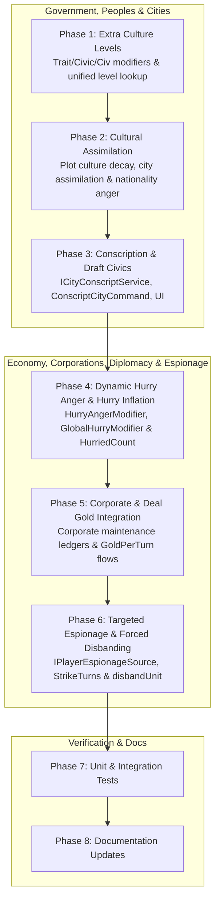

# Economy and Government & Peoples Completion Plan

## Overview

This plan completes all unfinished roadmap items in `docs/ROADMAP.md` under the **Economy** and **Government & Peoples** stanzas, along with the directly coupled **Conscription (Draft)** item from the **Cities** stanza, using the exact equations from the C++ DLL reference (`CvCity.cpp`, `CvPlayer.cpp`, `CvPlot.cpp`, `CvGame.cpp`, and `CvGameCoreUtils.cpp`):

- **Economy**
  - **Forced military disbanding** (`CvPlayer::doGold` & `CvPlayer::disbandUnit`): Track `StrikeTurns` when treasury drops below zero; on sustained deficit (`StrikeTurns > 1`), disband up to `StrikeTurns / 2` lowest-value units per turn until net gold rate is non-negative.
  - **Targeted espionage spending** (`CvPlayer::doEspionagePoints` & `CvPlayer::getEspionageSpending`): Replace unconditional aggregate pooling in `EconomyMod` with `IPlayerEspionageSource` and exact rival weight/remainder allocation in `EspionageService` and `PlayerEconomy`.
  - **Corporate cost integration** (`CvCity::calculateCorporationMaintenanceTimes100` & `CvCity::calculateBaseMaintenanceTimes100`): Unify corporate branch expenses, `CorporationMaintenanceModifier` / `RealCorporationMaintenanceModifier`, and city maintenance ledgers across `Corporations`, `Cities`, and `Economy`.
  - **Dynamic hurry anger** (`CvCity::flatHurryAngerLength`, `CvCity::getHurryAngerModifier`, `CvCity::getHurryPercentAnger`, `CvPlayer::changeHurriedCount`, `CvPlayer::doAdvancedEconomy`): Apply building `HurryAngerModifier` (including timer rescaling on modifier change), `BuildingDef.GlobalHurryModifier` (`economy:hurry_percent`), and hurry count inflation (`HurriedCount` decaying by `HURRY_INFLATION_DECAY_RATE` and `CivicDef.HurryInflationModifier`).
  - **Trade deal income in treasury** (`CvPlayer::calculateBaseNetGold` & `CvPlayer::getGoldPerTurn`): Include active bilateral `GoldPerTurn` diplomatic deals directly in `PlayerEconomy.Calculate` (`Income`, `Expenses`, `NetGold`, and ledger) and `PlayerEconomy.Settle` slider solvency adjustments.
- **Government & Peoples** (plus **Cities** prerequisite)
  - **Extra culture levels** (`CvPlayer::initCity`, `CvCity::updateCultureLevel`, `TraitDef.ExtraCultureLevel`): Grant initial threshold culture on founding when a trait has `ExtraCultureLevel`, evaluate `CultureLevelDef.Requirements` against the owning player/city, and unify effective culture level across `ICityCultureService`, `CityRequirements`, `CombatCalculator`, `ProjectVictoryService`, and `CityScreen`.
  - **Cultural assimilation & foreign nationality** (`CvGame::doCultureDecay`, `CvPlot::doCulturalDecay`, `CvCity::getCulturePercentAnger`, `CvCity::unhappyLevel` with `CivicDef.ForeignerUnhappyPercent`): Periodic plot cultural halving (`CULTURE_DECAY_TURNS` scaled by `GoldenAgePercent`), gradual city foreign culture assimilation, `CULTURE_PERCENT_ANGER` (with `AT_WAR_CULTURE_ANGER_MODIFIER`), and `CivicDef.ForeignerUnhappyPercent` unhappiness.
  - **Draft civics & Conscription (Draft)** (`CvCity::conscript`, `CvCity::canConscript`, `CvCity::getConscriptUnit`, `CvCity::getConscriptPopulation`, `CvCity::flatConscriptAngerLength`, `CvCity::getConscriptPercentAnger`, `getWorldSizeMaxConscript`): Full civic-enabled conscription in `Government`, `Cities`, `Civ.Client.Core`, and `Civ.Godot`.



## Usage of Subagents

Every implementation phase and review checkpoint is delegated to a sub-agent using `subagent_run` (or the `AskAntigravity` tool where specified). Complex implementation phases use `pawn:sol`; straightforward implementation phases use `pawn:luna`; Phase 8 uses `AskAntigravity`. Adversarial review checkpoints use `pawn:muse` and `AskAntigravity` (never with `mode=plan`). Sub-agents should be launched in background mode with a clear `title` matching the phase or checkpoint identifier.

## Parallelism

- **Phase 1** and **Phase 4** may run serially in the main checkout or in parallel in isolated git worktrees if desired; serial execution in phase order is the default because several phases extend contracts in `Civ.Core`.
- Within every review checkpoint (`R-a`, `R-b`, `R-c`, `R-d`), the two adversarial reviewers (`pawn:muse` and `AskAntigravity`) must run in parallel and independently without seeing each other's reports.

## Periodic Updates

Implementor sub-agents must update the **Encountered Serious Issues** sub-section of their assigned Phase whenever they encounter non-trivial problems, unexpected test interactions, or schema/contract constraints during implementation.

## Commit Boundaries

Every Phase ends in a standalone commit before its review checkpoint starts. Reviewers always inspect a frozen commit hash and must never run against an uncommitted working tree or edit tracked files. Commit messages must stand alone without referencing plan phase numbers or checkpoint IDs.

## Review Checkpoints

- **Checkpoint R-a**: Dual adversarial review of **Phase 1** and **Phase 2** by `pawn:muse` and `AskAntigravity` (do not use `mode=plan`).
- **Checkpoint R-b**: Dual adversarial review of **Phase 3** and **Phase 4** by `pawn:muse` and `AskAntigravity` (do not use `mode=plan`).
- **Checkpoint R-c**: Dual adversarial review of **Phase 5** and **Phase 6** by `pawn:muse` and `AskAntigravity` (do not use `mode=plan`).
- **Checkpoint R-d**: Dual adversarial review of **Phase 7** (unit and integration tests) by `pawn:muse` and `AskAntigravity` (do not use `mode=plan`).
- **Phase 8** is a documentation-only phase executed by `AskAntigravity` and receives no review checkpoint.

## Phase List

```
[x] 1.   (*pawn:luna* `subtask_pawn_1792032238271_84a046b3` -> `5920f6c923df0f03418dc4218240ca14f74b2f65`) Unify extra culture levels across traits, civics, civilizations, and culture-tier consumers
[x] 2.   (*pawn:sol* `subtask_pawn_1792032448040_26251d68` -> `7608fa00b5ef62d286049ad1944ac2d340a55b7b`, R1 fix `05fbb2fa7c8e83c3bc223375b32236294df4ec76`, R2 fix `db2f4432cbc82689074d0059721e34777987fb23`)  Implement cultural assimilation, plot culture decay, and foreign nationality unhappiness
[x] R-a. (*pawn:muse* `subtask_pawn_1792032656541_ab5bab42` R3 PASS: 3 ACCEPT, 2 NOTE, 0 DEMAND) (*AskAntigravity* `bg_c650dddf`/`bg_2edac576`/`bg_094cfd1d` conv `64b592fe-fed1-4627-b0c3-c486d954bd6c` R3 PASS: 2 ACCEPT, 0 NOTE, 0 DEMAND) Checkpoint A: Review Phase 1 & 2 (closed at `db2f4432cbc82689074d0059721e34777987fb23`)
[x] 3.   (*pawn:sol* `subtask_pawn_1792037946277_122e39fa` -> `47a41f45d0bff40499360505b7e4cb365affd0d5`)  Implement city conscription (draft) and draft civic limits, anger, and client UI
[x] 4.   (*pawn:luna* `subtask_pawn_1792038562703_71115fb9` -> `961cd9f0e675094569ba3d6c8026360aa32fd052`) Implement dynamic hurry anger modifiers and hurry inflation decay
[x] R-b. (*pawn:muse* `subtask_pawn_1792038868003_1b390c63` PASS: 5 ACCEPT, 4 NOTE, 0 DEMAND) (*AskAntigravity* `bg_dbc9a1cb` conv `64b592fe-fed1-4627-b0c3-c486d954bd6c` PASS: 7 ACCEPT, 1 NOTE, 0 DEMAND) Checkpoint B: Review Phase 3 & 4 (closed at `961cd9f0e675094569ba3d6c8026360aa32fd052`)
[x] 5.   (*pawn:sol* `subtask_pawn_1792039557630_53a9d175` -> `6cea8a5f099ecb3d9c423722ba7812d4f9fde99f`)  Unify corporate maintenance ledgers and bilateral trade deal per-turn gold in Economy
[x] 6.   (*pawn:sol* `subtask_pawn_1792040225045_a144069c` -> `fefb4baa0d941edd9487ca9a83399956837f878e`)  Implement targeted espionage spending integration and strike-based forced unit disbanding
[x] R-c. (*pawn:muse* `subtask_pawn_1792041342898_f1eb822d` PASS: 7 ACCEPT, 5 NOTE, 0 DEMAND) (*AskAntigravity* `bg_45630ee0` conv `64b592fe-fed1-4627-b0c3-c486d954bd6c` PASS: 7 ACCEPT, 1 NOTE, 0 DEMAND) Checkpoint C: Review Phase 5 & 6 (closed at `fefb4baa0d941edd9487ca9a83399956837f878e`)
[x] 7.   (*pawn:sol* `subtask_pawn_1792042727800_56473bb8` -> `bd7c6b503df4414ebb4af8041cabf7f84e4946db`)  Add comprehensive unit and integration tests for Economy, Government, Peoples, and Cities
[x] R-d. (*pawn:muse* `subtask_pawn_1792043596931_aca1691b` PASS: 9 ACCEPT, 3 NOTE, 0 DEMAND) (*AskAntigravity* `bg_c2cb1f57` conv `64b592fe-fed1-4627-b0c3-c486d954bd6c` PASS: 6 ACCEPT, 1 NOTE, 0 DEMAND) Checkpoint D: Review Phase 7 (closed at `bd7c6b503df4414ebb4af8041cabf7f84e4946db`)
[x] 8.   (*AskAntigravity* `bg_3f56e892` conv `64b592fe-fed1-4627-b0c3-c486d954bd6c` -> `f35a3d240bab9ecaeda108acb54a5e3816905b87`) Update ROADMAP.md and DESIGN.md (no review)
```

---

## Phase 1: Unify extra culture levels across traits, civics, civilizations, and culture-tier consumers

### Goal

Port the C++ DLL `ExtraCultureLevel` founding boost (`CvPlayer::initCity` at `CvPlayer.cpp:2967` and `CvCity::getCultureThreshold` at `CvCity.cpp:13460`), evaluate `CultureLevelDef.Requirements` (`CvCity::updateCultureLevel` at `CvCity.cpp:13711`) against the owning player/city rather than player `0` (and wire `game-option` requirement evaluation in `FoundationMod` using `GameOptionDef.Default` or explicit game options), and ensure all consumers (city radius, wonder capacity, building `culture-level` requirements, city defense, cultural victory, and client UI) use the unified effective culture level.

### Target Sites & Planned Changes

1. `src/Civ.Core/Game/CityContracts.cs` and `src/Mods/Foundation/FoundationMod.cs`
   - Extend `ICityCultureService` with read-only queries:
     - `int LevelIndex(Simulation sim, int city)`
     - `Civ.Content.Schema.CultureLevelDef Level(Simulation sim, int city)`
   - In `FoundationMod.Register`, supply a predicate to `ContentRegistration.Evaluator<GameOptionDef>(context, "game-option", ...)` that evaluates `sim.Content.Get<GameOptionDef>(leaf.Id).Default` (so `CultureLevelDef` requirements like `foundation:gameoption_realistic_culture_spread` and `foundation:gameoption_assimilation` evaluate their configured defaults instead of failing closed).
2. `src/Mods/Cities/CityData.cs`, `src/Mods/Cities/CityCulture.cs`, and `src/Mods/Cities/CityCommands.cs`
   - Update `CityData.Levels(Simulation sim, int player = 0, City? city = null)` to evaluate `l.Requirements` with `new RequirementContext(sim, player, city)`.
   - Update `CityData.LevelIndex(Simulation sim, City city, IReadOnlyList<S.CultureLevelDef> levels)` to return the highest index `i` where `city.Culture >= levels[i].SpeedThresholds[sim.Settings.GameSpeed]` (`CvCity::updateCultureLevel`, `CvCity.cpp:13713`).
   - In `CityCulture.Initialize(Simulation sim, City city)` (called when a city is founded in `CityCommands.Found`, matching `CvPlayer::initCity` at `CvPlayer.cpp:2967`):
     - Count `extraLevels = CityData.Effect(CityData.Effects(sim, city), "extra_culture_level")` (from `TraitDef.ExtraCultureLevel` and any civic/civilization contributing `cities:extra_culture_level`).
     - Loop `extraLevels` times: find the first eligible `CultureLevelDef` in `CityData.Levels(sim, city.Owner, city)` with `threshold > city.Culture` (`CvCity::getCultureThreshold`, `CvCity.cpp:13486`), set `city.Culture = threshold` and `CityData.Edit(sim, city).CultureHundredths[city.Owner] = threshold * 100`, and spread initial plot culture across `CityCulture.CultureRadius(sim, city)`.
   - Implement `LevelIndex` and `Level` on `CityCulture`.
3. `src/Mods/Cities/CityRequirements.cs`
   - Update the `"culture-level"` requirement evaluator so a city satisfies `leaf.Id` when `CityData.Level(context.Sim, city).SpeedThresholds[context.Sim.Settings.GameSpeed] >= context.Sim.Content.Get<S.CultureLevelDef>(leaf.Id).SpeedThresholds[context.Sim.Settings.GameSpeed]`.
4. `src/Mods/Military/CombatCalculator.cs`, `src/Mods/ProjectsVictory/ProjectVictoryService.cs`, and `src/Civ.Client.Core/CityScreen.cs`
   - In `CombatCalculator.CityDefense`, query `ICityCultureService.Level(sim, city.Id).CityDefenseModifier` when `ICityCultureService` is registered.
   - In `ProjectVictoryService.Cultural`, check `ICityCultureService.Level(sim, c.Id)` against the target `CultureLevelDef` threshold.
   - In `GameSession.CultureLevelName(City city)`, return `OptionalService<ICityCultureService>()?.Level(Sim, city.Id).Name`.
5. Bump `version` in `src/Mods/Foundation/mod.json`, `src/Mods/Cities/mod.json`, `src/Mods/Military/mod.json`, and `src/Mods/ProjectsVictory/mod.json`.

### Pseudocode

```csharp
// CvPlayer::initCity & CvCity::getCultureThreshold (CvPlayer.cpp:2967, CvCity.cpp:13460)
long extraLevels = CityData.Effect(CityData.Effects(sim, city), "extra_culture_level");
var levels = CityData.Levels(sim, city.Owner, city);
for (long step = 0; step < extraLevels; step++)
{
    var next = levels.FirstOrDefault(l => l.SpeedThresholds[sim.Settings.GameSpeed] > city.Culture);
    if (next is null) break;
    long threshold = next.SpeedThresholds[sim.Settings.GameSpeed];
    city.Culture = threshold;
    var state = CityData.Edit(sim, city);
    state.CultureRemainder = 0;
    state.CultureHundredths[city.Owner] = threshold * 100;
}
```

### Exit Criteria

- Targeted tests pass: `dotnet test tests/Civ.Mods.Tests --no-restore --filter "FullyQualifiedName~CityRulesTests|FullyQualifiedName~GovernmentPeoplesTests|FullyQualifiedName~ProjectsVictoryRulesTests"` (deferring full E2E/race suites to Phase 7).
- The Phase's required checks pass, and no known regression from an earlier Phase.

### Encountered Serious Issues

_None yet._

---

## Phase 2: Implement cultural assimilation, plot culture decay, and foreign nationality unhappiness

### Goal

Implement the C++ DLL cultural decay and nationality mechanics (`CvGame::doCultureDecay` at `CvGame.cpp:15411`, `CvPlot::doCulturalDecay` at `CvPlot.cpp:9299`, `CvPlot::calculateCulturePercent` at `CvPlot.cpp:9201`, `CvCity::getCulturePercentAnger` at `CvCity.cpp:7117`, and `CivicDef.ForeignerUnhappyPercent` at `CvCity.cpp:7484` & `11185`) so foreign nationality on captured city plots gradually converts to the new owner over time and drives foreign-nationality unhappiness.

### Target Sites & Planned Changes

1. `src/Civ.Core/Game/CityContracts.cs`
   - Add `public string? OriginalCivilization { get; set; }` to `CityRuleState` (`CvCity::m_iCiv`, `CvCity.cpp:510, 6922`).
   - Extend `ICityCultureService` with:
     - `int OwnerCulturePercent(Simulation sim, int city)` (`CvPlot::calculateCulturePercent(getOwnerINLINE())`, `CvPlot.cpp:9201`: `plot.Culture[owner] * 100 / totalPlotCulture`, or `100` if `totalPlotCulture == 0`).
     - `int TeamCulturePercent(Simulation sim, int city)` (`CvPlot::calculateTeamCulturePercent(getTeam())`, `CvPlot.cpp:9230`: sum of `calculateCulturePercent(p)` for living players on the city owner's team, or `100` if `totalPlotCulture == 0`).
2. `src/Mods/Cities/CityCommands.cs`, `src/Mods/Cities/CityCapture.cs`, and `src/Mods/Cities/ProductionEligibility.cs`
   - On founding (`CityCommands.Found`), set `CityData.Edit(sim, city).OriginalCivilization = sim.State.PlayerById(player).Civilization`.
   - On capture (`CityCapture.Capture`), preserve `state.OriginalCivilization ??= sim.State.PlayerById(city.Owner).Civilization` before transferring ownership (`CvCity.cpp:510`).
   - In `ProductionEligibility.Substitution` (`CvCity.cpp:3365, 3953, 6922`) and `CityConscript` unit resolution, when `foundation:gameoption_assimilation` is enabled (its default in `game-option.json` is `true`), resolve `UnitOverrides` and `BuildingOverrides` using `CityData.Read(sim, city).OriginalCivilization ?? sim.State.PlayerById(city.Owner).Civilization`.
3. `src/Mods/Cities/CityCulture.cs` and `src/Mods/Cities/CitiesMod.cs`
   - Register `DecayPlotCulture(Simulation sim)` at `TurnPhase.Map + 2` (`CvGame::doCultureDecay`, `CvGame.cpp:15411` and `CvPlot::doCulturalDecay`, `CvPlot.cpp:9299`):
     - `int halvingTurns = CityData.Constants(sim).CultureDecayTurns;`
     - If `halvingTurns > 0`:
       - `halvingTurns = Math.Max(10, halvingTurns * CityData.Speed(sim).GoldenAgePercent / 100);`
       - When `sim.State.Turn % halvingTurns == 0`, for each tile on the map:
         - For each player entry in `plot.Culture` where the player is not barbarian and `culture >= CityData.Constants(sim).CityFreeCultureGrowthFactor`, set `plot.Culture[player] = culture / 2`.
         - Call `CityCulture.Resolve(sim, tile)` to update plot ownership if the leading cultural player changed.
     - Also decay foreign `CityRuleState.CultureHundredths` entries (`key != city.Owner && value >= CityData.Constants(sim).CityFreeCultureGrowthFactor * 100`) by `/= 2` on the same halving boundary so city-level nationality percentages (`CvCity::calculateCulturePercent`, `CvCity.cpp:16134`) assimilate in lockstep with plot culture.
4. `src/Mods/Government/CivicEffects.cs`
   - In `CivicEffects.City`, contribute `sink.Add(c.Id, "cities:foreigner_unhappy_percent", c.ForeignerUnhappyPercent)` and `sink.Add(c.Id, "cities:civic_percent_anger", c.CivicPercentAnger)`.
5. `src/Mods/Cities/CityWellbeing.cs`
   - Implement `CvCity::getCulturePercentAnger()` (`CvCity.cpp:7117`) and `CivicPercentAnger` (`CvCity.cpp:7408`):
     - Read city plot `plot = sim.State.PlotAt(city.Position)` and `long totalCulture = plot.Culture.Values.Sum()`.
     - For each living player `p` on a different team (`sim.TeamOf(p).Id != sim.TeamOf(city.Owner).Id`) with `plot.Culture[p] > 0`:
       - `long c = plot.Culture[p];`
       - If at war (`sim.TeamOf(city.Owner).Wars.Contains(sim.TeamOf(p).Id)`), `c = c * Math.Max(0, 100 + Constants(sim).AtWarCultureAngerModifier) / 100;`.
       - `angryCulture += c;`.
     - `long culturePercentAnger = totalCulture > 0 ? Constants(sim).CulturePercentAnger * angryCulture / totalCulture : 0;`
     - `long cultureUnhappy = culturePercentAnger * city.Population / Math.Max(1, Constants(sim).PercentAngerDivisor);`
     - Add ledger line `("cities:culture_anger", "happiness", -cultureUnhappy)`.
   - Implement `ForeignerUnhappyPercent` (`CvCity.cpp:7484`):
     - `long foreignAnger = Effect(effects, "foreigner_unhappy_percent");`
     - If `foreignAnger != 0`:
       - `long factor = 100 / foreignAnger;`
       - `long foreignUnhappy = Math.Max(0, (100 - OwnerCulturePercent(sim, city)) * factor / 100);`
       - Add ledger line `("government:foreigner_anger", "happiness", -foreignUnhappy)`.
6. Bump `version` in `src/Mods/Cities/mod.json` and `src/Mods/Government/mod.json`.

### Pseudocode

```csharp
// CvGame::doCultureDecay & CvPlot::doCulturalDecay (CvGame.cpp:15411, CvPlot.cpp:9299)
internal static void DecayPlotCulture(Simulation sim)
{
    int halvingTurns = CityData.Constants(sim).CultureDecayTurns;
    if (halvingTurns <= 0) return;
    halvingTurns = Math.Max(10, halvingTurns * CityData.Speed(sim).GoldenAgePercent / 100);
    if (sim.State.Turn % halvingTurns != 0) return;
    int minCulture = CityData.Constants(sim).CityFreeCultureGrowthFactor;
    foreach (var tile in sim.State.Grid.Tiles)
    {
        var plot = sim.State.Plots[tile.Value];
        bool changed = false;
        foreach (int player in plot.Culture.Keys.ToArray())
        {
            if (IsBarbarian(sim, player) || plot.Culture[player] < minCulture) continue;
            plot.Culture[player] /= 2;
            changed = true;
        }
        if (changed) Resolve(sim, tile);
    }
}
```

### Exit Criteria

- Targeted tests pass: `dotnet test tests/Civ.Mods.Tests --no-restore --filter "FullyQualifiedName~CityRulesTests|FullyQualifiedName~GovernmentPeoplesTests"` (deferring full E2E/race suites to Phase 7).
- The Phase's required checks pass, and no known regression from an earlier Phase.

### Encountered Serious Issues

_None yet._

---

## Phase 3: Implement city conscription (draft) and draft civic limits, anger, and client UI

### Goal

Implement the exact C++ DLL conscription rules (`CvCity.cpp:5935–6120`, `7227`, and `CvGameCoreUtils.cpp:506`) across `Government`, `Cities`, `Civ.Client.Core`, and `Civ.Godot`.

### Target Sites & Planned Changes

1. `src/Civ.Core/Game/CityContracts.cs`
   - Add `ConscriptResult(string UnitId, int PopulationCost, int MinPopulation, int Experience, int AngerTurns, int MaxPlayerDrafts, Ledger Ledger)`.
   - Add `ICityConscriptService`:
     - `ConscriptResult? Calculate(Simulation sim, int city)`
     - `string? Validate(Simulation sim, int player, int city)`
     - `void Conscript(Simulation sim, int city)`
   - Add `ConscriptCityCommand : GameCommand` (`cities:conscript`).
   - Add `ConscriptAngerTurns` and `DraftedThisTurn` to `CityRuleState`, and `ConscriptCountThisTurn` to `CityPlayerState`.
2. `src/Mods/Government/CivicEffects.cs`
   - In `CivicEffects.Player`, contribute `("cities:max_conscript", GetWorldSizeMaxConscript(sim, c))` where:
     `GetWorldSizeMaxConscript(sim, c) = c.MaxConscript * Math.Max(0, 100 + sim.Content.Get<WorldSizeDef>(sim.Settings.WorldSize!).MaxConscriptModifier) / 100` (`CvGameCoreUtils.cpp:506`).
3. `src/Mods/Cities/CityConscript.cs` and `src/Mods/Cities/CitiesMod.cs`
   - Implement `CityConscript : ICityConscriptService, IModifierSource`:
     - `getConscriptUnit()` (`CvCity.cpp:5935`): iterate `UnitDef`s resolved through `CivilizationDef.UnitOverrides` for `city.Owner` where `ProductionEligibility.Validate(sim, city, "cities:unit", u.Id).Success` and `u.Conscription > 0`; pick highest `u.Conscription` (tie-breaking by ordinal `u.Id`).
     - `getConscriptPopulation()` (`CvCity.cpp:5959`):
       `int perCost = CityData.Raw(sim, "CONSCRIPT_POPULATION_PER_COST", 60);`
       `return perCost == 0 ? 0 : Math.Max(1, unitDef.Cost / perCost);`
     - `conscriptMinCityPopulation()` (`CvCity.cpp:5974`):
       `CityData.Constants(sim).MinimumConscriptPopulation + conscriptPopulation`.
     - `flatConscriptAngerLength()` (`CvCity.cpp:5980`):
       `Math.Max(1, CityData.Constants(sim).ConscriptAngerDivisor * CityData.Speed(sim).HurryConscriptAngerPercent / 100)`.
     - `canConscript()` (`CvCity.cpp:5996`):
       - `!GovernmentStatus.IsDisorder(sim, city)`
       - `!cityState.DraftedThisTurn`
       - `playerState.ConscriptCountThisTurn < maxConscript`
       - `city.Population > conscriptPopulation`
       - `city.Population >= conscriptMinCityPopulation`
       - `cultureService.TeamCulturePercent(sim, city.Id) >= CityData.Raw(sim, "CONSCRIPT_MIN_CULTURE_PERCENT", 10)`
       - `conscriptUnit is not null`
     - `conscript()` (`CvCity.cpp:6081` & `4725`):
       - Subtract `conscriptPopulation` from `city.Population` and call `work.Assign(sim, city.Id)`.
       - `cityState.ConscriptAngerTurns += flatConscriptAngerLength()`.
       - `cityState.DraftedThisTurn = true; playerState.ConscriptCountThisTurn++;`
       - Spawn unit at `city.Position` with `Experience = CityProduction.CityExperience(sim, city, unitDef) / 2` and `MovesLeft = 0`.
     - `Contribute` (`CvCity.cpp:7227`):
       - When `ConscriptAngerTurns > 0`:
         `int stacks = (ConscriptAngerTurns - 1) / flatConscriptAngerLength() + 1;`
         `int unhappy = stacks * CityData.Constants(sim).ConscriptPopulationAnger;`
         `sink.Add("cities:conscript", "cities:unhappiness", unhappy);`
     - Turn phase hooks: reset `DraftedThisTurn` and `ConscriptCountThisTurn` at `TurnPhase.PlayerBegin`, and decrement `ConscriptAngerTurns` at `TurnPhase.PlayerEnd`.
4. `src/Civ.Client.Core/CityScreen.cs`, `src/Civ.Client.Core/GameSession.Cities.cs`, and `src/Civ.Godot/CityUi.Right.cs`
   - Expose `ConscriptOption? Conscript` on `CityScreen`, `Session.Conscript(City city)` on `GameSession`, and a Draft button in `CityUi.Right.cs`.

### Pseudocode

```csharp
// CvCity::getConscriptPopulation & conscriptMinCityPopulation (CvCity.cpp:5959-5977)
int perCost = CityData.Raw(sim, "CONSCRIPT_POPULATION_PER_COST", 60);
int popCost = perCost <= 0 ? 0 : Math.Max(1, unit.Cost / perCost);
int minPop = CityData.Constants(sim).MinimumConscriptPopulation + popCost;
```

### Exit Criteria

- Targeted tests pass: `dotnet test tests/Civ.Mods.Tests --no-restore --filter "FullyQualifiedName~CityRulesTests|FullyQualifiedName~GovernmentPeoplesTests|FullyQualifiedName~ClientSessionTests"` (deferring full E2E/race suites to Phase 7).
- The Phase's required checks pass, and no known regression from an earlier Phase.

### Encountered Serious Issues

Military unit initialization adds experience and restores full movement. The shared city spawn path now initializes units before it halves draft experience and removes movement. This preserves free promotions and prevents the creation event from restoring draft movement.

---

## Phase 4: Implement dynamic hurry anger modifiers and hurry inflation decay

### Goal

Implement the C++ DLL hurry anger and hurry inflation equations (`CvCity.cpp:6426`, `7216`, `8208`, `10225–10256`, and `CvPlayer.cpp:5806`, `10835`, `11676`, `24148`, `34209–34227`, `34763–34778`):
1. `flatHurryAngerLength()` scales by `Math.Max(0, 100 + getHurryAngerModifier()) / 100` where `getHurryAngerModifier()` aggregates `BuildingDef.HurryAngerModifier` (`cities:hurry_anger_percent`).
2. When a building with `HurryAngerModifier != 0` is completed in a city with an active `HurryAngerTurns > 0`, rescale `HurryAngerTurns` by the ratio of `(100 + newModifier) / (100 + oldModifier)` (`CvCity.cpp:10246-10253`).
3. Contribute `BuildingDef.GlobalHurryModifier` to player `economy:hurry_percent` (`CvPlayer.cpp:10835`).
4. Track `HurriedCount` on `EconomyPlayerState`: each hurry increments `HurriedCount` by 1 (`CvCity.cpp:5806`), which multiplies per-turn inflation by `Math.Max(0, 100 + HurriedCount) / 100` (`CvPlayer.cpp:11676`) and decays by 1 whenever `elapsedTurns % Math.Max(1, HURRY_INFLATION_DECAY_RATE * TrainPercent / 100 * Math.Max(0, 100 + HurryInflationModifier) / 100) == 0` (`CvPlayer.cpp:34763`).

### Target Sites & Planned Changes

1. `src/Civ.Core/Game/EconomyContracts.cs`
   - Add `public int HurriedCount { get; set; }` to `EconomyPlayerState`.
2. `src/Mods/Cities/BuildingEffects.cs`
   - Contribute `("cities:hurry_anger_percent", b.HurryAngerModifier)` in `BuildingEffects.Local`.
   - Contribute `("economy:hurry_percent", b.GlobalHurryModifier)` at `ModifierScope.Player` for active buildings owned by the player.
3. `src/Mods/Economy/CityHurry.cs`, `src/Mods/Economy/RecurringCosts.cs`, and `src/Mods/Economy/EconomyMod.cs`
   - Update `CityHurry.AngerLength(Simulation sim, City city)`:
     ```csharp
     int baseLen = EconomyData.Rules(sim).Values.HurryAngerDivisor * EconomyData.Speed(sim).HurryConscriptAngerPercent / 100;
     long mod = ModifierSink.Collect(new(sim, ModifierScope.City, city.Owner, city)).Ledger.Total("cities:hurry_anger_percent");
     return (int)Math.Max(1, baseLen * Math.Max(0, 100 + mod) / 100);
     ```
   - Subscribe to `BuildingCompleted` in `EconomyMod` so if the completed building has `HurryAngerModifier != 0` and the city has `HurryAngerTurns > 0`, `HurryAngerTurns` rescales via `CvCity::changeHurryAngerModifier` (`CvCity.cpp:10246`).
   - In `CityHurry.Hurry`, increment `EconomyData.Edit(sim, city.Owner).HurriedCount++`.
   - In `Inflation.Update`, apply `perTurn = perTurn * Math.Max(0, 100 + state.HurriedCount) / 100` and decay `state.HurriedCount` using `HURRY_INFLATION_DECAY_RATE`, `Speed(sim).TrainPercent`, and `Civics(sim, player).Sum(c => c.HurryInflationModifier)`.

### Pseudocode

```csharp
// CvCity::flatHurryAngerLength (CvCity.cpp:8208)
internal static int AngerLength(Simulation sim, City city)
{
    long anger = EconomyData.Rules(sim).Values.HurryAngerDivisor;
    anger = anger * EconomyData.Speed(sim).HurryConscriptAngerPercent / 100;
    long mod = ModifierSink.Collect(new(sim, ModifierScope.City, city.Owner, city)).Ledger.Total("cities:hurry_anger_percent");
    anger = anger * Math.Max(0, 100 + mod) / 100;
    return (int)Math.Max(1, anger);
}
```

### Exit Criteria

- Targeted tests pass: `dotnet test tests/Civ.Mods.Tests --no-restore --filter "FullyQualifiedName~ResearchEconomyTests|FullyQualifiedName~CityRulesTests"` (deferring full E2E/race suites to Phase 7).
- The Phase's required checks pass, and no known regression from an earlier Phase.

### Encountered Serious Issues

Collecting the city modifier ledger inside `CityHurry` recursively called its own anger contribution. The implementation now sums active building modifiers directly, with the same obsolescence and civic-activity checks as `BuildingEffects`.

---

## Phase 5: Unify corporate maintenance ledgers and bilateral trade deal per-turn gold in Economy

### Goal

Port the full `CvCity::calculateCorporationMaintenanceTimes100` equation (`CvCity.cpp:10059–10140`), unify corporate branch expenses into `CityMaintenanceResult` and `RecurringCosts` ledgers (`CvCity.cpp:10170`), wire `cities:corporation_maintenance_percent` modifiers (`CivicDef.CorporationMaintenanceModifier` / `RealCorporationMaintenanceModifier` at `CvPlayer.cpp:23977`), and integrate bilateral `GoldPerTurn` diplomatic trade deals into `PlayerEconomy.Calculate` and `PlayerEconomy.Settle` (`CvPlayer::calculateBaseNetGold` at `CvPlayer.cpp:11741`).

### Target Sites & Planned Changes

1. `src/Civ.Core/Game/CityContracts.cs` and `src/Mods/Cities/CityMaintenance.cs`
   - Extend `CityMaintenanceResult` with `long CorporateHundredths = 0`.
   - In `CityMaintenance.Calculate`, record `CorporateHundredths` from `cities:maintenance_flat_hundredths` (and `corporations:maintenance_hundredths`) and emit `("economy:city:" + city.Id, "economy:corporate_maintenance_hundredths", cost.CorporateHundredths)` and `("economy:rules", "economy:corporate_maintenance", totalCorporateHundredths / 100)` in `RecurringCosts.Calculate` (`src/Mods/Economy/RecurringCosts.cs`).
2. `src/Mods/Corporations/CorporationService.cs` and `src/Mods/Government/CivicEffects.cs`
   - In `CivicEffects.Player`, contribute `c.RealCorporationMaintenanceModifier` when `foundation:gameoption_realistic_corporations` is active, otherwise `c.CorporationMaintenanceModifier`, under key `"cities:corporation_maintenance_percent"` (`CvPlayer.cpp:23977`).
   - In `CorporationService.MaintenanceHundredths(Simulation sim, int city)` (`CvCity::calculateCorporationMaintenanceTimes100`, `CvCity.cpp:10074`), for each active corporation in the city:
     1. `long maintenance = 100L * (def.HeadquartersCommerce.Gold + def.HeadquartersCommerce.Research + def.HeadquartersCommerce.Culture + def.HeadquartersCommerce.Espionage);`
     2. `long bonusMaint = def.MaintenanceHundredths * ConsumedBonusCount(sim, city, corporation);`
     3. `bonusMaint = bonusMaint * sim.Content.Get<WorldSizeDef>(sim.Settings.WorldSize!).CorporationMaintenancePercent / 100;`
     4. `maintenance += bonusMaint;`
     5. `maintenance = maintenance * (cityObj.Population + 17) / 18;`
     6. `maintenance = maintenance * sim.Content.Get<HandicapDef>(sim.Settings.Handicap).CorporationMaintenancePercent / 100;`
     7. `long modifier = ModifierSink.Collect(new(sim, ModifierScope.Player, cityObj.Owner)).Ledger.Total("cities:corporation_maintenance_percent");`
     8. `maintenance = maintenance * Math.Max(0, 100 + modifier) / 100;`
     9. Divide by inflation when active (`int inflation = InflationRate(sim, cityObj.Owner) + 100; if (inflation > 0) maintenance = maintenance * 100 / inflation;`).
     10. If `foundation:gameoption_realistic_corporations` is active and `handicap.CorporationMaintenancePercent > 80`, `maintenance = maintenance * handicap.CorporationMaintenancePercent / 80;`.
   - Update expected values in `tests/Civ.Mods.Tests/CorporationRulesTests.cs` to match the full `CvCity::calculateCorporationMaintenanceTimes100` formula.
3. `src/Mods/Economy/PlayerEconomy.cs`
   - In `PlayerEconomy.Calculate(Simulation sim, int player)` (`CvPlayer::calculateBaseNetGold`, `CvPlayer.cpp:11741`):
     - Query `sim.Content.Services.Get<IDiplomacyService>().SingleOrDefault()?.Deals(sim)` for active live deals (`Status == Active` and teams not at war).
     - Sum incoming `GoldPerTurn` items (`FromPlayer != player`) into `dealIncome` and outgoing `GoldPerTurn` items (`FromPlayer == player`) into `dealExpenses`.
     - Add `dealIncome` to `income` (`("diplomacy:deals", "economy:deal_income", dealIncome)`) and `dealExpenses` to `expenses` (`("diplomacy:deals", "economy:deal_expenses", dealExpenses)`), so `NetGold = income - expenses` matches `getCommerceRate(COMMERCE_GOLD) + getGoldPerTurn() - calculateInflatedCosts()`.
   - In `PlayerEconomy.Settle(Simulation sim, int player)`:
     - Use full `netGold` (including `dealIncome - dealExpenses`) when shifting commerce sliders to keep `owner.Treasury + netGold >= 0`.
     - Apply domestic net gold (`total.Gold / 100 - domesticExpenses`) to `owner.Treasury` at `TurnPhase.Gold` while `diplomacy:deals` settles the bilateral `GoldPerTurn` transfers between players once per turn.

### Pseudocode

```csharp
// CvPlayer::calculateBaseNetGold (CvPlayer.cpp:11741)
long dealIncome = 0, dealExpenses = 0;
if (sim.Content.Services.Get<IDiplomacyService>().SingleOrDefault() is { } diplomacy)
{
    foreach (var deal in diplomacy.Deals(sim).Where(d => d.Status == DiplomaticDealStatus.Active &&
        (d.Proposer == player || d.Recipient == player) &&
        !sim.TeamOf(d.Proposer).Wars.Contains(sim.TeamOf(d.Recipient).Id)))
    {
        foreach (var item in deal.Items.Where(i => i.Kind == TradeItemKind.GoldPerTurn))
        {
            if (item.FromPlayer == player) dealExpenses += item.Amount;
            else dealIncome += item.Amount;
        }
    }
}
```

### Exit Criteria

- Targeted tests pass: `dotnet test tests/Civ.Mods.Tests --no-restore --filter "FullyQualifiedName~CorporationRulesTests|FullyQualifiedName~DiplomacyRulesTests|FullyQualifiedName~ResearchEconomyTests"` (deferring full E2E/race suites to Phase 7).
- The Phase's required checks pass, and no known regression from an earlier Phase.

### Encountered Serious Issues

- Diplomacy transfers deal gold at `TurnPhase.Map + 1`, after every player's Gold phase. An early treasury clamp forgave domestic debt before incoming payments arrived. Economy now records that debt in `UnpaidGold` and reconciles it at `TurnPhase.Map + 2`. Slider adjustments use full net gold, but Gold applies only domestic income and costs. Strike handling must distinguish this temporary domestic debt from the final deficit after deal settlement.
- Diplomacy checked each side's gross payment separately. This rejected outgoing payments that incoming payments from the same deal covered. Settlement now checks each participant's net payment within that deal. Diplomacy still owns all transfers. Deals retain their existing ascending-id settlement order.
- The realistic corporation option defaults to true. Guilds contributes `-105`, so its corporate maintenance reaches the zero clamp. Tests now retain headquarters-based costs without resources and use Corporatist for the nonzero save/load settlement case. Corporate ledger values expose base costs before city maintenance modifiers, like the existing distance and city-count values.

---

## Phase 6: Implement targeted espionage spending integration and strike-based forced unit disbanding

### Goal

Implement the C++ DLL espionage allocation (`CvPlayer::doEspionagePoints` & `CvPlayer::getEspionageSpending`, `CvPlayer.cpp:20407–20555`) and strike-based forced unit disbanding (`CvPlayer::doGold` at `CvPlayer.cpp:20322` and `CvPlayer::disbandUnit` at `CvPlayer.cpp:4095`).

### Target Sites & Planned Changes

1. `src/Civ.Core/Game/EconomyContracts.cs` and `src/Civ.Core/Game/DomainEvents.cs`
   - Add `IPlayerEspionageSource { long EspionageHundredths(Simulation sim, int player); }` in `EconomyContracts.cs`.
   - Add `public int StrikeTurns { get; set; }` to `EconomyPlayerState`.
   - Add `public sealed record UnitDisbandedForDeficit(int UnitId, int Player, Hex Position) : DomainEvent;` in `DomainEvents.cs`.
2. `src/Mods/Economy/EconomyMod.cs`, `src/Mods/Economy/PlayerEconomy.cs`, and `src/Mods/Espionage/EspionageService.cs`
   - Register `PlayerEconomy` as `IPlayerEspionageSource`.
   - In `EconomyMod`, only accumulate `EconomyPlayerState.EspionageHundredths` when `sim.Content.Services.Get<IEspionageService>().Any()` is false.
   - In `EspionageService.Allocate`, read `IPlayerEspionageSource.EspionageHundredths(sim, player)` when available.
   - In `PlayerEconomy.Calculate`, when `IEspionageService` is present, emit per-rival espionage allocation lines (`"economy:espionage_target:" + rivalTeam`) in the player economy ledger.
3. `src/Mods/Economy/PlayerEconomy.cs` (Forced Disbanding — `CvPlayer.cpp:20322` & `4095`)
   - In `PlayerEconomy.Settle(Simulation sim, int player)`:
     - After slider adjustments, compute `long treasury = owner.Treasury + domesticNetGold;`.
     - If `treasury < 0`:
       - `state.UnpaidGold = -treasury; owner.Treasury = 0;`
       - If `!IsBarbarian(sim, player) && EconomyData.Cities(sim, player).Any()`:
         - `state.StrikeTurns++;`
         - If `state.StrikeTurns > 1`:
           - `int disbandLimit = state.StrikeTurns / 2;`
           - Loop up to `disbandLimit` times:
             - Select lowest-value eligible unit via `SelectDisbandUnit(sim, player)` (`CvPlayer::disbandUnit`, `CvPlayer.cpp:4095`):
               - Exclude units with `GoldenAge == true` or `Cost <= 0`, and do not disband the sole `MilitaryHappiness` unit in a city when active civics have `HappyPerMilitaryUnit > 0`.
               - Score `value = 10000 + sim.Rng.Next(1000) + def.Cost * 5 + unit.Experience * 20 + level * 100`.
               - If `def.Strength > 0 && !def.NoDefensiveBonus && sim.State.CityAt(unit.Position) is not null`: `value *= 2`.
               - If `plot.Owner is { } plotOwner && sim.TeamOf(plotOwner).Id == team`: `value *= 3`.
               - If `plot.Owner == player`: `value /= 6`.
               - Apply `DefaultUnitAi` multiplier (`unitai_settle` * 20, `unitai_worker` * 10, `unitai_explore` * 15, `unitai_city_defense` * 6, `unitai_attack` / `unitai_attack_city` / `unitai_collateral` / `unitai_pillage` / `unitai_counter` / `unitai_reserve` * 2, `unitai_spy` * 12, etc.).
               - If `def.ExtraCost > 0`: `value /= (def.ExtraCost + 1)`.
             - Remove the selected unit, publish `UnitDisbandedForDeficit`, and if `Calculate(sim, player).NetGold >= 0` break.
           - Recompute visibility if any unit was disbanded.
     - Else (`treasury >= 0`):
       - `owner.Treasury = treasury; state.UnpaidGold = 0; state.StrikeTurns = 0;`

### Pseudocode

```csharp
// CvPlayer::doGold (CvPlayer.cpp:20322)
if (treasury < 0)
{
    state.UnpaidGold = -treasury;
    owner.Treasury = 0;
    if (!IsBarbarian(sim, player) && EconomyData.Cities(sim, player).Any())
    {
        state.StrikeTurns++;
        if (state.StrikeTurns > 1)
        {
            int count = state.StrikeTurns / 2;
            for (int i = 0; i < count; i++)
            {
                if (!DisbandLowestValueUnit(sim, player)) break;
                if (Calculate(sim, player).NetGold >= 0) break;
            }
        }
    }
}
else
{
    owner.Treasury = treasury;
    state.UnpaidGold = 0;
    state.StrikeTurns = 0;
}
```

### Exit Criteria

- Targeted tests pass: `dotnet test tests/Civ.Mods.Tests --no-restore --filter "FullyQualifiedName~ResearchEconomyTests|FullyQualifiedName~EspionageRulesTests|FullyQualifiedName~AiTests"` (deferring full E2E/race suites to Phase 7).
- The Phase's required checks pass, and no known regression from an earlier Phase.

### Encountered Serious Issues

- Strike checks now run during gold reconciliation at `TurnPhase.Map + 2`, after actual diplomatic transfers. Expected payments can fail when a payer cannot afford a deal. A domestic deficit that incoming payments cover resets the strike counter. A remaining deficit increments it. This ordering also means unit production finishes before forced disbanding.
- The existing espionage tests require largest-remainder allocation, lower-team-id tie breaks, and held points when every weight is zero. The reference instead gives remainder points to the highest-weight teams and distributes points even when every weight is zero. This implementation preserves the existing tested service rules. `IEspionageService.Spending` provides one read-only calculation for both settlement and ledger forecasts, including held points. Ledger target amounts use whole points under `economy:espionage_spending`, so they do not duplicate city `economy:espionage_hundredths` totals.

---

## Phase 7: Add comprehensive unit and integration tests for Economy, Government, Peoples, and Cities

### Goal

Add thorough unit, contract, save/load determinism, and integration tests covering every mechanic introduced in Phases 1–6, and run the full repository verification suite (`mise run test`).

### Target Sites & Planned Changes

1. `tests/Civ.Mods.Tests/GovernmentPeoplesTests.cs` and `tests/Civ.Mods.Tests/CityRulesTests.cs`
   - Tests for extra culture levels from traits, civics, and civilizations affecting border radius, building `culture-level` requirements, city defense, cultural victory, and `CityScreen.CultureLevel`.
   - Tests for plot cultural decay (`CULTURE_DECAY_TURNS`), captured-city cultural assimilation, `CULTURE_PERCENT_ANGER` (including `AT_WAR_CULTURE_ANGER_MODIFIER`), and `CivicDef.ForeignerUnhappyPercent`.
   - Tests for draft civics (`getWorldSizeMaxConscript`), `ConscriptCityCommand` validation/execution, population deduction, half production XP, 0 moves, draft anger decay, and save/load hash equality.
2. `tests/Civ.Mods.Tests/ResearchEconomyTests.cs`, `tests/Civ.Mods.Tests/CorporationRulesTests.cs`, `tests/Civ.Mods.Tests/DiplomacyRulesTests.cs`, `tests/Civ.Mods.Tests/EspionageRulesTests.cs`
   - Tests for `HurryAngerModifier` (including timer rescaling when a building with `HurryAngerModifier` completes), `GlobalHurryModifier`, and `HurriedCount` inflation and decay (`HURRY_INFLATION_DECAY_RATE`, `HurryInflationModifier`).
   - Tests for corporate maintenance modifier unification and ledger lines in `CityMaintenanceResult` and `PlayerEconomyResult`.
   - Tests for bilateral `GoldPerTurn` trade deals appearing in `PlayerEconomyResult` (`Income`, `Expenses`, `NetGold`) and triggering slider adjustments before bankruptcy.
   - Tests for `IPlayerEspionageSource` targeted rival allocation without duplicate aggregate pooling.
   - Tests for `StrikeTurns` and `disbandUnit` on sustained deficit (turn 1 increments `StrikeTurns` to 1 without disbanding; turn 2+ disbands `StrikeTurns / 2` lowest-value units, preferring units outside own borders and with `ExtraCost`, until `NetGold >= 0`).

### Exit Criteria

- Full default test suite passes: `mise run test`.
- Save/load determinism and lockstep tests pass with zero regressions.
- The Phase's required checks pass, and no known regression from an earlier Phase.

### Encountered Serious Issues

The default suite exposed an existing architecture-test failure in `src/Civ.Godot/Debug/DebugScenario.cs`: JSON documentation examples named shipped mod identities. Replaced those example IDs with generic IDs without changing the assertion. Disband location tests follow the reference equation: owned territory lowers a unit's score, despite the target-test wording suggesting an outside-border preference.

---

## Phase 8: Update ROADMAP.md and DESIGN.md (no review)

### Goal

Use `AskAntigravity` to update `docs/ROADMAP.md` and `docs/DESIGN.md` to record completion of all 5 **Economy** items, all 3 **Government & Peoples** items, and **Conscription (Draft)** under **Cities**.

### Target Sites & Planned Changes

1. `docs/ROADMAP.md`
   - Check off / move the 5 items under **Economy**, the 3 items under **Government & Peoples**, and **Conscription (Draft)** under **Cities**, and update the **What Is Done** summaries for Economy, Cities, Government & Civics, and Peoples, Leaders & Traits.
2. `docs/DESIGN.md`
   - Update the Economy, Cities, and Government & Peoples sections to describe strike-based unit disbanding, hurry anger modifiers and hurry inflation, `IPlayerEspionageSource`, bilateral `GoldPerTurn` ledger integration, corporate maintenance ledger breakdown, plot culture decay and cultural assimilation, conscription, and extra culture levels.

### Exit Criteria

- `mise run test` passes (including `DogfoodContractTests` and brand-scrub checks).
- No forbidden product names appear anywhere in `docs/` or `src/`.
- The Phase's required checks pass, and no known regression from an earlier Phase.

### Encountered Serious Issues

_None yet._

---

## Review Protocol

**Verdicts.** Every finding gets exactly one:

- **ACCEPT** — the reviewer reproduced the claimed behavior (or the claimed absence of a
  defect) and confirms it. Nothing to record and no action needed.
- **NOTE** — the reviewer has something to record: a caveat, a nit, or an unreachable
  edge case. It does not require a change, and it is carried into the plan and the
  closing summary so it is not lost.
- **DEMAND** — a change is required before the checkpoint closes. A DEMAND must carry a
  minimal reproduction and an exact implementable scope.

**Review scope.** Every review states which areas and behaviors it examined, how it
examined them (for example, code inspection, tests, or probes), and what it did not
examine or run. Reviewers should assess whether the phase's relevant tests support its
claims, but they do not need to prove that a defect category is exhausted or enumerate
hypothetical untested cases. Report a coverage gap as a finding only when it creates a
specific concern; explain the scenario and its reachability. A DEMAND requires a minimal
reproduction and an exact implementable scope.

---

## Stopping Rule

- **Complete** when all 8 Phases are committed, both adversarial reviewers (`pawn:muse` and `AskAntigravity`) close Checkpoints `R-a`, `R-b`, `R-c`, and `R-d` with no open `DEMAND`s, `mise run test` passes cleanly, and any remaining `NOTE` items are recorded with severity and reachability.
- **Not complete** if any `DEMAND` remains open, if any existing test is weakened to pass, or if a residual defect is reachable through normal gameplay or command validation.
