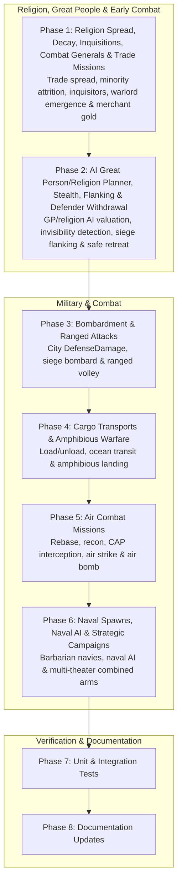

# Military & Combat and Religion & Great People Completion Plan

## Overview

This plan completes all 13 unimplemented tasks in `docs/ROADMAP.md` under the **Religion & Great People** (6 items) and **Military & Combat** (7 items) stanzas, along with their supporting city defense damage, visibility, and client UI contracts, using the equations and rules from the reference C++ DLL (`CvCity.cpp`, `CvPlayer.cpp`, `CvPlayerAI.cpp`, `CvGame.cpp`, `CvPlot.cpp`, `CvUnit.cpp`, and `CvUnitAI.cpp`):

- **Religion & Great People**
  - **Foreign trade religion spread** (`CvCity::doReligion`, `CvCity.cpp:20521`): Spread religion across international trade routes (`ITradeRouteService` and `ICityConnectionService`) to contacted foreign cities, and support multi-religion spread when `foundation:gameoption_multiple_religion_spread` is enabled.
  - **Religion decay & attrition** (`CvCity::doReligion`, `CvCity.cpp:20653–20751`): Gradual loss of non-state minority religions (and their prerequisite religious buildings) in non-holy cities based on religion count, religion age, domestic network religious influence, local shrine/building influence, and holy city owner diplomacy.
  - **Inquisitions** (`CvUnit::canPerformInquisition`, `CvUnit::performInquisition`, `CvCity::isInquisitionConditions`, `CvPlayer::isInquisitionConditions`, `CvUnit.cpp:22186–22430`): Civic-gated (`AllowInquisitions` / `!DisallowInquisitions`) inquisitor training and city purges of non-state religions and religious buildings, with holy-city/religion-count success odds, hurry anger penalty, Revolution index reduction or treasury compensation gold, and diplomatic memory penalties.
  - **Combat Great Generals** (`CvPlayer::setCombatExperience`, `CvPlayer::greatPeopleThreshold(true)`, `CvPlayer::createGreatPeople`, `CvUnit::canLead`, `CvUnit::lead`, `CvUnit::giveExperience`, `CvUnit::construct`, `CvPlayer.cpp:13079, 15716, 26786`, `CvUnit.cpp:9180, 10518–10705`): Spawn Great Generals in a player's cities when earned military combat experience reaches the speed- and era-scaled Great General threshold, increment personal and team Great General threshold modifiers, and support attaching Great Generals to combat units (`lead` warlord promotion + stack XP distribution + leader-only promotions) as well as constructing special buildings (`ConstructibleBuildings` / `ForceBuildings` such as Military Academy and Academy).
  - **Trade missions** (`CvUnit::getTradeGold`, `CvUnit::canTrade`, `CvUnit::trade`, `CvUnit.cpp:9456–9550`): Great Merchant trade mission in peaceful foreign cities granting instant treasury gold scaled by `BaseTrade`, `TradeMultiplier * capitalTradeProfit`, `UnitTradePercent`, and team `TradeMissionModifier`.
  - **AI Great Person valuation** (`CvUnitAI::AI_prophetMove`, `AI_artistMove`, `AI_scientistMove`, `AI_merchantMove`, `AI_engineerMove`, `AI_generalMove`, `CvPlayerAI::AI_calculateGoldenAgeValue`, `CvUnitAI.cpp:6048–7100`): Deterministic AI utility comparison across Golden Age triggers, immediate tech bulbing, special building/shrine construction, wonder hurry, Great Merchant foreign trade missions, Great General warlord attachment, and city settlement, plus AI missionary and inquisitor execution.
- **Military & Combat**
  - **Stealth & invisibility** (`CvUnit::isInvisible`, `CvPlot::isInvisibleVisible`, `CvUnit.cpp:12968`, `CvPlot.cpp:11573`): Per-team unit invisibility (`UnitDef.Invisibility` and `UnitDef.Invisible`) and detector radius (`UnitDef.VisibleInvisibilityTypes` within unit sight range), filtering combat targeting, movement blocking, sentry wake checks, and client map visibility.
  - **Flanking & defender withdrawal** (`CvUnit::flankingStrikeCombat`, `CvUnit::resolveCombat`, `CvUnit.cpp:1844–2030, 18534`): Post-combat flanking damage by surviving/withdrawing attackers against enemy siege units (`UnitDef.FlankingStrikes`) outside cities, and tactical defender withdrawal to an adjacent safe tile after round 1 when a lethal hit occurs.
  - **Artillery bombardment & ranged attacks** (`CvUnit::canBombard`, `CvUnit::bombard`, `CvUnit::canVolleyAt`, `CvUnit::doVolley`, `CvCity::getDefenseModifier`, `CvCity::cityDefenseRecoveryRate`, `CvUnit.cpp:7639, 21284`, `CvCity.cpp:13042, 27704`): Persistent city `DefenseDamage` (scaling total city defense and healing each turn when not bombarded), siege `Bombard` reducing city defenses mitigated by `BombardDefense`, and ranged `Volley` / `RangedStrike` (`BombRange`, `BombAccuracyPercent`) damaging defenders and collateral targets without mutual melee damage.
  - **Cargo transports & amphibious warfare** (`CvUnit::canLoadUnit`, `loadUnit`, `canUnload`, `unload`, `CvUnit.cpp:5021–5370`): Loading land/air/special units onto naval/carrier transports (`Cargo`, `TotalCargo`, `CargoDomain`, `CargoCategories`, `PromotionDef.CargoChange`), synchronized transport movement and destruction, unloading, and amphibious assaults from transports onto coastal land tiles with `-AmphibAttackModifier` unless `Amphibious` is held.
  - **Air combat missions** (`CvUnit::canMoveInto`, `canReconAt`, `recon`, `canAirStrike`, `airStrike`, `canAirBombAt`, `airBomb`, `bestInterceptor`, `resolveAirCombat`, `CvUnit.cpp:1466, 6420, 7220, 12669, 18645`): Aircraft rebasing within `2 * AirRange` (respecting city `AirUnitCapacity`), aerial reconnaissance revealing fogged tiles, Combat Air Patrol (`UnitActivity.Intercept`) and anti-air interception (`InterceptionPercent`, `EvasionPercent`), air strikes against units (`AirCombat`, `AirCombatLimit`), and air bombardment of city defenses and tile improvements (`BombRate`).
  - **Naval unit spawns & naval AI** (`CvGame::createBarbarianUnits`, `CvGame.cpp:8666–8820`): Barbarian galley/pirate spawning on coastal water tiles scaled by `UnownedWaterTilesPerBarbarianUnit` and player naval counts, barbarian naval hunting/pillaging, and AI naval exploration, warship patrol, and transport escort.
  - **Strategic military AI campaigns** (`src/Mods/Ai/`): Multi-theater offensive staging by landmass, coordinated amphibious transport invasions across water, pre-assault siege bombardment and ranged fire, front-line air rebase/strike/bombard/intercept execution, and threat-weighted defensive reinforcement lines.



## Usage of Subagents

Every implementation phase and review checkpoint is delegated to a sub-agent using `subagent_run` (or the `AskAntigravity` tool where specified). Complex implementation phases use `pawn:sol` (simple phases, when present, use `pawn:luna`); Phase 8 uses `AskAntigravity`. Adversarial review checkpoints use `pawn:muse` and `AskAntigravity` (never with `mode=plan`). Sub-agents must be launched in background mode with a concise `title` matching the phase or checkpoint identifier.

## Parallelism

- Implementation phases run sequentially in phase order because later phases build on shared `Civ.Core` contracts and services introduced in earlier phases.
- Within every review checkpoint (`R-a`, `R-b`, `R-c`, `R-d`), the two adversarial reviewers (`pawn:muse` and `AskAntigravity`) must run in parallel and independently without seeing each other's findings.

## Periodic Updates

Implementor sub-agents must update the **Encountered Serious Issues** sub-section of their assigned Phase whenever they encounter non-trivial problems, contract constraints, or unexpected test interactions during implementation.

## Commit Boundaries

Every Phase ends in a standalone commit before its review checkpoint starts. Reviewers always inspect a frozen commit hash and must never run against an uncommitted working tree or edit tracked files. Commit messages must stand alone without referencing plan phase numbers or checkpoint IDs.

## Review Checkpoints

- **Checkpoint R-a**: Dual adversarial review of **Phase 1** and **Phase 2** by `pawn:muse` and `AskAntigravity` (do not use `mode=plan`).
- **Checkpoint R-b**: Dual adversarial review of **Phase 3** and **Phase 4** by `pawn:muse` and `AskAntigravity` (do not use `mode=plan`).
- **Checkpoint R-c**: Dual adversarial review of **Phase 5** and **Phase 6** by `pawn:muse` and `AskAntigravity` (do not use `mode=plan`).
- **Checkpoint R-d**: Dual adversarial review of **Phase 7** (unit and integration tests) by `pawn:muse` and `AskAntigravity` (do not use `mode=plan`).
- **Phase 8** is a documentation-only phase executed by `AskAntigravity` and receives no review checkpoint.

## Phase List

```
[x] 1.   (*pawn:sol* `subtask_pawn_1792071136792_a0ea3581` -> `2561e63744c274f11288fe6df37614a11fc78e7e`)  Implement foreign trade religion spread, religion decay, inquisitions, Combat Great Generals, and Great Merchant trade missions
[x] 2.   (*pawn:sol* `subtask_pawn_1792071789708_63c81e36` -> `498331a47d58bdc8ea29aa4b39751e1b8b2b0301`)  Implement AI Great Person & religion planning, unit stealth & invisibility, and combat flanking & defender withdrawal
[x] R-a. (*pawn:muse* `subtask_pawn_1792072288611_825193ec` PASS: 7 ACCEPT, 11 NOTE, 0 DEMAND) (*AskAntigravity* `bg_2e01b419` conv `72e32342-67f3-4369-be81-05db9b2d01cd` PASS: 7 ACCEPT, 2 NOTE, 0 DEMAND) Checkpoint A: Review Phase 1 & 2 (closed at `498331a47d58bdc8ea29aa4b39751e1b8b2b0301`)
[x] 3.   (*pawn:sol* `subtask_pawn_1792075043101_b0801edc` -> `c8a2753ccb0126c0c1855b8f619f31bd53bd6b05`)  Implement city defense damage, artillery bombardment, and ranged attacks
[x] 4.   (*pawn:sol* `subtask_pawn_1792075415657_79a6a319` -> `4e0eabe12f37f512e51810f7a25542ee5eeaa19d`)  Implement cargo transports and amphibious warfare
[x] R-b. (*pawn:muse* `subtask_pawn_1792075852833_f88be62f` PASS: 10 ACCEPT, 7 NOTE, 0 DEMAND) (*AskAntigravity* `bg_dada229d` conv `72e32342-67f3-4369-be81-05db9b2d01cd` PASS: 8 ACCEPT, 1 NOTE, 0 DEMAND) Checkpoint B: Review Phase 3 & 4 (closed at `4e0eabe12f37f512e51810f7a25542ee5eeaa19d`)
[x] 5.   (*pawn:sol* `subtask_pawn_1792076593633_cb37ed02` -> `593e14bd3f72ec47ae23a9d59615278ff5088bdb`)  Implement air combat missions (rebase, recon, interception, air strike, and air bomb)
[x] 6.   (*pawn:sol* `subtask_pawn_1792077356944_c2f26a05` -> `cac6d9b689f1993a189d3071d8a1cdcb7a1b6ab1`)  Implement barbarian naval spawns, naval AI, and strategic military AI campaigns
[x] R-c. (*pawn:muse* `subtask_pawn_1792081273993_53e53342` Round 1: 3 DEMANDs D1–D3, 5 NOTEs; Fix `pawn:sol` `subtask_pawn_1792081626053_10102b2e` -> `d113081254b69db276cfe5321e6358b3301de05b`; Round 2 PASS: 4 ACCEPT, 5 NOTE, 0 DEMAND) (*AskAntigravity* `bg_a1547d9a` & `bg_e9e831cb` conv `72e32342-67f3-4369-be81-05db9b2d01cd` PASS: 6 ACCEPT, 0 NOTE, 0 DEMAND) Checkpoint C: Review Phase 5 & 6 (closed at `d113081254b69db276cfe5321e6358b3301de05b`)
[x] 7.   (*pawn:sol* `subtask_pawn_1792081626053_10102b2e` -> `63273f97d4d43e23e2a3c75b385bd7bc65d9a53a` & `d113081254b69db276cfe5321e6358b3301de05b`)  Add comprehensive unit and integration tests for Military, Religion, Great People, and AI
[x] R-d. (*pawn:muse* `subtask_pawn_1792083280813_98f88aff` PASS: 6 ACCEPT, 3 NOTE, 0 DEMAND) (*AskAntigravity* `bg_865a6539` & `bg_e9e831cb` conv `72e32342-67f3-4369-be81-05db9b2d01cd` PASS: 6 ACCEPT, 0 NOTE, 0 DEMAND) Checkpoint D: Review Phase 7 (closed at `d113081254b69db276cfe5321e6358b3301de05b`)
[x] 8.   (*AskAntigravity* `bg_da2bb8be` conv `72e32342-67f3-4369-be81-05db9b2d01cd` -> `6834cebf88a8394e39d14e4944f12707b23dc691` & `d113081254b69db276cfe5321e6358b3301de05b`) Update ROADMAP.md and DESIGN.md (no review)
```

---

## Phase 1: Implement foreign trade religion spread, religion decay, inquisitions, Combat Great Generals, and Great Merchant trade missions

### Goal

Port the C++ DLL foreign trade religion spread (`CvCity::doReligion` at `CvCity.cpp:20521`), minority religion decay and attrition (`CvCity::doReligion` at `CvCity.cpp:20653–20751`), civic-gated Inquisitions with Holy City purge and relocation (`CvUnit::canPerformInquisition` and `CvUnit::performInquisition` at `CvUnit.cpp:22186–22430`, `CvCity::isInquisitionConditions` at `CvCity.cpp:24058`, and `CvPlayer::isInquisitionConditions` at `CvPlayer.cpp:14056`), Great General combat emergence and warlord attachment/building construction rules (`CvPlayer.cpp:13079, 15716, 26786`, `CvUnit.cpp:9180, 10518–10705`), and Great Merchant foreign trade missions (`CvUnit.cpp:9456–9550`).

### Target Sites & Planned Changes

1. `src/Civ.Core/Game/ReligionContracts.cs`, `src/Civ.Core/Game/GreatPeopleContracts.cs`, and `src/Civ.Core/Game/MilitaryContracts.cs`
   - In `ReligionContracts.cs`:
     - Add domain events:
       - `public sealed record ReligionRemoved(string Religion, int City, string Reason) : DomainEvent;`
       - `public sealed record InquisitionAttempt(int Unit, int City, int Player, bool Success, IReadOnlyList<string> RemovedReligions, long CompensationGold) : DomainEvent;`
     - Extend `IReligionService` with:
       - `bool IsInquisitionEnabled(Simulation sim, int player);`
       - `bool HasInquisitionTargets(Simulation sim, int city);`
       - `string? ValidateInquisition(Simulation sim, int player, int unit);`
       - `int InquisitionChance(Simulation sim, int unit);`
       - `void PerformInquisition(Simulation sim, int unit);`
       - `int DecayChancePermille(Simulation sim, int city, string religion);`
     - Add `PerformInquisitionCommand : GameCommand` (`religion:perform_inquisition`).
   - In `GreatPeopleContracts.cs` and `MilitaryContracts.cs`:
     - Extend `MilitaryPlayerState` with `public int GreatGeneralsCreated { get; set; }` and `public int GeneralThresholdModifier { get; set; }`.
     - Extend `MilitaryUnitState` with `public string? AttachedLeaderUnitType { get; set; }`.
     - Extend `IGreatPeopleService` with:
       - `long GeneralThreshold(Simulation sim, int player);`
       - `long GeneralProgress(Simulation sim, int player);`
     - Add `LeadGreatPersonCommand : GreatPersonCommand` (`Action => "lead"`), `ConstructGreatPersonCommand : GreatPersonCommand` (`Action => "construct"`), and `TradeGreatPersonCommand : GreatPersonCommand` (`Action => "trade"`).
     - Add `public sealed record GreatGeneralBorn(int Player, int City, int Unit, string UnitType) : DomainEvent;`.
2. `src/Mods/Religion/NaturalSpreadRules.cs`
   - **Foreign trade religion spread**:
     - Allow `NaturalSpreadOdds` and `NaturalSpread` to evaluate cities that already have `count > 0` religions when `foundation:gameoption_multiple_religion_spread` is enabled on `sim.Content.Requirements`, scaling each source's spread by `/ (count + 1)`.
     - Treat a source city `source` as trade-connected to `city` if `connections.Connected(sim, city.Id, source.Id)` is true OR if `ITradeRouteService` has an active domestic or foreign trade route between `city` and `source` (in either direction) and, for foreign cities, the teams have met (`IDiplomacyService.HasMet`) and are not at war.
   - **Religion decay & attrition** (`CvCity.cpp:20653–20751`):
     - Implement `DecayChancePermille(Simulation sim, int cityId, string religion)` and run religion decay inside `NaturalSpread(Simulation sim, City city)` when `foundation:gameoption_religion_decay` is enabled (or when `Present(sim, city.Id).Count > 1` and `religion != StateReligion(sim, city.Owner)`):
       - Never decay the `StateReligion(sim, city.Owner)` or the religion's `HolyCity(sim, religion) == city.Id`.
       - Require `count > 2 || (stateReligion is null && eraRank > 0) || (stateReligion is not null && ReligionData.Has(sim, city, stateReligion))`.
       - Compute `decay = def.SpreadFactor`:
         - If `count < 3`: `decay = decay * count / 3;`
         - Else if `count > 3`: `decay += 10 * (count - 3);`
         - Age adjustment: if `age < youngThreshold`, `decay /= 10`; if `age > oldThreshold`, `decay = decay * 4 / 3`.
         - For each domestic city `other` (`other.Owner == city.Owner`) connected to `city` that has `religion`: `decay = decay * 9 / (10 + Math.Max(0, Influence(sim, other, religion)))`.
         - `decay /= Math.Max(1, 1 + Influence(sim, city, religion));`
         - If `HolyCity(sim, religion)` is `holyId` and `sim.State.FindCity(holyId) is { } holyCity`:
           - If `holyCity.Owner == city.Owner`: `decay /= 2;`
           - Else if `sim.TeamOf(city.Owner).Wars.Contains(sim.TeamOf(holyCity.Owner).Id)`: `decay = decay * 4 / 3;`
       - Roll `sim.Rng.Next(spreadRand) < decay * 100` where `spreadRand = Math.Max(1, ReligionData.Raw(sim, "RELIGION_SPREAD_RAND", 1000) * sim.Content.Get<GameSpeedDef>(sim.Settings.GameSpeed).GrowthPercent / 50)`.
       - On decay: remove `religion` from `ReligionCityState.Religions`, remove non-wonder buildings in `city.Buildings` whose `ReligionType == religion` or whose `Requirements` have a leaf `Kind == "religion" && Id == religion`, and publish `ReligionRemoved(religion, city.Id, "decay")`.
3. `src/Mods/Religion/InquisitionRules.cs` (new partial on `ReligionService`), `src/Mods/Religion/ReligionMod.cs`, and `src/Mods/Cities/ProductionEligibility.cs`
   - Implement `IsInquisitionEnabled(sim, player)` (`CvPlayer.cpp:14061`): `StateReligion(sim, player) is not null`, at least one active civic has `AllowInquisitions`, and no active civic has `DisallowInquisitions`.
   - In `ProductionEligibility.ValidateUnit`, if `unit.Inquisitor` is true and `sim.Content.Services.Get<IReligionService>().SingleOrDefault() is { } religion && !religion.IsInquisitionEnabled(sim, city.Owner)`, fail with `"Civics and state religion do not allow inquisitions"`.
   - Implement `HasInquisitionTargets(sim, cityId)` (`CvCity.cpp:24058` with Holy City purge enabled): `StateReligion(sim, city.Owner) is { } stateReligion && ReligionData.Has(sim, city, stateReligion)` and `Present(sim, cityId).Any(r => r != stateReligion)`.
   - Implement `ValidateInquisition(sim, player, unitId)`, `InquisitionChance(sim, unitId)` (`Math.Max(25, 95 - holyCityVal - 5 * nonStateCount)`, where `holyCityVal = 50` if any non-state religion present in `city` has `HolyCity(sim, r) == city.Id`, else `0`), and `PerformInquisition(sim, unitId)` (`CvUnit.cpp:22228` with Holy City purge and relocation enabled):
     - On success:
       - Remove non-state religions and their prerequisite non-wonder buildings (`ReligionType == r` or `Requirements` leaf `Kind == "religion" && Id == r`).
       - Compute `compensationGold`: `building.Cost * ConstructPercent / Math.Max(1, INQUISITION_BUILDING_GOLD_DIVISOR)` per removed building + `RELIGION_REMOVAL_GOLD` per removed non-holy religion + `HOLYCITY_REMOVAL_GOLD` per removed Holy City religion.
       - When a purged religion `r` had `HolyCity(sim, r) == city.Id` (`CvUnit.cpp:22340–22395`): find the living player with the most remaining cities containing `r` (tie-breaking by player ID) and relocate `ReligionGameState.Founded[r]` to that player's first city (by city ID) that has `r`; if no remaining city on the map has `r`, set `HolyCity` to `-1` (no active holy city).
       - Add `flatHurryAngerLength` to city hurry anger (`HurryCityState.HurryAngerTurns`), apply `compensationGold` to reduce `RevolutionCityState.RevolutionIndex` (or add to `owner.Treasury` when `IRevolutionService` is absent), record diplomatic memory (`memory_inquisition`) with players whose `StateReligion` or Holy City was purged, and publish `ReligionRemoved` + `InquisitionAttempt`.
     - Remove the inquisitor unit and recompute visibility.
   - Register `PerformInquisitionCommand` in `ReligionMod`.
4. `src/Mods/Military/CombatService.cs`, `src/Mods/Military/UnitService.cs`, and `src/Mods/Military/MovementService.cs`
   - In `CombatService.AwardGeneralPoints` (`CvPlayer::setCombatExperience`, `CvPlayer.cpp:15716`):
     - After adding earned points to `playerState.GeneralPoints`, check `long threshold = GeneralThreshold(sim, winner.Owner)` (using `GREAT_GENERALS_THRESHOLD` = 30, `playerState.GeneralThresholdModifier`, `Speed.GreatPeoplePercent / Math.Max(1, Speed.TrainPercent)`, and `StartingEra.GreatPeoplePercent / 100`).
     - While `playerState.GeneralPoints >= threshold && threshold > 0`:
       - Select best city owned by `winner.Owner` (`CvPlayer.cpp:15739`: lowest `4 * sim.Rng.Next(cities.Length) + foodRank + prodRank + commerceRank + popRank`; if player has no cities, use `winner.Position`).
       - Resolve the player's Great General unit type (`u.GreatGeneral && civ.UnitOverrides.GetValueOrDefault(u.DefaultUnit, u.DefaultUnit) == u.Id`).
       - Spawn the Great General at the selected city's position, subtract `threshold` from `playerState.GeneralPoints`, increment `playerState.GreatGeneralsCreated`, and increase `GeneralThresholdModifier` by `GREAT_GENERALS_THRESHOLD_INCREASE * (playerState.GreatGeneralsCreated / 10 + 1)` for `winner.Owner` and `GREAT_GENERALS_THRESHOLD_INCREASE_TEAM * (teamGenerals / 10 + 1)` for all team members (`CvPlayer.cpp:26808`).
       - Publish `GreatGeneralBorn` and `GreatPersonBorn`.
   - In `UnitService.PromotionEligibility`, allow promotions with `promotion.Leader == true` when `MilitaryData.Read(sim, unit).AttachedLeaderUnitType is not null` (`CvUnit.cpp:10453`).
   - In `MovementService.TerritoryEntry`, allow units with `def.BaseTrade > 0 || def.TradeMultiplier > 0` (Great Merchants) to enter peaceful foreign territory (`!Enemy`) so they can reach foreign cities for trade missions, matching Caravans/Merchants in `CvUnit.cpp`.
5. `src/Mods/GreatPeople/GreatPeopleService.cs`, `src/Mods/GreatPeople/GreatPersonActions.cs`, `src/Mods/GreatPeople/GreatPeopleMod.cs`, `src/Civ.Client.Core/GameSession.Religion.cs`, and `src/Civ.Client.Core/GameSession.Units.cs`
   - Implement `GeneralThreshold` and `GeneralProgress` on `GreatPeopleService`.
   - Extend `GreatPersonActions.Available` and `GreatPeopleCommands` (and register `LeadGreatPersonCommand`, `ConstructGreatPersonCommand`, `TradeGreatPersonCommand` in `GreatPeopleMod`):
     - **Warlord attachment (`great_people:lead_unit`, action `"lead"`)** (`CvUnit::canLead`, `CvUnit::lead`, `CvUnit::giveExperience`, `CvUnit.cpp:10518–10705`):
       - Available when `def.LeaderPromotion is { } leaderPromo` (or `def.LeaderExperience > 0`) and there is at least one friendly combat unit (`u.Owner == player && u.Id != unit.Id && uDef.Strength > 0 && !uDef.GreatGeneral && !u.Promotions.Contains(leaderPromo) && MilitaryData.Read(sim, u).AttachedLeaderUnitType is null`) on `unit.Position`.
       - `Target` is the target unit ID as string; `Amount` is total experience distributed (`def.LeaderExperience * (100 + Math.Min(50, (eligibleUnits.Length - 1) * Raw(sim, "WARLORD_EXTRA_EXPERIENCE_PER_UNIT_PERCENT", 0))) / 100`).
       - Executing `"lead"` grants `leaderPromo` to the target unit (without incrementing `Level`), sets `AttachedLeaderUnitType = unit.Type`, distributes `Amount` across eligible friendly combat units on the plot (`minXp = totalXp / n`, first `totalXp % n` units get `minXp + 1`), and removes the Great General.
     - **Special building construction (`great_people:construct_building`, action `"construct"`)** (`CvUnit::canConstruct`, `CvUnit::construct`, `CvUnit.cpp:9180–9265`):
       - In `CityActions`, for each building in `def.ConstructibleBuildings.Where(p => p.Value).Select(p => p.Key).Concat(def.ForceBuildings.Where(p => p.Value).Select(p => p.Key)).Distinct().Order(StringComparer.Ordinal)` (resolved via `civ.BuildingOverrides`):
         - Skip shrines (`buildingDef.GlobalReligionCommerce is not null`, which use `BuildShrineCommand`).
         - Check that `!city.Buildings.Contains(buildingId)` and that either `def.ForceBuildings.GetValueOrDefault(buildingId)` is true OR `ICityProductionService.Validate(sim, city.Id, "cities:building", buildingId)` has no failures other than `"Building cannot be constructed"`.
         - Emit `new("great_people:construct_building", buildingId, 1)`. Executing `"construct"` adds `buildingId` to `city.Buildings`, publishes `BuildingCompleted(city.Id, buildingId)`, and removes the Great Person.
     - **Trade mission (`great_people:trade_mission`, action `"trade"`)** (`CvUnit::getTradeGold`, `CvUnit::canTrade`, `CvUnit::trade`, `CvUnit.cpp:9456–9550`):
       - When `def.BaseTrade > 0 || def.TradeMultiplier > 0` and `sim.State.CityAt(unit.Position) is { } tradeCity` owned by a non-hostile foreign team (`sim.TeamOf(tradeCity.Owner).Id != sim.TeamOf(player).Id && !sim.TeamOf(player).Wars.Contains(sim.TeamOf(tradeCity.Owner).Id)`):
         - Compute `capitalTradeProfit = CalculateCapitalTradeProfit(sim, player, tradeCity)` (`CvCity::calculateTradeProfit(pCapitalCity)`, using the player's capital city and the `TradeRouteService` base profit + modifiers in whole gold).
         - `long gold = (def.BaseTrade + def.TradeMultiplier * capitalTradeProfit) * GreatPeopleData.Speed(sim).UnitTradePercent / 100;`
         - Multiply by `(100 + teamTradeMissionModifier) / 100` where `teamTradeMissionModifier` sums `TechDef.TradeMissionModifier` (if any) and active `BuildingDef` modifiers.
         - If `gold > 0`, emit `new("great_people:trade_mission", tradeCity.Id.ToString(CultureInfo.InvariantCulture), gold)`.
         - Executing `"trade"` adds `gold` to `sim.State.PlayerById(player).Treasury` and removes the Great Merchant.
   - Surface `PerformInquisitionCommand` in `GameSession.ReligionActions` and map `"lead_unit"`, `"construct_building"`, and `"trade_mission"` in `GameSession.GreatPeopleActions`.
6. Bump `version` in `src/Mods/Religion/mod.json`, `src/Mods/Cities/mod.json`, `src/Mods/Military/mod.json`, and `src/Mods/GreatPeople/mod.json`.

### Pseudocode

```csharp
// CvUnit::performInquisition (CvUnit.cpp:22228) & CvUnit::getTradeGold (CvUnit.cpp:9456)
int nonStateCount = 0, holyCityPenalty = 0;
foreach (string r in Present(sim, city.Id))
{
    if (r == stateReligion) continue;
    nonStateCount++;
    if (HolyCity(sim, r) == city.Id) holyCityPenalty = 50;
}
int chance = Math.Max(25, 95 - holyCityPenalty - 5 * nonStateCount);
bool success = sim.Rng.Next(100) < chance;

long profit = CapitalTradeProfit(sim, player, foreignCity);
long gold = (def.BaseTrade + def.TradeMultiplier * profit)
    * GreatPeopleData.Speed(sim).UnitTradePercent / 100;
gold = gold * Math.Max(0, 100 + TeamTradeMissionModifier(sim, player)) / 100;
```

### Exit Criteria

- Targeted tests pass: `dotnet test tests/Civ.Mods.Tests --no-restore --filter "FullyQualifiedName~ReligionRulesTests|FullyQualifiedName~GreatPeopleRulesTests|FullyQualifiedName~MilitaryRulesTests|FullyQualifiedName~ClientSessionTests"` (deferring full E2E/race suites to Phase 7).
- The Phase's required checks pass, and no known regression from an earlier Phase.

### Encountered Serious Issues

- The existing anger state is `EconomyCityState.HurryAngerTurns`. The existing revolution counter is `RevolutionCityState.InstabilityIndex`.
- Diplomacy lacked a memory API. Added persistent directional memories and attitude contributions for inquisition penalties.
- Trade exposed only active routes. Added a city-pair profit query so missions share the route equations.
- Technology and building schemas lacked `TradeMissionModifier`. Added zero-default fields for mission bonuses.
- The game has no vassal relationship state. Inquisitions accept same-team cities with matching state religion. Vassal access remains unavailable.
- All 54 targeted tests pass, including two new action tests. Existing analyzer warnings remain unchanged.

---

## Phase 2: Implement AI Great Person & religion planning, unit stealth & invisibility, and combat flanking & defender withdrawal

### Goal

Port the C++ DLL AI Great Person decision logic (`CvUnitAI::AI_prophetMove`, `AI_artistMove`, `AI_scientistMove`, `AI_merchantMove`, `AI_engineerMove`, `AI_generalMove`, and `CvPlayerAI::AI_calculateGoldenAgeValue`, `CvUnitAI.cpp:6048–7100`) and religious unit AI (`AI_doInquisition`, missionary spread, shrine construction, and inquisitor training) into `src/Mods/Ai/`, alongside unit invisibility and anti-stealth detection (`CvUnit::isInvisible` at `CvUnit.cpp:12968`, `CvPlot::isInvisibleVisible` at `CvPlot.cpp:11573`), cavalry flanking strikes (`CvUnit::flankingStrikeCombat` at `CvUnit.cpp:18534`), and tactical defender withdrawal (`CvUnit::resolveCombat` at `CvUnit.cpp:1844–2030`).

### Target Sites & Planned Changes

1. `src/Mods/Ai/GreatPersonPlanner.cs` (new), `src/Mods/Ai/ReligionPlanner.cs` (new), `src/Mods/Ai/CityPlanner.cs`, and `src/Mods/Ai/StandardAi.cs`
   - In `GreatPersonPlanner.Plan()`, evaluate every living Great Person owned by `ctx.PlayerId` (`u.GreatPeoples.Any() || u.GreatGeneral || u.BaseDiscover > 0 || u.BaseHurry > 0 || u.BaseTrade > 0 || u.GreatWorkCulture > 0 || u.LeaderPromotion is not null`):
     - Compute `goldenAgeValue = CalculateGoldenAgeValue(ctx) / Math.Max(1, gpService.GoldenAgeUnitsRequired(ctx.Sim, ctx.PlayerId))` (`CvPlayerAI.cpp:19913`: scaled by total empire population, `GoldenAgeLength`, and average city `RevolutionIndex` when `IRevolutionService` is present).
     - Compute action scores across the empire and reachable foreign cities:
       - **Shrine / Special Building (`BuildShrineCommand` / `ConstructGreatPersonCommand`)**: highest priority if a holy city lacks its shrine or the top research/production city lacks an Academy / Military Academy.
       - **Wonder / Building Hurry (`HurryGreatPersonCommand`)**: if a city is building a wonder or high-cost building where `hurryAmount >= cost / 2`, move to that city and execute `"hurry"`.
       - **Trade Mission (`TradeGreatPersonCommand`)**: for Great Merchants (`BaseTrade > 0`), find the best reachable peaceful foreign city (preferring foreign capitals); if `tradeGold >= goldenAgeValue`, move toward that city and execute `"trade"` upon arrival.
       - **Great General (`LeadGreatPersonCommand` / `ConstructGreatPersonCommand` / `JoinGreatPersonCommand`)**: if at war and a combat unit is available, move to and attach (`"lead"`) to the highest-strength friendly combat unit; otherwise construct a Military Academy or settle (`"join"`) in the highest-production city.
       - **Golden Age vs Tech Bulb vs Settle (`GoldenAgeGreatPersonCommand` / `DiscoverGreatPersonCommand` / `JoinGreatPersonCommand`)**:
         - If `goldenAgeValue * 100 / Math.Max(1, discoverAmount) > 60` and `!ctx.Self.Extensions.Get<CityPlayerState>(ctx.Sim.Content)?.GoldenAge == true` and required units are available, trigger `GoldenAgeGreatPersonCommand`.
         - Else if `discoverAmount > 0` and (`ctx.Turn > 80` or `discoverAmount >= goldenAgeValue`), execute `DiscoverGreatPersonCommand`.
         - Else move to the best city (highest relevant yield/commerce modifier) and execute `JoinGreatPersonCommand` (or `CultureGreatPersonCommand` for Great Artists in low-culture frontier cities).
   - In `ReligionPlanner.Plan()`:
     - Adopt a state religion if civics allow (`RequiresStateReligion`), player has no state religion (or a strictly more widespread religion exists), and `!IsAnarchy`.
     - Order idle missionaries (`def.ReligionSpreads.Count > 0`) to move to friendly cities lacking the religion and execute `SpreadReligionCommand`.
     - Order idle inquisitors (`def.Inquisitor`) to move to friendly cities where `HasInquisitionTargets` is true (prioritizing cities with high instability) and execute `PerformInquisitionCommand` (`CvUnitAI.cpp:16942`).
   - In `CityPlanner.Scored`: when `IReligionService.IsInquisitionEnabled` is true and any owned city has `HasInquisitionTargets` with no living/queued inquisitor, score training an inquisitor unit (`CvCityAI::AI_trainInquisitor`, `CvCityAI.cpp:14496`).
   - Call `new ReligionPlanner(ctx).Plan()` and `new GreatPersonPlanner(ctx).Plan()` in `StandardAi.Run(AiContext ctx)`.
2. `src/Civ.Core/Game/WorldContracts.cs` and `src/Civ.Core/Game/MilitaryContracts.cs`
   - Extend `IVisibilityService` with:
     - `bool IsUnitVisible(Simulation sim, int unit, int observerTeam);`
   - Extend `CombatOutcome` with `DefenderWithdrawn`.
   - Extend `CombatReport` with `IReadOnlyList<CollateralHit>? Flanking = null`.
3. `src/Mods/World/VisibilityService.cs`
   - Implement `IsUnitVisible(Simulation sim, int unitId, int observerTeam)` (`CvUnit.cpp:12968` & `CvPlot.cpp:11573`):
     - Find `unit = sim.State.FindUnit(unitId)`; if `unit is null`, return `false`.
     - If `sim.State.PlayerById(unit.Owner).TeamId == observerTeam`, return `true`.
     - If `!sim.State.PlotAt(unit.Position).Visible.Contains(observerTeam)`, return `false`.
     - If `unit.Extensions.Get<MilitaryUnitState>(sim.Content)?.TransportId is not null`, return `false` (`bCheckCargo`: cargo units are hidden from foreign teams).
     - Read `def = sim.Content.Get<S.UnitDef>(unit.Type)`.
     - If `def.Invisibility is null && !def.Invisible`, return `true`.
     - Check whether any unit `detector` belonging to `observerTeam` has `unit.Position` within its sight radius (`Math.Max(1, tuning.UnitSight + detector.Promotions.Sum(p => sim.Content.Get<S.PromotionDef>(p).VisibilityChange))`) and:
       - If `def.Invisibility is { } invType`: `sim.Content.Get<S.UnitDef>(detector.Type).VisibleInvisibilityTypes.Contains(invType, StringComparer.Ordinal)`.
       - Else (`def.Invisible == true`): `sim.State.Grid.Distance(detector.Position, unit.Position) <= 1 && !sim.Content.Get<S.UnitDef>(detector.Type).OnlyDefensive`.
4. `src/Mods/Military/CombatService.cs`, `src/Mods/Military/CombatCalculator.cs`, `src/Mods/Military/MovementService.cs`, `src/Mods/Military/UnitService.cs`, and `src/Civ.Client.Core/GameSession.Map.cs`
   - In `CombatService.EligibleDefender`, `MovementService.HostilePlot`, `MovementService.HostileDefenders`, `MovementService.ControlledTransition`, and `UnitTurnSystem.WakeSentry`: filter enemy units by `IsUnitVisible(sim, enemy.Id, observerTeam)`.
   - In `GameSession.VisibleUnits` and `GameSession.AddUnitLines`: filter foreign units by `Service<IVisibilityService>().IsUnitVisible(Sim, u.Id, Me.TeamId)`.
   - **Flanking strikes** (`CvUnit::flankingStrikeCombat`, `CvUnit.cpp:18534`):
     - In `CombatService.Resolve`, when `outcome is CombatOutcome.AttackerWon or CombatOutcome.Withdrawn` and `sim.State.CityAt(defenderHex) is null`:
       - Call `Flanking(sim, a, d, defenderHex, preview)`:
         - Find all visible enemy units `u` on `defenderHex` (`u.Id != d.Id`, `EligibleDefender(sim, a, u)`) where `aDef.FlankingStrikes.GetValueOrDefault(uDef.DefaultUnit) is int flankStrength && flankStrength > 0`.
         - For each such `u`, if `sim.Rng.Next(preview.DieSides) >= preview.DefenderRoundOdds * (100 - preview.WithdrawalPercent) / 100`:
           - Compute `collateralDamage = flankStrength * preview.DamageToDefender / 100`.
           - Compute `maxDamage = aDef.CollateralDamageLimit > 0 ? aDef.CollateralDamageLimit : MilitaryData.Constants(sim).MaxHitPoints`.
           - `int currentDamage = maxHp - u.Health; int newDamage = Math.Max(currentDamage, Math.Min(currentDamage + collateralDamage, maxDamage));`
           - If `newDamage > currentDamage`, add `(u, newDamage - currentDamage)` to candidates.
         - Randomly pick up to `aDef.CollateralDamageMaxUnits > 0 ? aDef.CollateralDamageMaxUnits : candidates.Count` candidates using `sim.Rng.Next(candidates.Count)`, apply damage to `u.Health`, remove `u` if `u.Health <= 0`, and record in `CombatReport.Flanking`.
   - **Defender withdrawal** (`CvUnit::resolveCombat`, `CvUnit.cpp:1938–2025`):
     - In `CombatService.Resolve`, track `closeCombatRound = 0` (rounds where `firstA == 0 && firstD == 0`).
     - In `HitDefender`: when `closeCombatRound > 1` (after the first close combat round), `!aDef.Suicide`, and `d.Health - preview.DamageToDefender <= 0`:
       - Compute `defenderWithdrawal = Math.Clamp(dDef.WithdrawalPercent + MilitaryData.Effect(MilitaryData.Effects(sim, d), "withdrawal"), 0, 100)`.
       - If `defenderWithdrawal > 0 && FindSafeRetreatHex(sim, d, a) is { } retreatHex && sim.Rng.Next(100) < defenderWithdrawal`:
         - Set `d.Health = Math.Max(1, d.Health - preview.DamageToDefender + 1)` (survives at 1 HP), move `d` to `retreatHex`, award combat XP to `a` and withdrawal XP (`EXPERIENCE_FROM_WITHDRAWL` = 1) to `d`, and return `CombatOutcome.DefenderWithdrawn` (allowing `a` in `MovementService.MoveStep` to advance if no other hostile defenders remain on `target`).
5. Bump `version` in `src/Mods/Ai/mod.json`, `src/Mods/World/mod.json`, and `src/Mods/Military/mod.json`.

### Pseudocode

```csharp
// CvPlayerAI::AI_calculateGoldenAgeValue & CvUnit::flankingStrikeCombat (CvPlayerAI.cpp:19913, CvUnit.cpp:18534)
long gaPerUnit = GoldenAgeValue(ctx) / Math.Max(1, gpService.GoldenAgeUnitsRequired(ctx.Sim, ctx.PlayerId));
long discoverValue = Math.Max(1L, DiscoverAmount(ctx, unit));
if (gaPerUnit * 100 / discoverValue > 60 && TryStartGoldenAge(ctx, unit)) return;

int killOdds = preview.DefenderRoundOdds * (100 - preview.WithdrawalPercent) / 100;
foreach (var target in EligibleFlankTargets(sim, attacker, defender, plot))
{
    int flank = attackerDef.FlankingStrikes.GetValueOrDefault(MilitaryData.Definition(sim, target).DefaultUnit);
    if (flank <= 0 || sim.Rng.Next(preview.DieSides) < killOdds) continue;
    int delta = Math.Min(flank * preview.DamageToDefender / 100, limit - (maxHp - target.Health));
    if (delta > 0) candidates.Add((target, delta));
}
```

### Exit Criteria

- Targeted tests pass: `dotnet test tests/Civ.Mods.Tests --no-restore --filter "FullyQualifiedName~AiTests|FullyQualifiedName~GreatPeopleRulesTests|FullyQualifiedName~ReligionRulesTests|FullyQualifiedName~MilitaryRulesTests|FullyQualifiedName~WorldRulesTests|FullyQualifiedName~ClientSessionTests"` (deferring full E2E/race suites to Phase 7).
- The Phase's required checks pass, and no known regression from an earlier Phase.

### Encountered Serious Issues

- Great Person previews only supported the current plot. Added an optional destination to the read-only query for AI planning.
- Cargo state does not exist yet. Cargo visibility remains part of the transport implementation.
- Military test fixtures inserted units without updating sight. Updated the fixture helper to recompute visibility before combat.
- The requested test-name filter also selects long E2E tests. Added `Category!=E2E` to keep verification targeted.

---

## Phase 3: Implement city defense damage, artillery bombardment, and ranged attacks

### Goal

Port the C++ DLL city defense damage and recovery mechanics (`CvCity.cpp:1790, 13042–13125, 27704`), siege city bombardment (`CvUnit::canBombard` and `CvUnit::bombard` at `CvUnit.cpp:7639–7730`), and ranged volley attacks without mutual melee damage (`CvUnit::canVolleyAt` and `CvUnit::doVolley` at `CvUnit.cpp:21284–21610`).

### Target Sites & Planned Changes

1. `src/Civ.Core/Game/CityContracts.cs`, `src/Civ.Core/Game/MilitaryContracts.cs`, and `src/Civ.Core/Game/MilitaryCommands.cs`
   - Add `public int DefenseDamage { get; set; }` and `public bool BombardedThisTurn { get; set; }` to `CityRuleState`.
   - Extend `ICombatService` with:
     - `string? ValidateBombard(Simulation sim, int player, int unit, Hex target);`
     - `int BombardCity(Simulation sim, int unit, Hex target);`
     - `string? ValidateRangedStrike(Simulation sim, int player, int unit, Hex target);`
     - `CombatReport RangedStrike(Simulation sim, int unit, Hex target);`
   - Add `BombardCityCommand : GameCommand` (`military:bombard_city`) and `RangedStrikeCommand : GameCommand` (`military:ranged_strike`).
   - Add `public sealed record CityBombarded(int Unit, int City, int DefenseReduction, int TotalDefenseDamage) : DomainEvent;`.
2. `src/Mods/Cities/CitiesMod.cs` and `src/Mods/Military/CombatCalculator.cs`
   - In `CitiesMod`, register a player turn phase at `TurnPhase.PlayerBegin + 1` (`CvCity.cpp:1790`) that, for each city owned by `player`:
     - If `!state.BombardedThisTurn && state.DefenseDamage > 0`:
       `state.DefenseDamage = Math.Max(0, state.DefenseDamage - CityData.Constants(sim).CityDefenseDamageHealRate);`
     - `state.BombardedThisTurn = false;`
   - In `CombatCalculator.CityDefense(Simulation sim, City city, bool ignoreBuilding)` (`CvCity::getDefenseModifier`, `CvCity.cpp:13112`):
     - If `GovernmentStatus.IsDisorder(sim, city)` return `0`.
     - Compute `int totalDefense = Math.Max(culture, building) + global;`.
     - Read `int damage = city.Extensions.Get<CityRuleState>(sim.Content)?.DefenseDamage ?? 0;`.
     - Read `int maxDamage = Math.Max(1, MilitaryData.Constants(sim).MaximumCityDefenseDamage);`.
     - Return `totalDefense * Math.Clamp(maxDamage - damage, 0, maxDamage) / maxDamage`.
3. `src/Mods/Military/MilitaryData.cs` and `src/Mods/Military/CombatService.cs`
   - In `PromotionEffects.AddNumbers`, contribute `("bombard_rate", p.BombardRateChange)`.
   - Implement `ValidateBombard` and `BombardCity` (`CvUnit.cpp:7639–7730`):
     - Effective `bombardRate = def.BombardRate + MilitaryData.Effect(effects, "bombard_rate")`.
     - Require `unit.Owner == player`, `unit.MovesLeft > 0`, `!state.Attacked`, `state.TransportId is null`, `def.Domain != "military:domain_air"`, `bombardRate > 0`, `sim.State.Grid.Distance(unit.Position, target) == 1`, and `sim.State.CityAt(target) is { } city` where `MilitaryData.Enemy(sim, player, city.Owner)` and `CombatCalculator.CityDefense(sim, city, false) > 0`.
     - In `BombardCity`:
       - Compute `int bombardDefense = def.IgnoreBuildingDefense ? 0 : MilitaryData.Buildings(sim, city).Sum(b => b.BombardDefense);`.
       - Compute `int reduction = Math.Max(1, bombardRate * Math.Max(0, 100 - bombardDefense) / 100);`.
       - Convert `reduction` to `DefenseDamage` delta via `CvCity::changeDefenseModifier(-reduction)` (`int delta = (maxDamage * reduction + totalDefense / 2) / Math.Max(1, totalDefense)`), clamp `cityState.DefenseDamage` to `0..maxDamage`, and set `cityState.BombardedThisTurn = true`.
       - Set `unitState.Attacked = true; unitState.Moved = true; unitState.FortifyTurns = 0; unit.MovesLeft = Math.Max(0, unit.MovesLeft - MilitaryData.Constants(sim).MoveDenominator);`.
       - Publish `CityBombarded(unit.Id, city.Id, reduction, cityState.DefenseDamage)`.
   - Implement `ValidateRangedStrike` and `RangedStrike` (`CvUnit::canVolleyAt`, `CvUnit::doVolley`, `CvUnit.cpp:21284–21610`):
     - Require `unit.Owner == player`, `unit.MovesLeft > 0`, `!state.Attacked`, `state.TransportId is null`, `def.Domain != "military:domain_air"`, `def.BombRange > 0`, `int dist = sim.State.Grid.Distance(unit.Position, target)` in `1..def.BombRange`, target plot visible to `sim.TeamOf(player).Id`, and either `BestDefender(sim, unit.Id, target) is not null` or (`bombardRate > 0 && sim.State.CityAt(target) is { } c && MilitaryData.Enemy(sim, player, c.Owner) && CombatCalculator.CityDefense(sim, c, false) > 0`).
     - In `RangedStrike`:
       - Compute `accuracy = Math.Clamp(def.BombAccuracyPercent > 0 ? def.BombAccuracyPercent : 50, 10, 100)`.
       - Roll `bool hit = sim.Rng.Next(100) < accuracy;`.
       - If `hit` and `BestDefender(sim, unit.Id, target) is { } defenderId`:
         - Apply `Collateral(sim, unit, defender)` and compute ranged damage `Math.Max(1, preview.DamageToDefender / 2)` capped by `def.CombatLimit` (`maxHp - defender.Health < def.CombatLimit`), without dealing damage to `unit`.
       - If `hit` and `bombardRate > 0` and enemy city at `target` has `CityDefense > 0`: apply city defense reduction as in `BombardCity`.
       - Spend movement (`int costMp = Math.Max(MoveDenominator, MaximumMoves * MilitaryData.Raw(sim, "VOLLEY_MP_COST_PERCENT", 65) / 100)`), set `unitState.Attacked = true; unitState.Moved = true;`, and record/publish the `CombatReport`.
4. `src/Civ.Client.Core/GameSession.Units.cs`
   - Expose available `Bombard` and `RangedStrike` actions in `UnitActions`.
5. Bump `version` in `src/Mods/Cities/mod.json` and `src/Mods/Military/mod.json`.

### Pseudocode

```csharp
// CvUnit::bombard & CvCity::changeDefenseModifier (CvUnit.cpp:7659, CvCity.cpp:13059)
int bombardDefense = def.IgnoreBuildingDefense ? 0 : MilitaryData.Buildings(sim, city).Sum(b => b.BombardDefense);
int reduction = Math.Max(1, bombardRate * Math.Max(0, 100 - bombardDefense) / 100);
int totalDefense = CombatCalculator.TotalCityDefense(sim, city, false);
int deltaDamage = Math.Max(1, (maxDamage * reduction + totalDefense / 2) / Math.Max(1, totalDefense));
cityState.DefenseDamage = Math.Clamp(cityState.DefenseDamage + deltaDamage, 0, maxDamage);
cityState.BombardedThisTurn = true;
```

### Exit Criteria

- Targeted tests pass: `dotnet test tests/Civ.Mods.Tests --no-restore --filter "FullyQualifiedName~MilitaryRulesTests|FullyQualifiedName~CityRulesTests|FullyQualifiedName~ClientSessionTests"` (deferring full E2E/race suites to Phase 7).
- The Phase's required checks pass, and no known regression from an earlier Phase.

### Encountered Serious Issues

- Cargo state was scheduled for the transport work. Added the nullable `TransportId` field now so artillery validators can reject loaded units.
- City-only volleys have no unit defender. Their reports use defender ID `-1` and remain in combat history. Only volleys against units publish `CombatResolved`; this prevents city bombardment from granting scripted unit-victory rewards.
- The reference volley implementation has newer multi-round accuracy rules. This implementation follows the requested single accuracy roll and half-preview damage contract.
- All 55 targeted tests pass, including bombardment recovery and ranged hit/miss save replay checks. Existing analyzer warnings remain.

---

## Phase 4: Implement cargo transports and amphibious warfare

### Goal

Port the C++ DLL unit transport loading, cargo capacity, ocean transit, unloading, and amphibious landing mechanics (`CvUnit::canLoadUnit`, `loadUnit`, `canUnload`, `unload`, `CvUnit.cpp:5021–5370`).

### Target Sites & Planned Changes

1. `src/Civ.Core/Game/MilitaryContracts.cs` and `src/Civ.Core/Game/MilitaryCommands.cs`
   - Add `public int? TransportId { get; set; }` to `MilitaryUnitState`.
   - Extend `IUnitService` with:
     - `int CargoCapacity(Simulation sim, int transport);`
     - `IReadOnlyList<int> CargoUnits(Simulation sim, int transport);`
     - `string? ValidateLoad(Simulation sim, int player, int unit, int transport);`
     - `void Load(Simulation sim, int unit, int transport);`
     - `string? ValidateUnload(Simulation sim, int player, int unit, Hex? destination = null);`
     - `void Unload(Simulation sim, int unit, Hex? destination = null);`
   - Add `LoadUnitCommand : GameCommand` (`military:load_unit`) and `UnloadUnitCommand : GameCommand` (`military:unload_unit`).
2. `src/Mods/Military/MilitaryData.cs` and `src/Mods/Military/UnitService.cs`
   - In `PromotionEffects.AddNumbers`, contribute `("cargo", p.CargoChange)`.
   - Implement `CargoCapacity(sim, transportId)`: `Math.Max(def.Cargo, def.TotalCargo) + MilitaryData.Effect(effects, "cargo")`.
   - Implement `CargoUnits(sim, transportId)`: all living units `u` where `MilitaryData.Read(sim, u).TransportId == transportId`, ordered by `u.Id`.
   - Implement `ValidateLoad` and `Load` (`CvUnit.cpp:5021–5210`):
     - Require `unit.Owner == player`, `unit.MovesLeft > 0`, `unit.Id != transport.Id`, `sim.TeamOf(unit.Owner).Id == sim.TeamOf(transport.Owner).Id`, `unit.Position == transport.Position`.
     - Require `MilitaryData.Read(sim, unit).TransportId != transport.Id`, `CargoUnits(sim, unit.Id).Count == 0`, `MilitaryData.Read(sim, transport).TransportId is null`.
     - Require `CargoCapacity(sim, transport.Id) > CargoUnits(sim, transport.Id).Count`.
     - Require domain compatibility (`transportDef.CargoDomain is null || transportDef.CargoDomain == unitDef.Domain`) and category compatibility (`transportDef.CargoCategories.IsEmpty || unitDef.Categories.Intersect(transportDef.CargoCategories, StringComparer.Ordinal).Any()`).
     - `Load`: set `MilitaryData.Edit(sim, unit).TransportId = transport.Id; MilitaryData.Edit(sim, unit).Activity = UnitActivity.Sleep;`.
   - Implement `ValidateUnload` and `Unload` (`CvUnit.cpp:5275–5365`):
     - Require `unit.Owner == player`, `MilitaryData.Read(sim, unit).TransportId is not null`, `unit.MovesLeft > 0`.
     - Target hex `dest = sim.State.Grid.Normalize(destination ?? unit.Position)` must be at `Distance <= 1` from `unit.Position`.
     - If `dest == unit.Position`, require that `unit.Position` is valid domain/terrain for `unit` (e.g., transport is inside a coastal city or fort).
     - If `dest != unit.Position`, require `IMovementService.CanEnter(sim, unit.Id, sim.State.Grid.TileAt(unit.Position), sim.State.Grid.TileAt(dest), attack: false) is null`.
     - `Unload`: clear `TransportId = null`, set `Activity = UnitActivity.Awake`, and if `dest != unit.Position`, move `unit` to `dest` and set `unit.MovesLeft = 0; state.Moved = true;`.
3. `src/Mods/Military/MovementService.cs` and `src/Mods/Military/CombatService.cs`
   - In `MovementService.MoveStep`:
     - When `unit` moves to `target`, also move every cargo unit in `CargoUnits(sim, unit.Id)` to `target` (`sim.State.MoveUnit(cargoId, target)`).
     - **Amphibious landing / attack from transport**:
       - When a loaded land unit (`MilitaryData.Read(sim, unit).TransportId is not null`) is on a water tile and `to` is an adjacent land tile, `CanEnter` evaluates terrain/target entry on `to`.
       - In `MoveStep`, when a loaded land unit moves onto a land tile (either peaceful disembarkation or winning an amphibious combat where `CombatCalculator.AddDefense` applies `-Constants(sim).AmphibAttackModifier` unless `amphibious` promotion is held):
         - If the unit advances onto `target`, clear `MilitaryData.Edit(sim, unit).TransportId = null`; if moving from water to land without `amphibious`, set `unit.MovesLeft = 0`.
     - **Auto-load on move onto transport** (`CvUnit::shouldLoadOnMove`, `CvUnit.cpp:5143`): when a land unit moves onto a water tile that contains a friendly transport with available cargo capacity (`ValidateLoad(sim, unit.Owner, unit.Id, transport.Id) is null`), allow `CanEnter` and automatically `Load` the unit onto that transport in `MoveStep` with `unit.MovesLeft = 0`.
   - In `CombatService.EligibleDefender`: exclude units where `MilitaryData.Read(sim, unit).TransportId is not null` when the plot is water (`TerrainDef.IsWater`).
   - When a transport unit is removed in `CombatService.AwardVictory` or `UnitService.Execute(Disband)`, also remove all `CargoUnits(sim, transport.Id)`.
4. `src/Civ.Client.Core/GameSession.Units.cs`
   - Expose `Load` and `Unload` actions in `UnitActions`.
5. Bump `version` in `src/Mods/Military/mod.json`.

### Pseudocode

```csharp
// Transport movement & amphibious disembarkation (CvUnit.cpp:5021-5370)
foreach (int cargoId in CargoUnits(sim, unit.Id))
    sim.State.MoveUnit(cargoId, target);

if (state.TransportId is not null && !sim.Content.Get<S.TerrainDef>(sim.State.Plots[to.Value].Terrain).IsWater)
{
    state.TransportId = null;
    if (MilitaryData.Effect(MilitaryData.Effects(sim, unit), "amphibious") == 0)
        unit.MovesLeft = 0;
}
```

### Exit Criteria

- Targeted tests pass: `dotnet test tests/Civ.Mods.Tests --no-restore --filter "FullyQualifiedName~MilitaryRulesTests|FullyQualifiedName~ClientSessionTests"` (deferring full E2E/race suites to Phase 7).
- The Phase's required checks pass, and no known regression from an earlier Phase.

### Encountered Serious Issues

- Auto-boarding validates a future position, while explicit loading requires co-location. A shared read-only boarding check accepts the destination without moving the unit.
- Cargo must follow transport withdrawal and disappear after ranged kills or civilian capture. Shared movement and removal helpers cover these paths too.
- Same-plot aircraft unloading checks friendly city or fort capacity. Adjacent aircraft movement remains reserved for air missions.
- All 60 targeted Military, World, and ClientSession tests pass. Existing analyzer warnings remain unchanged.

---

## Phase 5: Implement air combat missions (rebase, recon, interception, air strike, and air bomb)

### Goal

Port the C++ DLL aircraft missions and air defense interception (`CvUnit::canMoveInto` rebase, `CvUnit::canReconAt` / `recon`, `CvUnit::bestInterceptor` / `resolveAirCombat`, `CvUnit::canAirStrike` / `airStrike`, and `CvUnit::canAirBombAt` / `airBomb`, `CvUnit.cpp:1466–1890, 6420–6505, 7220–7620, 12669, 18645–18780`).

### Target Sites & Planned Changes

1. `src/Civ.Core/Game/MilitaryContracts.cs`, `src/Civ.Core/Game/MilitaryCommands.cs`, and `src/Civ.Core/Game/DomainEvents.cs`
   - Add `Intercept` to `UnitActivity` (`Awake, Fortify, Sleep, Sentry, Intercept`).
   - Add `public bool InterceptedThisTurn { get; set; }` to `MilitaryUnitState`.
   - Add `public List<ReconSight> ReconSights { get; set; } = [];` (`public sealed record ReconSight(int Team, Hex Center, int Radius);`) to `MilitaryGameState`.
   - Add `public enum AirMissionKind { Rebase, Recon, AirStrike, AirBomb }` and `public sealed record AirMissionReport(AirMissionKind Kind, int Unit, Hex Target, int? Interceptor, int AttackerDamage, int InterceptorDamage, int? TargetUnit, int TargetDamage, int CityDefenseReduction, string? DestroyedImprovement);`.
   - Add `public interface IAirMissionService`:
     - `int AirRange(Simulation sim, int unit);`
     - `int InterceptionProbability(Simulation sim, int unit);`
     - `string? Validate(Simulation sim, int player, int unit, AirMissionKind kind, Hex target);`
     - `AirMissionReport Execute(Simulation sim, int unit, AirMissionKind kind, Hex target);`
   - Add `AirMissionCommand : GameCommand` (`military:air_mission`).
   - Add `public sealed record AirMissionResolved(AirMissionReport Report) : DomainEvent;`.
2. `src/Mods/Military/MilitaryData.cs`, `src/Mods/Military/UnitService.cs`, and `src/Mods/World/VisibilityService.cs`
   - In `PromotionEffects.AddNumbers`, contribute `("air_range", p.AirRangeChange)`, `("intercept", p.InterceptChange)`, and `("evasion", p.EvasionChange)`.
   - In `UnitService.ValidateActivity`, allow `UnitActivity.Intercept` only when `InterceptionProbability(sim, unit.Id) > 0` and (for `domain_air`) `!MilitaryData.Read(sim, unit).Moved`.
   - In `UnitTurnSystem.Refresh`, reset `state.InterceptedThisTurn = false;`.
   - In `MilitaryMod` `TurnStarted`, clear `CombatService.HistoryState(sim).ReconSights.Clear()`.
   - In `VisibilityService.Recompute`, after unit and city sight reveals, apply any active `MilitaryGameState.ReconSights` for the current turn.
3. `src/Mods/Military/AirMissionService.cs` (new) and `src/Mods/Military/MilitaryMod.cs`
   - Implement `AirRange(sim, unitId)`: `Math.Max(0, def.AirRange + MilitaryData.Effect(effects, "air_range"))`.
   - Implement `InterceptionProbability(sim, unitId)` (`CvUnit.cpp:13015`):
     `int maxProb = Math.Clamp(def.InterceptionPercent + MilitaryData.Effect(effects, "intercept"), 0, MilitaryData.Raw(sim, "MAX_INTERCEPTION_PROBABILITY", 100));`
     `return maxProb * unit.Health / MilitaryData.Constants(sim).MaxHitPoints;`
   - Implement `Validate` and `Execute` for each `AirMissionKind`:
     - **Rebase (`AirMissionKind.Rebase`)**:
       - Require `def.Domain == "military:domain_air"`, `unit.MovesLeft > 0`, `!state.Attacked`, `target != unit.Position`, `Distance(unit.Position, target) <= AirRange(sim, unit.Id) * 2`.
       - Target must be a friendly city (`sim.TeamOf(city.Owner).Id == sim.TeamOf(player).Id`), a friendly fort (`ActsAsCity`), or a friendly carrier transport with open cargo space. If target is a city and `def.AirUnitCap > 0`, check air unit count on `target` against `CITY_AIR_UNIT_CAPACITY` (4) + active `BuildingDef.AirUnitCapacity`.
       - Move `unit` to `target` (and clear `TransportId` or load onto carrier if on water), set `unit.MovesLeft = 0; state.Moved = true;`.
     - **Recon (`AirMissionKind.Recon`)** (`CvUnit.cpp:6420–6500`):
       - Require `def.Domain == "military:domain_air"`, `AirRange > 0`, `unit.MovesLeft > 0`, `!state.Attacked`, `1 <= Distance(unit.Position, target) <= AirRange(sim, unit.Id)`.
       - Add `new ReconSight(sim.TeamOf(unit.Owner).Id, target, tuning.UnitSight + 1)` to `HistoryState(sim).ReconSights`, call `MilitaryData.Sight(sim)`, and set `unit.MovesLeft = 0; state.Moved = true;`.
     - **Interception helper (`TryIntercept`)** (`CvUnit.cpp:1466–1600, 12669, 18645`):
       - Check evasion: `int evasion = Math.Clamp(def.EvasionPercent + MilitaryData.Effect(effects, "evasion"), 0, 100);`
       - If `sim.Rng.Next(100) < evasion`, return `null`.
       - Find `BestInterceptor`: living enemy unit `u` where `InterceptionProbability(sim, u.Id) > 0`, `!uState.InterceptedThisTurn`, (`uDef.Domain != "military:domain_air"` || (`!uState.Moved` && `uState.Activity == UnitActivity.Intercept`)), and `Distance(u.Position, target) <= AirRange(sim, u.Id)` (so range-0 ground anti-air intercepts at `Distance == 0`), ordered by descending `InterceptionProbability` then `u.Id`.
       - If `interceptor` is found and `sim.Rng.Next(100) < InterceptionProbability(sim, interceptor.Id)`:
         - Resolve `INTERCEPTION_MAX_ROUNDS` (5) rounds of air combat (`CvUnit.cpp:1466`), apply damage to `unit` and/or `interceptor` (removing either if `Health <= 0` and awarding combat XP), set `interceptorState.InterceptedThisTurn = true` if `interceptorDef.Domain != "military:domain_air"`, consume `MoveDenominator` on `unit` (`state.Attacked = true`), and return the interception report (aborting the air strike / air bomb).
     - **Air Strike (`AirMissionKind.AirStrike`)** (`CvUnit.cpp:18707–18790`):
       - Require `def.Domain == "military:domain_air"`, `def.AirCombat > 0`, `unit.MovesLeft > 0`, `!state.Attacked`, `1 <= Distance(unit.Position, target) <= AirRange(sim, unit.Id)`, target plot visible to team, and `AirStrikeTarget(sim, unit, target)` (`BestDefender` on `target` with `MaxHitPoints - d.Health < def.AirCombatLimit`) is not null.
       - Run `TryIntercept`; if not intercepted:
         - Compute `airStr = def.AirCombat * unit.Health / maxHp`, `defStr = CombatCalculator.Calculate(sim, unit, defender).DefenseStrength.Current / 100`.
         - Compute `damage = Math.Max(1, Constants(sim).AirCombatDamage * (airStr + factor) / Math.Max(1, defStr + factor))`, capped so `maxHp - defender.Health` does not exceed `def.AirCombatLimit`.
         - Apply `Collateral(sim, unit, defender)` if `def.CollateralDamage > 0`, apply `damage` to `defender`, spend `MoveDenominator` moves (`state.Attacked = true; state.Moved = true;`), and if `def.Suicide` remove `unit`.
     - **Air Bombard (`AirMissionKind.AirBomb`)** (`CvUnit.cpp:7220–7420, 19695`):
       - Require `def.Domain == "military:domain_air"`, `def.BombRate > 0`, `unit.MovesLeft > 0`, `!state.Attacked`, `1 <= Distance(unit.Position, target) <= AirRange(sim, unit.Id)`, target plot visible and owned by an enemy team with either a city where `CityDefense > 0` OR a non-goody `Improvement is not null`.
       - Run `TryIntercept`; if not intercepted:
         - `int currRate = Math.Max(1, def.BombRate * unit.Health / maxHp);`
         - If enemy city at `target` has `CityDefense > 0`: reduce city defense by `currRate * Math.Max(0, 100 - bombardDefense) / 100` (updating `CityRuleState.DefenseDamage` and `BombardedThisTurn = true`).
         - Else if `plot.Improvement is { } impId`: roll `sim.Rng.Next(currRate) >= sim.Rng.Next(Math.Max(1, sim.Content.Get<S.ImprovementDef>(impId).AirBombDefense))`; on hit, set `plot.Improvement = sim.Content.Get<S.ImprovementDef>(impId).ImprovementPillage; plot.ImprovementTurns = 0;`.
         - Spend `MoveDenominator` moves (`state.Attacked = true; state.Moved = true;`).
4. `src/Civ.Client.Core/GameSession.Units.cs`
   - Expose `Intercept` activity and `AirMissionService` actions in `UnitActions`.
5. Bump `version` in `src/Mods/Military/mod.json` and `src/Mods/World/mod.json`.

### Pseudocode

```csharp
// CvUnit::airStrike & interceptTest (CvUnit.cpp:18645-18785)
if (TryIntercept(sim, unit, target) is { } intercepted)
    return intercepted;
var defender = AirStrikeTarget(sim, unit, target)!;
int damage = AirCombatDamage(sim, unit, defender);
int cap = def.AirCombatLimit > 0 ? def.AirCombatLimit : maxHp;
int applied = Math.Max(0, Math.Min(damage, cap - (maxHp - defender.Health)));
defender.Health -= applied;
```

### Exit Criteria

- Targeted tests pass: `dotnet test tests/Civ.Mods.Tests --no-restore --filter "FullyQualifiedName~MilitaryRulesTests|FullyQualifiedName~ClientSessionTests"` (deferring full E2E/race suites to Phase 7).
- The Phase's required checks pass, and no known regression from an earlier Phase.

### Encountered Serious Issues

- The content sets `CITY_AIR_UNIT_CAPACITY` to 8, not 4. Basing uses that setting, with 4 as the fallback.
- The melee defender query uses `CombatLimit`. Air strikes need a separate selection query because they use `AirCombatLimit`.
- Aircraft have zero ground strength. Shared collateral damage now uses `AirCombat` for aircraft, and interception reuses combat XP awards.
- The reference has optional advanced air-combat rules. This implementation uses the requested five-round interception rules and one air-bomb mission.
- All 69 targeted Military, World, and ClientSession tests pass. New tests cover mission commands, interception, evasion, recon lifetime, client actions, and save replay.
- Lizard reports complexity 9 for the mission validator after extraction, reduced from 11. Existing analyzer warnings remain unchanged.
---

## Phase 6: Implement barbarian naval spawns, naval AI, and strategic military AI campaigns

### Goal

Port the C++ DLL barbarian naval spawning and behavior (`CvGame::createBarbarianUnits` at `CvGame.cpp:8666–8820`) and implement AI naval exploration, naval warfare, amphibious transport operations, air missions, siege/ranged pre-assault fire, and multi-theater strategic military campaigns (`src/Mods/Ai/`).

### Target Sites & Planned Changes

1. `src/Mods/Military/Barbarians.cs`
   - In `BarbarianSpawns.SpawnArea` (`CvGame.cpp:8666–8820`):
     - When `sim.Content.Get<S.TerrainDef>(sim.State.Plots[area[0].Value].Terrain).IsWater` is true:
       - Skip lakes (`sim.State.Plots[area[0].Value].IsLake`).
       - Read `int divisor = sim.Content.Get<S.HandicapDef>(sim.Settings.Handicap).UnownedWaterTilesPerBarbarianUnit;`; if `divisor <= 0` return.
       - Count existing barbarian units in `area` and count non-barbarian sea units (`u.Domain == "military:domain_sea"`) in `area`; if `existing > Math.Max(1, nonBarbarianSeaUnits)` return (`CvGame.cpp:8726`).
       - Compute `deficit = area.Count(t => sim.State.Plots[t.Value].Owner is null) / divisor - existing;`; if `deficit <= 0` return.
       - Filter `candidates` using `SpawnWaterPlot(sim, tile)`: unowned water plot, not impassable, adjacent to at least one land plot (`RANDPLOT_ADJACENT_LAND`), not visible to any non-barbarian team, no units at plot, and at least `MIN_BARBARIAN_STARTING_DISTANCE` from non-barbarian units.
       - Filter `SpawnUnits(sim, player, water: true)` to `u.Domain == "military:domain_sea" && u.Strength > 0 && u.Cost >= 0 && !u.OnlyDefensive && !u.Animal` whose tech/resource requirements are met by the barbarian player.
   - In `BarbarianBehavior.Act`:
     - If `def.Domain == "military:domain_sea"`:
       - Attack adjacent enemy sea units when `Odds >= 500_000`.
       - Pillage improvements on the current water plot if `Validate(Pillage)` succeeds.
       - Otherwise move toward the nearest enemy sea unit, worked water improvement, or coastal city bordering the unit's water area.
2. `src/Mods/Ai/AiCatalog.cs`, `src/Mods/Ai/AiOptions.cs`, and `src/Mods/Ai/CityPlanner.cs`
   - Extend `UnitRole` in `AiCatalog.cs`:
     `internal enum UnitRole { Other, Settler, Worker, Explorer, Melee, Siege, NavalExplorer, NavalCombat, NavalTransport, Air }`
     - Classify `domain_sea` units: `Cargo > 0 || TotalCargo > 0` -> `NavalTransport`; `Strength > 0 && UnitAiTypes.ContainsKey("military:unitai_explore_sea") && !UnitAiTypes.ContainsKey("military:unitai_attack_sea")` -> `NavalExplorer`; `Strength > 0` -> `NavalCombat`.
     - Classify `domain_air` units with `AirCombat > 0 || BombRate > 0 || InterceptionPercent > 0` -> `Air`.
   - In `CityPlanner.Expansion` & `ArmyOptions`:
     - For coastal cities (`CityData.Coastal`), allow queuing a `NavalExplorer` when unexplored water tiles exist on the adjacent water area, `NavalCombat` warships when enemy naval units or coastal threats exist (or during wartime), `NavalTransport` when wartime targets lie on another landmass (`AreaId`), and `Air` units when air techs are unlocked and wartime/defense demand exists.
3. `src/Mods/Ai/NavalPlanner.cs` (new), `src/Mods/Ai/AttackPlanner.cs`, `src/Mods/Ai/MilitaryPlanner.cs`, and `src/Mods/Ai/StandardAi.cs`
   - **Naval AI (`NavalPlanner.cs`)**:
     - `NavalExplorer` units explore fogged water/coastal tiles using `ExplorerPlanner`.
     - `NavalCombat` units hunt enemy ships within range, bombard coastal enemy cities (`BombardCityCommand` / `RangedStrikeCommand`), escort loaded `NavalTransport` units, or patrol friendly coastal cities.
     - `NavalTransport` units coordinate amphibious sealift: move to friendly coastal cities with waiting offensive land units, load (`LoadUnitCommand`) `Melee`/`Siege` units up to `CargoCapacity`, pathfind to water tiles adjacent to the target enemy city's staging ring on another landmass, and unload (`UnloadUnitCommand`) onto the beachhead (or execute amphibious attacks when odds exceed threshold).
   - **Strategic Military AI Campaigns (`AttackPlanner.cs` & `MilitaryPlanner.cs`)**:
     - **Multi-theater staging**: partition free land soldiers by landmass (`AreaId`) so each theater with an enemy city forms its own coordinated task force (`TargetCityForArea(int areaId)`) and stages 2 hexes from that theater's target city; soldiers on landmasses with no enemy cities rally to coastal embarkation cities for `NavalPlanner` sealift.
     - **Combined arms siege & ranged fire**: in `AttackPlanner.Order` / `Engage`, before melee units attack, order `Siege` and ranged units (`BombRange > 0` or `BombardRate > 0`) to execute `BombardCityCommand` when `CityDefense > 0` and `RangedStrikeCommand` against defenders to soften the stack before close-combat assaults.
     - **Air mission execution**: in `MilitaryPlanner.Plan`, for each `Air` unit:
       - Rebase (`AirMissionKind.Rebase`) to the closest friendly city within `AirRange` of an active target city if currently out of range.
       - Execute `AirMissionKind.AirBomb` against enemy city defenses (or strategic improvements) and `AirMissionKind.AirStrike` against enemy stacks within `AirRange`.
       - Otherwise set fighters with `InterceptionProbability > 0` to `UnitActivity.Intercept` (Combat Air Patrol) and fly `AirMissionKind.Recon` toward unrevealed frontier tiles.
     - **Defensive reinforcement lines**: in `MilitaryPlanner.Reinforce`, score candidate defenders by `Threat` differential so units in safe interior cities reinforce high-threat border cities along road corridors without stripping any city below its minimum garrison.
4. Bump `version` in `src/Mods/Military/mod.json` and `src/Mods/Ai/mod.json`.

### Pseudocode

```csharp
// Multi-theater campaign & combined-arms engagement (AttackPlanner.cs)
foreach (var theater in free.GroupBy(u => ctx.Sim.State.PlotAt(u.Position).AreaId))
{
    if (TargetCityInArea(theater.Key) is { } target)
        ExecuteTheaterCampaign(theater.ToList(), target);
    else
        StageForNavalSealift(theater.ToList());
}
```

### Exit Criteria

- Targeted tests pass: `dotnet test tests/Civ.Mods.Tests --no-restore --filter "FullyQualifiedName~MilitaryRulesTests|FullyQualifiedName~AiTests"` (deferring full E2E/race suites to Phase 7).
- The Phase's required checks pass, and no known regression from an earlier Phase.

### Encountered Serious Issues

- Barbarian spawning and behavior live in `src/Mods/Military/Barbarians.cs`; there is no separate Barbarians mod. Changes and the version bump use Military.
- Reference line offsets differ in this checkout: naval spawning starts near `CvGame.cpp:8670`, naval behavior near `CvUnitAI.cpp:7730/8690`, and target valuation near `CvPlayerAI.cpp:4100`. The requested ranges were checked before locating the named routines.
- Cargo must share a plot with its transport to use `LoadUnitCommand`. Campaigns therefore load at friendly coastal cities, then use adjacent-tile unload commands at the beachhead.
- Naval spawn density uses the handicap divisor when positive, otherwise the requested default of 40, with the requested threefold density scaling. Lakes and owned tiles are excluded.
- Verification: the requested non-E2E filter passes all 38 tests, including new overseas transport capture and fighter interception tests. Existing analyzer warnings remain. No full E2E suite was run.
- Complexity check: Lizard reports no touched campaign methods above 10. Extracted naval unit selection, naval exploration production, and adjacent sea assaults. SpawnWater fell from 15 to 8, NavalOptions from 14 to 10, and Deliver from 11 to 8.

---

## Phase 7: Add comprehensive unit and integration tests for Military, Religion, Great People, and AI

### Goal

Add thorough unit, contract, client session, save/load determinism, and integration tests covering every mechanic introduced in Phases 1–6, and run the full default test suite (`mise run test`).

### Target Sites & Planned Changes

1. `tests/Civ.Mods.Tests/ReligionRulesTests.cs` and `tests/Civ.Mods.Tests/GreatPeopleRulesTests.cs`
   - Tests for foreign trade religion spread across international trade routes and `foundation:gameoption_multiple_religion_spread`.
   - Tests for minority religion decay & attrition (`foundation:gameoption_religion_decay`), verifying holy-city immunity, state-religion immunity, age/influence scaling, building removal, and `ReligionRemoved` event emission.
   - Tests for civic-gated Inquisitions (`AllowInquisitions` vs `DisallowInquisitions`), inquisitor production gating, `PerformInquisitionCommand` validation/execution, non-state religion and building purge, hurry anger addition, Revolution index reduction / gold compensation, and save/load hash equality.
   - Tests for Combat Great General emergence at `GREAT_GENERALS_THRESHOLD`, personal and team threshold increases, warlord attachment (`LeadGreatPersonCommand` granting `LeaderPromotion`, distributing `LeaderExperience`, and unlocking `PromotionDef.Leader` promotions), special building construction (`ConstructGreatPersonCommand`), and Great Merchant foreign trade missions (`TradeGreatPersonCommand`).
2. `tests/Civ.Mods.Tests/MilitaryRulesTests.cs`, `tests/Civ.Mods.Tests/AiTests.cs`, and `tests/Civ.Mods.Tests/ClientSessionTests.cs`
   - Tests for unit stealth & invisibility (`Invisibility` / `VisibleInvisibilityTypes` / cargo invisibility) affecting `IsUnitVisible`, `BestDefender`, movement blocking, sentry wake, and `GameSession.VisibleUnits`.
   - Tests for cavalry `FlankingStrikes` damaging/killing enemy siege units outside cities on attacker win or withdrawal, and defender tactical withdrawal (`CombatOutcome.DefenderWithdrawn`) to an adjacent safe tile.
   - Tests for city `DefenseDamage` & per-turn recovery (`CityDefenseDamageHealRate`), siege `BombardCityCommand` mitigated by `BombardDefense`, and `RangedStrikeCommand` (`BombRange`, `BombAccuracyPercent`) dealing ranged/collateral damage without mutual melee damage.
   - Tests for `LoadUnitCommand`, `UnloadUnitCommand`, `CargoCapacity` (including `CargoChange` promotions), transport movement carrying cargo, transport destruction killing cargo, and amphibious attacks from water transports onto land tiles (`-AmphibAttackModifier` vs `Amphibious` promotion).
   - Tests for `AirMissionCommand` (`Rebase` within `2 * AirRange` and `AirUnitCapacity`, `Recon` revealing fogged tiles, `UnitActivity.Intercept` Combat Air Patrol and ground anti-air interception, `AirStrike` capped at `AirCombatLimit`, and `AirBomb` reducing city defenses or pillaging improvements).
   - Tests for barbarian naval unit spawning on coastal water tiles (`UnownedWaterTilesPerBarbarianUnit`), barbarian naval behavior, AI Great Person & inquisitor decisions, AI naval transport invasions, and AI combined-arms siege/ranged/air campaigns.

### Exit Criteria

- Full default test suite passes: `mise run test`.
- Save/load determinism and lockstep state hash tests pass with zero regressions.
- The Phase's required checks pass, and no known regression from an earlier Phase.

### Encountered Serious Issues

- Final verification: `mise run test` passed all 550 tests (430 mod, 80 core, 40 importer). The run reported no warnings or errors.
- The baseline default suite had five failures. Four combat fixtures omitted visibility updates. The client also used a shipped domain identity directly.
- The new AI inquisitor test reproduced a crash without the optional revolution mod. `ReligionPlanner` now uses `TryGet` for optional instability state.
- The multi-religion option is absent from the default catalog, as recorded at R-a. Tests declare the opt-in option through a configured foundation mod.
- Foreign trade fixtures need open borders, revealed transit tiles, and enabled trade slots. Contact alone does not establish a trade network.
- `HolyCity` returns `null` after the last holy city disappears. The saved founding record retains `-1`. Tests check both contracts.
- Inquisition memory effects need a leader personality. Neutral political fixtures remove personalities, so the memory tests retain real leaders.
- The default suite emitted six existing xUnit analyzer warnings after recompilation. Updated the assertions without changing their contracts.

---

## Phase 8: Update ROADMAP.md and DESIGN.md (no review)

### Goal

Use `AskAntigravity` to update `docs/ROADMAP.md` and `docs/DESIGN.md` to record completion of all 7 **Military & Combat** items and all 6 **Religion & Great People** items.

### Target Sites & Planned Changes

1. `docs/ROADMAP.md`
   - Check off all 7 items under **Military & Combat** and all 6 items under **Religion & Great People** in Section 4, and update the **What Is Done** summaries for **Military & Combat**, **Advanced Systems (Religion & Great People)**, and **Computer Players (`ai:standard`)** in Section 3.
2. `docs/DESIGN.md`
   - Document the contracts and mechanics for foreign trade religion spread, religion decay, inquisitions, combat Great Generals (`lead` and `construct`), Great Merchant trade missions, AI Great Person valuation, unit stealth/invisibility detection, flanking strikes, defender withdrawal, city defense damage and siege bombardment, ranged strikes, cargo transports and amphibious landings, air combat missions and interception, barbarian naval spawns, and multi-theater combined-arms AI.

### Exit Criteria

- `mise run test` passes (including `DogfoodContractTests` and brand-scrub checks).
- No forbidden product names appear anywhere in `docs/` or `src/`.
- The Phase's required checks pass, and no known regression from an earlier Phase.

### Encountered Serious Issues

_None yet._

---

## Review Protocol

**Verdicts.** Every finding gets exactly one:

- **ACCEPT** — the reviewer reproduced the claimed behavior (or the claimed absence of a
  defect) and confirms it. Nothing to record and no action needed.
- **NOTE** — the reviewer has something to record: a caveat, a nit, or an unreachable
  edge case. It does not require a change, and it is carried into the plan and the
  closing summary so it is not lost.
- **DEMAND** — a change is required before the checkpoint closes. A DEMAND must carry a
  minimal reproduction and an exact implementable scope.

**Review scope.** Every review states which areas and behaviors it examined, how it
examined them (for example, code inspection, tests, or probes), and what it did not
examine or run. Reviewers should assess whether the phase's relevant tests support its
claims, but they do not need to prove that a defect category is exhausted or enumerate
hypothetical untested cases. Report a coverage gap as a finding only when it creates a
specific concern; explain the scenario and its reachability. A DEMAND requires a minimal
reproduction and an exact implementable scope.

---

## Stopping Rule

- **Complete** when all 8 Phases are committed, both adversarial reviewers (`pawn:muse` and `AskAntigravity`) close Checkpoints `R-a`, `R-b`, `R-c`, and `R-d` with no open `DEMAND`s, `mise run test` passes cleanly, and any remaining `NOTE` items are recorded with severity and reachability.
- **Not complete** if any `DEMAND` remains open, if any existing test is weakened to pass, or if a residual defect is reachable through normal gameplay or command validation.
