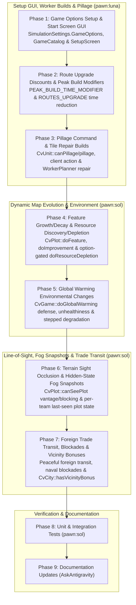

# World & Map Generation Completion Plan

## Overview

This plan completes every item in the **World & Map Generation** stanza of `docs/ROADMAP.md` except for **custom map generator scripts** (which is moved to its own standalone checkbox in `docs/ROADMAP.md` and remains unimplemented), and adds **Game Options** support to `SimulationSettings`, `GameCatalog`, `NewGameOptions`, and the Godot `SetupScreen` GUI so that **Resource Depletion** (along with the other implemented simulation game options) can be toggled at game start, using the equations and rules from the C++ DLL reference (`CvPlot.cpp`, `CvGame.cpp`, `CvUnit.cpp`, `CvCity.cpp`, and `CvPlayer.cpp`):

- **Game Options setup & start screen GUI**: Add `GameOptions` (`SortedDictionary<string, bool>`) to `SimulationSettings` and `Simulation.IsOptionEnabled(string id)`; expose only the game options backed by implemented simulation rules (`foundation:gameoption_assimilation`, `foundation:gameoption_realistic_corporations`, `foundation:gameoption_realistic_culture_spread`, `foundation:gameoption_religion_decay`, `foundation:gameoption_no_inquisitions`, `foundation:gameoption_no_revolution`, `foundation:gameoption_multiple_religion_spread`, and `foundation:gameoption_resource_depletion`) via `ISetupPolicy` / `GameCatalog.GameOptions`; wire `NewGameOptions` and `SetupScreen` (`src/Civ.Godot/SetupScreen.cs`) to display checkboxes for those implemented options; and record `src/Mods/Foundation/data/game-option.json`'s remaining unimplemented option flags in `docs/ROADMAP.md`.
- **Route upgrade discounts & peak build modifiers** (`CvPlot::getBuildTime`, `CvPlot.cpp:3512–3565`): Apply `PEAK_BUILD_TIME_MODIFIER` (+100%) to worker build time on `PlotKind.Peak` tiles and subtract the existing route's base `BuildDef.Time` (floored at `1`) when `ROUTES_UPGRADE` is enabled and a worker upgrades a lower-value route to a higher-value route.
- **Pillage command & tile repair builds** (`CvUnit::canPillage`, `CvUnit::pillage`, `CvUnit.cpp:7728–8020`, `CvGameUtils.py:311`): Enforce cargo, domain, permanent-improvement, and peacetime own-improvement pillage rules; award pillage gold (`2` rolls of `ImprovementDef.PillageGold` scaled by `pillage_percent`) only when pillaging non-teammate improvements; step improvements down along `ImprovementDef.ImprovementPillage`; expose `PillageCommand` in `GameSession.UnitActions`; and update `WorkerPlanner` to repair/replace pillaged, ruined, or depleted tile improvements and severed routes.
- **Dynamic feature growth & decay** (`CvPlot::doFeature`, `CvPlot.cpp:11798–12045`): Per-turn feature disappearance rolls (`FeatureDef.Disappearance`) and adjacent feature growth/spread rolls (`FeatureDef.Growth`, `FeatureDef.Spread`, `FeatureDef.CanGrowAnywhere`, `ImprovementDef.FeatureGrowth` on adjacent preserves) scaled by `FEATURE_GROWTH_MODIFIER` (+25%), `ROUTE_FEATURE_GROWTH_MODIFIER` (-25% on routed tiles), and `GameSpeedDef.VictoryDelayPercent`.
- **Resource discovery & depletion** (`CvPlot::doImprovement`, `CvPlot::doResourceDepletion`, `CvPlot.cpp:977–1095, 14541–14745`): Per-turn discovery rolls (`ImprovementBonus.DiscoveryRandomRange` scaled by `GameSpeedDef.ConstructPercent`, and 10× more frequent when `foundation:gameoption_resource_depletion` is enabled) on worked, bonus-free improved plots for valid revealed bonuses; plus game-option-gated (`foundation:gameoption_resource_depletion`) resource deposit exhaustion (`ImprovementBonus.DepletionRandomRange`) and mine exhaustion (`ImprovementDef.DepletionRand` converting mines to `world:depleted_mine` and setting `Plot.DepletedMine` to block `BuildDef.Mine` until a bonus is revealed on the tile).
- **Environmental changes (global warming)** (`CvGame::doGlobalWarming`, `CvGame.cpp:7558–7880`): Per-turn global warming defense from map features (`FeatureDef.WarmingDefense`, doubled by `TREEHUGGER_DEFENSE_BONUS` under civics with `ExtraHealth > 0`, scaled by `GLOBAL_WARMING_FOREST` per land plot) versus empire city unhealthiness from buildings (`GLOBAL_WARMING_UNHEALTH_WEIGHT`), resources (`GLOBAL_WARMING_BONUS_WEIGHT`), and dirty power (`GLOBAL_WARMING_POWER_WEIGHT`), driving stepped feature/terrain degradation (`snow -> tundra/marsh -> grass -> plains -> desert -> coast`) and clearing tile improvements.
- **Terrain sight occlusion & hidden-state fog snapshots** (`CvPlot::seeFromLevel`, `CvPlot::seeThroughLevel`, `CvPlot::canSeePlot`, `CvPlot::getRevealedImprovementType`, `CvPlot::getRevealedRouteType`, `CvPlot::getRevealedOwner`, `CvPlot.cpp:2379–2630, 10650–10830`): Line-of-sight elevation and feature occlusion (`TerrainDef.SeeFrom`, `TerrainDef.SeeThrough`, `FeatureDef.SeeThrough`, `HILLS_SEE_FROM_CHANGE`, `HILLS_SEE_THROUGH_CHANGE`, `PEAK_SEE_FROM_CHANGE`, `PEAK_SEE_THROUGH_CHANGE`) blocking sight behind hills, peaks, and dense forests/jungles while granting vantage range from high ground (with aerial bypass for `domain_air` and recon); plus per-team fog-of-war plot snapshots so fogged tiles retain their last-observed terrain, feature, improvement, route, and owner until re-sighted.
- **Foreign trade network transit, blockades & vicinity resource predicates** (`CvPlot::isTradeNetwork`, `CvPlot::isTradeNetworkConnected`, `CvUnit::canPlunder`, `CvUnit::plunder`, `CvUnit::updatePlunder`, `CvCity::isBlockaded`, `CvCity::hasVicinityBonus`, `CvPlot::isHasValidBonus`, `CvPlot.cpp:5356, 5844–5950, 10107`, `CvUnit.cpp:8030–8175`, `CvCity.cpp:8906, 25833`): Allow physical resource and city-connection networks to transit revealed peaceful foreign territory without requiring an explicit Open Borders treaty; implement enemy naval blockades within `SHIP_BLOCKADE_RANGE` severing water trade network tiles and coastal city sea work/trade; and tighten vicinity resource checks (`CityRequirements.Vicinity` and `BuildingEffects.AddVicinity`) to require a valid bonus-enabling improvement and network connection to the city (or city-center / local building free bonus).



## Usage of Subagents

Every implementation phase and review checkpoint is delegated to a sub-agent using `subagent_run` (or the `AskAntigravity` tool where specified). Easy implementation phases (**Phase 1**, **Phase 2**, and **Phase 3**) use `pawn:luna`; complex implementation phases (**Phase 4**, **Phase 5**, **Phase 6**, **Phase 7**, and **Phase 8**) use `pawn:sol`; **Phase 9** (documentation-only) uses `AskAntigravity`. Adversarial review checkpoints use `pawn:ds4` and `AskAntigravity` (never with `mode=plan`). Sub-agents must be launched in background mode with a concise `title` matching the phase or checkpoint identifier.

## Parallelism

- Implementation phases run sequentially in phase order because later phases build on shared `Civ.Core` contracts, `Plot` state, and `World` services introduced in earlier phases.
- Within every review checkpoint (`R-a`, `R-b`, `R-c`, `R-d`), the two adversarial reviewers (`pawn:ds4` and `AskAntigravity`) must run in parallel and independently without seeing each other's reports.

## Periodic Updates

Implementor sub-agents must update the **Encountered Serious Issues** sub-section of their assigned Phase whenever they encounter non-trivial problems, unexpected test interactions, or schema/contract constraints during implementation.

## Commit Boundaries

Every Phase ends in a standalone commit before its review checkpoint starts. Reviewers always inspect a frozen commit hash and must never run against an uncommitted working tree or edit tracked files. Commit messages must stand alone without referencing plan phase numbers or checkpoint IDs.

## Review Checkpoints

- **Checkpoint R-a**: Dual adversarial review of **Phase 1**, **Phase 2**, and **Phase 3** by `pawn:ds4` and `AskAntigravity` (do not use `mode=plan`).
- **Checkpoint R-b**: Dual adversarial review of **Phase 4** and **Phase 5** by `pawn:ds4` and `AskAntigravity` (do not use `mode=plan`).
- **Checkpoint R-c**: Dual adversarial review of **Phase 6** and **Phase 7** by `pawn:ds4` and `AskAntigravity` (do not use `mode=plan`).
- **Checkpoint R-d**: Dual adversarial review of **Phase 8** (unit and integration tests) by `pawn:ds4` and `AskAntigravity` (do not use `mode=plan`).
- **Phase 9** is a documentation-only phase executed by `AskAntigravity` and receives no review checkpoint.

## Phase List

```
[x] 1.   (*pawn:luna*) Implement Game Options setup settings, start screen GUI, and active option wiring (verified by ds4 and Gemini at R-a)
[x] 2.   (*pawn:luna*) Implement route upgrade discounts and peak build time modifiers (verified by ds4 and Gemini at R-a)
[x] 3.   (*pawn:luna*) Complete unit pillaging rules, client pillage action, and worker tile repair builds
[x] R-a. (*pawn:ds4*) (`AskAntigravity`) Checkpoint A: Review Phase 1, 2 & 3 — closed at 6f41501
[x] 4.   (*pawn:sol*)  Implement dynamic feature growth & decay and game-option-gated resource discovery & depletion (verified by ds4 and Gemini at R-b)
[x] 5.   (*pawn:sol*)  Implement global warming environmental changes (verified by ds4 and Gemini at R-b)
[x] R-b. (*pawn:ds4*) (`AskAntigravity`) Checkpoint B: Review Phase 4 & 5 — closed at 6858f9c
[x] 6.   (*pawn:sol*)  Implement terrain sight occlusion and hidden-state fog snapshots (verified by ds4 and Gemini at R-c)
[x] 7.   (*pawn:sol*)  Implement foreign trade network transit, naval blockades, and vicinity resource predicates (verified by ds4 and Gemini at R-c)
[x] R-c. (*pawn:ds4*) (`AskAntigravity`) Checkpoint C: Review Phase 6 & 7 — closed at 3260efb
[x] 8.   (*pawn:sol*)  Add comprehensive unit and integration tests for Game Options and World & Map Generation mechanics (verified by ds4 and Gemini at R-d)
[x] R-d. (*pawn:ds4*) (`AskAntigravity`) Checkpoint D: Review Phase 8 — closed at d5febe6
[x] 9.   (`AskAntigravity`) Update ROADMAP.md and DESIGN.md (no review)
```

---

## Execution Log

- Phase 3 committed `26e3417722120b6e9124c1690e6bea77673e6a2e`; task `subtask_pawn_1792115682822_bf0ce994`; session `/home/gordon/.pi/agent/sessions/--home-gordon-workspace-civ--/2026-10-16T01-54-42-842Z_01a1426b-2e19-74ff-83be-0ff9a3b46cf1.jsonl`. Three regression tests passed and failed on baseline per implementer; broad exit command timed out; direct worker coverage missing.
- R-a round 1: Muse task `subtask_pawn_1792116439975_7eb14299`; session `/home/gordon/.pi/agent/sessions/--home-gordon-workspace-civ--/2026-10-16T02-07-19-994Z_01a14276-bbb8-74ff-83be-0ffb9931b271.jsonl`. Final report recovered with pi-session-read at user request (2026-10-16T03:07:56.031Z), superseding earlier provider-failure status. Reviewed frozen `26e3417722120b6e9124c1690e6bea77673e6a2e`. DEMAND: restore typed reference validation by implementing IContentRequirementEvaluator on GameOptionRequirements with DefinitionType = typeof(GameOptionDef). Probe failed on reviewed commit and passed on baseline; otherwise typoed option leaves can bypass reference closure, including inverted gates. Scope: restore typed contract and add regression test. Targeted checks reported passed: 4 focused, 54 client/religion, 35 world/AI plus 5 core AI, 1 content closure. Full suite/E2E/extractor/Godot GUI not run. NOTEs: keep depletion GUI deferral until Phase 4; fix malformed Resolve XML summary; add direct worker coverage; replace reflected pillage event assertions with typed assertions and specific rejection reasons; cover route-only pillage, positive enemy gold, negative modifiers in Phase 8. R-a remains open with both reviewers' demands pending.
- Phase 4: task `subtask_pawn_1792123138700_f0c3886d`; session `/home/gordon/.pi/agent/sessions/--home-gordon-workspace-civ--/2026-10-16T03-58-58-718Z_01a142dc-f29a-74ff-83be-1003dfb8b464.jsonl`; commit `f8dafa0296bc1ea8d8a91ae0415749cc10975a7b`. Implementer reports 54 targeted tests passed, baseline failures confirmed, new rule complexity ≤8. Depletion option exposed; zero-valued depletion odds skip as reference. Resource-consumption service absent, using reference zero-consumption formula (review pending; preserve limitation in final docs).
- Phase 5: task `subtask_pawn_1792123914852_bfad78cc`; session `/home/gordon/.pi/agent/sessions/--home-gordon-workspace-civ--/2026-10-16T04-11-54-870Z_01a142e8-ca75-74ff-83be-10046ad1173c.jsonl`; commit `4cfb6e22b3759649a31ca67d56a45facb7e7126c`. Authoritative city pollution and warming implemented, implementer reports 97 targeted checks, 32 baseline failures/14 controls.
- R-b round1: ds4 `subtask_pawn_1792124902304_306b2662`, session `/home/gordon/.pi/agent/sessions/--home-gordon-workspace-civ--/2026-10-16T04-28-22-322Z_01a142f7-dbb2-74ff-83be-1006c5e0055b.jsonl`, demanded disorder gate for discovery/mine exhaustion/upgrades; Gemini conversation `b5c1e851-8351-415b-a839-c235c0e6ec30` ACCEPT. Fixer same Phase4 session committed `48318844d345d9c2a445014632eecf1aed12b9e8`; 13 pre-fix failures/1 control, 110 world tests pass.
- R-b round2: ds4 `subtask_pawn_1792127104509_ff7811ab` found remaining OutsideBorders upgrade bypass; Gemini ACCEPT. Same fixer committed invariant-based correction `6858f9c182a8dcd36e0d325462a028e67a31f7b4` with assigned/productive states separate. New matrix 8 baseline failures/12 controls, 20 fixed cases pass.
- R-b round3 CLOSED: ds4 `subtask_pawn_1792129058554_0076c421`, session `/home/gordon/.pi/agent/sessions/--home-gordon-workspace-civ--/2026-10-16T05-37-38-573Z_01a14337-470c-74ff-83be-100ee7287157.jsonl`, and Gemini conversation `b5c1e851-8351-415b-a839-c235c0e6ec30` ACCEPT frozen `6858f9c182a8dcd36e0d325462a028e67a31f7b4`, zero DEMANDs. Both reproduced 8 pre-fix failures/12 controls and 130 passing WorldRulesTests. Gemini 33 client tests and Godot build clean. No full suite/GUI runtime. Carry low-severity reference differences: genuinely-unworked OutsideBorders upgrades retained by existing design; zero-consumption depletion and absent disabled-power state; deterministic non-native warming selection/RNG. Low-risk overlap OutsideBorders matrix case not directly tested; productive union is covered separately. Future incapacitation states must use GovernmentStatus.IsDisorder.
- Phase 6 BLOCKED on expected-contract conflicts: task `subtask_pawn_1792129444819_994950b3`; session `/home/gordon/.pi/agent/sessions/--home-gordon-workspace-civ--/2026-10-16T05-44-04-860Z_01a1433d-2bfb-74ff-83be-10103b11b6b3.jsonl`; commit `f465be2e594fc48f2a79ddb020eedc633d5156c2`. Implementer reports new10 tests pass, baseline9 failures/1 control; broader222 pass/4 fail. Three existing title cases mark Revealed without snapshot; one existing terrain test expects edits to fogged forest to render immediately. Existing expectations unchanged; stopped for user decision rather than weakening tests or restoring privacy leaks. Godot build clean. Phase6 not exit-complete; no R-c review yet.
- Phase6 authorized migration: user approved four fog-memory contract updates. Same Phase6 task/session committed `ba3eca639948626869d2b31d11adc615e08bfd74`, no production changes, preserved title/locality assertions and strengthened hidden-state checks; targeted226 pass, Godot build clean. R-c pending.
- Phase7 BLOCKED: task `subtask_pawn_1792154411787_a00ae45e`; session `/home/gordon/.pi/agent/sessions/--home-gordon-workspace-civ--/2026-10-16T12-40-11-796Z_01a144ba-2313-74ff-83be-101392cf1979.jsonl`; commit `f201d075cb83200cb09caec93a9d000d3f038b1e`. Implementer reports38 new cases pass (baseline34 fail/4 controls with inert compile contracts); final293 pass/5 unchanged failures. Two diplomacy tests require treaty-gated physical transit; three warming fixtures assume count-zero FreeBonus grants one copy, contrary to reference count semantics. Existing tests unchanged; awaiting user authorization for contract migration before exit. Godot build clean; maximum touched complexity10; no AI blockade planner added. Full suite/R-c not run.
- Phase7 authorized migration committed `3260efbd832a19fac5f53f4009e6be0c801d85ae`: same task/session, user approved only five conflicts; no production changes;15 focused/298 targeted pass, Godot clean.
- R-c CLOSED at `3260efbd832a19fac5f53f4009e6be0c801d85ae`: ds4 task `subtask_pawn_1792157816720_04cdf3f6`, session `/home/gordon/.pi/agent/sessions/--home-gordon-workspace-civ--/2026-10-16T13-36-56-814Z_01a144ee-17ed-74ff-83be-1014f28c10c7.jsonl`, and Gemini conversation `089e2a72-7e62-4a52-8153-2d576257a712` ACCEPT zero DEMANDs. Both298 targeted pass/Godot clean; ds4 additional50 sibling tests and2 city-memory probes pass. Both audited nine authorized migrations as preserved/strengthened. Carry notes: water see-through constant differs from reference but both shipped defaults0; city-memory save/removal probes not committed; blockade query performance unmeasured; all-units blockade action UX nit; wrapped tie orientations/water-tech vantage not exhaustive. Full default suite pending Phase8; runtime GUI/E2E/extractor not run.
- Phase8 BLOCKED before tracked changes: task `subtask_pawn_1792158561897_52e08620`; session `/home/gordon/.pi/agent/sessions/--home-gordon-workspace-civ--/2026-10-16T13-49-21-907Z_01a144f9-7673-74ff-83be-1017c415331d.jsonl`; baseline3260efb unchanged. Implementer ran mise run test: core80 pass/import40 pass/mod608 pass1 fail, total728 pass1 fail0 skipped. TerrainMeshTests.Revealing_a_tile_dirties_its_chunks sets only Revealed without snapshot; strict fog-memory contract hides geometry. Existing test unchanged; requested permission to establish memory via IVisibilityService.RevealPlot while retaining dirty-chunk assertions. Remaining coverage and AI spending assessment pending; no commit/R-d yet.
- User authorized all future intentional unit-test contract migrations (preserve/strengthen checks; no hiding defects). Phase8 same task/session committed `d5febe61d370bfb892d8c0ab5a89f02b8712c78d`; full default743 pass0 fail0 skipped. Added distinct carried coverage; active paid AI work query fixes two reproduced repeat-charge/abandonment defects without changing spending policy.
- R-d CLOSED at `d5febe61d370bfb892d8c0ab5a89f02b8712c78d`: ds4 task `subtask_pawn_1792160316264_70b37f7f`, session `/home/gordon/.pi/agent/sessions/--home-gordon-workspace-civ--/2026-10-16T14-18-36-274Z_01a14514-3b72-74ff-83be-10195e141976.jsonl`, and independent Gemini conversation `ec8a62ad-856b-4973-b39a-19580d1f8ce8` ACCEPT no DEMANDs. Both independently ran full mise run test743 pass0 fail0 skipped, focused31, Godot build clean and baseline2 failures/2 controls. Covered prior negative pillage, bonus repair, typed event, city memory, water vantage/ties, world counts. Carry low notes: new-job cost weighting remains product policy; retreat/restart charging is pre-existing and only inspected, no new concrete defect demonstrated; road timing test uses content320; geometry samples not exhaustive. E2E/extractor/runtime GUI/performance not run. Phase9 docs pending.
- Phase9 COMPLETE: Gemini conversation `0c764326-86eb-47e6-a160-b24686201756`; docs-only commit `d60fbdc6b82d884afc7e28cf84406222b855e73b`. Reports mise run test743 passed0 failed0 skipped, clean tracked tree/product-name checks, no production/test edits. Corrected plan's six-versus-seven roadmap count; all seven complete, custom scripts separate pending. Game-option file referenced for future flags; player blockade documented without claiming AI orders. All nine phases committed, checkpoints closed. No open DEMANDs.
- Final residuals: low/product-policy AI new-job scoring ignores gold beyond affordability; no concrete economy defect shown, future fix requires chosen cost policy. Low pre-existing retreat/restart charging noted by inspection, not reproduced; any change needs interruption behavior tests and payment policy. Low test maintenance road work320 constant; adjust test only with deliberate content tuning. Informational/reference differences unworked OutsideBorders, zero-consumption depletion, absent outage state, port RNG and non-default water sight constants retained/documented; future parity work needs corresponding services/contract decisions. Low unmeasured large-map blockade cost and nonexhaustive geometry; future performance/geometry probes required if observed defects. E2E/extractor/runtime GUI/race checks not run. Stopping rule met using delegated verification summaries; no executor-run tests.
- User reviewer override: all future pawn review runs use pawn:ds4, retaining independent AskAntigravity reviewer. Historical Muse report above remains attributed to Muse.
- R-a Gemini conversation `e6423515-ff34-4b36-b153-9fde0fcfec87` reviewed `26e3417722120b6e9124c1690e6bea77673e6a2e`: ACCEPT Phases 1–2; DEMAND funded route upgrades fail because AvailableBuilds rejects paid builds; allow affordable builds with tile validation. DEMAND direct AI repair and upgrade regression tests. NOTE worked unimproved water tiles indefinitely block route upgrades; correct eligibility to improvable plots before final closure. Reviewer reports 7 focused plus 27 additional tests passed. R-a remains open.
- R-a round 2 CLOSED at `6f41501d0ac176f85709dd5390c23f2bfe00dd20`: ds4 task `subtask_pawn_1792121857624_5c123522`, session `/home/gordon/.pi/agent/sessions/--home-gordon-workspace-civ--/2026-10-16T03-37-37-670Z_01a142c9-6685-74ff-83be-1000931b5811.jsonl`, and independent Gemini conversation `e6423515-ff34-4b36-b153-9fde0fcfec87` both ACCEPT, no open DEMANDs. ds4 independently confirmed 5 pre-fix failures and passing frozen tests (12 focused, 33 closure/religion, 81 military/client, 40 AI/world), Godot build clean. Gemini confirmed focused fixes. Full suite and runtime GUI not run. Carry low-severity notes: depletion checkbox must be added in Phase 4; Phase 8 negative pillage modifier/bonus-connection AI tests and remaining reflected client event assertion; AI may spend heavily on affordable builds since gain ignores gold cost (reachable with funded expensive choices; assess economy behavior in Phase 8); build-time test name overpromises downgrade negative coverage.
- R-a fixer recovery committed as `6f41501d0ac176f85709dd5390c23f2bfe00dd20`: restored typed game-option reference closure and invalid-id rejection without adding schema entries for policy-only options; AI build choices now include affordable paid builds, exclude non-improvable work from the readiness invariant, and prioritize corridor upgrades. Added direct AI tests for funded/unfunded route work, water/land readiness, and freshwater ruin repair. Typed pillage tests exposed a missing treasury credit; fixed it and covered foreign gold and route-only events. On isolated baseline `26e3417`, 5/10 focused tests failed for the expected reasons: both game-option closure/rejection tests, funded route-upgrade cases, and missing pillage treasury credit. Current focused run passed 10/10. Negative `pillage_percent` and direct AI bonus-connection repair coverage remain Phase 8 follow-ups; R-a is still open pending re-review.
- Phase 2: task `subtask_pawn_1792115305204_98d1b008`; session `/home/gordon/.pi/agent/sessions/--home-gordon-workspace-civ--/2026-10-16T01-48-25-210Z_01a14265-6af9-74ff-83be-0ff629d77522.jsonl`; commit `6fe384b35e7eccdb548ca235d5786a3f929ec5a0`. Implementer reports 18 targeted tests passed, regression failed on baseline; independent review pending.
- Phase 1: task `subtask_pawn_1792115057199_f1b69ebb`; session `/home/gordon/.pi/agent/sessions/--home-gordon-workspace-civ--/2026-10-16T01-44-17-212Z_01a14261-a23c-74ff-83be-0ff48228f6a6.jsonl`; commit `c2c9cbd3178c36bf32e76bebb814dc676d20a3b4`. Implementer reports 56 targeted tests passed and Godot build clean; independent review pending. Resource Depletion checklist entry deferred until Phase 4 supplies rules, to honor implemented-options-only GUI. Roadmap file reference added early.

## Phase 1: Implement Game Options setup settings, start screen GUI, and active option wiring

### Goal

Add per-session `GameOptions` to `SimulationSettings` and `Simulation.IsOptionEnabled(string id)`, expose only the game options backed by implemented simulation rules through `ISetupPolicy` and `GameCatalog.GameOptions` (including `foundation:gameoption_resource_depletion`), wire all existing option consumers to `sim.IsOptionEnabled`, and add a Game Options checklist to the Godot `SetupScreen` GUI.

### Target Sites & Planned Changes

1. `src/Civ.Core/Game/Simulation.cs` and `src/Civ.Core/Game/PresentationContracts.cs`
   - In `SimulationSettings`, add:
     `public SortedDictionary<string, bool> GameOptions { get; init; } = new(StringComparer.Ordinal);`
   - In `Simulation`, add:
     ```csharp
     public bool IsOptionEnabled(string id) =>
         Settings.GameOptions.TryGetValue(id, out bool enabled)
             ? enabled
             : Content.TryGet<Civ.Content.Schema.GameOptionDef>(id, out var def) && def.Default;
     ```
   - In `PresentationContracts.cs`:
     - Add `public sealed record SetupGameOption(string Id, string Name, bool Default, string Help = "");`.
     - Extend `ISetupPolicy` with `IEnumerable<SetupGameOption> GameOptions(ContentDb content) => [];`.
     - Extend `SetupPolicies` with:
       ```csharp
       public static IReadOnlyList<SetupGameOption> GameOptions(ContentDb content) =>
           content.Services.Get<ISetupPolicy>().SelectMany(p => p.GameOptions(content))
               .OrderBy(o => o.Name, StringComparer.Ordinal).ThenBy(o => o.Id, StringComparer.Ordinal).ToList();
       ```
2. `src/Mods/Foundation/FoundationMod.cs`, `src/Mods/Foundation/SetupPolicy.cs`, `src/Mods/Cities/ProductionEligibility.cs`, `src/Mods/Corporations/CorporationService.cs`, `src/Mods/Government/CivicEffects.cs`, and `src/Mods/Religion/NaturalSpreadRules.cs`
   - In `FoundationMod.Register`:
     - Update the `"game-option"` evaluator to evaluate `ctx.Sim.IsOptionEnabled(leaf.Id)` (and register an `IRequirementEvaluator` for `"game-option"` that checks `context.Sim.IsOptionEnabled(leaf.Id)` without failing when `leaf.Id` is a policy-supplied modder option such as `foundation:gameoption_resource_depletion` or `foundation:gameoption_multiple_religion_spread`, while preserving `GameOptionDef` registry count = 64 for `ModContentTests`).
   - In `Foundation.SetupPolicy.GameOptions(ContentDb content)`:
     - Return the `SetupGameOption` entries for the options backed by implemented simulation rules:
       - From `Content.Get<GameOptionDef>`:
         - `foundation:gameoption_assimilation`
         - `foundation:gameoption_realistic_corporations`
         - `foundation:gameoption_realistic_culture_spread`
         - `foundation:gameoption_religion_decay`
         - `foundation:gameoption_no_inquisitions`
         - `foundation:gameoption_no_revolution`
       - Policy-supplied modder game options (from C++ `ModderGameOptionTypes` in `CvEnums.h:3457, 3465`):
         - `new("foundation:gameoption_multiple_religion_spread", "Multiple Religion Spread", false, "Cities with an existing religion can still receive additional religions via natural spread.")`
         - `new("foundation:gameoption_resource_depletion", "Resource Depletion", false, "Worked mines and resource deposits may exhaust over time, while new resource discovery becomes more frequent.")`
   - Replace direct `.Default` lookups in `ProductionEligibility.cs` (`foundation:gameoption_assimilation`), `CorporationService.cs` and `CivicEffects.cs` (`foundation:gameoption_realistic_corporations`), and `NaturalSpreadRules.Option` with `sim.IsOptionEnabled(...)`.
3. `src/Civ.Client.Core/GameCatalog.cs`, `src/Civ.Client.Core/NewGameOptions.cs`, and `src/Civ.Godot/SetupScreen.cs`
   - In `GameCatalog`:
     - Add `public IReadOnlyList<SetupGameOption> GameOptions { get; }` initialized via `SetupPolicies.GameOptions(Content)`.
   - In `NewGameOptions`:
     - Add `IReadOnlyDictionary<string, bool>? GameOptions = null` parameter (defaulting to `null`), and in `ToSettings(GameCatalog catalog)` populate `SimulationSettings.GameOptions` from ` catalog.GameOptions` defaults merged with any explicit `GameOptions` overrides.
   - In `SetupScreen.cs`:
     - Add a scrollable `VBoxContainer` of `CheckBox` controls in `SettingsColumn()` under `"Game options"`, one for each entry in `_catalog.GameOptions` (pre-checked to `option.Default`, with `TooltipText = option.Help`), and pass the selected `Dictionary<string, bool>` into `new NewGameOptions(..., GameOptions: selectedOptions)` in `Options()`.
4. Bump `version` in `src/Mods/Foundation/mod.json`, `src/Mods/Cities/mod.json`, `src/Mods/Corporations/mod.json`, `src/Mods/Government/mod.json`, and `src/Mods/Religion/mod.json`.

### Pseudocode

```csharp
// Simulation.cs & SetupPolicy.cs
public bool IsOptionEnabled(string id) =>
    Settings.GameOptions.TryGetValue(id, out bool enabled)
        ? enabled
        : Content.TryGet<Civ.Content.Schema.GameOptionDef>(id, out var def) && def.Default;
```

### Exit Criteria

- Targeted tests pass: `dotnet test tests/Civ.Mods.Tests --no-restore --filter "FullyQualifiedName~ModContentTests|FullyQualifiedName~ClientSessionTests|FullyQualifiedName~ReligionRulesTests"` (deferring full suite to Phase 8).
- The Phase's required checks pass, and no known regression from an earlier Phase.

### Encountered Serious Issues

_None yet._

---

## Phase 2: Implement route upgrade discounts and peak build time modifiers

### Goal

Port the C++ DLL worker build time calculation (`CvPlot::getBuildTime` at `CvPlot.cpp:3512–3565`) into `WorkerBuildService.RequiredWork` so building on mountain peaks applies `PEAK_BUILD_TIME_MODIFIER` and upgrading an existing route to a higher-tier route subtracts the existing route's base build time when `ROUTES_UPGRADE` is enabled.

### Target Sites & Planned Changes

1. `src/Mods/World/WorkerBuildService.cs`
   - In `WorkerBuildService.RequiredWork(Simulation sim, TileId tile, string buildId)`:
     - Start with `long time = build.Time;` and add `build.FeatureEffects.GetValueOrDefault(f)?.Time ?? 0` if `plot.Feature is { } f`.
     - **Peak build time modifier** (`CvPlot.cpp:3525`):
       - When `plot.Kind == PlotKind.Peak`, read `int peakMod = Raw(sim, "PEAK_BUILD_TIME_MODIFIER", 100);` (from `RuleConstantsDef.Raw`) and scale:
         `time = time * Math.Max(0, 100 + peakMod) / 100;`
     - **Route upgrade discount** (`CvPlot.cpp:3530–3545`):
       - When `build.RouteType is not null && plot.Route is { } existingRoute && Raw(sim, "ROUTES_UPGRADE", 1) != 0`:
         - Find the first `S.BuildDef` in `sim.Content.Get<S.BuildDef>().All` (in ordinal `Id` order) where `b.RouteType == existingRoute`:
           `time = Math.Max(1, time - existingRouteBuild.Time);`
     - Continue applying `TerrainDef.BuildModifier`, `GameSpeedDef.BuildPercent`, and `EraDef.BuildPercent` sequentially, returning `checked((int)Math.Max(1, time))`.
2. Bump `version` in `src/Mods/World/mod.json`.

### Pseudocode

```csharp
// CvPlot::getBuildTime (CvPlot.cpp:3512)
long time = build.Time;
if (plot.Feature is { } f) time += build.FeatureEffects.GetValueOrDefault(f)?.Time ?? 0;
if (plot.Kind == PlotKind.Peak)
    time = time * Math.Max(0, 100 + Raw(sim, "PEAK_BUILD_TIME_MODIFIER", 100)) / 100;
if (build.RouteType is not null && plot.Route is { } oldRoute && Raw(sim, "ROUTES_UPGRADE", 1) != 0)
{
    var oldBuild = sim.Content.Get<S.BuildDef>().All.FirstOrDefault(b => b.RouteType == oldRoute);
    if (oldBuild is not null) time = Math.Max(1, time - oldBuild.Time);
}
time = time * Math.Max(0, 100 + sim.Content.Get<S.TerrainDef>(plot.Terrain).BuildModifier) / 100;
time = time * sim.Content.Get<S.GameSpeedDef>(sim.Settings.GameSpeed).BuildPercent / 100;
time = time * sim.Content.Get<S.EraDef>(sim.Settings.StartingEra).BuildPercent / 100;
return checked((int)Math.Max(1, time));
```

### Exit Criteria

- Targeted tests pass: `dotnet test tests/Civ.Mods.Tests --no-restore --filter "FullyQualifiedName~WorldRulesTests"` (deferring full suite to Phase 8).
- The Phase's required checks pass, and no known regression from an earlier Phase.

### Encountered Serious Issues

_None yet._

---

## Phase 3: Complete unit pillaging rules, client pillage action, and worker tile repair builds

### Execution Log

- Implemented directly (no nested implementer session); commit `26e3417722120b6e9124c1690e6bea77673e6a2e` (`Complete unit pillaging and worker repairs`). Targeted build succeeded for `Civ.Mods.Military`, `Civ.Mods.Ai`, `Civ.Client.Core`, `Civ.Mods.World`, and `Civ.Mods.Tests`. Three focused pillage/client tests passed. The same three tests failed on baseline `6fe384b` in a temporary worktree for the intended gold, owned-route validation, and missing-client-action behaviors; the temporary worktree was removed.

### Goal

Complete `CvUnit::canPillage` and `CvUnit::pillage` (`CvUnit.cpp:7728–8020`, `CvGameUtils.py:311`), publish a `PlotPillaged` domain event, surface `PillageCommand` in `GameSession.UnitActions`, and update `WorkerPlanner` so workers repair/replace pillaged, ruined, or depleted improvements and rebuild pillaged routes.

### Target Sites & Planned Changes

1. `src/Civ.Core/Game/MilitaryContracts.cs`
   - Add domain event `public sealed record PlotPillaged(int Unit, int Player, TileId Plot, string? Improvement, string? ReplacementImprovement, string? Route, int Gold) : DomainEvent;`.
2. `src/Mods/Military/UnitService.cs`
   - In `ValidatePillage` & `ValidatePillagePlot` (`CvUnit::canPillage`, `CvUnit.cpp:7728`):
     - Reject if `MilitaryData.Read(sim, unit).TransportId is not null` (`"Loaded cargo cannot pillage"`).
     - Reject if `def.Domain == "military:domain_air"` or `(def.Domain == "military:domain_sea") != sim.Content.Get<S.TerrainDef>(plot.Terrain).IsWater` (`"Invalid domain for pillaging"`).
     - If `plot.Improvement is { } impId`:
       - `var imp = sim.Content.Get<S.ImprovementDef>(impId);`
       - Reject if `imp.Goody` (`"Cannot pillage a goody hut"`) or `imp.Permanent` (`"Cannot pillage a permanent improvement"`).
     - Else if `plot.Route is null`: return `"Nothing to pillage"`.
     - If `plot.Owner is { } owner`:
       - If `!MilitaryData.Enemy(sim, unit.Owner, owner)`:
         - Allow only when `owner == unit.Owner && plot.Improvement is not null` (`CvUnit.cpp:7780–7785`: a player may demolish their own non-permanent improvement at peace, but may never pillage own/friendly routes or peaceful foreign territory).
   - In `Pillage(Simulation sim, Unit unit)` (`CvUnit::pillage`, `CvUnit.cpp:7805`):
     - If `plot.Improvement is { } id`:
       - `var def = sim.Content.Get<S.ImprovementDef>(id);`
       - Award gold only when `plot.Owner is null || sim.TeamOf(plot.Owner.Value).Id != sim.TeamOf(unit.Owner).Id` (`CvUnit.cpp:7865`):
         `int gold = def.PillageGold > 0 ? sim.Rng.Next(def.PillageGold) + sim.Rng.Next(def.PillageGold) : 0;`
         `gold = gold * Math.Max(0, 100 + MilitaryData.Effect(MilitaryData.Effects(sim, unit), "pillage_percent")) / 100;`
         `sim.State.PlayerById(unit.Owner).Treasury += gold;`
       - Set `plot.Improvement = def.ImprovementPillage; plot.ImprovementTurns = 0;`.
       - Publish `new PlotPillaged(unit.Id, unit.Owner, sim.State.Grid.TileAt(unit.Position), id, def.ImprovementPillage, null, gold)`.
     - Else if `plot.Route is { } routeId`:
       - Set `plot.Route = null;`.
       - Publish `new PlotPillaged(unit.Id, unit.Owner, sim.State.Grid.TileAt(unit.Position), null, null, routeId, 0)`.
     - Clear `plot.BuildProgress.Clear()`, deduct `MoveDenominator` moves (`state.Moved = true; state.FortifyTurns = 0`), and recompute visibility if an `ActsAsCity` improvement was removed.
3. `src/Civ.Client.Core/GameSession.Units.cs`
   - In `UnitActions(Unit unit, Schema.UnitDef def)`:
     - When `def.Pillage` is true, add `Action("pillage", "Pillage", new PillageCommand { Player = Human, Unit = unit.Id })` (included when `Command != null`).
4. `src/Mods/Ai/WorkerPlanner.cs`
   - Update `TilePriority(TileId tile, bool worked)` and `ConnectionValue(string id, Plot plot)`:
     - Treat `world:city_ruins`, `world:city_ruins_arcology`, and `DepletedMine` improvements (or improvements with negative net yield change) as needing repair/cleanup (`priority += 15` instead of `priority -= 18`).
     - In `ConnectionValue`, when `VisibleBonus(plot) is { } bonus`: if `plot.Improvement is { } existingImp` and `ctx.Sim.Content.Get<ImprovementDef>(existingImp).BonusEffects.GetValueOrDefault(bonus.Id)?.Connects != true` (e.g., an improvement was pillaged down or built before the resource was revealed), still award the full resource connection bonus (`30 + 8 * bonus.Happiness + 6 * bonus.Health`) so workers replace/repair the improvement to connect the bonus.
     - In `RoadTiles()`, also allow route upgrades along connected city/resource corridors when a worker can build a superior route (`RouteDef.Value > existingRoute.Value`) and all worked tiles are already improved.
5. Bump `version` in `src/Mods/Military/mod.json` and `src/Mods/Ai/mod.json`.

### Pseudocode

```csharp
// CvUnit::canPillage & CvUnit::pillage (CvUnit.cpp:7728-7960)
bool foreignOrUnowned = plot.Owner is null || sim.TeamOf(plot.Owner.Value).Id != sim.TeamOf(unit.Owner).Id;
int gold = 0;
if (foreignOrUnowned && def.PillageGold > 0)
{
    gold = sim.Rng.Next(def.PillageGold) + sim.Rng.Next(def.PillageGold);
    gold = gold * Math.Max(0, 100 + MilitaryData.Effect(MilitaryData.Effects(sim, unit), "pillage_percent")) / 100;
    sim.State.PlayerById(unit.Owner).Treasury += gold;
}
plot.Improvement = def.ImprovementPillage;
plot.ImprovementTurns = 0;
```

### Exit Criteria

- Targeted tests pass: `dotnet test tests/Civ.Mods.Tests --no-restore --filter "FullyQualifiedName~MilitaryRulesTests|FullyQualifiedName~WorldRulesTests|FullyQualifiedName~ClientSessionTests|FullyQualifiedName~AiTests"` (deferring full suite to Phase 8).
- The Phase's required checks pass, and no known regression from an earlier Phase.

### Encountered Serious Issues

- Reference inspection corrected two details in the phase pseudocode: `CvPlot::isValidDomainForAction` allows units with `CanMoveAllTerrain` to act across land/water boundaries, and `CvGameUtils.doPillageGold` applies `gold += pillageChange * gold / 100` (not a nonnegative-clamped multiplier). Both are reflected in the implementation. The filtered phase-exit test command was attempted, but timed out while compiling the full test dependency graph under concurrent unrelated Godot work; focused project builds and the 3 relevant pillage/client tests completed successfully. R-a follow-up found the pillage event recorded the award without crediting treasury; that is now corrected. Route upgrade readiness is defined over worker-improvable land only; worked water and blocked land do not block corridor upgrades. Negative `pillage_percent` behavior remains a Phase 8 test follow-up.

---

## Phase 4: Implement dynamic feature growth & decay and game-option-gated resource discovery & depletion

### Goal

Port `CvPlot::doFeature` (`CvPlot.cpp:11798–12045`), `CvPlot::doImprovement` resource discovery and game-option-gated mine depletion (`CvPlot.cpp:977–1095`), and game-option-gated `CvPlot::doResourceDepletion` (`CvPlot.cpp:14678–14745`), along with `Plot.DepletedMine` enforcement (`CvPlayer.cpp:10993` and `CvTeam.cpp:7316`).

### Target Sites & Planned Changes

1. `src/Civ.Core/Game/Plot.cs` and `src/Civ.Core/Game/WorldContracts.cs`
   - Add `public bool DepletedMine { get; set; }` to `Plot`.
   - Add domain events in `WorldContracts.cs`:
     - `public sealed record FeatureChanged(TileId Plot, string? PreviousFeature, string? NewFeature) : DomainEvent;`
     - `public sealed record BonusDiscovered(TileId Plot, string Bonus, int Player) : DomainEvent;`
     - `public sealed record BonusDepleted(TileId Plot, string Bonus, int Player) : DomainEvent;`
     - `public sealed record MineDepleted(TileId Plot, string PreviousImprovement, string ReplacementImprovement, int Player) : DomainEvent;`
2. `src/Mods/World/BuildEligibility.cs`, `src/Mods/World/WorkerBuildService.cs`, and `src/Mods/World/WorldMod.cs`
   - In `BuildEligibility.Location` (`CvPlayer.cpp:10993`):
     - If `plot.DepletedMine && build.Mine`, return `"Mine is depleted on this plot"`.
   - In `WorldMod.Register` (`CvTeam.cpp:7316`):
     - Subscribe to `TechDiscovered`: when a team discovers `e.Tech`, for every plot on the map where `plot.Bonus is { } bonusId && sim.Content.Get<S.BonusDef>(bonusId).RevealTech == e.Tech` and `plot.Owner is { } owner && sim.TeamOf(owner).Id == e.Team`, set `plot.DepletedMine = false`.
3. `src/Mods/World/WorkerBuildService.cs` (`ImprovementTurnSystem` at `TurnPhase.Map`)
   - **Dynamic feature growth & decay (`CvPlot::doFeature`, `CvPlot.cpp:11940–12045`)**:
     - For each `tile` in `sim.State.Grid.Tiles`:
       - Let `plot = sim.State.Plots[tile.Value]` and `hex = sim.State.Grid.HexOf(tile)`.
       - If `plot.Feature is { } currentId`:
         - `int disappearance = sim.Content.Get<S.FeatureDef>(currentId).Disappearance;`
         - If `disappearance > 0`:
           - `int odds = Math.Max(1, 10000 * sim.Content.Get<S.GameSpeedDef>(sim.Settings.GameSpeed).VictoryDelayPercent / 100);`
           - If `sim.Rng.Next(odds) < disappearance`:
             - `plot.Feature = null;`
             - `sim.Events.Publish(new FeatureChanged(tile, currentId, null));`
       - Else if `sim.State.CityAt(hex) is null`:
         - For each `S.FeatureDef feature` in `sim.Content.Get<S.FeatureDef>().All`:
           - Require `(feature.Growth > 0 && !sim.State.UnitsAt(hex).Any()) || feature.Spread > 0`.
           - Require `plot.Improvement is null || (feature.CanGrowAnywhere && !worked.Contains(tile) && !Geography.Water(sim.Content, plot))`.
           - Require `Placement.FeatureValid(sim.State.Grid, sim.State.Plots, sim.Content, tile, feature)`.
           - Require `plot.Bonus is null || sim.Content.Get<S.BonusDef>(plot.Bonus).Features.GetValueOrDefault(feature.Id) || feature.Spread > 0`.
           - Compute `long prob = feature.CanGrowAnywhere ? feature.Growth : 0;`
           - For each `neighbor` in `sim.State.Grid.Neighbors(tile)`:
             - `var nPlot = sim.State.Plots[neighbor.Value];`
             - If `nPlot.Feature == feature.Id`:
               - `prob += nPlot.Improvement is { } impId ? sim.Content.Get<S.ImprovementDef>(impId).FeatureGrowth : feature.Growth;`
               - `prob += feature.Spread;`
           - `prob = prob * Math.Max(0, 100 + Raw(sim, "FEATURE_GROWTH_MODIFIER", 25)) / 100;`
           - If `plot.Route is not null`:
             `prob = prob * Math.Max(0, 100 + Raw(sim, "ROUTE_FEATURE_GROWTH_MODIFIER", -25)) / 100;`
           - If `prob > 0`:
             - `int odds = Math.Max(1, 10000 * sim.Content.Get<S.GameSpeedDef>(sim.Settings.GameSpeed).VictoryDelayPercent / 100);`
             - If `sim.Rng.Next(odds) < prob`:
               - `plot.Feature = feature.Id;`
               - `sim.Events.Publish(new FeatureChanged(tile, null, feature.Id));`
               - `break;`
   - **Resource discovery & game-option-gated depletion (`CvPlot::doImprovement` & `CvPlot::doResourceDepletion`, `CvPlot.cpp:977–1095, 14678–14745`)**:
     - Let `bool depletionEnabled = sim.IsOptionEnabled("foundation:gameoption_resource_depletion");`.
     - **Discovery** (on worked, owned plots with `plot.Improvement is { } impId && plot.Bonus is null`):
       - Iterate `S.BonusDef bonus` in `sim.Content.Get<S.BonusDef>().All`:
         - Require `bonus.RevealTech is null || sim.KnowsTech(owner, bonus.RevealTech)`.
         - Require `Placement.BonusValid(sim.State.Grid, sim.State.Plots, tile, bonus, areaSizes[plot.AreaId])`.
         - `int discoverRand = improvement.BonusEffects.GetValueOrDefault(bonus.Id)?.DiscoveryRandomRange ?? 0;`
         - If `discoverRand > 0`:
           - `int odds = Math.Max(1, discoverRand * sim.Content.Get<S.GameSpeedDef>(sim.Settings.GameSpeed).ConstructPercent / 100);`
           - If `depletionEnabled`, `odds = Math.Max(1, odds / 10);` (`CvPlot.cpp:1019`).
           - If `sim.Rng.Next(odds) == 0`:
             - `plot.Bonus = bonus.Id; plot.DepletedMine = false;`
             - `sim.Events.Publish(new BonusDiscovered(tile, bonus.Id, owner));`
             - `break;`
     - **Mine Depletion** (`depletionEnabled && worked && plot.Owner is { } owner && plot.Improvement is { } impId`, `CvPlot.cpp:1051–1085`):
       - Let `bool obstruction = plot.Bonus is { } b && PlotYieldService.RevealedBonus(sim, owner, plot) is not null && improvement.BonusEffects.GetValueOrDefault(b)?.MakesValid == true;`.
       - If `!obstruction && improvement.DepletionRand > 0`:
         - Find `depletedMine = sim.Content.Get<S.ImprovementDef>().All.FirstOrDefault(i => i.DepletedMine)`.
         - If `depletedMine is not null`:
           - `long odds = (long)improvement.DepletionRand * improvement.DepletionRand * sim.Content.Get<S.GameSpeedDef>(sim.Settings.GameSpeed).ConstructPercent / 100;`
           - If `odds > 0 && sim.Rng.Next(checked((int)Math.Min(int.MaxValue, odds))) == 0`:
             - `plot.Improvement = depletedMine.Id; plot.ImprovementTurns = 0; plot.DepletedMine = true;`
             - `sim.Events.Publish(new MineDepleted(tile, improvement.Id, depletedMine.Id, owner));`
     - **Resource Deposit Depletion** (`depletionEnabled && plot.Owner is { } owner && plot.Bonus is { } bonusId && plot.Improvement is { } impId`, `CvPlot.cpp:14689–14740`):
       - When `PlotYieldService.RevealedBonus(sim, owner, plot) is not null` and `improvement.BonusEffects.TryGetValue(bonusId, out var bonusEffect)` and `bonusEffect.MakesValid && bonusEffect.DepletionRandomRange > 0`:
         - `long odds = (long)bonusEffect.DepletionRandomRange * sim.Content.Get<S.GameSpeedDef>(sim.Settings.GameSpeed).ConstructPercent / 100;`
         - `odds = Math.Max(1, odds * 12 * (worldSizeIndex + 1) / Math.Max(1, mapBonusCount));`
         - If `sim.Rng.Next(checked((int)Math.Min(int.MaxValue, odds))) == 0`:
           - `plot.Bonus = null;`
           - `sim.Events.Publish(new BonusDepleted(tile, bonusId, owner));`
4. Bump `version` in `src/Mods/World/mod.json`.

### Pseudocode

```csharp
// CvPlot::doImprovement & CvPlot::doResourceDepletion (CvPlot.cpp:977, 14678)
bool depletion = sim.IsOptionEnabled("foundation:gameoption_resource_depletion");
int odds = Math.Max(1, discoverRand * constructPercent / 100);
if (depletion) odds = Math.Max(1, odds / 10);
if (sim.Rng.Next(odds) == 0)
{
    plot.Bonus = bonus.Id;
    plot.DepletedMine = false;
    sim.Events.Publish(new BonusDiscovered(tile, bonus.Id, owner));
}
```

### Exit Criteria

- Targeted tests pass: `dotnet test tests/Civ.Mods.Tests --no-restore --filter "FullyQualifiedName~WorldRulesTests"` (deferring full suite to Phase 8).
- The Phase's required checks pass, and no known regression from an earlier Phase.

### Encountered Serious Issues

- R-b round 2 ds4 found that the `OutsideBorders` exception still bypassed disorder at frozen `48318844`. The invariant now distinguishes assignment from productive work. An assigned, nonproductive tile never advances or upgrades, regardless of the target flag. Genuinely unworked tiles retain the existing outside-border exception. The upgrade gate receives both sets and rejects suspended assignments before target eligibility. Timer advancement is a separate helper. Features and deposit exhaustion remain unchanged.
- R-b ds4 found a missing city-disorder gate at frozen `4cfb6e22b3759649a31ca67d56a45facb7e7126c`. `CvCity::doTurn` calls improvement work only outside disorder. The fix retains all assigned tiles for feature overgrowth protection. A separate union from non-disordered cities supplies productive tiles, including centers, to discovery, mine exhaustion, and ordinary upgrades. Shared tiles remain productive when any healthy city works them. Deposit exhaustion remains independent of productive work. Outside-border upgrade behavior remains unchanged.
- Reference inspection corrected the planned depletion arithmetic. A zero result after speed or density scaling skips depletion. It does not force exhaustion. Discovery still uses a minimum RNG range of one.
- The reference checks revealed bonuses, including obsolete bonuses, for mine protection and deposit exhaustion. `PlotYieldService.RevealedBonus` excludes obsolete bonuses, so these rules use a separate reveal predicate.
- The imported world-size registry uses ordinal ids, not size order. Deposit odds use map-area rank (Duel through Gigantic), consistent with catalog order. Per-resource counts include every map copy and update after discoveries and exhaustion.
- Intermediate products use `Int128`. Only the final RNG range clamps to `int.MaxValue`. This prevents overflow in squared mine odds and repeated percent modifiers.
- The reference also scales deposit odds by resource consumption when consumption is positive. This repository has no resource-consumption state or service. The implementation therefore uses the reference's zero-consumption path. Future consumption rules must supply that adjustment.
- Added the deferred default-off setup choice without adding imported definitions. Registry counts, imported identities, and typed requirement closure remain unchanged.

### Implementation Checks

- Commit: `f8dafa0296bc1ea8d8a91ae0415749cc10975a7b` (`Add dynamic feature evolution and optional resource exhaustion`). The plan remains local because `/plans` is ignored by the repository.
- Baseline targeted run: 20 passed (WorldRulesTests and typed option checks).
- Final targeted run: 54 passed (WorldRulesTests, depletion catalog/setup/reload, registry counts, and typed option closure). Existing assertions remain unchanged.
- Regression proof used `/tmp/civ-evolution-baseline` at `6f41501`. The catalog test failed because the depletion choice was absent. Nine positive mechanics cases also failed with only inert new property/event declarations copied into that worktree for compilation. Two negative mine controls passed. No baseline mechanics changed, and no live files reverted.
- Lizard found no touched production function above complexity 10. New rule methods have maximum complexity 8. `ImprovementTurnSystem.Run` stayed at 1. `BuildEligibility.Location` changed from 8 to 10.
- World build passed with zero warnings and errors. `git diff --check` passed. Full/default, race, E2E, extractor, and runtime GUI checks remain deferred. Independent review remains pending.
- R-b fix commit: `48318844d345d9c2a445014632eecf1aed12b9e8` (`Suspend productive improvement work during city disorder`). The plan remains local under ignored `/plans`.
- R-b fix checks: `/tmp/civ-disorder-baseline` used frozen `4cfb6e2` with only the new tests copied in. The focused disorder filter produced 13 failures and one passing preservation control. All 12 discovery/mine/upgrade cases failed under city-local disorder or empire anarchy, on centers or assigned tiles. The shared-work regression also failed because the disordered center exhausted. After the fix, the same filter passed 14/14. The complete `WorldRulesTests` filter passed 110/110, including environmental tests. Prior test expectations did not change. Lizard measured `ImprovementTurnSystem.Run` at 1 before and after. `git diff --check` passed. Full/default and race suites remain deferred. Independent re-review remains pending.
- R-b round 2 correction commit: `6858f9c182a8dcd36e0d325462a028e67a31f7b4` (`Block suspended assignments from outside-border improvement upgrades`). The plan remains local under ignored `/plans`.
- R-b round 2 correction checks: the new matrix covers local disorder/anarchy, center/assigned tile, both target `OutsideBorders` values, and partial/completion-ready progress. Every row also checks healthy recovery. Four additional rows cover genuinely unworked tiles, including the outside-border exception during empire anarchy. All rows check RNG state. Frozen `48318844` in `/tmp/civ-upgrade-disorder-baseline`, with only the test file copied in, produced eight failures and 12 passing controls. All eight outside-border disorder rows failed through unwanted progress or completion. The fixed matrix passed 20/20. The complete `WorldRulesTests` filter passed 130/130. Prior expectations remain unchanged. Lizard: runner 1 to 1, upgrade eligibility 9 to 10, new timer helper 2. `git diff --check` passed. Full/default and race suites remain deferred. Independent re-review remains pending.
- Implementer session: `/home/gordon/.pi/agent/sessions/--home-gordon-workspace-civ--/2026-10-16T03-58-58-718Z_01a142dc-f29a-74ff-83be-1003dfb8b464.jsonl`.

---

## Phase 5: Implement global warming environmental changes

### Goal

Port `CvGame::doGlobalWarming` (`CvGame.cpp:7558–7880`) into `WorldMod` at `TurnPhase.Environment` (`9200`), modeling global warming defense from forests/jungles/swamps/ice and environmental civics, unhealthiness offense from cities, and stepped tile feature/terrain degradation.

### Target Sites & Planned Changes

1. `src/Civ.Core/Game/WorldContracts.cs`
   - Add domain event `public sealed record GlobalWarmingOccurred(TileId Plot, string PreviousTerrain, string NewTerrain, string? PreviousFeature, string? NewFeature) : DomainEvent;`.
2. `src/Mods/World/GlobalWarmingSystem.cs` (new) and `src/Mods/World/WorldMod.cs`
   - Register `GlobalWarmingSystem : ITurnSystem` (`Id => "world:global_warming"`, `Order => TurnPhase.Environment`) in `WorldMod.Register`.
   - **Global Warming Defense (`iGlobalWarmingDefense`, `CvGame.cpp:7562–7610`)**:
     - Identify `treeHugger` players: living players who have any active civic `c` with `sim.Content.Get<S.CivicDef>(c).ExtraHealth > 0`.
     - Read `int treeHuggerBonus = Raw(sim, "TREEHUGGER_DEFENSE_BONUS", 2);` and `int forestWeight = Raw(sim, "GLOBAL_WARMING_FOREST", 60);`.
     - Sum `defensePoints` over all plots where `plot.Feature is { } f`:
       - `int w = sim.Content.Get<S.FeatureDef>(f).WarmingDefense;`
       - If `w > 0`: add `plot.Owner is { } o && treeHuggers.Contains(o) ? w * treeHuggerBonus : w`.
     - `int landPlots = Math.Max(1, sim.State.Plots.Count(p => !Geography.Water(sim.Content, p)));`
     - `int globalWarmingDefense = defensePoints * forestWeight / landPlots;`
   - **Global Warming Value (`iGlobalWarmingValue`, `CvGame.cpp:7612–7630`)**:
     - Read `unhealthWeight = Raw(sim, "GLOBAL_WARMING_UNHEALTH_WEIGHT", 10)`, `bonusWeight = Raw(sim, "GLOBAL_WARMING_BONUS_WEIGHT", 5)`, `powerWeight = Raw(sim, "GLOBAL_WARMING_POWER_WEIGHT", 5)`.
     - For each living player's city `city` (querying `ICityWellbeingService` when registered, or active `BuildingDef` / `BonusDef` health):
       - Sum `badBuildingHealth` (negative health from active buildings in `city`, `BuildingOnlyHealthy` excluded), `badBonusHealth` (negative health from connected bonuses and building `BonusHealthChanges` in `city`), and `badPowerHealth` (`-RuleConstants.DirtyPowerHealthChange` if any active building has `DirtyPower` and `!NoUnhealthyPopulation`).
       - Add `badBuildingHealth * unhealthWeight + badBonusHealth * bonusWeight + badPowerHealth * powerWeight` to `totalWarmingPoints`.
     - `int globalWarmingValue = (int)(totalWarmingPoints / Math.Max(1, sim.State.Plots.Length));`
   - **Warming Rolls & Stepped Degradation (`CvGame.cpp:7646–7785`)**:
     - Read `int baseProb = Raw(sim, "GLOBAL_WARMING_PROB", 10);`.
     - `int odds = (baseProb - globalWarmingDefense) * 100 / Math.Max(1, sim.Content.Get<S.GameSpeedDef>(sim.Settings.GameSpeed).VictoryDelayPercent);`
     - For `int i = 0; i < globalWarmingValue; i++`:
       - If `odds <= 0 || sim.Rng.Next(100) >= odds` continue.
       - Pick a random non-city plot (`RANDPLOT_NOT_CITY`: `var candidates = sim.State.Grid.Tiles.Where(t => sim.State.CityAt(sim.State.Grid.HexOf(t)) is null).ToArray()`).
       - Apply stepped degradation:
         - If `plot.Feature is { } feat`:
           - If `feat != "world:fallout"`:
             - If `feat != "world:ice"`:
               - If `feat == "world:forest"` and `plotYields.CalculateNature(sim, plot.Owner ?? 0, tile, ignoreFeature: true).Yields.Food > 1` and `Placement.FeatureValid(sim.State.Grid, sim.State.Plots, sim.Content, tile, sim.Content.Get<S.FeatureDef>("world:jungle"))`:
                 `plot.Feature = "world:jungle";`
               - Else if `plot.Terrain == "world:tundra"` or `plot.Terrain == "world:marsh"`:
                 `plot.Terrain = "world:grass";`
               - Else if `plot.Terrain == "world:snow"`:
                 `plot.Terrain = "world:tundra";`
               - Else:
                 `plot.Feature = null;`
             - Else (`feat == "world:ice"`):
               `plot.Feature = null;`
         - Else if `!Geography.Water(sim.Content, plot)`:
           - `world:snow` -> `world:tundra`
           - `world:tundra` or `world:marsh` -> `world:grass`
           - `world:grass` -> `world:plains`
           - `world:plains` -> `world:desert`
           - `world:desert`: when `Raw(sim, "GW_MOD_ENABLED", 1) != 0 && plot.Kind == PlotKind.Flat && Geography.Coast(sim.State.Grid, sim.State.Plots, sim.Content, tile)`:
             `plot.Terrain = "world:coast"; plot.Route = null; Geography.AssignAreas(sim.State.Grid, sim.State.Plots, sim.Content);`
         - If terrain or feature changed:
           - If `plot.Feature is { } remainingFeat && !Placement.FeatureValid(sim.State.Grid, sim.State.Plots, sim.Content, tile, sim.Content.Get<S.FeatureDef>(remainingFeat))` (when underlying terrain melted), clear `plot.Feature = null`.
           - Clear `plot.Improvement = null; plot.ImprovementTurns = 0; plot.BuildProgress.Clear();`.
           - Publish `GlobalWarmingOccurred`.
3. Bump `version` in `src/Mods/World/mod.json`.

### Pseudocode

```csharp
// CvGame::doGlobalWarming (CvGame.cpp:7558)
int odds = (baseProb - globalWarmingDefense) * 100 / Math.Max(1, victoryDelayPercent);
for (int i = 0; i < globalWarmingValue; i++)
{
    if (odds > 0 && sim.Rng.Next(100) < odds)
        DegradeRandomNonCityPlot(sim);
}
```

### Exit Criteria

- Targeted tests pass: `dotnet test tests/Civ.Mods.Tests --no-restore --filter "FullyQualifiedName~WorldRulesTests"` (deferring full suite to Phase 8).
- The Phase's required checks pass, and no known regression from an earlier Phase.

### Encountered Serious Issues

- Reference inspection corrected the civic predicate: `ExtraHealth != 0`, not `> 0`. Defense applies only to living owners. Unowned features still contribute.
- Reference building pollution includes local, area, global, civic building-class, and population-scaled building health. `BuildingOnlyHealthy` suppresses these penalties, but not resource pollution.
- Reference power pollution includes ordinary power health and dirty-power health. Population-health immunity does not suppress either source. Clean city power or team-area power suppresses the dirty component. Resource-based power requires fuel.
- Cities has no general power-state service or disabled-power timer. Its new wellbeing query derives pollution from active building and resource rules. Existing city health and food accounting remain unchanged. Future power-state rules must supply disabled-power adjustments.
- The reference consumes probability rolls even when defense prevents damage. The implementation preserves that behavior. It uses the plan's ordinal non-city candidate array. The native code instead retries random coordinates with a separate map RNG. This port does not reproduce native RNG streams.
- Forest conversion uses the best natural food with no team bonus knowledge. It does not use player zero or resource food. Existing feature placement rules still gate jungle conversion.
- New intermediate products use `Int128`, including population-scaled health. The wellbeing query clamps only at its public `long` boundary.
- Nuclear winter is outside this phase. The existing resource-consumption limitation from Phase 4 remains unchanged.

### Implementation Checks

- Implemented directly without delegation. Commit: `4cfb6e22b3759649a31ca67d56a45facb7e7126c` (`Add global warming from city pollution and environmental defense`). This plan is local because `/plans` is ignored.
- Baseline WorldRulesTests: 50 passed. Final focused run: 97 passed, including 46 new cases and the existing city food/unhealth contract. No existing assertion changed.
- Regression proof used `/tmp/civ-warming-baseline` at `f8dafa0296bc1ea8d8a91ae0415749cc10975a7b`. The 46 new cases produced 32 intended failures and 14 passing controls. Only the new test file and inert Core declarations were copied. Those declarations added the event, result record, and default-zero interface method. No baseline rule implementation changed. No live file was reverted.
- Tests cover damage steps, events, improvement clearing, flooding, city exclusion, source weights, active buildings, fuel, clean power, defense, integer truncation, wide arithmetic, and reload continuity. New tests use the public environment phase and wellbeing query. They require no test-only production hooks.
- World build passed with zero warnings and errors. `git diff --check` passed. Lizard found no touched production function above complexity 10. New warming methods have maximum complexity 9. Existing nature methods changed from `CalculateNature` 3 to wrapper 1 plus `Nature` 3, `Unworkable` 2 to 3, and `AddNature` 8 to 9.
- World, Cities, and Government versions increased. Cities owns the pollution breakdown. World does not duplicate building or resource health accounting.
- Full/default, blanket race, E2E, extractor, and runtime GUI checks remain deferred. Independent review remains pending.
- Implementer session: `/home/gordon/.pi/agent/sessions/--home-gordon-workspace-civ--/2026-10-16T04-11-54-870Z_01a142e8-ca75-74ff-83be-10046ad1173c.jsonl`.

---

## Phase 6: Implement terrain sight occlusion and hidden-state fog snapshots

### Goal

Port `CvPlot::seeFromLevel`, `CvPlot::seeThroughLevel`, and `CvPlot::canSeePlot` (`CvPlot.cpp:2379–2630`) into `VisibilityService` so hills, peaks, and dense features occlude unit/city sight while high ground grants outer-ring vantage sight; and implement per-team fog-of-war plot snapshots (`CvPlot::getRevealedImprovementType`, `getRevealedRouteType`, `getRevealedOwner`, plus terrain/feature memory) so fogged plots display last-seen state rather than live unseen mutations.

### Target Sites & Planned Changes

1. `src/Civ.Core/Game/Plot.cs` and `src/Civ.Core/Game/WorldContracts.cs`
   - Add `RevealedPlotSnapshot` record:
     ```csharp
     public sealed record RevealedPlotSnapshot(
         string Terrain, PlotKind Kind, bool IsLake, string? Feature,
         string? Bonus, string? Improvement, string? Route, int? Owner);
     ```
   - On `Plot`, add `public SortedDictionary<int, RevealedPlotSnapshot> RevealedSnapshots { get; set; } = new();` (keyed by team ID).
   - Extend `IVisibilityService` in `WorldContracts.cs` with:
     - `bool CanSeePlot(Simulation sim, TileId observer, TileId target, int team, int range, bool aerial = false);`
     - `RevealedPlotSnapshot? SnapshotOf(Simulation sim, TileId tile, int team);`
2. `src/Mods/World/VisibilityService.cs`
   - Implement `SeeFromLevel(Simulation sim, TileId tile, int team)` (`CvPlot.cpp:2379`):
     - `var plot = sim.State.Plots[tile.Value]; var terrain = sim.Content.Get<S.TerrainDef>(plot.Terrain);`
     - For `PlotKind.Peak`, use land base `Math.Max(1, terrain.SeeFrom)` + `Raw(sim, "PEAK_SEE_FROM_CHANGE", 2)` (= 3).
     - For `PlotKind.Hills`, `terrain.SeeFrom + Raw(sim, "HILLS_SEE_FROM_CHANGE", 1)` (= 2 on land).
     - For water (`terrain.IsWater`), `terrain.SeeFrom + Raw(sim, "SEAWATER_SEE_FROM_CHANGE", 0) + (sim.State.TeamById(team).Techs.Any(t => sim.Content.Get<S.TechDef>(t).ExtraWaterSeeFrom) ? 1 : 0)`.
     - Otherwise `terrain.SeeFrom` (= 1 on flat land).
   - Implement `SeeThroughLevel(Simulation sim, TileId tile)` (`CvPlot.cpp:2411`):
     - `var plot = sim.State.Plots[tile.Value]; var terrain = sim.Content.Get<S.TerrainDef>(plot.Terrain);`
     - Base `int level = plot.Kind == PlotKind.Peak ? Math.Max(1, terrain.SeeThrough) + Raw(sim, "PEAK_SEE_THROUGH_CHANGE", 2) : plot.Kind == PlotKind.Hills ? terrain.SeeThrough + Raw(sim, "HILLS_SEE_THROUGH_CHANGE", 1) : terrain.SeeThrough;`
     - If `plot.Feature is { } f`: `level += sim.Content.Get<S.FeatureDef>(f).SeeThrough;`
     - If `terrain.IsWater`: `level += Raw(sim, "SEAWATER_SEE_THROUGH_CHANGE", 0);`
     - Return `level`.
   - Implement `CanSeePlot(Simulation sim, TileId observer, TileId target, int team, int range, bool aerial = false)` (`CvPlot.cpp:2525–2630`):
     - Let `int dist = sim.State.Grid.Distance(observer, target);`.
     - If `aerial`: return `dist <= range`.
     - Check up to `int maxRange = range + 1;` (`CvPlot.cpp:2527: iRange++`). If `dist > maxRange`, return `false`.
     - If `dist <= 1`: return `true` (origin and adjacent ring `firstPlot` are always visible).
     - Let `bool outerRing = dist == maxRange;` and `int fromLevel = SeeFromLevel(sim, observer, team);`.
     - Adapt `canSeeDisplacementPlot` to the hex grid:
       - Among the neighbors `step` of `target` with `sim.State.Grid.Distance(observer, step) == dist - 1`, select the step(s) closest to the straight line between `observer` and `target` in wrapped pixel/axial space (`crossProduct` minimal).
       - Recursively require a clear line of sight to `step` (`CanSeeStep(sim, observer, step, team, fromLevel, firstStep: dist - 1 == 1)` where intermediate steps require `fromLevel >= SeeThroughLevel(sim, step)`).
       - At `target`:
         - If `outerRing`: require `fromLevel >= SeeThroughLevel(sim, step)` and `(fromLevel > SeeThroughLevel(sim, step) || SeeFromLevel(sim, target, team) > fromLevel)`.
         - Else (`dist <= range`): require `fromLevel >= SeeThroughLevel(sim, step)` and (`fromLevel >= SeeThroughLevel(sim, target)` or `dist == 2`).
   - In `VisibilityService.Recompute(Simulation sim)`:
     - When revealing for a unit (`!def.NoRevealMap`), pass `aerial: def.Domain == "military:domain_air"`.
     - When revealing for a city, use `tuning.CitySight` (with `CanSeePlot`).
     - When `ReconSights` are applied, use `aerial: true`.
     - Whenever a tile is marked `Visible` for `team` (or for any tile already in `plot.Revealed` that lacks a `RevealedSnapshots[team]` entry on first recompute/load), update `plot.RevealedSnapshots[team]` with the current `Plot` state (`Terrain`, `Kind`, `IsLake`, `Feature`, `Bonus`, `Improvement`, `Route`, `Owner`).
   - Implement `SnapshotOf(Simulation sim, TileId tile, int team)`:
     - If `plot.Visible.Contains(team)`: return live snapshot from `plot`.
     - If `plot.Revealed.Contains(team)`: return `plot.RevealedSnapshots.GetValueOrDefault(team)` (falling back to live `plot` if no snapshot was recorded yet).
     - Otherwise return `null`.
3. `src/Civ.Client.Core/GameSession.Map.cs`, `src/Civ.Client.Core/Terrain/TerrainSnapshot.cs`, and `src/Civ.Godot/MapRenderer.Land.cs` / `MapRenderer.Roads.cs`
   - Add `public RevealedPlotSnapshot? PerceivedPlot(TileId tile)` / `PerceivedPlot(Hex hex)` on `GameSession` delegating to `Service<IVisibilityService>().SnapshotOf(Sim, tile, Me.TeamId)`.
   - Update `GameSession.DescribeTile`, `TerrainSnapshot.From`, `MapRenderer.BuildLand`, and `MapRenderer.DrawRoute` to read `Terrain`, `Kind`, `IsLake`, `Feature`, `Bonus`, `Improvement`, `Route`, and `Owner` from `PerceivedPlot` when `Sight == Sight.Fogged` so unseen changes on fogged tiles remain hidden until re-observed.
4. Bump `version` in `src/Mods/World/mod.json`.

### Pseudocode

```csharp
// CvPlot::canSeePlot & canSeeDisplacementPlot (CvPlot.cpp:2525-2630)
int fromLevel = SeeFromLevel(sim, observer, team);
int passThroughLevel = SeeThroughLevel(sim, prevTile);
if (fromLevel < passThroughLevel) return false;
if (outerRing)
    return fromLevel > passThroughLevel || SeeFromLevel(sim, target, team) > fromLevel;
return true;
```

### Exit Criteria

- Targeted tests pass: `dotnet test tests/Civ.Mods.Tests --no-restore --filter "FullyQualifiedName~WorldRulesTests|FullyQualifiedName~MilitaryRulesTests|FullyQualifiedName~ClientSessionTests"` (deferring full suite to Phase 8).
- The Phase's required checks pass, and no known regression from an earlier Phase.

### Encountered Serious Issues

- Resolved with explicit user approval: migrate only the four conflicting test cases to the intended fog-memory contract. No gameplay rule changed. The historical conflict and initial results remain recorded below.
- Existing-test conflict: baseline targeted world/military/client/terrain run passed 216/216. With strict missing-memory handling, the three `ClientSessionTests.Tile_titles_use_standalone_mountains_and_preserve_other_relief` cases fail because they set only `Revealed` and expect live terrain with no observation. `TerrainIntegrationTests.Removing_a_generated_forest_rebuilds_only_its_neighbourhood_and_preserves_distant_props` also depends on unobserved fog edits becoming visible. Those tests remain unchanged. Restoring their old setup behavior would violate the requested no-live-fallback invariant; fixture/semantics changes require explicit approval.
- The planned load/recompute fallback is unsafe: it would invent observations for newly unseen changes and forced older saves. Missing fog memory therefore returns null until actual sight or an explicit map reveal. Normal older content saves are rejected by existing mod/content checks; force loading does not reconstruct absent history.
- Rivers, city marks/building-ring scatter clearings, neighboring route endpoints, live yield tooltips, and city-work marks also read live state outside the plan's named sites. They are included in the perception boundary to prevent geometry and description leaks.
- The square-grid reference permits the first tall target on a ray at any distance, not only distance two. The implementation preserves that rule and uses integer nearest-center hex rays, considering tied shortest wrap images. Peaks use a land-base level because the imported mountain terrain is a zero-level graphical placeholder.

---

### Implementation Checks

- Implemented directly, without delegation or independent review. Session: `/home/gordon/.pi/agent/sessions/--home-gordon-workspace-civ--/2026-10-16T05-44-04-860Z_01a1433d-2bfb-74ff-83be-10103b11b6b3.jsonl`.
- Ten new behavioral cases pass. Baseline proof at frozen `6858f9c` in `/tmp/civ-sight-baseline` produced nine failures and one passing flat-ray control. Only tests, snapshot data declarations, and compile-only default interface members were copied. The defaults expose the old distance-only sight, null memory, and a no-op explicit reveal; no baseline production algorithm changed. That worktree was removed; the live tree was never reverted.
- Original targeted suite: 216 passed before changes. Final world/military/client/terrain/new-memory filter: 222 passed, four failed, zero skipped. The failures are the unchanged contract conflicts recorded above. Phase exit is NOT clean.
- Godot build passed with zero warnings/errors. Diff whitespace check passed. Lizard: Recompute 3 to 2; IsUnitVisible 11 to 7 with Detected 5; new sight query 9, capture 6, integer-ray helpers at most 4. No touched perception method exceeds 10.
- Snapshot acquisition and pre-clear loss capture retain last observations. Feature and warming events refresh sight before subsequent events; completed worker builds also refresh immediately. Explicit goody/debug map reveals now record memory. Fog yields/work marks are omitted rather than calculated from live neighbor state.
- Full/default, race, E2E, extractor and runtime GUI checks were not run. Tests do not directly exercise Godot route mesh upload, city ring rendering, water-tech vantage, or every wrapped tie orientation. These remain verification limitations, not independent review claims.

### Authorized Test-Contract Migration

- Commit: `ba3eca639948626869d2b31d11adc615e08bfd74` (`Update map tests for observed fog memory and re-observation`). This plan remains local under ignored `/plans`.

- The user approved the four obsolete fixture/expectation changes after baseline `f465be2e594fc48f2a79ddb020eedc633d5156c2` reported 222 passes and four failures.
- Only `ClientSessionTests.cs` and `TerrainIntegrationTests.cs` changed. Production code and reference visibility rules remain unchanged. No assertion was deleted or skipped.
- Title cases now establish memory through `IVisibilityService.RevealPlot`, the supported explicit map-observation path. They retain every expected title. Additional assertions check fog state, remembered relief, and title stability after unseen terrain changes.
- The forest case now establishes real memory and selects a fogged forest with existing scatter. Before re-observation, it checks unchanged chunk signatures, zero dirty chunks, identical meshes, and identical scatter. A unit then acquires sight through `Recompute`. The original neighborhood, clearing, and distant-preservation assertions remain intact.
- Test-audit gate: these tests protect title formatting and generated terrain/scatter updates at their public boundaries. Credible regressions include live fog fallback and stale geometry after re-observation. The earlier memory tests do not check generated chunk meshes and scatter. No test-only production seam was added.
- Focused migrated cases: four passed. Final world/military/client/terrain/memory filter: 226 passed, zero failed, zero skipped. Command: `mise exec -- dotnet test tests/Civ.Mods.Tests --no-restore --filter 'FullyQualifiedName~WorldRulesTests|FullyQualifiedName~MilitaryRulesTests|FullyQualifiedName~ClientSessionTests|FullyQualifiedName~TerrainIntegrationTests|FullyQualifiedName~SightMemoryTests'`.
- Godot build passed with zero warnings and zero errors. Command: `mise exec -- dotnet build src/Civ.Godot --no-restore`. `git diff --check` passed. The change adds 34 test lines and removes four fixture/name lines. Production changes: zero.
- No full/default, race, E2E, extractor, or runtime GUI checks ran. R-c remains pending. This session performed no independent review.
- Continuation session: `/home/gordon/.pi/agent/sessions/--home-gordon-workspace-civ--/2026-10-16T05-44-04-860Z_01a1433d-2bfb-74ff-83be-10103b11b6b3.jsonl`.

## Phase 7: Implement foreign trade network transit, naval blockades, and vicinity resource predicates

### Goal

Port the C++ DLL plot-group trade network rules (`CvPlot::isTradeNetwork` and `CvPlot::isTradeNetworkConnected` at `CvPlot.cpp:5844–5950`), naval blockades (`CvUnit::canPlunder`, `CvUnit::plunder`, `CvUnit::updatePlunder` at `CvUnit.cpp:8030–8175`, `CvCity::isBlockaded` at `CvCity.cpp:8906`), and vicinity resource predicates (`CvCity::hasVicinityBonus` at `CvCity.cpp:25833` and `CvPlot::isHasValidBonus` at `CvPlot.cpp:5356`).

### Target Sites & Planned Changes

1. `src/Civ.Core/Game/MilitaryContracts.cs`, `src/Civ.Core/Game/WorldContracts.cs`, and `src/Mods/Military/UnitService.cs`
   - Add `Blockade` to `UnitActivity` (`Awake, Fortify, Sleep, Sentry, Intercept, Blockade`).
   - Extend `ICityConnectionService` with:
     - `bool IsTileBlockaded(Simulation sim, TileId tile, int team);`
     - `bool IsCityBlockaded(Simulation sim, int city);`
   - In `UnitService.ValidateActivity`:
     - Allow `UnitActivity.Blockade` (`CvUnit::canPlunder`, `CvUnit.cpp:8030`) when:
       - `def.Domain == "military:domain_sea" && def.Pillage`
       - `unit.MovesLeft > 0`
       - `plot` is non-lake water (`Geography.Water` / `TerrainDef.IsWater && !plot.IsLake`)
       - `plot.Owner is null || sim.TeamOf(plot.Owner.Value).Id != sim.TeamOf(unit.Owner).Id`
     - When `SetActivity(sim, unit, UnitActivity.Blockade)` is executed (`CvUnit::plunder`, `CvUnit.cpp:8065`), set `unit.MovesLeft = 0; state.Moved = true;`.
     - Expose `Blockade` in `GameSession.UnitActions`.
2. `src/Mods/World/ResourceNetwork.cs`, `src/Mods/Cities/CityWork.cs`, and `src/Mods/Trade/TradeRouteService.cs`
   - **Naval blockade query (`CvUnit::updatePlunder` at `CvUnit.cpp:8080`, `CvCity::isBlockaded` at `CvCity.cpp:8906`)**:
     - `IsTileBlockaded(Simulation sim, TileId tile, int team)`:
       - A water tile `tile` (`Geography.Water(sim.Content, plot)`) is blockaded for `team` if any living unit `u` on an enemy team (`sim.State.TeamById(team).Wars.Contains(sim.TeamOf(u.Owner).Id)`) has `u.Extensions.TryGet<MilitaryUnitState>(sim.Content)?.Activity == UnitActivity.Blockade`, is on the same water area (`sim.State.PlotAt(u.Position).AreaId == plot.AreaId`), and is within `SHIP_BLOCKADE_RANGE` (default `3` in `RuleConstantsDef.Raw`).
     - `IsCityBlockaded(Simulation sim, int cityId)`:
       - True if any neighbor tile of `city.Position` is water and `IsTileBlockaded(sim, neighbor, sim.TeamOf(city.Owner).Id)`.
   - **Foreign trade network transit without Open Borders (`CvPlot::isTradeNetwork`, `CvPlot.cpp:5844–5950`)**:
     - In `ResourceNetwork.ConnectedCounts`: always pass `peacefulForeign: true` to `Reachable`.
     - In `ResourceNetwork.Access(Simulation sim, int player, TileId tile, Plot plot, bool peacefulForeign)`:
       - Check `!IsTileBlockaded(sim, tile, sim.TeamOf(player).Id)`.
       - If `plot.Owner is { } owner`:
         - Return `sim.TeamOf(owner).Id == sim.TeamOf(player).Id || (peacefulForeign && !sim.TeamOf(player).Wars.Contains(sim.TeamOf(owner).Id) && plot.Revealed.Contains(sim.State.PlayerById(player).TeamId))` — removing the `OpenBorders(sim, player, owner)` gate on plot-group network transit (while `TradeRouteService.Candidate` continues to require `HasOpenBorders` for international city trade routes, and additionally rejects blockaded cities `!connections.IsCityBlockaded(sim, source.Id) && !connections.IsCityBlockaded(sim, partner.Id)` as in `CvCity.cpp:18788`).
   - In `CityWork.cs`: prevent a city from working a water tile that is currently blockaded for the city's team (`CvCity.cpp:2599`).
3. `src/Mods/Cities/CityRequirements.cs` and `src/Mods/Cities/BuildingEffects.cs`
   - Implement unified helper `HasVicinityBonus(Simulation sim, City city, string bonusId, int requiredCount = 1)` (`CvCity::hasVicinityBonus` at `CvCity.cpp:25833` and `CvPlot::isHasValidBonus` at `CvPlot.cpp:5356`):
     - Check `BonusDef` reveal/obsolete tech gates for `city.Owner`.
     - Check that the city has the bonus available in its city bonus ledger (`BuildingEffects.Bonuses(sim, city).GetValueOrDefault(bonusId) > 0`).
     - Count valid vicinity sources for `city`:
       1. The city's own center plot (`CityData.Tile(sim, city)`) if `cityPlot.Bonus == bonusId`.
       2. Any plot `tile` in `WorkArea(sim, city.Id)` where `plot.Owner == city.Owner && plot.Bonus == bonusId`, `plot.Improvement is { } impId && sim.Content.Get<S.ImprovementDef>(impId).BonusEffects.GetValueOrDefault(bonusId)?.MakesValid == true`, and `tile` is connected to `city` in `ResourceNetwork`.
       3. Any active building in `city` where `b.FreeBonus == bonusId || b.ExtraFreeBonuses.GetValueOrDefault(bonusId) > 0`.
     - Use `HasVicinityBonus` in `CityRequirements.Vicinity` and `BuildingEffects.AddVicinity`.
4. Bump `version` in `src/Mods/World/mod.json`, `src/Mods/Military/mod.json`, `src/Mods/Cities/mod.json`, and `src/Mods/Trade/mod.json`.

### Pseudocode

```csharp
// CvPlot::isTradeNetwork (CvPlot.cpp:5844) & CvCity::hasVicinityBonus (CvCity.cpp:25833)
private static bool Access(Simulation sim, int player, TileId tile, Plot plot, bool peacefulForeign)
{
    int team = sim.TeamOf(player).Id;
    if (IsTileBlockaded(sim, tile, team)) return false;
    if (plot.Owner is { } owner)
        return sim.TeamOf(owner).Id == team
            || (peacefulForeign && !sim.TeamOf(player).Wars.Contains(sim.TeamOf(owner).Id)
                && plot.Revealed.Contains(team));
    return plot.Revealed.Contains(team);
}
```

### Exit Criteria

- Targeted tests pass: `dotnet test tests/Civ.Mods.Tests --no-restore --filter "FullyQualifiedName~WorldRulesTests|FullyQualifiedName~TradeRulesTests|FullyQualifiedName~CityRulesTests|FullyQualifiedName~MilitaryRulesTests"` (deferring full suite to Phase 8).
- The Phase's required checks pass, and no known regression from an earlier Phase.

### Encountered Serious Issues

- Resolved with explicit user approval: migrate only the five reported contract conflicts. The test migration changes no production code. The historical conflict and initial results remain recorded below.
- At implementation commit `f201d07`, five existing cases conflicted with the requested contracts. Every existing test remained unchanged pending user authorization.
- `DiplomacyRulesTests.Domestic_resources_transit_open_borders_partner_roads_only_while_open_borders_last` expects zero physical copies before a treaty. The new contract requires one copy through the revealed peaceful corridor.
- `DiplomacyRulesTests.Foreign_passage_between_own_cities_needs_open_borders` expects no physical connection before a treaty. The new contract requires that connection. International city trade still requires the treaty when Diplomacy supplies the rules.
- Three rows in `WorldRulesTests.Warming_weights_authoritative_health_sources_not_net_health_or_population` omit `FreeBonusCount`. Their sources are `bonus_factory`, `healthy_bonus`, and `bonus_dirty`. The schema defaults that count to zero. The reference grants zero copies for zero and uses `WorldSizeDef.NumFreeBuildingBonuses` for `-1`. The old `Math.Max(1, count)` behavior invented one copy. Correct counts remove the expected resource pollution and resource-dependent power from those fixtures. Their expected results remain unchanged.
- World cannot read concrete Military state. Core now defines `INavalBlockadeService`. Military owns live unit validation and blockade coverage. World uses that optional service for network queries. No concrete Military assembly dependency was added.
- The reference uses water-path distance, not only geometric distance. Bounded water traversal prevents coverage across an isthmus within the same sea area. Hex paths replace the reference square paths.
- Blockade effects derive from current units, health, cargo, activity, position, territory, and wars. No saved counters or caches require cleanup. Existing movement and loading commands clear the activity. Peace suppresses effects immediately. A retained order resumes its effects after a new war.
- `BuildingEffects.AddVicinity` receives the existing bonus ledger. It does not collect modifiers or call back into city effects. Both consumers share `VicinityBonuses`. The helper counts actual local sources after reveal, obsolescence, availability, improvement validity, and physical connection gates.
- The connection contract exposes actual reachable tiles. It does not infer a connection from the aggregate resource ledger. `MakesValid` and `Connects` remain distinct predicates. A remote connected copy can supply availability, but cannot supply a local vicinity source.
- City yield queries also omit blockaded worked water immediately. They do not wait for the next assignment phase to prune saved assignments.

### Implementation Checks

- Commit: `f201d075cb83200cb09caec93a9d000d3f038b1e` (`Implement peaceful resource transit and naval blockade rules`). The plan remains local under ignored `/plans`.
- Implemented directly, without delegation or independent review. Session: `/home/gordon/.pi/agent/sessions/--home-gordon-workspace-civ--/2026-10-16T12-40-11-796Z_01a144ba-2313-74ff-83be-101392cf1979.jsonl`.
- Baseline `ba3eca639948626869d2b31d11adc615e08bfd74`: 250 targeted existing cases passed. Command: `mise exec -- dotnet test tests/Civ.Mods.Tests --no-restore --filter 'FullyQualifiedName~WorldRulesTests|FullyQualifiedName~TradeRulesTests|FullyQualifiedName~CityRulesTests|FullyQualifiedName~MilitaryRulesTests|FullyQualifiedName~ClientSessionTests|FullyQualifiedName~DiplomacyRulesTests'`.
- All 38 new cases pass. The tests cover foreign transit with and without Diplomacy, treaty-only international city trade, blockade commands, client actions, water networks, city work, immediate yields, both trade endpoints, range, area and isthmus limits, lifecycle changes, vicinity sources, and actual free-bonus counts. They also cover read-only query hashes, RNG preservation, reload, and continued turn determinism.
- Test-audit gate: these tests protect observable command and service contracts. Missing mechanics, stale blockade effects, loose vicinity predicates, and invented free copies cause failures. Existing tests did not cover these behaviors. No test-only production hook was added. Negative controls retain unrelated prerequisites and test the intended gate.
- Regression proof used `/tmp/civ-network-baseline` at the exact baseline. Only the new test file and compile-only declarations entered that worktree. The declarations append `UnitActivity.Blockade` and provide two interface defaults that return false. No baseline production algorithm changed. The run produced 34 failures and four passing controls. The controls cover valid, valid-but-not-connecting, foreign-owned, and hidden local resources. The worktree was removed. Live files were never reverted.
- Baseline proof command: `cd /tmp/civ-network-baseline && mise exec -- dotnet test tests/Civ.Mods.Tests --filter FullyQualifiedName~NetworkTransitTests`. Restore was necessary in the fresh worktree. The zero-copy case failed through the incorrect pollution ledger. Positive free-source cases failed through missing vicinity support. Transit, blockade validation, missing effects, movement consumption, and the missing client action supplied the other intended failures.
- Final targeted command: `mise exec -- dotnet test tests/Civ.Mods.Tests --no-restore --filter 'FullyQualifiedName~WorldRulesTests|FullyQualifiedName~TradeRulesTests|FullyQualifiedName~CityRulesTests|FullyQualifiedName~MilitaryRulesTests|FullyQualifiedName~ClientSessionTests|FullyQualifiedName~DiplomacyRulesTests|FullyQualifiedName~NetworkTransitTests|FullyQualifiedName~SightMemoryTests'`. Result: 293 passed, five failed, zero skipped. Only the five unchanged conflicts listed above failed.
- `mise exec -- dotnet build src/Civ.Godot --no-restore` passed with zero warnings and errors. `git diff --check` passed.
- Lizard C# measurements: `ValidateActivity` 9 to 8, with `ValidateIntercept` 4. `CityWork.CanWork` 10 to 7, with `BlockedPlot` 5. `CityRequirements.Vicinity` 8 to 3. `BuildingEffects.AddVicinity` 7 to 2. `TradeRouteService.Candidate` 9 to 6, with `ForeignTradeAllowed` 6. New vicinity and blockade methods have maximum complexity 9. `ResourceNetwork.Mode` remains 10. No touched production method exceeds 10.
- World, Military, Cities, and Trade manifest versions increased. No AI blockade order planner was added. The specified scope includes commands and effects, not autonomous orders.
- Full/default, race, E2E, extractor, and runtime GUI checks remain deferred. Large-map blockade-query performance, wrapped-water path variants, and every independent lifecycle combination lack direct coverage. R-c remains pending. This implementation does not claim independent review.

---

### Authorized Test-Contract Migration

- Commit: `3260efbd832a19fac5f53f4009e6be0c801d85ae` (`Align transit tests and warming fixtures with resource contracts`). The plan remains local under ignored `/plans`.
- The user approved the five reported migrations after baseline `f201d075cb83200cb09caec93a9d000d3f038b1e` reported 293 passes and five failures.
- Only `tests/Civ.Mods.Tests/DiplomacyRulesTests.cs` and `tests/Civ.Mods.Tests/WorldRulesTests.Warming.cs` changed. Production changes: zero. No test was skipped or deleted.
- The resource transit case now requires one connected copy before and after Open Borders. It also checks that no treaty exists initially. Its original wartime zero-copy assertion remains unchanged.
- The city connection case now distinguishes exploration from a treaty. An unrevealed foreign corridor blocks the connection. Revealing that corridor permits the connection without Open Borders. The original post-treaty connection assertion remains. Removing exploration after the treaty blocks the connection again, and restoring exploration restores it.
- Existing international city-trade controls remain unchanged. `Open_borders_unlock_foreign_routes_and_unit_passage_but_no_foreign_trade_civics_still_block_routes` checks no routes before contact or before a treaty. It also checks successful treaty-enabled trade, closed unit borders, and the foreign-trade civic restriction. `NetworkTransitTests.Physical_foreign_city_connection_does_not_grant_international_city_trade` separately checks the physical/trade distinction. No duplicate treaty test was added.
- The `bonus_factory`, `healthy_bonus`, and `bonus_dirty` warming fixtures now explicitly grant `FreeBonusCount = 1`. All pollution, power, RNG, and event expectations remain unchanged. The existing zero-copy control in `NetworkTransitTests` remains unchanged.
- Test-audit gate: the migrated cases protect physical resource access, physical city connections, and source-weighted warming behavior. Treaty-only transit or a treaty bypass of exploration fails the diplomacy assertions. Missing pollution or incorrect attempt counts fails the unchanged warming assertions. Existing treaty controls cover international city trade, so the migration adds no duplicate case. No test-only production hook was added.
- Before migration, the focused filter reproduced five failures and ten passes on `f201d07`. Command: `mise exec -- dotnet test tests/Civ.Mods.Tests --no-restore --filter 'FullyQualifiedName~Domestic_resources_transit_open_borders_partner_roads_only_while_open_borders_last|FullyQualifiedName~Foreign_passage_between_own_cities_needs_open_borders|FullyQualifiedName~Warming_weights_authoritative_health_sources_not_net_health_or_population'`.
- After migration, the corresponding focused filter passed 15/15. Command: `mise exec -- dotnet test tests/Civ.Mods.Tests --no-restore --filter 'FullyQualifiedName~Domestic_resources_transit_peaceful_foreign_roads_with_or_without_open_borders|FullyQualifiedName~Physical_connections_through_foreign_territory_require_exploration_not_open_borders|FullyQualifiedName~Warming_weights_authoritative_health_sources_not_net_health_or_population'`.
- Final targeted filter passed 298/298, with zero failures and zero skipped cases. Command: `mise exec -- dotnet test tests/Civ.Mods.Tests --no-restore --filter 'FullyQualifiedName~WorldRulesTests|FullyQualifiedName~TradeRulesTests|FullyQualifiedName~CityRulesTests|FullyQualifiedName~MilitaryRulesTests|FullyQualifiedName~ClientSessionTests|FullyQualifiedName~DiplomacyRulesTests|FullyQualifiedName~NetworkTransitTests|FullyQualifiedName~SightMemoryTests'`.
- `mise exec -- dotnet build src/Civ.Godot --no-restore` passed with zero warnings and errors. `git diff --check` passed. The tracked diff adds 15 lines and removes seven lines, all in tests or fixtures.
- Full/default, race, E2E, extractor, and runtime GUI checks remain deferred. No independent review occurred. R-c remains pending.
- Continuation session: `/home/gordon/.pi/agent/sessions/--home-gordon-workspace-civ--/2026-10-16T12-40-11-796Z_01a144ba-2313-74ff-83be-101392cf1979.jsonl`.

---

## Phase 8: Add comprehensive unit and integration tests for Game Options and World & Map Generation mechanics

### Goal

Add thorough unit, contract, client session, AI worker, and save/load determinism tests covering every mechanic introduced in Phases 1–7, and run the full default test suite (`mise run test`).

### Target Sites & Planned Changes

1. `tests/Civ.Mods.Tests/WorldRulesTests.cs`
   - Tests for `SimulationSettings.GameOptions`, `Simulation.IsOptionEnabled`, `GameCatalog.GameOptions` filtering to implemented options, and `NewGameOptions.ToSettings` propagating selected game options.
   - Tests for `PEAK_BUILD_TIME_MODIFIER` doubling worker build time on `PlotKind.Peak` and `ROUTES_UPGRADE` subtracting the existing route's base build time when upgrading routes.
   - Tests for dynamic feature growth (`world:forest`, `world:jungle`), feature spread (`world:biogas` / `world:plaguegas`), `ImprovementDef.FeatureGrowth` (`world:improvement_improvement_forest_preserve`), route growth penalty (`ROUTE_FEATURE_GROWTH_MODIFIER`), unit/worked-tile exclusions, and feature disappearance (`world:fallout`, `world:storm`).
   - Tests for resource discovery (`DiscoveryRandomRange` on worked mines/farms/pastures, including the 10× boost when `foundation:gameoption_resource_depletion` is enabled) and game-option-gated resource/mine depletion (`DepletionRandomRange` and `DepletionRand` -> `world:depleted_mine` + `Plot.DepletedMine` blocking `BuildDef.Mine` until tech reveal).
   - Tests for `GlobalWarmingSystem` defense (`FeatureDef.WarmingDefense` and `TREEHUGGER_DEFENSE_BONUS`), city unhealthiness offense (`GLOBAL_WARMING_UNHEALTH_WEIGHT`, `GLOBAL_WARMING_BONUS_WEIGHT`, `GLOBAL_WARMING_POWER_WEIGHT`), stepped terrain/feature degradation, improvement clearing, and `GlobalWarmingOccurred` event emission.
   - Tests for terrain sight occlusion (`SeeFromLevel`, `SeeThroughLevel`, `CanSeePlot`): hills/peaks/forests blocking behind-tile sight from flat ground, hills/peaks granting outer-ring vantage sight across lower terrain, and aerial units/recon bypassing terrain occlusion.
   - Tests for per-team hidden-state fog snapshots (`SnapshotOf` / `PerceivedPlot`): unseen improvements, routes, features, terrain changes, and ownership changes on fogged tiles remain hidden in `SnapshotOf`, `GameSession.DescribeTile`, and `TerrainSnapshot.From` until re-sighted, and survive save/load.
   - Tests for foreign trade network transit through revealed peaceful foreign territory without Open Borders, naval blockades (`UnitActivity.Blockade` within `SHIP_BLOCKADE_RANGE`) severing water resource/city connections and blocking coastal city sea plot working and trade routes, and vicinity resource predicates (`CityRequirements.Vicinity` and `BuildingEffects.AddVicinity`) requiring a valid bonus improvement + connection (or city-center / building free bonus).
2. `tests/Civ.Mods.Tests/MilitaryRulesTests.cs`, `tests/Civ.Mods.Tests/ClientSessionTests.cs`, and `tests/Civ.Mods.Tests/AiTests.cs`
   - Tests for `PillageCommand` validation (cargo rejection, permanent improvement rejection, domain check, peacetime own-improvement demolition with zero gold vs wartime enemy pillaging with `PillageGold` and `pillage_percent`, step-down via `ImprovementPillage`, and `PlotPillaged` event), `GameSession.UnitActions` exposing `"pillage"` and `"blockade"`, and `WorkerPlanner` repairing/replacing pillaged or depleted improvements.

### Exit Criteria

- Full default test suite passes: `mise run test`.
- Save/load determinism and lockstep state hash tests pass with zero regressions.
- The Phase's required checks pass, and no known regression from an earlier Phase.

### Encountered Serious Issues

- BLOCKED at baseline `3260efbd832a19fac5f53f4009e6be0c801d85ae`. The initial default suite found one additional fog-memory contract conflict.
- `TerrainMeshTests.Revealing_a_tile_dirties_its_chunks` clears visibility and exploration, then sets only `Revealed`. It expects terrain geometry without an observed snapshot.
- `TerrainTestMaps.RevealedSession` sets masks but does not record memory. `VisibilityService.SnapshotOf` correctly returns null for this fogged tile.
- The chunk assertion fails at `TerrainMeshTests.cs:171`: expected chunk 9, actual dirty set empty. Both snapshots contain hidden geometry.
- This case is outside the nine authorized migrations. Implementation stopped without changes to production code or existing tests.
- Proposed scope for explicit user approval: establish the observation through `IVisibilityService.RevealPlot`, then retain the complete dirty-chunk assertions. No approval is assumed.

### Implementation Checks

- Initial command: `mise run test`. Completed results: `Civ.Tests` 80 passed, `Civ.ContentImport.Tests` 40 passed, `Civ.Mods.Tests` 608 passed and one failed. Total: 728 passed, one failed, zero skipped. The Mods duration was 3 m 14 s. Log: `/tmp/civ-phase8-default-initial.log`.
- Focused command: `mise exec -- dotnet test tests/Civ.Mods.Tests --no-build --no-restore --filter 'FullyQualifiedName~TerrainMeshTests.Revealing_a_tile_dirties_its_chunks|FullyQualifiedName~SightMemoryTests.Missing_fog_history_is_not_reconstructed_from_live_state'`. Result: one passed, one failed, zero skipped. The existing missing-memory control passed. The chunk case reproduced the same failure. Log: `/tmp/civ-phase8-conflict.log`.
- Read the test-audit, execution, and mise skills. Inspected existing sight-memory coverage and the failing test, fixture, perception boundary, and visibility owner. No new tests or production seams were added.
- No production fix or pre-fix regression proof occurred. No live file was reverted. No E2E, extractor, race, or runtime GUI checks ran.
- Remaining coverage and AI spending assessment remain pending because the contract conflict requires a user decision. No new commit exists. The tracked working tree remains clean. Phase 8 and R-d remain open.
- Assigned implementer task: `subtask_pawn_1792158561897_52e08620`. Session: `/home/gordon/.pi/agent/sessions/--home-gordon-workspace-civ--/2026-10-16T13-49-21-907Z_01a144f9-7673-74ff-83be-1017c415331d.jsonl`.

---

## Phase 8 Continuation: Authorization, Coverage, and Verification

### Authorization and Serious Issues

- The user authorized all future unit-test migrations for intentional contract changes. This supersedes the earlier nine-case approval limit.
- This authorization does not permit weaker assertions, deleted or skipped checks, hidden defects, or test-only production seams.
- Resolved the terrain fixture conflict through `IVisibilityService.RevealPlot`. All dirty-chunk assertions remain unchanged. A local privacy control rejects bare exploration without memory.
- Reproduced a real AI spending defect with shipped road content. A funded worker paid the initial two-gold cost again on subsequent decisions.
- With exactly two gold, the same worker abandoned its paid unfinished road because the planner filtered builds by current affordability.
- The invariant is that a legal active worker order continues without a new assignment or payment. Threat retreat still takes priority.
- World now supplies the read-only `IWorkerBuildService.IsWorking` query. It checks the persisted order, current position, and continuing-build eligibility.
- The AI uses this query before choosing a replacement job. World retains ownership of order state and legality. This query has a production caller.
- No spending reserve, price weighting, or other economy policy changed. New-job scoring still ignores gold cost after the affordability gate.
- No separate long-game economy harm from that scoring rule was demonstrated. Such a policy change needs product direction, not an invented threshold.

### Coverage Audit and Authoring Gate

- Existing owners already cover options and typed closure, route timing, evolution, warming, basic fog memory, transit, blockades, and vicinity rules.
- Relevant owners include `ClientSessionTests`, `ModContentTests`, `WorldRulesTests`, `AiTests`, `MilitaryRulesTests`, `SightMemoryTests`, and `NetworkTransitTests`.
- Retained those tests without duplicate broad per-method coverage. The additions target distinct arithmetic, AI, persistence, geometry, or world-size risks.
- `PillageModifierTests` covers -33, -100, and -150 percent through real commands. It checks signed truncation, treasury, typed events, two RNG draws, step-down, route preservation, and reload replay.
- `WorkerRepairTests` covers revealed-resource repair without yield gain. A hidden-resource control prevents an unrelated yield incentive from satisfying the test.
- Its paid-road matrix covers funded and exhausted treasuries, continued progress, final resource connection, persisted orders, and equal replay hashes.
- The client pillage case now checks typed commands and events, including actor, plot, and improvement identities. The original step-down assertion remains.
- Added remembered-city observation, immutable building memory, hidden mutation/removal, save/load, hash sensitivity, and removal after re-observation.
- Added water-tech team ownership, actual visibility after reload, range limits, and peak occlusion. The observer has a shipped sight promotion.
- Added three shortest wrapped-image tie orientations. Each permits either clear path and rejects two blocked paths, in both viewing directions.
- Extended the existing free-bonus table with Duel and Gigantic settings. All vicinity, pollution, suppression, count, and obsolescence assertions remain.
- All additions use real commands, services, registered turn systems, or persisted state. No production seam exists only for tests.

### Actual Checks

- Pre-fix proof: `/tmp/civ-worker-continuation-baseline` at frozen `3260efbd832a19fac5f53f4009e6be0c801d85ae`. Only `WorkerRepairTests.cs` entered that worktree.
- Command: `mise exec -- dotnet test tests/Civ.Mods.Tests --filter FullyQualifiedName~WorkerRepairTests`. Result: two intended failures and two passing controls.
- The 100-gold row failed with expected 98 and actual 96. The two-gold row failed because the worker retreated from the unfinished road.
- The bonus-repair positive and hidden control passed before the fix. No compilation stubs or baseline rule edits were necessary.
- The temporary worktree was removed. No live file was reverted. Proof log: `/tmp/civ-phase8-prefixed-worker.log`.
- Final focused command: `mise exec -- dotnet test tests/Civ.Mods.Tests --no-restore --filter 'FullyQualifiedName~WorkerRepairTests|FullyQualifiedName~PillageModifierTests|FullyQualifiedName~SightMemoryTests|FullyQualifiedName~City_centers_and_active_local_building_grants_use_actual_copy_counts|FullyQualifiedName~TerrainMeshTests.Revealing_a_tile_dirties_its_chunks|FullyQualifiedName~ClientSessionTests.Pillage_action'`.
- Focused result: 31 passed, zero failed, zero skipped. Log: `/tmp/civ-phase8-focused-final.log`.
- Final default command: `mise run test`. Results: `Civ.Tests` 80 passed, `Civ.ContentImport.Tests` 40 passed, `Civ.Mods.Tests` 623 passed.
- Default total: 743 passed, zero failed, zero skipped. Mods duration: 3 m 53 s. Log: `/tmp/civ-phase8-default-final.log`.
- `mise exec -- dotnet build src/Civ.Godot --no-restore` passed with zero warnings and zero errors. `git diff --check` passed.
- Read the complexity skill before production changes. Lizard measured the new `IsWorking` method at six. `WorkerPlanner.Act` changed from six to seven.
- Lizard misparses the containing nested records. The Act measurements therefore used exact method extracts in temporary files, with the same analyzer.
- The implementer inspected the final diff and authoring gate. No independent review occurred. R-d remains open.

### Residuals and Scope

- No E2E, extractor, blanket race, or GUI runtime checks ran. No large-map blockade performance measurement occurred.
- Worker tests invoke real AI decisions and registered worker cycles directly. They isolate build payments from unrelated empire income and expenses.
- Wrapped ray cases are meaningful orientations, not an exhaustive geometry proof. Nondefault water sight constants remain outside this coverage.
- Earlier reference differences remain: absent resource consumption, absent disabled-power state, and non-native warming RNG selection.
- Commit: `d5febe61d370bfb892d8c0ab5a89f02b8712c78d` (`Preserve paid worker orders and strengthen world integration coverage`). The tracked working tree is clean.
- Diff: production/contracts/manifests add 17 lines and remove two. Tests add 284 lines and remove four. The plan remains ignored.
- Actual session: `/home/gordon/.pi/agent/sessions/--home-gordon-workspace-civ--/2026-10-16T13-49-21-907Z_01a144f9-7673-74ff-83be-1017c415331d.jsonl`.

---

## Phase 9: Update ROADMAP.md and DESIGN.md (no review)

### Goal

Use `AskAntigravity` to update `docs/ROADMAP.md` and `docs/DESIGN.md` to record completion of all 6 implemented **World & Map Generation** items, split **custom map generator scripts** into its own unimplemented checkbox, and note the unimplemented game option flags in `src/Mods/Foundation/data/game-option.json`.

### Target Sites & Planned Changes

1. `docs/ROADMAP.md`
   - Under `## 4. What Needs to Be Done (Pending & Deferred Work)` -> `### Foundation & Setup`:
     - Add an unimplemented checkbox noting the remaining unimplemented game option flags in `src/Mods/Foundation/data/game-option.json`:
       - `- [ ] **Remaining game option flags**: Implement simulation rules for the unimplemented game option definitions in src/Mods/Foundation/data/game-option.json.`
   - Under `## 4. What Needs to Be Done (Pending & Deferred Work)` -> `### World & Map Generation`:
     - Check off (`[x]`):
       - **Dynamic feature growth & decay**
       - **Resource discovery & depletion**
       - **Pillage command**
       - **Route upgrade discounts & peak build modifiers**
       - **Environmental changes**: Implement global warming tile degradation.
       - **Terrain sight occlusion**
       - **Foreign trade network transit**
     - Move **Custom map generator scripts** to its own unimplemented checkbox:
       - `- [ ] **Custom map generator scripts**: Support external/custom procedural map script definitions.`
   - Update `## 3. What Is Done (Implemented Systems & Mechanics)` -> `### Foundation & Core Contracts` and `### World & Map Generation` (and `### Client, Presentation & 3D Art`) with concise summaries of the newly completed systems.
2. `docs/DESIGN.md`
   - Document the contracts and mechanics for per-session `SimulationSettings.GameOptions` and `SetupScreen` game option selection, route upgrade discounts, peak build modifiers, pillaging & worker repair, dynamic feature growth/spread/disappearance, resource discovery and option-gated mine/bonus depletion, global warming, terrain sight occlusion, per-team fog snapshots, peaceful foreign trade network transit, naval blockades, and vicinity resource requirements.

### Exit Criteria

- `mise run test` passes (including `DogfoodContractTests` and brand-scrub checks).
- No forbidden product names appear anywhere in `docs/` or `src/`.
- The Phase's required checks pass, and no known regression from an earlier Phase.

### Encountered Serious Issues

- None. Documentation updates strictly adhered to Simple English rules, the product name ban, and actual implementation boundaries.
- Counted actual completed world items accurately: exactly 7 items are checked off, while custom map generator scripts remains a separate unimplemented checkbox.
- Clarified that autonomous AI naval blockade planning is absent (only player mechanics and effects are implemented; Trade section notes player blockades without claiming AI orders).
- Retained known small reference differences: unworked OutsideBorders upgrade path, resource depletion zero-consumption path until consumption service, derived warming pollution due to absent power outage state, deterministic port RNG candidate selection versus native map RNG retries, and missing fog memory hiding until observation.
- Documented remaining unimplemented option flags in src/Mods/Foundation/data/game-option.json as a future pending item without enumerating flags.

### Verification Notes

- Documentation updates verified against Simple English guidelines (sentences <= 25 words in descriptive text, no contractions, no semicolons, active voice, American English).
- Grep verified zero occurrences of forbidden product names ("AND", "A New Dawn", "Rise of Mankind", "RoM") in tracked files.
- Full default test suite `mise run test` passed cleanly with 743 passed (Civ.Tests 80, Civ.ContentImport.Tests 40, Civ.Mods.Tests 623), 0 failed, 0 skipped.
- Working tree clean with zero changes to production or test code.

---

## Review Protocol

**Verdicts.** Every finding gets exactly one:

- **ACCEPT** — the reviewer reproduced the claimed behavior (or the claimed absence of a
  defect) and confirms it. Nothing to record and no action needed.
- **NOTE** — the reviewer has something to record: a caveat, a nit, or an unreachable
  edge case. It does not require a change, and it is carried into the plan and the
  closing summary so it is not lost.
- **DEMAND** — a change is required before the checkpoint closes. A DEMAND must carry a
  minimal reproduction and an exact implementable scope.

**Review scope.** Every review states which areas and behaviors it examined, how it
examined them (for example, code inspection, tests, or probes), and what it did not
examine or run. Reviewers should assess whether the phase's relevant tests support its
claims, but they do not need to prove that a defect category is exhausted or enumerate
hypothetical untested cases. Report a coverage gap as a finding only when it creates a
specific concern; explain the scenario and its reachability. A DEMAND requires a minimal
reproduction and an exact implementable scope.

---

## Stopping Rule

- **Complete** when all 9 Phases are committed, both adversarial reviewers (`pawn:ds4` and `AskAntigravity`) close Checkpoints `R-a`, `R-b`, `R-c`, and `R-d` with no open `DEMAND`s, `mise run test` passes cleanly, and any remaining `NOTE` items are recorded with severity and reachability.
- **Not complete** if any `DEMAND` remains open, if any existing test is weakened to pass, or if a residual defect is reachable through normal gameplay or command validation.
